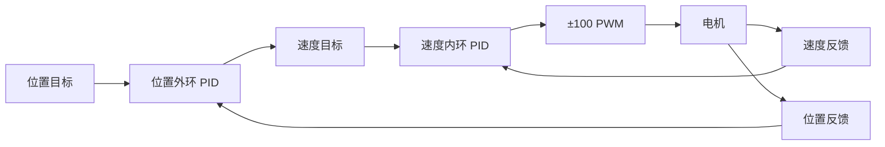

# 09 串级控制与 PID 封装

## 本章问题

为什么要把位置和速度分成两个闭环？外环输出到底应该是什么单位？

> 前置：先完成 [[05 四种单环控制实验]]，确认速度反馈是固定窗口计数、位置反馈是累计计数。
>
> 本章对应标准库程序的 12～13：双环 PID 和 PID 结构体封装。

## 1. 串级结构

先建立直觉：把串级想象成汽车巡航定速。外环（位置环）看"离目的地还有多远"，决定"当前应该开多快"；内环（速度环）只负责"让实际车速跟上这个目标车速"。分工的好处是：路面颠簸（扰动）由响应快的内环就地镇定，目标修正由外环慢慢给出——两个环各自面对简单的被控对象。注意"先内后外"在调参语境里指"先调好内环"，而代码执行顺序是另一回事，见第 3 节。



外环输出不是 PWM，而是内环的速度参考。课程单环实验的 40 ms count 窗口可以作为速度单位；本工程默认把内环目标限制在 ±20 count/40 ms。

## 2. 结构体隔离

`pid_t` 的积分、上一拍误差、微分滤波和输出都属于实例。外环和内环必须使用两个独立实例：

```c
cascade_config_t cascade_config;
cascade_config.outer = position_config;
cascade_config.inner = speed_config;
cascade_init(&cascade, &cascade_config);
```

不能共用一份 `Error0/Error1/ErrorInt/Out`，否则外环改目标会污染内环历史。

## 3. 更新顺序

`cascade_step()` 的规则是：

```text
outer_due → 更新外环
         → 限制 inner_setpoint
inner_due → 用最近的外环目标更新内环
```

当两个周期同时到期时，本 HAL 例程选择"外环先、内环后"。课程 12/13 源码是同一中断中先内环、后外环，因此外环新目标要下一次内环拍才生效。两种顺序不能在比较实验时静默替换。

课程内外环周期都为 40 ms；这只是课程实现事实，不等于通常意义上的快内环/慢外环。

## 4. 分步实验

本章对应标准库程序的 12～13。使用 `APP_DEMO_CASCADE`，不重新配置 CubeMX。

### 4.1 只调速度内环

1. 复制第 05 章工程为 `09_Cascade`。
2. 本工程没有独立的内环目标输入。把外环 P 暂时设为一个小值，让位置目标成为内环目标来源。
3. 先把位置目标设为 0，再逐步改变位置目标，观察 `held_inner_setpoint`。
4. 记录 `inner_measurement`、`inner_result.output` 和最终 PWM。

如果外环 P、I、D 全部为 0，外环输出就是 0，内环不会有独立目标；不要把 `held_inner_setpoint` 当作 RP1 直接写入的变量。

**预期**分两种情况：

- 外环 P/I/D 全 0 时：外环输出恒为 0，`held_inner_setpoint` 保持 0，内环积分不被污染——这是"内环已调好、外环未接入"的验证状态；
- 外环只开一个很小的 P 时：`held_inner_setpoint` 跟随位置误差变化，并被限幅在 ±20 count/40 ms 内。

`held_inner_setpoint`、`inner_measurement` 和 `inner_result.output` 都不在串口 CSV 和 OLED 中，需要用调试器观察（它们是 `cascade.c`/`app.c` 的内部状态）。

### 4.2 接入位置外环 P

只打开 `cascade.outer.kp`，保持外环 `Ki=Kd=0`。

1. 将位置目标从 0 改为小步位置；
2. 观察 `outer_result.output` 是否成为内环目标；
3. 确认 `held_inner_setpoint` 被限制在 `inner_setpoint_min/max`；
4. 记录位置误差、速度参考和最终输出。

**预期**：位置误差先转换成速度参考，而不是直接变成 PWM。

### 4.3 接入位置外环 D

在内环已经能跟踪后，只增加外环 `Kd`，观察目标反向时的提前制动和输出变化。若出现高频抖动，先停止，不要同时修改内环。

### 4.4 验证两个 PID 状态独立

1. 在外环运行时改变位置目标；
2. 观察外环积分变化不应直接出现在内环积分中；
3. 停止并重新启动，确认 `cascade_reset()` 同时清零两个实例；
4. 主机运行 `test_cascade()`，检查外环限幅和内环目标。

**通过标准**：

- 外环输出单位是 count/40 ms 或 count/目标周期，不是 PWM；
- 外环输出先限幅，再成为内环目标；
- 内环反馈是速度窗口，不是累计位置；
- 两环积分、上一拍误差和输出状态互不共享；
- 外环目标改变时，内环使用的参考变化可以被记录和解释。

### 4.5 记录表

| 阶段 | 外环目标 | 位置反馈 | 外环输出 | 内环目标 | 速度反馈 | PWM |
|---|---:|---:|---:|---:|---:|---:|
| 内环单独调参 | 0 |  |  |  |  |  |
| 外环 P |  |  |  |  |  |  |
| 外环 PD |  |  |  |  |  |  |
| 停止/重启 |  |  |  |  |  |  |

## 新手操作卡

1. 复制第 05 章工程为 `09_Cascade`。
2. 在 `User/Src/app.c` 的 `init_controllers()` 中只修改 `cascade.outer` 和 `cascade.inner`。
3. 先关闭外环调内环，再打开外环；记录 `held_inner_setpoint`。
4. 保持内外环状态为两个不同 `pid_t`，不要复用同一个积分变量。
5. 只有内环稳定后才改变位置目标。

## 5. 验收

- [ ] 外环输出单位是速度参考，不是 PWM；
- [ ] 外环输出经过独立限幅；
- [ ] 内环反馈是窗口速度，不是累计位置；
- [ ] 两环状态互不污染；
- [ ] 同一拍更新顺序与实验记录一致；
- [ ] 位置目标改变时没有无法解释的历史跳变。

## 排障

| 现象 | 优先检查 |
|---|---|
| 位置环一开就满输出 | 外环方向、内环目标限幅、位置单位 |
| 速度环正常但位置回不去 | 外环反馈是否累计、目标零点是否明确 |
| 外环改了但电机没变化 | 内环是否在同一拍消费了旧参考 |
| 两个环互相污染 | 是否错误复用了同一个 `pid_t` |

## 上一章 / 下一章

[[08 输出偏移与死区]] · [[10 倒立摆结构与角度采集]]
