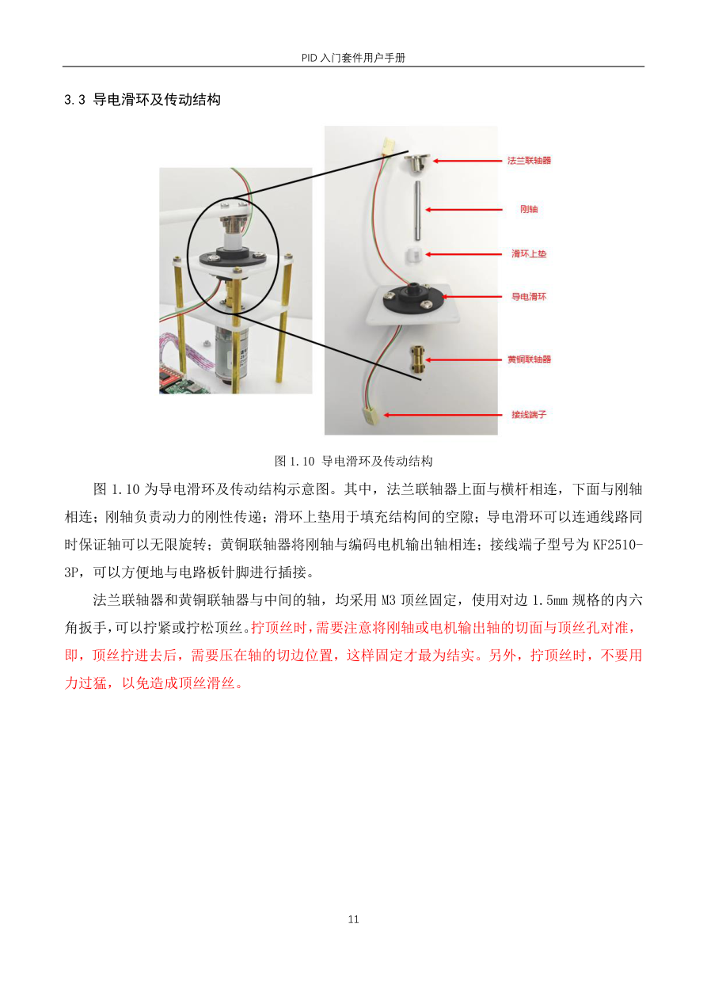
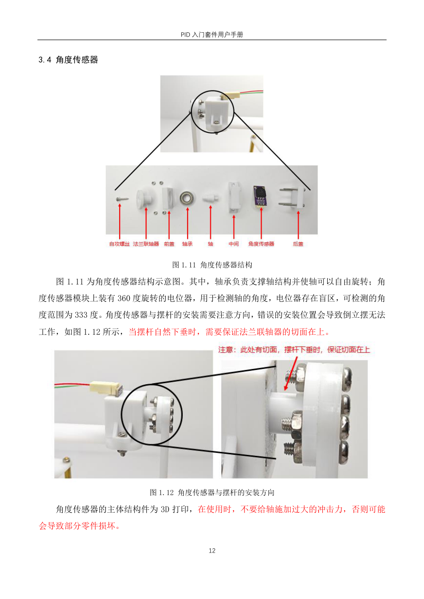

# 10 倒立摆结构与角度采集

## 本章问题

横杆、摆杆、编码器和角度传感器分别测什么？为什么 2010 不能直接当作物理直立角度？

> 前置：先完成 [[00 从零复刻HAL工程]] 和 [[04 基础驱动与观测实验]]，本章仍保持电机断开。
>
> 本章对应标准库程序的 14：倒立摆结构和角度传感器采集。

## 1. 机械信号分工

- 编码器测电机/横杆的运动增量；
- 角度传感器测摆杆相对横杆的角度；
- 电机 PWM 是唯一执行输出；
- 导电滑环用于旋转时保持线路连通，不是动力传动轴。



先断电安装顶丝和联轴器，确保轴切面被压住。电机转动而横杆只小幅摆动，通常是顶丝或联轴器打滑。

## 2. 角度传感器不是"角度 ADC"

G1 接 PB0/ADC1_IN8，输出是 0～4095 的 ADC 原始码。课程代码直接把原始码送入 PID，因此 `2010` 的单位是 ADC code，不是度或弧度。

00 V1.0/V1.1 综合程序的默认中心是 `2050`，捕获区间为 `1700～2300`，停止边界为 `<1000` 或 `>3000`。这些是 00 程序的参数，不要和 15/16 的 `2010/±500` 混用。

课程资料给出的传感器有效范围约为 333°（课程参考，以本地资料为准），现场仍以实测盲区为准：

- 盲区在传感器轨道断口；
- 自然下垂时应让盲区位于下方；
- 直立附近必须连续；
- 进入盲区时读数可能暂时接近 0 或 4095；
- 悬空滤波电容可能造成漂移。



## 3. HAL 采集链

```text
PB0 → ADC1_IN8
ADC prescaler = PCLK2/6 = 12 MHz
12-bit right aligned
55.5 cycles
software trigger
```

`BSP_StartAngleConversion()` 启动转换，下一控制拍由 `BSP_ReadAngleIfReady()` 非阻塞读取。两拍未完成就丢弃样本并触发安全处理。

旋钮 ADC2 采用逐通道单次转换。ADC 校准只在初始化阶段执行，不在每个控制拍重复校准。

## 4. 4095 和 4096

- ADC 有 4096 个量化桶；
- 从码 0 到码 4095 的端点间隔是 4095；
- 有效角范围换算必须说明采用哪个约定。

不能在同一章中一处用 `333.3/4096`、另一处用 `333.3/4095` 却不解释。

## 5. 角度标定实验

### 5.1 机械准备

1. 断开电机电源，只给传感器和逻辑部分供电。
2. 检查摆杆、角度传感器和导电滑环的机械连接。
3. 将传感器自然下垂，确认盲区位于下方；直立位置附近必须没有断口。
4. 轻动线缆和传感器支架，确认线缆不会被摆动拉扯。

### 5.2 有效区与方向

1. 选择 `APP_DEMO_OBSERVE`，记录 OLED/串口中的 `angle`。
2. 从一个有效区端点开始，每次移动很小角度，记录 `angle`。
3. 记录顺时针和逆时针转动时 ADC 是增加还是减少。
4. 记录有效区两端、中心估计值和每一度机械角的 count 变化量。
5. 从盲区两侧分别进入有效区，确认每次都能恢复正常读数。

### 5.3 直立中心

1. 手动扶摆杆到机械直立位置，不启动电机。
2. 连续记录 10 个角度样本，取中心附近的中位趋势。
3. 记录 `center_code`、顺逆方向和初始安全范围。
4. 把中心值填入 `User/Inc/app_config.h` 的 `APP_ANGLE_CENTER`；`APP_ANGLE_RANGE` 只作为第一轮较宽的安全范围。

课程 15/16 的 `2010/500` 是参考装配值；00 V1.0/V1.1 的 `2050` 是另一套综合程序参数。不要在没有本机记录时任选一个数。

### 5.4 采样异常

1. 在传感器线缆、供电或 ADC 状态异常时观察 OLED 和串口。
2. 连续两拍未完成角度转换时，确认 `app_angle_valid` 置 0——最直接的可见信号是串口 CSV 的 `angle` 字段变成 `-1`（无效样本在遥测中固定显示 -1）。
3. 在 `APP_DEMO_BALANCE` 或起摆已进入平衡时，确认应用停止电机并锁存故障。
4. 恢复正常角度后，先回到观察模式，不要直接重新启动闭环。

### 5.5 标定记录

| 项目 | 左侧 | 中间 | 右侧 |
|---|---:|---:|---:|
| 角度原始码 |  |  |  |
| 机械方向 |  |  |  |
| 是否进入盲区 |  |  |  |
| 线缆轻动后是否跳变 |  |  |  |

## 6. 代码实验

先使用 `APP_DEMO_OBSERVE`，不要启动电机。OLED 和串口显示 `angle`，只记录原始码。

当采样超过超时：

- `app_angle_valid` 置 0；
- 平衡模式撤销输出；
- 故障状态保留到显式清故障；
- 不把过期角度继续当作 0～4095 的有效反馈。

## 新手操作卡

1. 复制第 04 章工程为 `10_Angle`。
2. 保持电机电源断开，只观察 `BSP_StartAngleConversion()` 和 `BSP_ReadAngleIfReady()`。
3. 记录有效区、盲区两侧、顺逆方向和中心码。
4. 只有角度直立附近连续、ADC 超时能安全退出后，才复制工程进入第 11 章。
5. 角度中心只在本机记录，不直接把 2010 写死成所有设备的常数。

## 7. 验收

- [ ] 直立附近 ADC 连续；
- [ ] 盲区位置已确认；
- [ ] G1 与 PB0/ADC1_IN8 成对核对；如使用 00 的第二路角度，再单独核对 PB1/ADC1_IN9；
- [ ] 角度原始码没有被误称为物理角度；
- [ ] ADC 超时不会无限卡住；
- [ ] 采样异常会阻止平衡输出。

## 排障

| 现象 | 检查 |
|---|---|
| 直立时读数突然到 0/4095 | 盲区、安装方向、滤波电容 |
| 读数总在 2048 附近但不变化 | 传感器供电、PB0、ADC 通道 |
| G1 改了但无变化 | PB0/ADC1_IN8、传感器供电和采样状态 |
| 电机一动角度就跳 | 线缆、滑动环、顶丝和机械松动 |

## 上一章 / 下一章

[[09 串级控制与PID封装]] · [[11 手动双环平衡控制]]
