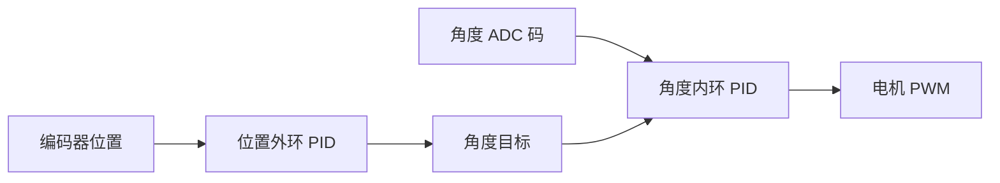

# 11 手动双环平衡控制

## 本章问题

怎样先让摆杆保持直立，再让横杆位置回到目标？越界时怎样保证同一控制拍停止？

> 前置：先完成 [[09 串级控制与PID封装]]、[[10 倒立摆结构与角度采集]]，并完成角度中心、方向和机械限位记录。
>
> 本章对应标准库程序的 15：倒立摆手动双环平衡控制。

## 1. 控制结构

先回答"为什么角度是内环、位置是外环"：摆杆一旦开始倒下，几百毫秒内就会超出可挽回范围，所以"接住摆杆"必须是响应最快的小闭环——它直接用角度驱动 PWM；而横杆位置漂移是慢过程，只能通过"改变摆杆目标"来间接纠正。快环保命、慢环修目标，这就是倒立摆串级的分工直觉。



课程 15/16 的参考参数：

| 环路 | 输入 | 输出 | 周期 | 15/16 课程参考 |
|---|---|---|---:|---|
| 角度内环 | ADC 原始码 | PWM | 5 ms | 0.3 / 0.01 / 0.4 |
| 位置外环 | 累计 count | 角度目标修正 | 50 ms | 0.4 / 0 / 4 |

用户已实测的 00 V1.1 是另一套综合程序参数：角度内环 `0.25/0.009/0.41`，位置外环 `0.52/0.01/4.56`，中心 `2050`。参数不同的原因之一是它的分频差一拍——角度环实际 6 ms、外环实际 51 ms（见 [[00 从零复刻HAL工程]] 第 16.3 节），采样周期不同，整定值不可互换。它可以作为平台起点，但不能用 00 的参数覆盖 15/16 的课程实验记录。

两环输出的单位不同：角度内环输出是 PWM，位置外环输出是 ADC 码修正。位置外环限幅 ±100 也不能解释为 ±100 PWM。

## 2. HAL 例程的更新顺序

`App_Tick1ms()` 每 5 ms 读取角度并更新内环；每 50 ms 允许位置外环更新。外环输出按课程方向：

```c
angle_target = CENTER_ANGLE - location_pid.output;
```

负号是负反馈方向，不能随意改成加号。

本例程的 `balance_update()` 会在角度不在安全区间时返回 `false`，并把命令置 0；应用层随后停止运行，不继续执行本拍 PID。

## 3. 分层实验

本章只做手动启动的双环平衡，不进入自动起摆。每一层都先保存快照，再只改变当前层的一个参数。

### 层 0：传感器和安全范围

**模式**：`APP_DEMO_OBSERVE`。

1. 电机电源断开，手扶摆杆在中心附近。
2. 确认 `angle_valid=1`、角度码连续且在 `CENTER_ANGLE±CENTER_RANGE` 内。
3. 把摆杆移出安全范围，确认观察模式仍能显示，但平衡模式不会启动。

**代码落点**：`BSP_StartAngleConversion()`、`BSP_ReadAngleIfReady()`、`balance_angle_safe()`。

**通过**：直立附近有连续有效区，盲区位置明确，越界条件可复现。

### 层 1：方向确认

**模式**：先在 [[04 基础驱动与观测实验]] 完成开环方向确认，再安装摆杆。不要在 `APP_DEMO_BALANCE` 中直接寻找固定 PWM 入口。

1. 记录正 PWM 对应的横杆运动方向和编码器符号。
2. 让摆杆分别向左右倾斜很小角度，确认电机动作方向是"接住"而不是"继续倒下"。
3. 断开电机，确认 `BSP_MotorStop()` 能立即输出 0。

**失败处理**：方向错误时立即停止，不用负 `Kp` 掩盖接线或符号问题。

### 层 2：只调角度 P

**模式**：`APP_DEMO_BALANCE`。

只打开角度内环 `angle_pid`。第一轮可以使用下面的保守起点（不是所有机构的最终参数）：

```c
angle_pid.kp = 0.10f;
angle_pid.ki = 0.0f;
angle_pid.kd = 0.0f;
angle_pid.output_min = -20.0f;
angle_pid.output_max = 20.0f;
```

位置外环保持关闭（目标为 0，不参与调参）。电机 VM 先设置最低可用限流，并准备硬件急停。

1. 手动把摆杆放在中心附近，按 K1 启动。
2. 轻推左右各一次，观察电机是否产生纠正动作。
3. 记录 `angle`、`angle_target`、`command` 和是否越界（`angle_target` 不在 OLED/CSV 中，用调试器观察 `balance` 结构体）。

**预期**：P 增大通常使纠偏更直接，但过大时出现振荡；越过安全范围时同一控制拍输出归零。

### 层 3：角度 PD

固定 P，只增加 `Kd`。课程参考 D 约 0.4 仅作为起点，必须观察：

- 目标附近是否更快安静；
- D 是否放大了角度 ADC 噪声；
- 采样周期改变后是否仍使用同一 D 系数。

### 层 4：少量角度 I

只有当 P/PD 已能工作、但小误差长期无法消除时，才加入少量 `Ki`。每次增加后重新检查：

- 中心附近是否出现低频摆动；
- 角度误差是否真正减小；
- 停止后积分是否被清零。

不要用大量 I 掩盖中心角、方向或机械间隙问题。

### 层 5：接入位置外环

固定已经通过的角度内环，只打开位置外环 P。第一轮把 `position_pid.output_min/output_max` 设为 `-20/+20`，再逐步增加 P。

1. 先把位置目标和软件零点设为 0；
2. 只增加很小的 `position_pid.kp`；
3. 用 K2/K3 改变位置目标，观察横杆是否回到目标；
4. 外环 P 通过后，再增加 D。

**代码落点**：`balance_update()` 中的 `angle_target = center - position_result.output`，以及 `run_balance_5ms()` 的停止路径。

**预期**：位置外环输出是角度目标修正量，不是 PWM；位置偏差应通过改变摆杆目标来纠正横杆位置。

### 每层记录表

| 层次 | 角度 P/I/D | 位置 P/I/D | 目标 | 轻推方向 | 输出峰值 | 是否越界 | 结论 |
|---|---|---|---:|---|---:|---|---|
| 传感器 | 0/0/0 | 0/0/0 | 0 |  |  |  |  |
| 方向 | 0/0/0 | 0/0/0 | 0 |  |  |  |  |
| 角度 P |  | 0/0/0 | 0 |  |  |  |  |
| 角度 PD |  | 0/0/0 | 0 |  |  |  |  |
| 角度 PID |  | 0/0/0 | 0 |  |  |  |  |
| 位置外环 |  |  |  |  |  |  |  |

每次只填一行；下一行从上一行通过的参数开始。

K1 只有在以下条件下才能启动平衡：

```text
angle_valid == true
APP_ANGLE_CENTER - APP_ANGLE_RANGE < angle
angle < APP_ANGLE_CENTER + APP_ANGLE_RANGE
```

启动时重置：

- 角度 PID 积分、微分历史和输出；
- 位置 PID 积分、微分历史和输出；
- 角度目标回到中心；
- 位置目标和软件位置策略明确。

停止或越界时显式 `BSP_MotorStop()`，不能只把状态变量改成 0。

HAL 例程中 K2/K3 每次改变 `APP_POSITION_STEP=408` count，位置目标限制在 `±8999`（与 00 V1.1 倒立摆模式一致）。上板前确认机械行程允许这个范围。

## 4. 课程参数与本机标定

```c
APP_ANGLE_CENTER = 2010.0f
APP_ANGLE_RANGE = 500.0f
```

有效开区间为：

$$
1510<Angle<2510
$$

2010 是 15/16 课程装配的 ADC 中心，不是硬件常数。00 V1.0/V1.1 的默认中心是 2050，参数和阈值也与 15/16 不同。第一次上电先用观察模式重新测中心；动态平衡时还要检查电机方向、机械零点和中心偏差。

## 新手操作卡

1. 复制第 10 章工程为 `11_Balance`。
2. 保持电机低功率和机械限位，先把 `APP_SELECTED_DEMO` 改为 `APP_DEMO_BALANCE`。
3. 只调角度内环 `angle_pid`，外环保持 `position_pid` 的 P/D 为 0。
4. 角度内环通过后，只打开位置外环 P，再增加 D。
5. 每次越界都先确认 PWM 在同一控制拍归零，再继续调参。

## 5. 验收门

- [ ] 两侧倾倒均产生正确方向动作；
- [ ] 角度 P/PD/微量 I 分层通过；
- [ ] 位置外环加入后仍能保持平衡；
- [ ] 越界后同一控制拍 PWM 归零；
- [ ] 停止后重启无旧积分冲击；
- [ ] K2/K3 改变目标时仍能保持平衡；
- [ ] 轻推后角度和位置均能恢复。

## 排障

| 现象 | 优先检查 |
|---|---|
| 一启动就向一侧倒 | 角度中心、反馈方向、PID 输出符号 |
| 内环能立但位置发散 | `CENTER - LocationPID.Out` 的负号 |
| 输出一直饱和 | 目标角、编码器位置、PID 周期和机械限位 |
| 越界后下一拍才停 | 是否在同一 ISR 中继续执行 PID |
| 重新启动猛冲 | PID 状态、位置目标和计数器未复位 |

## 上一章 / 下一章

[[10 倒立摆结构与角度采集]] · [[12 自动起摆状态机]]
