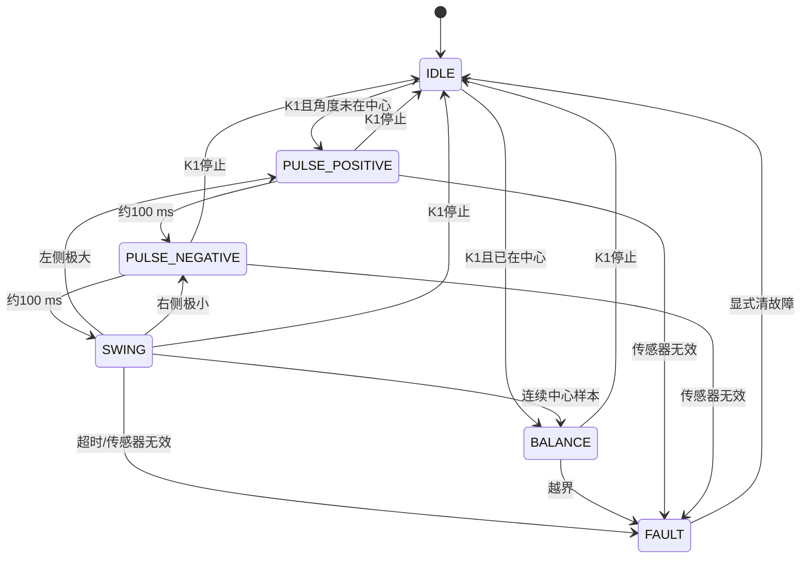

# 12 自动起摆状态机

## 本章问题

怎样用非阻塞状态机产生正反短脉冲，并在摆动进入中心后交给平衡控制器？

> 前置：先完成 [[11 手动双环平衡控制]]，确认越界同拍停机和手动平衡验收通过，再接自动起摆。
>
> 本章对应标准库程序的 16：自动起摆状态机。

## 1. 为什么要用脉冲：能量泵送的直觉

摆杆从下垂到直立差着大半个圆周的势能，电机一次性猛抬是抬不上去的——只会把摆杆甩到一边。秋千能越荡越高，靠的是每次经过最低点（相位合适时）顺着运动方向补一次小推力，一圈一圈把能量泵进去。起摆状态机做的就是这件事：用三点极值判断估计摆杆的相位（"到达最高点了"），在每次极值处施加一个与回摆方向相同的短脉冲，让摆幅逐圈增大；等摆杆进入中心捕获区，再无缝交给平衡控制器。这也解释了为什么状态机必须非阻塞——相位判断每 40 ms 做一次，脉冲宽度只有 100 ms，阻塞延时会彻底错过相位。

## 2. 课程原状态与 HAL 例程状态

课程 16 使用 0、1、21～24、31～34、4 等数字状态。00 V1.1 又重写了自动起摆状态机，使用 `START_PWM=35`、`START_TIME=90 ms`、中心 `2050` 和 `1700～2300` 捕获区间。

HAL 例程改成有名字的状态：

```text
IDLE
PULSE_POSITIVE
PULSE_NEGATIVE
SWING
BALANCE
FAULT
```

状态含义与课程状态机相近，但本实现增加了停止优先级、传感器无效、起摆超时和统一复位。串口/调试器中的状态值如下：

| 名称 | 数值 |
|---|---:|
| `IDLE` | 0 |
| `SWING` | 1 |
| `PULSE+` | 2 |
| `PULSE-` | 3 |
| `BALANCE` | 4 |
| `FAULT` | 5 |

## 3. 状态转移



停止请求优先级最高；任何状态收到停止都输出 0 并回到 `IDLE`。安全检查对任何状态生效：传感器无效同样会把脉冲状态切入 `FAULT`。

## 4. 极值检测

中心边界：

```text
L = CENTER - RANGE
H = CENTER + RANGE
```

每 40 ms 更新一次三点样本。课程传感器方向下：

- 三个样本都小于 L，中间样本最大：左侧极大，施加正脉冲；
- 三个样本都大于 H，中间样本最小：右侧极小，施加负脉冲；
- 连续两个中心样本：进入平衡。

本实现要求极值样本满足严格不等关系，盲区跨越样本不判极值。样本只在 `SWING` 状态按检测周期更新，避免把脉冲期间的陈旧样本当作等间隔数据。

## 5. 脉冲参数

课程 16 参考：

```text
START_PWM = 35
START_TIME = 100 ms
```

00 V1.0 参考为 `40/90 ms/5`，00 V1.1 参考为 `35/90 ms/0`（PWM/时间/偏移）。本例程使用课程 16 的 35 和 100 tick。

脉冲结束后必须回 0；`pulse_ticks` 为 0 会被初始化检查拒绝，避免无符号计数下溢。

## 6. 安全改进

课程 16 越界后把状态置 0，但同一中断可能继续执行 PID；本例程在 `balance_update()` 和 `swingup_step()` 中都先检查安全，失败直接输出 0 并返回。

另外增加：

- 起摆总超时 `timeout_ticks`；
- ADC 无效/非有限值故障；
- 故障锁存；
- 显式清故障后仍需再次 K1；
- 状态、PID、位置目标和历史样本统一复位。

这些是工程化改进，不代表硬件已经验证成功。

## 7. 分阶段实验

自动起摆必须分阶段打开，不能第一次就同时启用脉冲、极值判断和平衡接管。

### 7.1 观察和准备

1. 选择 `APP_DEMO_OBSERVE`，记录角度中心、盲区和正负方向。
2. 复制第 11 章工程为 `12_SwingUp`，选择 `APP_DEMO_SWINGUP`。
3. 断开摆杆或把机构固定好，准备硬件急停。
4. 在 `User/Src/app.c` 的 `init_controllers()` 中确认 `start_pwm`、`pulse_ticks` 和 `timeout_ticks`。

   HAL 例程默认使用课程 16 的 `35` 和 `100 tick`。

总超时为 `timeout_ticks=20000`，约 20 秒。

先记录这三个值，再开始上电实验。

### 7.2 只验证正负脉冲

1. 暂时让极值判断不运行，防止状态机进入 `SWING`/`BALANCE`：最简单的做法是把 `init_controllers()` 中 `swingup_config.detect_period_ticks` 临时改成 `60000U`（60 秒才判断一次，等于关闭），验证完改回 `40U`。
2. K1 启动，使用调试器或串口 `state` 观察 `PULSE+`、`PULSE-`。
3. 用逻辑分析仪记录方向脚和 PWM：正脉冲、负脉冲、归零各一段。
4. 在任意状态按 K1，确认停止请求优先，PWM 立即回 0。

**预期**：每个脉冲宽度由 `pulse_ticks` 决定，状态切换不依赖阻塞延时；当前硬件是否能把摆杆打到合适相位仍需实测。

### 7.3 加入三点极值判断

1. 把 `detect_period_ticks` 改回 `40U`，恢复 `SWING` 状态的极值检测。
2. 保持 40 ms 检测周期，记录连续三个角度样本。
3. 观察左侧极大、右侧极小时是否分别进入 `PULSE_POSITIVE`、`PULSE_NEGATIVE`。
4. 确认盲区跳变不会被当作有效极值。

**预期**：每次极值判断都基于同一采样节奏；没有进入有效摆幅时，状态不能凭旧样本反复触发。

### 7.4 接入中心确认和平衡接管

1. 只在连续中心样本满足条件时允许 `SWING → BALANCE`。
2. 进入平衡前调用 `balance_reset()`，清除两环 PID 历史和位置目标。
3. 记录接管前的角度、接管后的第一拍 PWM 和是否立即越界。
4. 如果接管后立即退出 `FAULT`，先检查中心窗口、角度方向和机械状态。当前 HAL 例程没有单独估计角速度，不要把"角速度条件"当作已实现的验收项。

### 7.5 故障、停止和重复启动

分别制造以下条件：

| 条件 | 预期状态/输出 |
|---|---|
| 任意状态按 K1 | 立即停止，PWM=0，回到 IDLE |
| ADC 无效或角度非有限 | 进入 FAULT，输出关闭 |
| 到达 `timeout_ticks` | 进入 FAULT，记录超时 |
| FAULT 时有效角度在中心 | K1 可清故障，但还要再次 K1 启动 |
| 第二次启动 | 没有旧积分、旧目标、旧历史样本 |

注意：`FAULT` 且摆杆自然垂下（不在中心捕获区）时，按 K1 清故障不会生效，程序看起来"没反应"——这不是死机，先手动把摆杆扶到中心附近，再按 K1 清故障，之后还要再按一次 K1 才会重新起摆。

### 7.6 重复性记录

至少重复 10 次，每次记录：

```text
次数、起摆耗时、接管耗时、是否成功、失败状态、最后角度区间、停止延迟
```

"能进入 BALANCE"不等于"已经稳定"；还要继续完成第 13 章的综合验收。

## 新手操作卡

1. 复制第 11 章工程为 `12_SwingUp`。
2. 先把 `start_pwm`、`pulse_ticks` 和 `timeout_ticks` 记录在纸上。
3. 不接平衡 PID，先单独验证正脉冲、负脉冲和归零。
4. 再打开 `SWING` 极值判断，最后才允许进入 `BALANCE`。
5. 任意状态下按 K1 都必须停止；故障后先清故障，再重新启动。

## 8. 验收

- [ ] 停止在每个状态都能快速归零；
- [ ] 正反脉冲方向和宽度符合记录；
- [ ] 传感器无效不会进入平衡；
- [ ] 超时会锁存故障；
- [ ] 接管前有中心确认；
- [ ] 第二次启动没有旧积分、旧目标或旧样本残留；
- [ ] 成功率、耗时和失败相位有记录。

## 排障

| 现象 | 检查 |
|---|---|
| 越摆越小 | 极值方向、脉冲符号、相位和样本有效性 |
| 一直不接管 | 中心窗口、两次确认、ADC 方向 |
| 进入中心后马上退出 | 中心确认、平衡外环和机械状态；当前例程未单独估计角速度 |
| 停止后下一次又输出 | 状态请求优先级、stop_request 是否被消费 |
| 故障无法清除 | 是否满足"传感器有效且在中心"的清故障条件 |

## 上一章 / 下一章

[[11 手动双环平衡控制]] · [[13 综合验收与调试记录]]
