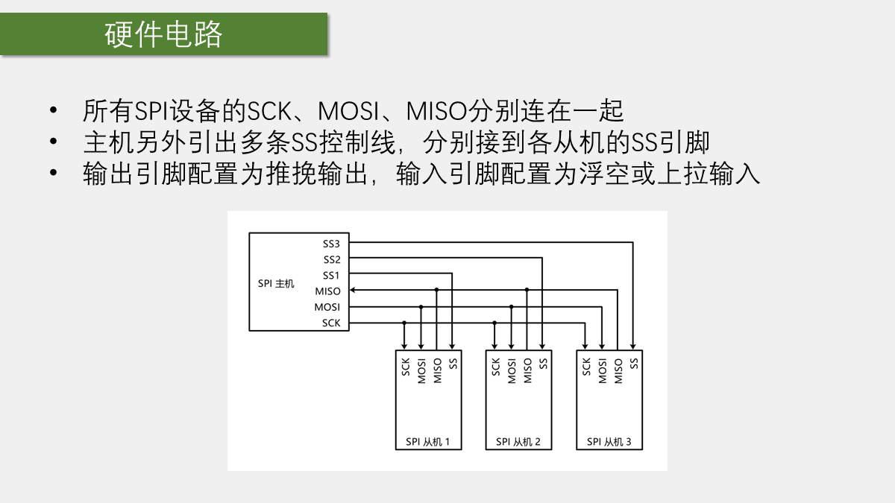
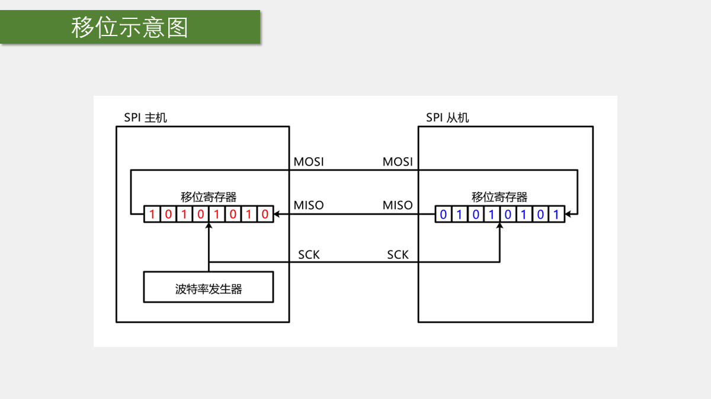
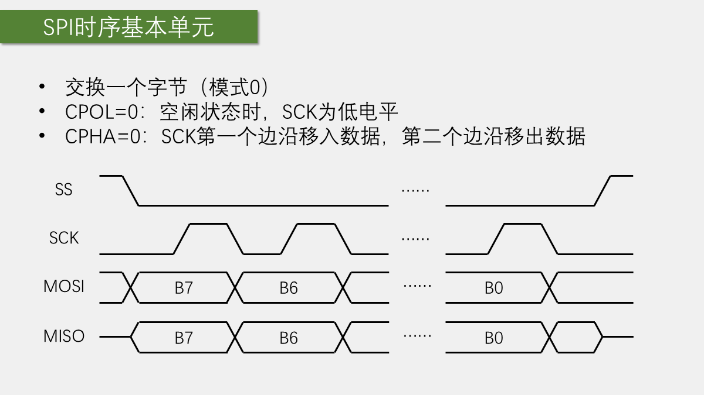
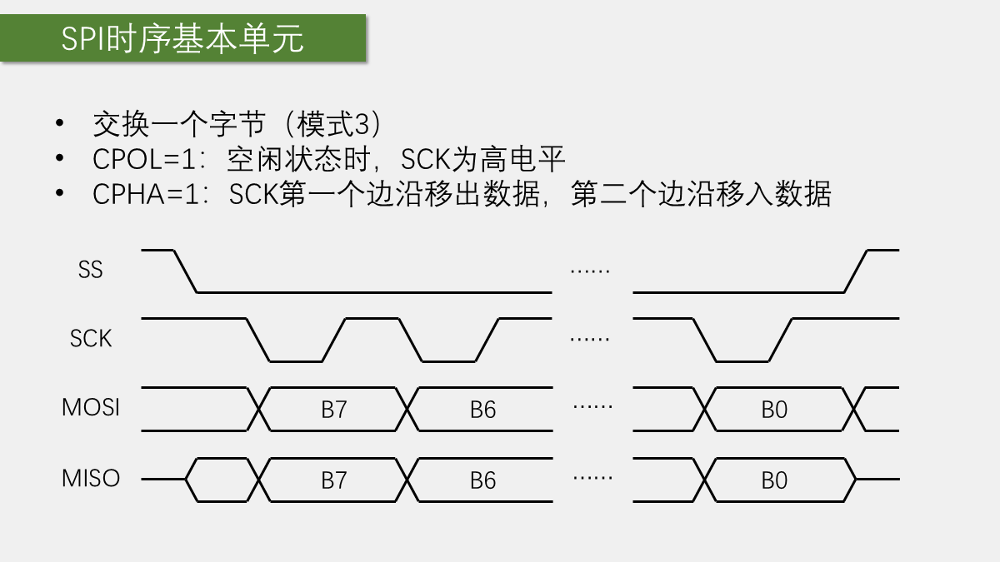
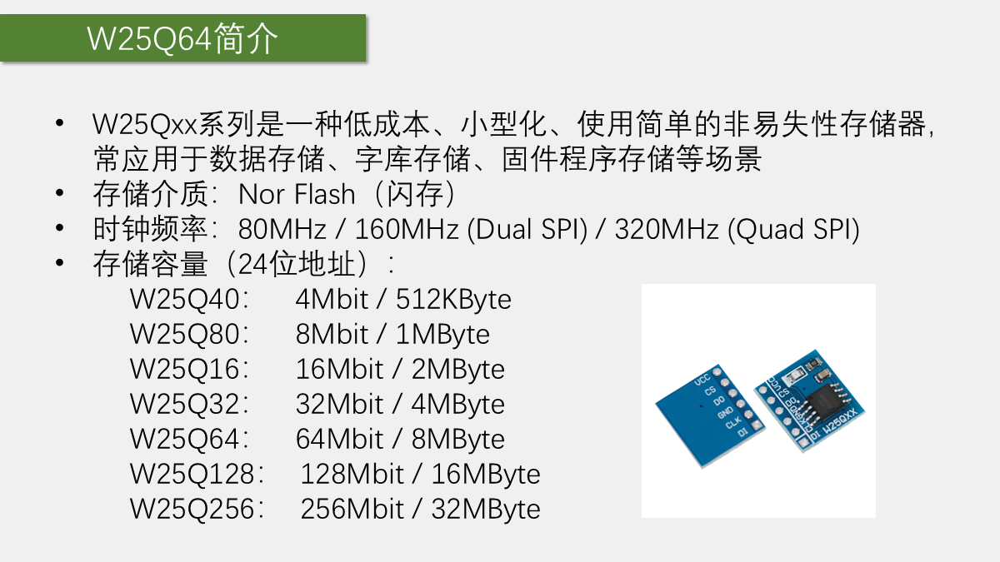
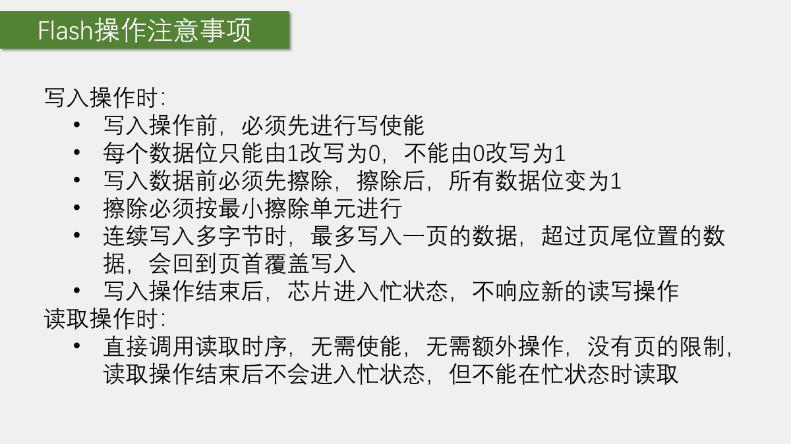
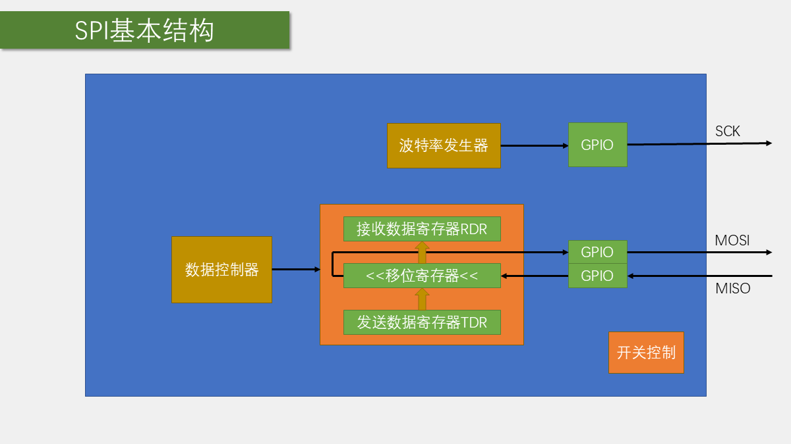
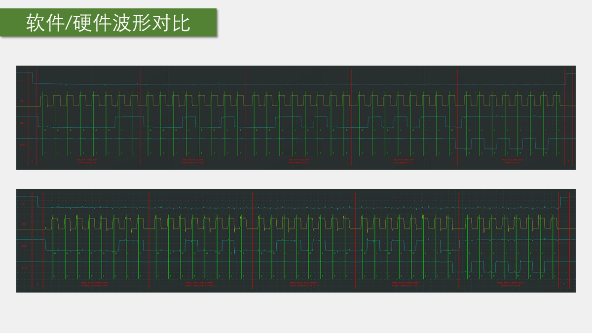

# 第 11 章 SPI 与 W25Q64

## 学习主线

本章先学习 SPI 通信的软硬件规定，再认识使用 SPI 的 Flash 存储器 W25Q64，然后用软件模拟 SPI 完成读写实验，最后把底层通信替换成 STM32 的硬件 SPI1。课程对应两个工程：

- `11-1 软件SPI读写W25Q64`
- `11-2 硬件SPI读写W25Q64`

两个工程完成的功能相同：读取芯片 ID，擦除指定扇区，写入一组数据，再读回显示。区别只在通信层：软件 SPI 用代码手动翻转 GPIO 电平，硬件 SPI 使用 STM32 内部的 SPI 外设。

本章的代码分层如下：

```text
GPIO 或 SPI 外设
    -> MySPI：引脚封装、初始化、起始/结束、交换一个字节
        -> W25Q64：读 ID、读状态、写使能、页编程、扇区擦除、读数据
            -> 主程序：调用驱动并在 OLED 上显示验证结果
```

---

## 1. SPI 是什么

### 1.1 从 I2C 到 SPI

SPI（Serial Peripheral Interface，串行外设接口）是摩托罗拉公司开发的一种通用数据总线，和 I2C 一样用于主控芯片与外挂芯片之间的数据交流。有了通信能力，主控就可以挂载并操纵存储器、显示屏、无线模块等各式各样的外部芯片。

回顾 I2C 的特点有助于理解 SPI 的设计取舍。I2C 用开漏外加上拉电阻的电路结构，换取了最少的通信线和最多的软件功能，但代价是高电平驱动能力弱：通信线由低变高时上升沿耗时较长，==限制了最大通信速度==。I2C 标准模式只有 `100 kHz`，快速模式只有 `400 kHz`；后续改进的高速模式可达 `3.4 MHz`，但普及程度不高，一般认为 I2C 时钟最多就是 `400 kHz`。

SPI 的设计思路相反，可以概括为三点：

- **传输更快**。SPI 协议没有严格规定最大传输速度，上限取决于芯片厂商的设计。本章的 W25Q64 手册标明 SPI 时钟频率最大可达 `80 MHz`，比 STM32F1 的主频还高。
- **设计简单**。SPI 实现的功能没有 I2C 那么多，时序和软件都更直接，学习起来比 I2C 轻松。
- **硬件开销大**。通信线个数多，且只发送或只接收时另一条数据线被浪费。

如果说 I2C 是精打细算的设计，SPI 就是不在乎花多少钱、只在乎任务是否最简单最快完成的设计。SPI 的基本特征为：同步时序、全双工、一主多从、没有应答机制。

课程之外也可以留意身边使用 SPI 的芯片和模块：本章的 W25Q64 Flash 模块、部分 OLED 屏幕、`NRF24L01` 2.4G 无线通信模块，以及 Micro SD 卡（官方协议是 SDIO，但兼容 SPI 方式读写）。

### 1.2 四根通信线与硬件电路

SPI 通信线通常包括四根：

| 信号 | 含义 | 主机方向 | 从机方向 |
| --- | --- | --- | --- |
| `SCK` | 串行时钟 | 输出 | 输入 |
| `MOSI` | 主机输出、从机输入 | 输出 | 输入 |
| `MISO` | 主机输入、从机输出 | 输入 | 输出 |
| `SS`/`CS` | 片选（从机选择） | 输出 | 输入 |

实际资料中这些名称常有别的表述：`SCK` 有的写作 `SCLK`、`CLK`、`CK`；`SS` 有的写作 `NSS`、`CS`；在始终作为从机的设备上，`MOSI`、`MISO` 常简写为 `DI`（数据输入）、`DO`（数据输出）。辨别方法是先确认芯片身份：从机的数据输入 `DI` 对应 `MOSI`，应接在主机的 `MOSI`；从机的数据输出 `DO` 对应 `MISO`。本章 W25Q64 模块上的 `CS`、`CLK`、`DI`、`DO` 就分别对应 `SS`、`SCK`、`MOSI`、`MISO`。

各信号的作用：

- `SCK` 提供同步时钟，数据位的移出和移入都在 `SCK` 的边沿进行。同步时序的好处是时钟快一点、慢一点或中途暂停都不会破坏数据。
- `MOSI` 与 `MISO` 分别承担发送和接收，方向固定不变，这就是全双工：输出线一直输出，输入线一直输入，不需要协调收发冲突。代价是比 I2C 多一根数据线（I2C 的 `SDA` 一根线分时收发，是半双工）。
- `SS` 用于指定从机。SPI 只支持一主多从，不支持多主机；它不像 I2C 那样在起始后发送地址字节寻址，而是给每个从机单独分配一根 `SS` 线，主机想和谁通信就把谁的 `SS` 拉低。



> **读图提示：** 所有 SPI 设备的 `SCK`、`MOSI`、`MISO` 分别连在一起；主机另外引出多条 `SS` 控制线，分别接到各从机的 `SS` 引脚。图中三条 `SS` 线就是“一主三从”的代价。

硬件电路上还有两条规定：

- **输出引脚配置为推挽输出，输入引脚配置为浮空或上拉输入。** 推挽输出高低电平均有很强的驱动能力，信号上升沿和下降沿都非常迅速，这是 SPI 能达到兆赫兹级别速度的硬件基础。I2C 不是不想用推挽输出，而是它要半双工切换方向、又要多主机仲裁，推挽输出会造成电源短路，只能选择开漏。SPI 不支持多主机且全双工，输出引脚始终是输出、输入引脚始终是输入，基本不会冲突，所以可以大胆使用推挽输出。
- **未被选中从机的 `MISO` 必须为高阻态。** `MISO` 是唯一的冲突点：多个从机的输出连在同一根线上。SPI 规定从机 `SS` 为高电平（未被选中）时，其 `MISO` 硬件切换为高阻态，相当于引脚断开、不输出任何电平；`SS` 为低电平时才允许推挽输出。这个切换由从机内部自动完成，写主机程序时不需要关注。

`SS` 低电平有效。主机初始化后所有 `SS` 输出高电平，即谁也不选中；需要通信时把目标从机的 `SS` 置低，其余保持高电平、保持沉默。**同一时间只能有一个 `SS` 为低电平**，否则多个从机同时驱动 `MISO` 会造成数据冲突。

### 1.3 移位交换：SPI 的基本单元

SPI 硬件电路的核心是移位模型。理解了它，硬件电路和软件时序就都容易理解了。



> **读图提示：** 主机和从机内部各有一个 8 位移位寄存器，时钟由主机侧的波特率发生器提供，并经 `SCK` 送给从机。两条数据线把两个寄存器接成一个环：主机移出的位经 `MOSI` 进入从机寄存器，从机移出的位经 `MISO` 进入主机寄存器。

SPI 一般高位先行，每来一个时钟，移位寄存器向左移一位。以“上升沿移出、下降沿移入”的模型演示：主机待发送 `10101010`，从机待发送 `01010101`。第一个时钟上升沿，双方把各自最高位放到通信线上（`MOSI` 为 1，`MISO` 为 0）；下降沿，双方采样对方线上的电平，移入自己寄存器的最低位。重复八个时钟后，主机的 `10101010` 跑到从机里，从机的 `01010101` 跑到主机里，完成一次字节交换。

因此 SPI 的基本单位不是“发送一个字节”或“接收一个字节”，而是**交换一个字节**：

- 只想发送时，仍然执行交换时序，只是不看接收到的返回值。
- 只想接收时，也必须发送一个占位字节来产生时钟，否则从机没有时钟就不会移出数据。占位字节一般统一发 `0x00` 或 `0xFF`，用无意义的数据把从机的有用数据“置换”过来。

全双工意味着只发或只收时另一方向存在资源浪费，这是 SPI 为简单高效付出的代价。

### 1.4 一次 SPI 事务与字节流模型

`SS` 的下降沿是通信的开始（起始条件），上升沿是通信的结束（终止条件）；在整个选中状态中 `SS` 始终保持低电平。相比 I2C 的起始/停止条件，SPI 的事务边界非常简单。

一条完整的指令通常放在同一个片选事务中：

```text
CS 拉低：选中从机
发送指令、地址和数据，或交换返回数据
CS 拉高：结束本次事务
```

如果在指令、地址或数据传输中途把 `CS` 拉高，从机可能把这次通信当成不完整指令。W25Q64 的每条指令都要特别注意这个边界。

事务内部的字节流功能由从机芯片定义。I2C 采用“寄存器地址 + 读写数据”模型，而 SPI 通常采用**指令码 + 读写数据**模型：起始后第一个交换的字节是指令码，从机对照自己的指令集执行相应功能；不同指令后面跟随的数据个数不同，有的指令（如 W25Q64 的写使能）只需要一个指令码，有的指令（如写数据、读数据）后面还要跟地址和数据。具体格式在芯片手册的指令集中定义，见第 4 节。

---

## 2. SPI 时序与模式

### 2.1 CPOL、CPHA 与四种模式

移位模型只规定了“一个时钟移出并移入一位”，但没有规定从哪个边沿开始移位。SPI 把这两个时机开放为可配置项：

- `CPOL`（时钟极性）：决定 `SCK` 空闲状态时的电平。
- `CPHA`（时钟相位）：决定在第一个边沿还是第二个边沿采样（移入）数据。

二者各取 0 或 1，组合出四种模式：

| SPI 模式 | CPOL | CPHA | 采样边沿 |
| --- | ---: | ---: | --- |
| 模式 0 | 0 | 0 | 上升沿 |
| 模式 1 | 0 | 1 | 下降沿 |
| 模式 2 | 1 | 0 | 下降沿 |
| 模式 3 | 1 | 1 | 上升沿 |

先看**模式 1**，因为它与 1.3 节的移位模型直接对应：`CPOL=0` 表示空闲时 `SCK` 为低电平；`CPHA=1` 表示 `SCK` 第一个边沿移出数据、第二个边沿移入数据（也可以表述为“第二个边沿采样”或“偶数边沿采样”，意思相同）。时序为：`SS` 下降沿开始通信；每个时钟上升沿主机和从机同时移出当前最高位，下降沿同时采样移入；八个时钟后字节交换完成。

再看**模式 0**，它是实际应用最多的模式，也是本课程使用的模式：



> **读图提示：** 模式 0 的 `CPHA=0`，表示第一个边沿移入、第二个边沿移出。数据总得先移出才能移入，所以模式 0 把移出时机提前了半个时钟：`SS` 下降沿时 `SCK` 还没变化，但趁此刻立刻触发 `B7` 输出（`MOSI`/`MISO` 的数据变化对齐到 `SS` 下降沿）；随后 `SCK` 上升沿采样 `B7`，下降沿移出 `B6`，上升沿移入 `B6`……第八个上升沿完成 `B0` 移入。

模式 0 还有一个拼接细节：字节交换完成后 `SCK` 还会产生一个下降沿。若只交换一个字节，此刻 `MOSI` 可以置回默认电平或不管（SPI 没有规定 `MOSI` 默认电平），从机 `MISO` 则必须置回高阻态；若要连续交换多个字节，这个下降沿正好放下一个字节的 `B7`，下一个时钟上升沿接着采样，时序才能衔接。

**模式 2 和模式 3** 由极性取反得到：模式 2 与模式 0 的区别只是 `CPOL` 不同，模式 3 与模式 1 的区别也只是 `CPOL` 不同，波形上表现为 `SCK` 空闲电平取反，其余流程完全一致。



> **读图提示：** 对照模式 0 的图看：`SCK` 空闲为高电平，第一个边沿变成下降沿。把模式 0 波形的 `SCK` 取反就是模式 2，把模式 1 的取反就是模式 3。

关于 `CPHA` 有一个常见误解：它决定的是“第几个边沿采样”，**并不能单独决定上升沿还是下降沿采样**。在 `CPOL` 确定的前提下才能落到具体边沿：模式 0 和模式 3 都是 `SCK` 上升沿采样移入，模式 1 和模式 2 都是下降沿采样移入。

四种模式功能相同，重点掌握模式 0 即可，其余知道可以配置、需要时再查。W25Q64 手册的时序图同时兼容模式 0 和模式 3（图中以虚线标出），课程统一使用模式 0。如果主机和从机模式不一致，常见现象是数据整体错位、读取 ID 不正确或读回数据异常，因此初始化 SPI 外设或编写软件时序时，必须让 `CPOL`、`CPHA` 与芯片手册规定一致。

### 2.2 软件 SPI 交换一个字节

软件 SPI 不依赖专用外设，直接控制 GPIO 产生时序。时序图上 `SS` 下降沿与数据移出看起来同时发生，但对软件 SPI 来说程序是一条条执行的，实际顺序是先产生下降沿、再移出数据；硬件 SPI 由于移位寄存器电路，两个动作几乎同时。以模式 0、高位先行为例，`SS` 拉低之后一次交换的过程是：

1. 取待发送字节的当前位，放到 `MOSI`。
2. `SCK` 置 1 产生上升沿：从机采样走这一位，主机同时读取 `MISO`，把从机放出的位移入接收字节的对应位。
3. `SCK` 置 0 产生下降沿：双方准备移出下一位；主机在下一个循环开头把下一位放到 `MOSI`。
4. 重复 8 次，函数结束时 `SCK` 回到低电平。

对应的核心逻辑可以写成：

```c
uint8_t MySPI_SwapByte(uint8_t ByteSend)
{
    uint8_t i;
    uint8_t ByteReceive = 0;

    for (i = 0; i < 8; i++)
    {
        MySPI_W_MOSI(ByteSend & (0x80 >> i));
        MySPI_W_SCK(1);
        if (MySPI_R_MISO())
        {
            ByteReceive |= (0x80 >> i);
        }
        MySPI_W_SCK(0);
    }

    return ByteReceive;
}
```

`0x80 >> i` 依次挑出发送字节的每一位；`ByteReceive |= (0x80 >> i)` 把读到的 `MISO` 填进接收字节的对应位。`MySPI_W_MOSI()` 能直接接收 `ByteSend & (0x80 >> i)`，前提是写引脚函数把非 0 当成 1、把 0 当成 0；否则要把该位右移到最低位再写入。函数名叫 `SwapByte`，是因为一次调用既发送 `ByteSend`，又返回同时收到的一个字节：

- 只发送时，返回值通常不使用，但接收动作仍然存在。
- 只接收时，也必须调用交换函数发送占位字节，例如 `0x00` 或 `0xFF`，否则不会产生时钟，也就不会有接收数据。

另一种等价写法按 1.3 节的移位模型操作数据本身：先把 `ByteSend` 的最高位放到 `MOSI` 再左移一位，上升沿后把读到的位置入最低位。移位写法更契合移位模型、效率更高，但会破坏传入的 `ByteSend`。课程演示了两种写法并最终保留掩码写法，功能等价，任选其一即可。

在此基础上切换模式非常简单：

- **改相位**（模式 0 与模式 1 互换）：模式 1 的顺序是“`SCK` 上升沿 → 移出数据 → `SCK` 下降沿 → 移入数据”，即把循环内的语句顺序由“移出 → 上升沿 → 移入 → 下降沿”调整为“上升沿 → 移出 → 下降沿 → 移入”。
- **改极性**（模式 0 与模式 2、模式 1 与模式 3 互换）：把所有出现 `SCK` 电平的地方 0 改 1、1 改 0。

---

## 3. W25Q64 的存储结构

### 3.1 W25Q64 是什么

W25Qxx 系列是一种低成本、小型化、使用简单的非易失性存储器。非易失性指存储的数据掉电不丢失（SRAM、DRAM 等易失性存储器则掉电丢失），因此它常用于：

- **数据存储**：STM32 的参数、采集的数据等需要掉电保存的内容。
- **字库存储**：显示屏显示汉字需要点阵数据，汉字多时不适合存在 STM32 内部，可以存到外挂 Flash，显示前读取查询。
- **固件程序存储**：把程序文件下载到外挂芯片，需要时读取执行（XIP，就地执行），例如电脑 BIOS 固件。

本课程只使用它最简单的数据存储功能。



> **读图提示：** 图中容量表给出整个系列的型号与容量：型号后的数字是 Mbit 数，除以 8 即 MByte（`W25Q40`、`W25Q80` 要看成 04、08）。同系列型号操作方法完全相同，只是容量不同，学会一个型号即可迁移。

芯片要点：

- 存储介质为 Nor Flash（闪存）。U 盘、固态硬盘、STM32 的程序存储器使用的也是 Flash。
- 时钟频率最大 `80 MHz`，比 STM32 快得多，软件模拟时序时翻转引脚不需要加延时。手册还标出 `160 MHz`（Dual SPI 等效）和 `320 MHz`（Quad SPI 等效）：Dual SPI 让 `MOSI`/`MISO` 同时收发两位数据，Quad SPI 再把 `WP`、`HOLD` 两个引脚当作 `IO2`/`IO3`、一个时钟收发四位。本课程不使用，了解即可。
- 访问存储单元使用 24 位地址（三个字节）。24 位地址最大寻址 `16 MB`，对 `W25Q40` 到 `W25Q128` 都足够；`W25Q256` 容量为 `32 MB`，超出 24 位寻址范围，手册为它设计了三字节地址模式和四字节地址模式，三字节模式下只能读写前 `16 MB`。使用 `W25Q256` 时要注意这一点。

本课程使用 `W25Q64`：`64 Mbit`，即 `8 MByte`。

### 3.2 芯片引脚与模块电路

W25Q64 是八角芯片，引脚定义如下：

| 引脚 | 名称 | 功能 |
| --- | --- | --- |
| 8 | `VCC` | 电源正极，供电电压 `2.7 ~ 3.6 V`，是典型的 3.3 V 设备，不能接 5 V |
| 4 | `GND` | 电源负极 |
| 1 | `/CS` | 片选，低电平有效，对应 SPI 的 `SS` |
| 6 | `CLK` | 时钟，对应 `SCK` |
| 5 | `DI` | 数据输入，对应 `MOSI` |
| 2 | `DO` | 数据输出，对应 `MISO` |
| 3 | `/WP` | 写保护，低电平有效，配合内部寄存器实现硬件写保护 |
| 7 | `/HOLD` | 数据保持，低电平有效：拉低时芯片释放总线但记住当前时序状态，恢复高电平后继续之前的时序，相当于给 SPI 总线加一次“中断” |

课程模块的原理图很简洁：`WP` 和 `HOLD` 不使用，直接接 `VCC`（高电平，两个功能都不生效）；`C1` 是电源滤波电容；`R1`、`D1` 是电源指示灯，通电即亮，可用来检查供电是否正常；四根 SPI 通信线经排针引出。接线时 `VCC` 接 3.3 V、`GND` 接地，其余四根接 STM32。

### 3.3 块、扇区与页的划分

一整块 8 MB 的空间如果不划分，既不利于管理，也无法配合 Flash 擦除和写入的基本单元。W25Q64 的划分层次为：

```text
整片 8 MB（地址 0x000000 ~ 0x7FFFFF）
    -> 块（Block）：64 KB，共 128 块（Block0 ~ Block127）
        -> 扇区（Sector）：4 KB，每块 16 个（Sector0 ~ Sector15）
            -> 页（Page）：256 字节，每扇区 16 页
                -> 字节
```

地址空间从 `0x000000` 开始依次自增。24 位地址最大寻址 `16 MB`，而芯片只有 `8 MB`，所以只用到一半，最后一个字节的地址是 `0x7FFFFF`。

观察各级的地址规律，后面实验会反复用到：

- 块内地址只有最低两个字节变化：每块起始地址为 `XX0000`，结束地址为 `XXFFFF`。
- 扇区内地址只有最低三个十六进制位变化：每扇区起始地址为 `XXX000`，结束地址为 `XXXFFF`。因此**末尾三位为 0 的地址一定是扇区起始地址**，擦除时把地址对齐到扇区首地址，含义最明确。
- 页内地址只有最低一个字节变化：每页起始地址为 `XXXX00`，结束地址为 `XXXXFF`。页内偏移范围即 `0x00 ~ 0xFF`，例如第一页为 `0x000000 ~ 0x0000FF`，第二页为 `0x000100 ~ 0x0001FF`。

页是连续写入时的重要边界，扇区是擦除时的重要边界。

### 3.4 页缓存与 BUSY：写入为什么慢

W25Q64 的内部框图包含几个关键部分：

- **SPI 控制逻辑**：整个芯片的“管理员”。主机通过 SPI 把指令和数据发给控制逻辑，地址锁存、数据读写等内部操作由它自动完成。
- **状态寄存器**：记录芯片是否忙（`BUSY`）、是否写使能（`WEL`）、是否写保护等状态，见 4.7 节。
- **高电压生成器**：Flash 掉电不丢失，靠的是让存储单元产生断电也不消失的物理变化，这需要较高电压刺激；芯片内部集成高压发生器，外部不需要再接高压。
- **页地址 / 字节地址锁存计数器**：主机发来的三个地址字节中，高两个字节进页地址锁存器，最低一个字节进字节地址锁存器。因为带计数器，地址指针在读写后可以自动加一，从而实现从指定地址开始连续读写多个字节。
- **256 字节页缓存区**：一块 RAM 缓冲区，是理解写入限制的关键。

写入路径是：SPI 的写入频率很高，而 Flash 写入要留下“刻骨铭心”的变化、速度很慢，跟不上 SPI；所以写入的数据先放进页缓存（RAM 速度快，跟得上 SPI 总线），等一次写入时序结束后，芯片再慢慢把缓存数据搬进 Flash 阵列永久保存。由此产生两条规定：

- 页缓存只有 256 字节，所以**一次写入时序最多写入一页（256 字节）**；缓存与 Flash 的页对应，从页中间开始写、写到页尾时地址会跳回页首覆盖，不能跨页。
- 搬运期间芯片处于忙状态（`BUSY=1`），不响应新的读写操作，主机必须等待。

读取只是观察电路状态，基本不花时间，所以读取限制很少、速度很快，也没有页的限制。

### 3.5 Flash 与 RAM 的区别：改写与擦除

RAM 可以直接覆盖写入：原来存 `0xAA`，再写 `0x55`，单元里就是 `0x55`。Flash 没有这个能力，它的数据位**只能由 1 改写为 0，不能由 0 改写为 1**。

看一个具体例子：单元中已存 `0xAA`（`10101010`），不擦除直接覆盖写入 `0x55`（`01010101`）。逐位检查：要写成 0 的位可以成功，要写成 1 的位因为原来是 0 而改不动，最终单元里的数据是 `0x00`——写入 `0x55` 却存成了 `0x00`。

为了弥补这个缺陷，Flash 引入擦除操作：**擦除后所有数据位变为 1**，即读出 `0xFF`。先擦除再写入，无论写什么数据都只涉及 1→0 的变化，就能正确保存。所以 Flash 中读到一片 `FF` 表示这是擦除后尚未写入的空白空间——`FF` 代表空白，而不是 `00`。

擦除还有最小单元限制：不能指定某一个字节擦除，只能整片擦除、按块擦除或按扇区擦除，最小单元是一个扇区（`4096` 字节）。若只想修改扇区中的一个字节而扇区其他位置还有数据，只能先把 4096 字节全部读出保存，擦除整个扇区，修改后再全部写回。程序上常见的优化思路有：

- 把 Flash 数据读入 RAM 使用，有变动时再统一备份回 Flash。
- 把使用频繁的扇区放在 RAM，使用频率降低时再备份到 Flash。
- 数据量极少时，干脆一个字节独占一个扇区。



> **读图提示：** 这张图把写入和读取的全部边界放在一起。写入侧：先写使能；位只能 1→0；写前必须擦除；擦除按最小单元；一次写入不超过一页、超页尾回页首；写后进入忙状态。读取侧：无需使能、无页限制、读后不忙，但不能在忙状态时读取。后文的驱动函数和实验现象都围绕这几条展开。

因此，向已存数据的区域写入新数据的正确顺序是：

```text
擦除所在扇区
    -> 写使能
    -> 页编程
    -> 等待 BUSY 清零
    -> 读取验证
```

---

## 4. W25Q64 的指令与时序

### 4.1 指令集

W25Q64 通过 SPI 接收指令。每条指令的具体格式由手册指令集规定，主机在一个完整的 `CS` 事务中按顺序交换指令、地址和数据；指令表中用圆括号括起的字节表示接收方向的数据。本章用到的指令如下：

| 功能 | 指令 | 后续字节 |
| --- | --- | --- |
| 写使能 | `0x06` | 无 |
| 写禁止 | `0x04` | 无 |
| 读状态寄存器 1 | `0x05` | （状态字节，可连续读） |
| 页编程 | `0x02` | 24 位地址 + 写入数据 |
| 扇区擦除（4 KB） | `0x20` | 24 位地址 |
| 读数据 | `0x03` | 24 位地址 + （读回数据） |
| 读 JEDEC ID | `0x9F` | （厂商 ID + 设备 ID 高 + 设备 ID 低） |

手册中还有 32 KB 块擦除、64 KB 块擦除、整片擦除等指令；擦除范围按需选择，想少擦一点就用扇区擦除，课程只使用扇区擦除。

### 4.2 三个典型事务波形

以模式 0 的波形为例，看三类指令在字节流上的样子。

**发送单字节指令（写使能 `0x06`）：** `SS` 下降沿开始；`SS` 下降沿时刻 `MOSI` 就放出指令最高位，之后每个时钟下降沿变化数据、上升沿采样；八个时钟交换完一个字节。写使能不需要跟随数据，`SCK` 最后一个上升沿之后 `SS` 置高结束。这次交换中从机没有数据回传，手册规定此时 `DO` 保持高阻态；主机侧 `MISO` 是上拉输入，所以“换回来”的是默认高电平 `0xFF`，没有意义，不用看。

**指定地址写（页编程 `0x02`）：** 起始后第一个字节交换 `0x02`，表示写数据时序；随后连续交换三个字节 `0x12`、`0x34`、`0x56`，按手册规定依次是地址的 23~16 位、15~8 位、7~0 位，组合为 24 位地址 `0x123456`；再交换 `0x55`，表示在该地址写入数据 `0x55`。若交换完数据后不终止而继续交换，芯片内部地址指针自动加一，后续字节依次写入后续地址，从而实现从指定地址开始写入多个字节（仍受页限制）。整个流程只有发送需求，`MISO` 线始终挂机。

**指定地址读（读数据 `0x03`）：** 起始后交换指令 `0x03`，再交换三个地址字节 `0x12 34 56`；之后主机继续“抛砖引玉”，交换占位字节 `0xFF`，从机便把指定地址下的数据通过 `MISO` 发回；继续交换则指针自增、依次读回后续地址的数据，读取没有页限制。

更多指令的时序格式大同小异，都是“起始—交换—交换—…—停止”，只需关注每个字节的功能定义。

### 4.3 读取 ID

读取 ID 用于先验证 SPI 通信是否基本正确。时序是：

```text
CS 拉低
发送 0x9F
交换一个字节，得到厂商 ID
再交换两个字节，得到设备 ID
CS 拉高
```

课程实验中读到的结果是：

- 厂商 ID：`0xEF`
- 设备 ID：`0x4017`

其中设备 ID 的高 8 位表示存储器类型，低 8 位表示容量。ID 是芯片固定的识别信息，手册中有表可查；如果读出的结果与手册不一致，应先检查底层 SPI 通信、接线、时序模式和片选控制，不要直接进入写入测试。

### 4.4 读取数据

读取数据使用 `0x03`，流程是：

```text
CS 拉低
发送 0x03
发送 24 位起始地址
持续发送占位字节，并读取返回数据
CS 拉高
```

读取时芯片内部地址连续递增。课程强调读取可以跨页连续进行，不受一次只能写一页的限制。

### 4.5 页编程

页编程用于向指定地址写入数据。流程是：

```text
先发送写使能 0x06
CS 拉低
发送页编程指令 0x02
发送 24 位地址
连续发送要写入的数据
CS 拉高
等待芯片完成内部编程
```

一次页编程最多写入一页的数据。若从页中间开始写，数据到达页尾后不会自动进入下一页，而会回到当前页的页首继续写入。因此，跨页写入可能覆盖本页前面的数据。

安全使用单页编程函数时，应保证：

```text
写入数量不超过 256 字节
起始地址的页内偏移 + 写入数量不超过 256
```

如果数据量大于一页，应先计算需要跨越的页数，把数据拆成多次、每次不跨页的页编程操作。

### 4.6 扇区擦除

扇区擦除使用 `0x20`，流程是：

```text
先发送写使能 0x06
CS 拉低
发送扇区擦除指令 0x20
发送 24 位地址
CS 拉高
等待芯片完成擦除
```

指定地址所在的整个扇区会被擦除。地址虽然精确到字节，但课程建议把地址写成扇区起始地址（末尾三个十六进制位为 0），例如 `0x000000`，这样更容易明确当前擦除的是哪个扇区。

### 4.7 写使能与状态寄存器

Flash 的写入操作包括页编程和擦除。执行这些操作前必须先发送写使能指令 `0x06`，否则芯片不会执行；这是一种防误操作的保护，类似手机先解锁再操作。

状态寄存器 1 中与课程相关的有两个位：

- **`BUSY`（S0）**：设备正在执行页编程、扇区擦除、块擦除、整片擦除或写状态寄存器指令时，`BUSY` 置 1，期间忽略进一步的指令（读状态寄存器、擦除挂起等除外）；操作结束后 `BUSY` 清零，指示设备准备好。
- **`WEL`（S1，写使能锁存位）**：执行写使能指令后 `WEL=1`，芯片可以进行写入操作；上电后默认 `WEL=0`（写禁止）；页编程、擦除等写入操作完成后 `WEL` 自动清零。也就是说**一次写使能只保证紧随其后的一条写入操作可以执行**，写入完成会“顺手关门”，所以每次写入操作前都要重新写使能。

页编程或擦除结束后，芯片还需要一段内部处理时间把页缓存搬进 Flash，这段时间处于 BUSY 状态，不能继续读写。手册给出的时间量级：页编程典型 `0.7 ms`、最大 `3 ms`；扇区擦除典型 `30 ms`；整片擦除典型 `15 s`、最大 `30 s`。可见写入和擦除是毫秒级操作，等待不可省略。

读状态寄存器 1 有一个方便的特性：起始并发送 `0x05` 后若不停止而继续交换，芯片会不断输出**最新的**状态寄存器值。利用连续读出即可实现等待 BUSY 清零：

```c
void W25Q64_WaitBusy(void)
{
    MySPI_Start();
    MySPI_SwapByte(0x05);

    while (MySPI_SwapByte(0xFF) & 0x01)
    {
    }

    MySPI_Stop();
}
```

这里发送 `0xFF` 是为了继续产生时钟，从状态寄存器读回新的状态字节；`& 0x01` 用掩码取出最低位 `BUSY`，为 1 就继续循环读，为 0 跳出并停止时序。

---

## 5. 软件 SPI 读写 W25Q64

### 5.1 接线与供电检查

软件 SPI 使用普通 GPIO 手动实现时序，引脚理论上可以任意选择。课程把线路接在 STM32 的 SPI1 常用引脚上，以便后续切换到硬件 SPI 时不用改线：

| W25Q64 模块 | STM32 引脚 | 作用 |
| --- | --- | --- |
| `CS` | `PA4` | 片选 |
| `CLK` | `PA5` | 时钟 |
| `DO` | `PA6` | MISO，从机输出 |
| `DI` | `PA7` | MOSI，主机输出 |

接线步骤：模块插在面包板合适位置，`VCC` 引到 3.3 V 供电孔、`GND` 引到负极供电孔，再用飞线把四根通信线接到 `PA4 ~ PA7`。通电后模块电源指示灯点亮，说明供电基本没问题；若指示灯不亮，先查电源接线再查通信。

初始化后应设置：

- `CS` 默认输出高电平，表示未选中 W25Q64。
- `SCK` 默认输出低电平，对应 SPI 模式 0 的空闲状态。
- `MOSI` 配置为输出，默认电平无严格规定。
- `MISO` 配置为输入，不需要输出电平。

### 5.2 MySPI 模块

通信层封装成引脚操作和三个时序基本单元。引脚操作把 GPIO 读写换成有语义的名字（也可以用宏定义实现；用函数封装便于移植到其他单片机或日后加延时）：

```c
void MySPI_W_SS(uint8_t BitValue);    /* 写片选，PA4 */
void MySPI_W_SCK(uint8_t BitValue);   /* 写时钟，PA5 */
void MySPI_W_MOSI(uint8_t BitValue);  /* 写主机输出，PA7 */
uint8_t MySPI_R_MISO(void);           /* 读从机输出，PA6 */
```

初始化按 1.2 节的硬件规定配置引脚：主机侧 `SS`、`SCK`、`MOSI` 是输出引脚，配置为推挽输出；`MISO` 是输入引脚，配置为上拉输入（浮空或上拉均可，课程选上拉）。SPI 速度非常快，操作完引脚后暂时不需要加延时。初始化末尾设置默认电平：`SS` 高、`SCK` 低。

对外接口为：

```c
void MySPI_Init(void);
void MySPI_Start(void);   /* SS 置低，开始一次事务 */
void MySPI_Stop(void);    /* SS 置高，结束一次事务 */
uint8_t MySPI_SwapByte(uint8_t ByteSend);
```

`MySPI_SwapByte()` 的实现见 2.2 节。W25Q64 驱动层只调用这些接口，不需要关心字节究竟由 GPIO 翻转产生，还是由硬件 SPI 外设产生。这是后面用硬件 SPI 替换软件 SPI 的基础。

### 5.3 W25Q64 驱动函数

先把指令码替换为有意义的宏定义，单独放在头文件 `W25Q64_INS.h` 中（做法与 MPU6050 的寄存器地址宏相同）：每个指令名称对应一个指令码，另外定义 `W25Q64_DUMMY_BYTE` 为 `0xFF`，表示接收时交换过去的无用数据。这样驱动代码里一眼就能看出每个字节的含义。

W25Q64 初始化只需要调用底层的 `MySPI_Init()`。随后实现以下函数：

```c
void W25Q64_Init(void);
void W25Q64_ReadID(uint8_t *MID, uint16_t *DID);
void W25Q64_WriteEnable(void);
uint8_t W25Q64_ReadStatusRegister(void);
void W25Q64_WaitBusy(void);
void W25Q64_PageProgram(uint32_t Address, uint8_t *DataArray, uint16_t Count);
void W25Q64_SectorErase(uint32_t Address);
void W25Q64_ReadData(uint32_t Address, uint8_t *DataArray, uint32_t Count);
```

#### 读取 ID 的实现思路

函数需要返回厂商 ID 和设备 ID 两个值，C 语言用指针实现多返回值：

```c
MySPI_Start();
MySPI_SwapByte(W25Q64_JEDEC_ID);
*MID = MySPI_SwapByte(W25Q64_DUMMY_BYTE);
*DID = MySPI_SwapByte(W25Q64_DUMMY_BYTE);
*DID <<= 8;
*DID |= MySPI_SwapByte(W25Q64_DUMMY_BYTE);
MySPI_Stop();
```

第一次交换得到厂商 ID，后两次交换分别得到设备 ID 的高 8 位和低 8 位。合并时先把第一次读到的高字节左移 8 位，再用按位或合并低字节；第二次合并必须用 `|=` 而不能直接赋值，否则高 8 位又被清零。注意：虽然连续调用了几个形式相同的交换语句，但通信有时序，不同时刻调用同一函数意义不同，返回值也不同。

#### 页编程的实现思路

```c
W25Q64_WriteEnable();
MySPI_Start();
MySPI_SwapByte(W25Q64_PAGE_PROGRAM);
MySPI_SwapByte(Address >> 16);
MySPI_SwapByte(Address >> 8);
MySPI_SwapByte(Address);

for (i = 0; i < Count; i++)
{
    MySPI_SwapByte(DataArray[i]);
}

MySPI_Stop();
W25Q64_WaitBusy();
```

三个地址字节按高位先发：`Address >> 16` 取最高字节；`Address >> 8` 的结果是 16 位，传入 8 位参数时高位自动舍弃，实际发送中间字节；直接传 `Address` 则舍弃高位、发送最低字节。

参数类型有两处讲究：C 语言没有 24 位类型，地址用 `uint32_t` 即可；`Count` 必须用 `uint16_t`，因为页编程一次写入数量范围是 0~256，若定义为 `uint8_t` 只能表示 0~255，写满一页 256 字节时会出错。这个函数的 `Count` 必须满足单页限制，不能把跨页写入交给芯片“自动处理”。

#### 扇区擦除的实现思路

```c
W25Q64_WriteEnable();
MySPI_Start();
MySPI_SwapByte(W25Q64_SECTOR_ERASE_4KB);
MySPI_SwapByte(Address >> 16);
MySPI_SwapByte(Address >> 8);
MySPI_SwapByte(Address);
MySPI_Stop();
W25Q64_WaitBusy();
```

#### 读取数据的实现思路

```c
MySPI_Start();
MySPI_SwapByte(W25Q64_READ_DATA);
MySPI_SwapByte(Address >> 16);
MySPI_SwapByte(Address >> 8);
MySPI_SwapByte(Address);

for (i = 0; i < Count; i++)
{
    DataArray[i] = MySPI_SwapByte(W25Q64_DUMMY_BYTE);
}

MySPI_Stop();
```

读取时每次发送一个占位字节，把交换得到的返回值保存到数组中。读取可以连续跨页，`Count` 不受单页限制、可能很大，所以用 `uint32_t`（`uint16_t` 最大 65535 可能不够）。与页编程对照：写函数的数据数组是输入参数，读函数的数据数组是输出参数。

#### 自带写使能与等待 BUSY

涉及写入操作的时序只有页编程和扇区擦除。由于 `WEL` 在写入完成后自动清零、一次写使能只管一条写入操作，课程直接把 `W25Q64_WriteEnable()` 内置在这两个函数开头，调用者不必每次手动写使能；同理在时序结束后内置 `W25Q64_WaitBusy()`。

等待 BUSY 有两种策略：

- **事后等待**：写入时序结束后立刻等待 `BUSY` 清零再退出函数。最保险，函数返回后芯片肯定不忙；课程采用这种。
- **事前等待**：写入后不等，而是在每次操作（包括读取）之前等待不忙再操作。效率更高，等待时间可以被执行其他代码的时间消耗掉；但读取操作之前也必须等待，因为忙状态时读取同样不响应。

采用事后等待后，`W25Q64_ReadData()` 前后都不需要再等待：每次耗时操作之后都已经等过了。

### 5.4 主程序测试与实验现象

主程序复制 OLED 显示工程改建，初始化 W25Q64 和 OLED 后，定义写入数组 `ArrayWrite` 和读取数组 `ArrayRead`，在 OLED 上固定显示 `MID:`、`DID:`、`W:`、`R:` 四行，再按下面顺序验证驱动：

1. 调用 `W25Q64_ReadID()`，显示厂商 ID 和设备 ID。
2. 调用扇区擦除函数，擦除 `0x000000` 所在的扇区。
3. 从地址 `0x000000` 开始页编程，写入四个字节 `01 02 03 04`。
4. 从同一地址读取四个字节并显示。
5. 把写入数组改成 `A1 B2 C3 D4`，再次观察写入与读回。
6. 注释掉擦除和写入，只保留读取，断电重启后观察读回内容。
7. 解除擦除注释、只擦除不写入，观察读回内容。
8. 恢复带擦除的写入 `AA BB CC DD`；再注释掉擦除，直接改写为 `55 66 77 88`，观察读回内容。
9. 把写入起始地址改为页尾 `0x0000FF`，写入四个字节，分别从 `0x0000FF` 和 `0x000000` 读取观察。

课程演示的基本结果是：

```text
读取 ID：EF，4017
写入：01 02 03 04      读回：01 02 03 04
写入：A1 B2 C3 D4      读回：A1 B2 C3 D4
只读（断电重启后）：    读回：A1 B2 C3 D4
只擦除不写入：          读回：FF FF FF FF
不擦除改写 55 66 77 88：读回：00 22 44 88
从 0x0000FF 写 55 66 77 88，从 0x0000FF 读：55 FF FF FF
```

第 1 步读到 `EF` 和 `4017` 说明底层 SPI 时序、片选控制和指令事务已经连通；若这一步就不对，应走一步查一步，先排除接线和时序问题再继续写后面的代码。其余现象的分析见第 6 节。

---

## 6. 由实验现象理解 Flash 限制

### 6.1 擦除后读到 `FF`

擦除一个扇区后，扇区内各数据位恢复为 `1`，所以读取结果显示为 `0xFF`。课程通过只擦除、不写入的方式验证了这一点。

这也解释了为什么“空白区域”读到 `FF`：它表示当前位还没有被编程为 `0`，不表示通信一定失败。判断通信是否正常，应结合 ID 读取和其他操作一起观察。

### 6.2 掉电不丢失

注释掉擦除和写入、只保留读取后，断电重启仍读到上次写入的 `A1 B2 C3 D4`。非易失性存储器的数据不依赖供电维持，这正是外挂 Flash 用于保存参数和采集数据的原因。

### 6.3 不擦除直接覆盖写入

不擦除时读回的 `00 22 44 88` 不是随机错误，而可以由规则解释：**未擦除时，读回数据等于原数据与写入数据按位与**。逐字节验证：`AA & 55 = 00`，`BB & 66 = 22`，`CC & 77 = 44`，`DD & 88 = 88`。原因即 3.5 节的位改写规则：Flash 只能把位从 `1` 写成 `0`，原数据中为 `0` 的位无论写什么都保持 `0`。

因此，想让原来的 `0` 恢复成 `1` 必须先擦除；正确顺序是：

```text
写入新数据前
    -> 擦除所在扇区
    -> 写使能
    -> 页编程
    -> 等待 BUSY 清零
    -> 读取验证
```

### 6.4 跨页写入

从第一页最后一个字节 `0x0000FF` 连续写入 `55 66 77 88` 四个字节。由于一次页编程不能跨页，超出页尾的内容不会落在 `0x000100 ~ 0x000102`，而会回绕到当前页页首：`55` 写在 `0x0000FF`，`66 77 88` 写在 `0x000000 ~ 0x000002`。

实验现象与此一致：从 `0x0000FF` 读取四个字节得到 `55 FF FF FF`，后三个 `FF` 是第二页未被写入的空白；把读取起始地址改到 `0x000000`，则能看到回绕到页首的 `66 77 88`。其硬件原因是页缓存与 Flash 的页一一对应，缓存写满后地址回到页首。

要连续写入较大数组，必须：

1. 计算当前地址距离页尾还剩多少空间。
2. 先写满当前页的剩余空间。
3. 从下一页起始地址继续写入。
4. 每次页编程都遵守单页边界，并在需要时等待芯片不忙。

这个“计算跨页数、分批页编程”的过程可以封装成一个跨页连续写函数，课程留作进阶练习。

---

## 7. 硬件 SPI1 读写 W25Q64

### 7.1 软件 SPI 与硬件 SPI、引脚复用

软件 SPI 是用代码逐次控制 GPIO 电平，主打方便灵活；硬件 SPI 使用 STM32 内部的 SPI 外设和移位寄存器，时序由硬件电路自动完成，CPU 不需要手动翻转每一位 GPIO，主打高性能、节省软件资源。

硬件 SPI 的引脚不能像软件 SPI 那样任意选择，必须按芯片的复用功能表接线：

| 信号 | SPI1 默认复用 | SPI2 默认复用 | SPI1 重映射 |
| --- | --- | --- | --- |
| `NSS` | `PA4` | `PB12` | `PA15` |
| `SCK` | `PA5` | `PB13` | `PB3` |
| `MISO` | `PA6` | `PB14` | `PB4` |
| `MOSI` | `PA7` | `PB15` | `PB5` |

两点注意：

- `NSS` 仍计划用普通 GPIO 模拟片选（原因见 7.2 节），所以不必接 `PA4`；但 `SCK`、`MISO`、`MOSI` 必须接 `PA5`、`PA6`、`PA7`。
- 重映射引脚中的 `PA15`、`PB3`、`PB4` 默认作为 JTAG 调试端口使用，要把它们当 GPIO 或重映射外设引脚使用，必须先解除调试端口复用，否则引脚不会正常工作。

课程把软件 SPI 工程也接在 `PA4 ~ PA7` 上，因此硬件 SPI 工程的接线与软件 SPI 完全相同，不需要改线；替换底层通信实现后，上层 W25Q64 代码也不需要改变。

### 7.2 SPI 外设功能与基本结构

STM32 内部集成了硬件 SPI 收发电路，可以自动执行时钟生成、数据收发等功能。手册中 SPI 外设的功能和参数很多（硬件电路设计出来后功能就固定了，只能靠配置位微调，所以 STM32 把各种可能的结构都做了进去），课程采用主线加分支的学习方法，只贯通最常用的部分：

- **数据帧宽度**：可配置 8 位或 16 位。16 位数据帧即向 `DR` 写入一个 `uint16_t`、一次交换 16 位，很少使用；通信一般以字节为单位，课程用 8 位。
- **位序**：高位先行或低位先行。SPI 和 I2C 都是高位先行；串口是低位先行，其波形要从右往左读。课程用高位先行。
- **时钟频率**：`SCK` 频率 = `PCLK` / 分频系数，分频系数可配置为 2、4、8、…、256 八档，不能任意指定。SPI1 挂载在 APB2，`PCLK = 72 MHz`，二分频后最大 `36 MHz`；SPI2 挂载在 APB1，`PCLK = 36 MHz`。同样的分频配置下 SPI1 的时钟频率是 SPI2 的两倍，开启时钟和计算频率时都要注意外设挂在哪条总线。
- **其余功能了解即可**：多主机模型、从机模式、精简为半双工或单工、DMA 搬运、兼容 I2S 音频协议（I2S 是数字音频传输协议，与 SPI 共用部分电路；本课程的中容量芯片不支持 I2S）。



> **读图提示：** 简化结构只保留写程序需要的部分：波特率发生器经分频产生 `SCK`；发送数据寄存器 `TDR`、移位寄存器、接收数据寄存器 `RDR` 组成数据通路；数据控制器统一管理；开关控制即外设使能。`SS` 不在其中，仍由 GPIO 模拟。

数据通路的配合过程是理解读写代码的关键：

- `TDR` 和 `RDR` 占用同一个地址，统称 `DR`：写 `DR` 是写入 `TDR`，读 `DR` 是读出 `RDR`。
- 数据写入 `TDR` 后，一旦移位寄存器空闲就整体转入移位寄存器开始移位，**转入时刻 `TXE`（发送缓冲器空）置 1**，表示可以写入下一个待发送数据。
- 移位寄存器有数据后自动产生时钟，`MOSI` 移出的同时 `MISO` 移入；一个字节移入完成后整体转入 `RDR`，**转入时刻 `RXNE`（接收缓冲器非空）置 1**。若下一个字节已收到而上一个还没从 `RDR` 读走，`RDR` 的数据会被覆盖。

硬件 `NSS` 引脚的设计偏向多主机模型（多台设备互连 `NSS`，谁拉低谁宣布自己为主机），在一主多从的常规用法中完成不了“每个从机一根片选线”的需求，所以课程不使用硬件 `NSS`，用普通 GPIO 模拟 `SS`，了解即可。

### 7.3 连续传输与非连续传输

主模式全双工下有两种组织数据流的方式：

- **连续传输**：`TXE=1` 后立刻把下一个数据写入 `TDR` 候着，字节之间没有空隙，传输效率最高。代价是发送和接收交错进行（发送数据 1、发送数据 2、接收数据 1、发送数据 3、接收数据 2……），程序配合要求高、不易封装。对传输效率有极致要求时才研究它，或进一步配合 DMA。
- **非连续传输**：等一个字节完整结束（`RXNE=1`）、先把接收数据读走，再写入下一个发送数据。流程就是“等 `TXE`、写 `DR`、等 `RXNE`、读 `DR`”四步，容易封装成一个交换字节的函数，与软件 SPI 的流程几乎一一对应；代价是字节与字节之间产生间隙。

间隙的影响与时钟频率有关。课程用示波器对比了不同分频下非连续传输交换五个字节的波形：256 分频（约 `280 kHz`）时字节间间隙几乎看不出来；128 分频（约 `560 kHz`）、64 分频（约 `1 MHz` 多）时间隙逐渐明显；2 分频（`36 MHz`）时间隙所占时间已是数据传输时间的好几倍，实测速率远低于分频比的理论值。结论：低频下非连续传输的间隙可以忽略；追求极限速率时应改用连续传输或 DMA。课程使用非连续传输。

### 7.4 SPI1 初始化配置

课程只讨论 SPI 作为主机的情况。初始化分四步：开启时钟、初始化 GPIO、配置 SPI 外设、使能外设。

GPIO 配置按信号身份区分三种模式：`PA4` 是软件控制的片选输出，配置为通用推挽输出；`PA5`（`SCK`）、`PA7`（`MOSI`）是外设控制的输出信号，配置为复用推挽输出；`PA6`（`MISO`）是外设的输入信号，输入不存在“复用输入”，配置为上拉输入即可。

使用标准库初始化 SPI1 时，主要参数包括：SPI 主机模式、两线全双工、8 位数据、高位先行、SPI 模式 0、软件管理 NSS、合适的时钟分频。对应的初始化代码如下：

```c
SPI_InitTypeDef SPI_InitStructure;

RCC_APB2PeriphClockCmd(RCC_APB2Periph_GPIOA | RCC_APB2Periph_SPI1, ENABLE);
/* GPIO 配置：PA4 通用推挽输出，PA5/PA7 复用推挽输出，PA6 上拉输入 */

SPI_InitStructure.SPI_Mode = SPI_Mode_Master;
SPI_InitStructure.SPI_Direction = SPI_Direction_2Lines_FullDuplex;
SPI_InitStructure.SPI_DataSize = SPI_DataSize_8b;
SPI_InitStructure.SPI_FirstBit = SPI_FirstBit_MSB;
SPI_InitStructure.SPI_BaudRatePrescaler = SPI_BaudRatePrescaler_128;
SPI_InitStructure.SPI_CPOL = SPI_CPOL_Low;
SPI_InitStructure.SPI_CPHA = SPI_CPHA_1Edge;
SPI_InitStructure.SPI_NSS = SPI_NSS_Soft;
SPI_InitStructure.SPI_CRCPolynomial = 7;

SPI_Init(SPI1, &SPI_InitStructure);
SPI_Cmd(SPI1, ENABLE);
MySPI_W_SS(1);
```

参数说明：

- `SPI_BaudRatePrescaler` 选 128 是课程故意选慢一点：SPI1 的 `PCLK = 72 MHz`，`72 MHz / 128` 约 `560 kHz`。若换成 SPI2，同样的参数要按 `36 MHz` 计算。
- `SPI_CPHA_1Edge` 表示第一个边沿采样，即 `CPHA=0`，配合 `SPI_CPOL_Low` 得到模式 0。W25Q64 兼容模式 0 和模式 3，两者皆可，课程选模式 0。
- `SPI_NSS_Soft` 表示软件管理 NSS，片选由普通 GPIO 控制。
- `SPI_CRCPolynomial` 是 CRC 校验多项式，课程不使用 CRC，填默认值即可。
- 使能外设后调用 `MySPI_W_SS(1)`，默认不选中从机。

### 7.5 硬件 SPI 交换一个字节

非连续传输的一字节交换分成四步：

1. 等待发送缓冲器空，即 `TXE = 1`。
2. 向数据寄存器 `DR` 写入待发送字节。
3. 等待接收缓冲器非空，即 `RXNE = 1`。
4. 从数据寄存器 `DR` 读取接收字节。

标准库形式的代码如下：

```c
uint8_t MySPI_SwapByte(uint8_t ByteSend)
{
    while (SPI_I2S_GetFlagStatus(SPI1, SPI_I2S_FLAG_TXE) != SET)
    {
    }

    SPI_I2S_SendData(SPI1, ByteSend);

    while (SPI_I2S_GetFlagStatus(SPI1, SPI_I2S_FLAG_RXNE) == RESET)
    {
    }

    return SPI_I2S_ReceiveData(SPI1);
}
```

发送数据写入 `DR` 后，数据自动转入移位寄存器，SPI 外设自动在 `MOSI` 线上产生时序波形，不需要再调用“开始传输”之类的函数；同时 `MISO` 上的数据移入接收路径。读取 `DR` 得到本次交换收到的字节。三个注意点：

- **要想接收必须先发送。** 只有向 `TDR` 写数据才会触发时序生成；只调用接收函数而不写 `DR`，时钟不会动，也收不到数据。
- **`TXE`、`RXNE` 不需要手动清除。** 手册写“由软件清除”容易误导：写入 `DR` 会顺便清除 `TXE`，读取 `DR` 会顺便清除 `RXNE`，而代码中等待标志之后的下一步操作正好是写 `DR` / 读 `DR`，所以无需调用清标志函数。这与中断标志等“必须手动清除”的标志位不同，哪些标志能顺便清除要查手册。
- 等待 `TXE` 的循环基本不会卡死：`TDR` 有数据就会自动转入移位寄存器发送，过一会儿必然发完，不受外部电路影响，所以课程不加超时机制；不放心也可以加。

### 7.6 替换底层后保持上层不变

从软件 SPI 切换到硬件 SPI 时，在 `MySPI.c` 中只修改两部分：

1. 把原来软件 GPIO 的初始化替换为 SPI1 外设初始化（保留 `MySPI_W_SS`，删除软件写 `SCK`/`MOSI`、读 `MISO` 的函数）。
2. 把原来手动翻转电平的 `MySPI_SwapByte()` 替换为等待 `TXE`、发送 `DR`、等待 `RXNE`、读取 `DR` 的实现。

`MySPI_Start()`、`MySPI_Stop()` 仍由 GPIO 控制 `CS` 的起始和结束，指令、地址和数据必须继续放在同一个完整事务中。`W25Q64_ReadID()`、`W25Q64_WriteEnable()`、`W25Q64_WaitBusy()`、页编程、扇区擦除和读数据等上层代码保持不变——它们只调用通信层接口，不关心字节如何产生，这是代码隔离封装的好处。

### 7.7 硬件 SPI 实验结果

硬件 SPI 工程重复软件 SPI 的测试：



> **读图提示：** 两组波形都是相同的 SPI 事务：片选有效期间产生时钟，数据在 `MOSI`/`MISO` 上同步移位，采样结果一致。区别在于硬件波形的数据线变化紧贴 `SCK` 边沿，软件波形的变化发生在电平期间、略有延迟；软件时序也应让数据变化尽量贴近边沿，拖到接近下一个边沿才变化容易出错。

```text
读取 ID：EF，4017
写入：01 02 03 04
读回：01 02 03 04
```

如果硬件 SPI 读出的 ID 和读回数据与软件 SPI 一致，说明 SPI1 的初始化、引脚复用、交换函数以及上层 W25Q64 驱动已经正确衔接。

---

## 8. 本章验收与排错顺序

建议按下面顺序定位问题：

1. 先读取 ID，确认是否得到 `EF` 和 `4017`。
2. 如果 ID 不正确，检查四根线、`CS` 边界、SPI 模式 0、发送高位先行和交换函数。
3. 擦除测试扇区，读回并观察是否为 `FF`。
4. 写入四个已知字节，等待 BUSY 清零。
5. 读取相同地址并比较每个字节。
6. 改变写入数组，重复擦除、写入、读取；断电重启验证掉电不丢失。
7. 单独验证不擦除覆盖写入（按位与规则）和跨页写入（回绕页首）现象。
8. 将软件 SPI 的底层实现替换为硬件 SPI1，再重复相同测试。

现象与检查方向可以对应为：

| 现象 | 优先检查 |
| --- | --- |
| ID 读取不正确 | 接线、CS、模式 0、位序和 `SwapByte()` |
| 擦除后不是 `FF` | 擦除指令、地址、写使能和 BUSY 等待 |
| 写入后读回不一致 | 是否先擦除、是否执行写使能、是否等待 BUSY |
| 读回等于原数据按位与新数据 | 未擦除直接覆盖写入，属 Flash 特性而非通信错误 |
| 跨页写入结果异常 | 是否一次页编程超过页尾 |
| 高频下实测速率远低于分频理论值 | 非连续传输的字节间隙，属正常现象；极限速率改用连续传输或 DMA |
| 软件 SPI 正常、硬件 SPI 异常 | SPI1 引脚复用、外设初始化、`TXE/RXNE` 处理 |
| 重映射引脚不工作 | 是否已解除 JTAG 调试端口复用 |

## 本章小结

SPI 的基础是交换一个字节：发送和接收在同一组时钟下同时发生。硬件上 `SCK`、`MOSI`、`MISO` 共用、`SS` 每从机一根，输出推挽、未选中从机的 `MISO` 高阻；时序上由 `CPOL`、`CPHA` 组合出四种模式，课程使用模式 0。W25Q64 则在 SPI 字节流之上用“指令码 + 地址 + 数据”的模型定义了具体指令。

本章的核心闭环是：

```text
SPI 交换一个字节
    -> 读取 W25Q64 ID
        -> 写使能
            -> 扇区擦除
                -> 页编程
                    -> 等待 BUSY 清零
                        -> 读取并比较
```

使用 W25Q64 时必须记住的边界及其根源：

1. 编程或擦除前先写使能；`WEL` 在写入完成后自动清零，一次写使能只管一条写入操作。
2. Flash 只能把位从 `1` 写成 `0`，恢复 `1` 必须擦除；擦除最小单元是扇区，空白区域读出 `FF`。
3. 页编程不能跨页、一次不超过 256 字节，根源是 256 字节页缓存；读取则可以连续跨页。
4. 写入和擦除是毫秒级操作，结束后芯片进入 BUSY，必须等待清零再继续读写。

软件 SPI 和硬件 SPI 可以替换的是“一个字节怎样交换”，不能改变的是 W25Q64 的指令顺序、片选事务、写入限制和 BUSY 状态处理。硬件 SPI 用 `TDR`/移位寄存器/`RDR` 配合 `TXE`、`RXNE` 自动完成移位，非连续传输四步即可封装一个交换函数；追求极限速率时才需要连续传输或 DMA。
