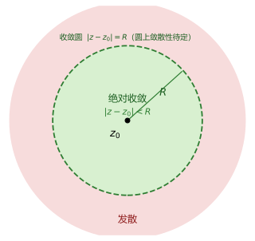
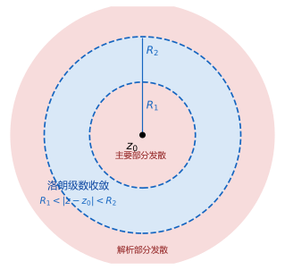

# 04 解析函数的级数表示

## 学习目标

<<<<<<< Updated upstream
- 判断复数列与复数项级数的敛散性
- 求幂级数的收敛半径与收敛圆
- 求幂级数的和函数
- 把解析函数展开成泰勒级数
- 按解析环把函数展开成洛朗级数

## 4.1 复数项级数

本章与高等数学的级数平行，只是把实数换成复数：4.1 是判定工具，结论都要靠实部、虚部拆回实级数；4.2 幂级数的收敛域必是圆盘，求收敛半径是第一号考点；4.3、4.4 分别是圆盘内的非负幂展开与允许负幂的圆环展开。

### 1. 复数列的极限

按顺序排下去的一列复数 $z_1,z_2,\dots,z_n,\dots$ 称为**复数列**，记作 $\{z_n\}$。若存在复数 $z_0$，使得任给 $\varepsilon>0$，总存在正整数 $N$，当 $n>N$ 时
=======
- 判定复数列与复数项级数的收敛、发散，并区分绝对收敛与条件收敛。
- 用阿贝尔定理判断幂级数的收敛范围，并用比值法或根值法求收敛半径。
- 写出解析函数在给定邻域内的泰勒展开式，并说明它成立的范围。
- 用间接法与直接法求常见函数的泰勒级数。
- 在指定圆环域内把解析函数展开成洛朗级数，并写出主要部分。

## 目录

1. 第一节 复数项级数
2. 第二节 复变函数项级数与幂级数
3. 第三节 泰勒级数
4. 第四节 洛朗级数

## 第一节 复数项级数

### 1. 复数列的极限

设 $\{z_n\}$ 是复数列，$z_n=x_n+iy_n$，$z_0=x_0+iy_0$。若对任意给定的 $\varepsilon>0$，总存在正整数 $N$，使当 $n>N$ 时恒有
>>>>>>> Stashed changes

$$
|z_n-z_0|<\varepsilon,
$$

<<<<<<< Updated upstream
则称 $z_n$ 以 $z_0$ 为极限，记作 $\lim_{n\to\infty}z_n=z_0$。定义与实数列逐字相同，只是把绝对值换成了模。

设 $z_n=x_n+iy_n$、$z_0=x_0+iy_0$，由模的夹逼关系

$$
|x_n-x_0|,\ |y_n-y_0|\le|z_n-z_0|
\le|x_n-x_0|+|y_n-y_0|
$$

立即得到**实虚拆分判据**：

$$
z_n\to z_0
\iff x_n\to x_0\ \text{且}\ y_n\to y_0.
$$

复数列的极限问题总能化成两个实数列的极限问题；若变形后 $|z_n-z_0|\le a_n$ 而 $a_n\to0$，直接夹逼往往更短。

### 2. 复数项级数、部分和与必要条件

给定复数列 $\{z_n\}$，表达式 $z_1+z_2+\cdots+z_n+\cdots$ 称为**复数项级数**，记作 $\sum_{n=1}^{\infty}z_n$；它的前 $n$ 项和

$$
S_n=z_1+z_2+\cdots+z_n=\sum_{k=1}^{n}z_k
$$

称为第 $n$ 个**部分和**。若 $\lim_{n\to\infty}S_n=S$ 存在（有限），则称级数收敛，并把这个极限称为级数的和；反之称级数发散。求敛散性永远是研究 $\{S_n\}$ 的极限，不是研究 $z_n$ 的极限。

由 $z_n=S_n-S_{n-1}$ 立刻得到收敛的**必要条件**：

$$
\sum_{n=1}^{\infty}z_n\ \text{收敛}\Longrightarrow z_n\to0.
$$

逆命题不成立（调和级数 $\sum1/n$ 即反例），因此**通项不趋于零则级数发散**；"不趋于零"包含极限存在但非零与极限不存在两种情形，例如 $\sum i^n$ 发散。**易错点**：必要条件不能代替审敛。

### 3. 化为两个实级数：可复用的实数级数结论

**定理 4.1（复数项级数收敛的充要条件）**：设 $z_n=x_n+iy_n$，部分和 $S_n=\sum x_k+i\sum y_k$，则

$$
\boxed{
\sum_{n=1}^{\infty}z_n\ \text{收敛}
\iff \sum_{n=1}^{\infty}x_n,\ \sum_{n=1}^{\infty}y_n\ \text{都收敛}.
}
$$

高等数学中已学过的结论可以直接搬用，常用的有下列几条。

- **几何级数**：$a\ne0$ 且 $|q|<1$ 时

$$
\sum_{n=0}^{\infty}aq^n=\frac{a}{1-q},
$$

$|q|\ge1$ 时通项不趋于零，级数发散；求部分和用 $S_n=\dfrac{a(1-q^n)}{1-q}$。几何级数是本章所有展开式的地基。

- **$p$-级数**：$\sum_{n=1}^{\infty}\dfrac{1}{n^p}$ 在 $p>1$ 时收敛，$p\le1$ 时发散；$p=1$ 即调和级数。

- **比值法与根值法**：对正项级数，计算

$$
\rho=\lim_{n\to\infty}\frac{u_{n+1}}{u_n}
\qquad\text{或}\qquad
\rho=\lim_{n\to\infty}\sqrt[n]{u_n},
$$

极限存在时 $\rho<1$ 收敛，$\rho>1$ 发散，$\rho=1$ 不能判断。含阶乘的用比值法，含 $n$ 次幂的用根值法。

- **比较法（极限形式）**：对正项 $u_n,v_n$，若 $u_n/v_n\to a$，则 $0<a<\infty$ 时两级数同敛散，$a=0$ 时由 $\sum v_n$ 收敛推出 $\sum u_n$ 收敛，$a=\infty$ 时反之；特别地，$\lim n^pu_n$ 有限且 $p>1$ 时 $\sum u_n$ 收敛。

- **莱布尼茨判别法**：若 $u_n>0$ 最终单调递减且 $u_n\to0$，则交错级数 $\sum(-1)^{n-1}u_n$ 收敛；判断条件收敛时几乎必用。

### 例 1：用几何级数的部分和判定收敛

**题目**：判断级数 $\displaystyle\sum_{n=0}^{\infty}\frac{1}{(1+i)^n}$ 的敛散性；若收敛，求其和。

**解答**：这是公比 $q=\dfrac{1}{1+i}$ 的几何级数，$|q|=\dfrac{1}{\sqrt2}<1$，故 $q^n\to0$，部分和

$$
S_n=\frac{1-q^n}{1-q}\longrightarrow\frac{1}{1-q}
=\frac{1}{1-\frac{1}{1+i}}=\frac{1+i}{i}=1-i,
$$

故级数收敛，和为 $1-i$。判定只看公比的模，公比是复数不增加难度；模小于 1 的复数的 $n$ 次幂必趋于零，这一事实本章反复使用。

### 4. 绝对收敛与条件收敛

若 $\sum|z_n|$ 收敛，则称 $\sum z_n$ **绝对收敛**；若 $\sum z_n$ 收敛而 $\sum|z_n|$ 发散，则称**条件收敛**。由 $|x_n|\le|z_n|$、$|y_n|\le|z_n|$ 知绝对收敛时 $\sum x_n$、$\sum y_n$ 都收敛，即

$$
\text{绝对收敛}\Longrightarrow\text{收敛}.
$$

逆命题不成立，且**模级数发散时不能断定原级数发散**——还须回去检查实部、虚部是否各自收敛，这正是条件收敛的来源。

### 例 2：绝对收敛与条件收敛的对比

**题目**：(1) 判断 $\displaystyle\sum_{n=1}^{\infty}\frac{i^n}{n^2}$ 的收敛类型；(2) 判断 $\displaystyle\sum_{n=1}^{\infty}\frac{i^n}{n}$ 的收敛类型。

**解答**：

(1) 取模得 $\left|\dfrac{i^n}{n^2}\right|=\dfrac{1}{n^2}$，模级数是 $p=2>1$ 的 $p$-级数，收敛，故原级数**绝对收敛**；先取模可消掉摆动因子。

(2) 取模得 $\left|\dfrac{i^n}{n}\right|=\dfrac1n$，模级数是调和级数，发散，故非绝对收敛。拆实虚，奇数项与偶数项分开（$n=2m+1$ 时 $i^n=\pm i$，$n=2m+2$ 时 $i^n=\pm1$）：

$$
\sum_{n=1}^{\infty}\frac{i^n}{n}
=i\sum_{m=0}^{\infty}\frac{(-1)^m}{2m+1}
-\sum_{m=0}^{\infty}\frac{(-1)^m}{2m+2}.
$$

两个实级数都是通项单调趋零的交错级数，由莱布尼茨判别法各自收敛，故原级数收敛，属**条件收敛**。判绝对收敛只需取模一步，判条件收敛必须两步。

## 4.2 幂级数

### 1. 复变函数项级数与和函数

把通项换成函数，即得**复变函数项级数** $\sum_{n=1}^{\infty}f_n(z)$，部分和 $S_n(z)=\sum_{k=1}^{n}f_k(z)$。若 $\{S_n(z)\}$ 在 $z$ 处收敛，其极限称为级数的**和函数**：

$$
S(z)=\lim_{n\to\infty}S_n(z)=\sum_{n=1}^{\infty}f_n(z).
$$

一般函数项级数很少直接考，重点是它的特例——幂级数。

### 2. 幂级数的定义与阿贝尔定理
=======
则称当 $n\to\infty$ 时 $\{z_n\}$ 以 $z_0$ 为极限，记作

$$
\lim_{n\to\infty}z_n=z_0 \quad\text{或}\quad z_n\to z_0,
$$

并称 $\{z_n\}$ 收敛于 $z_0$（$z_0$ 称为极限），否则称它发散。

定义与实数列极限平行，只需把 $|x_n-x_0|$ 换成距离 $|z_n-z_0|$。

### 2. 复数列收敛的充要条件

$$
\lim_{n\to\infty}z_n=z_0
\iff
\lim_{n\to\infty}x_n=x_0 \ \text{且}\ \lim_{n\to\infty}y_n=y_0.
$$

复数列收敛，等价于其实部数列、虚部数列分别收敛，于是复数域的问题归结为两个实数列的问题。判断发散常用 $|x_n-x_0|\le|z_n-z_0|$、$|y_n-y_0|\le|z_n-z_0|$。

### 3. 复数项级数及其敛散性

设 $\{z_n\}$ 是复数列，表达式

$$
\sum_{n=1}^{\infty}z_n=z_1+z_2+\cdots+z_n+\cdots
$$

称为**复数项（无穷）级数**，其前 $n$ 项和

$$
S_n=\sum_{k=1}^{n}z_k=z_1+z_2+\cdots+z_n
$$

称为**部分和**。若 $\{S_n\}$ 收敛于有限复数 $S$，则称级数 $\sum z_n$ **收敛**，$S$ 称为级数的和，记作 $\sum_{n=1}^{\infty}z_n=S$；若 $\{S_n\}$ 没有极限，则称级数**发散**。

### 4. 例题

#### 例 1：几何级数

**题目**：判定级数 $1+z+z^2+\cdots+z^n+\cdots$ 的敛散性（$z$ 为复常数）。

**解**：部分和 $S_n=1+z+\cdots+z^{n-1}$。当 $z\ne1$ 时，

$$
S_n=\frac{1-z^n}{1-z}.
$$

若 $|z|<1$，则 $|z^n|=|z|^n\to0$，$S_n\to\frac{1}{1-z}$，级数收敛，和为 $\frac{1}{1-z}$；若 $|z|\ge1$，则 $|z^n|\ge1$，一般项 $z^n$ 不趋于 $0$，级数发散。

于是

$$
\frac{1}{1-z}=1+z+z^2+\cdots+z^n+\cdots
=\sum_{n=0}^{\infty}z^n,\qquad |z|<1.
$$

### 5. 级数收敛的充要条件

记 $z_n=x_n+iy_n$，则

$$
\sum_{n=1}^{\infty}z_n\ \text{收敛}
\iff
\sum_{n=1}^{\infty}x_n\ \text{与}\ \sum_{n=1}^{\infty}y_n\ \text{都收敛}.
$$

**理由**：$S_n=\sum_{k=1}^{n}x_k+i\sum_{k=1}^{n}y_k$，而由第 2 小节，复数列收敛当且仅当实部、虚部两列分别收敛。因此只需分别判定两个实级数；只要有一个发散，原级数就发散。

### 6. 收敛的必要条件

若 $\sum_{n=1}^{\infty}z_n$ 收敛，则

$$
\lim_{n\to\infty}z_n=0.
$$

**证明**：设级数和为 $S$，则 $S_n\to S$、$S_{n-1}\to S$，而 $z_n=S_n-S_{n-1}$，故 $\lim\limits_{n\to\infty}z_n=S-S=0$。

其**逆否命题**同样有用：若 $\lim\limits_{n\to\infty}z_n\ne0$，则 $\sum z_n$ 必发散；例 1 在 $|z|\ge1$ 时正用此结论。

### 7. 绝对收敛与条件收敛

若 $\sum\limits_{n=1}^{\infty}|z_n|$ 收敛，则 $\sum\limits_{n=1}^{\infty}z_n$ 收敛，称 $\sum z_n$ **绝对收敛**；若 $\sum z_n$ 收敛但 $\sum|z_n|$ 发散，称 $\sum z_n$ **条件收敛**。

绝对收敛能推出收敛，是因为 $|x_n|\le|z_n|$、$|y_n|\le|z_n|$，由比较判别法，$\sum|x_n|$、$\sum|y_n|$ 都收敛，从而 $\sum x_n$、$\sum y_n$ 收敛，再由第 5 小节即得 $\sum z_n$ 收敛。

判断这两个实级数时，常用两个现成结论：**莱布尼茨判别法**——若 $u_n>0$ 单调减少且 $u_n\to0$，则 $\sum(-1)^{n-1}u_n$ 收敛；**$p$ 级数**——$\sum\frac{1}{n^p}$ 当 $p>1$ 时收敛、$p\le1$ 时发散（$p=1$ 即调和级数）。

### 8. 例题

#### 例 2：复数项级数的敛散性

**题目**：判断下列级数的敛散性；收敛时说明是绝对收敛还是条件收敛。

（1）$\sum\limits_{n=1}^{\infty}\left(\frac1n+\frac{i}{2^n}\right)$；

（2）$\sum\limits_{n=1}^{\infty}\frac{i^n}{n}$；

（3）$\sum\limits_{n=1}^{\infty}\frac{i^n}{n^2}$。

**解**：

（1）实部级数 $\sum\frac1n$ 是调和级数，发散。由第 5 小节，实部或虚部之一发散，原级数就发散。

（2）$i^n$ 按 $i,\,-1,\,-i,\,1$ 循环，拆成实部、虚部：

$$
\sum_{n=1}^{\infty}\frac{i^n}{n}
=\underbrace{\left(-\frac12+\frac14-\frac16+\frac18-\cdots\right)}_{\text{实部}}
+i\underbrace{\left(1-\frac13+\frac15-\frac17+\cdots\right)}_{\text{虚部}}.
$$

实部为 $-\frac12\left(1-\frac12+\frac13-\frac14+\cdots\right)=-\frac12\ln 2$，虚部为 $1-\frac13+\frac15-\frac17+\cdots=\frac{\pi}{4}$。两部分都是满足莱布尼茨判别法的交错级数，故原级数收敛，和为 $-\frac12\ln 2+\frac{\pi}{4}i$。

绝对值级数 $\sum\left|\frac{i^n}{n}\right|=\sum\frac1n$ 发散，所以原级数**条件收敛**。

（3）$\sum\left|\frac{i^n}{n^2}\right|=\sum\frac{1}{n^2}$ 是 $p=2>1$ 的 $p$ 级数，收敛，所以原级数**绝对收敛**。

## 第二节 复变函数项级数与幂级数

### 1. 复变函数项级数

设 $f_1(z),f_2(z),\dots,f_n(z),\dots$ 都在区域 $D$ 内有定义，表达式 $\sum\limits_{n=1}^{\infty}f_n(z)$ 称为区域 $D$ 内的**复变函数项级数**。其前 $n$ 项和

$$
S_n(z)=\sum_{k=1}^{n}f_k(z)=f_1(z)+f_2(z)+\cdots+f_n(z)
$$

称为级数的**部分和**。固定 $z=z_0$ 后，函数项级数退化为常数项级数 $\sum f_n(z_0)$。

### 2. 收敛与和函数

若 $\lim\limits_{n\to\infty}S_n(z_0)=S(z_0)$（有限复数）存在，则称级数在 $z_0$ 处**点收敛**，$S(z_0)$ 为它在 $z_0$ 处的值；若级数在 $D$ 内每一点都收敛，则称它在 $D$ 内收敛，并称

$$
S(z)=\lim_{n\to\infty}S_n(z)=\sum_{n=1}^{\infty}f_n(z),\qquad z\in D
$$

为级数的**和函数**。例如例 1 的 $\sum z^n$ 在 $|z|<1$ 内每点收敛，和函数为 $S(z)=\frac1{1-z}$。

逐点收敛中的 $N$ 依赖于 $z$，不同点收敛的快慢可以相差很远。若存在与 $z$ 无关的 $N$，使 $n>N$ 时区域内**所有** $z$ 都满足 $|S_n(z)-S(z)|<\varepsilon$，则称级数在该区域内**一致收敛**；若它在区域的任一闭子区域上一致收敛，则称**内闭一致收敛**。后面交换求和与积分、求导，都要用到一致收敛。

幂级数在收敛圆内是内闭一致收敛的。取 $|z-z_0|\le\rho<\rho'<R$，由绝对收敛知 $\sum|c_n|\rho'^n$ 收敛，而 $|c_n(z-z_0)^n|\le|c_n|\rho'^n$，由优级数判别法，级数在闭圆盘 $|z-z_0|\le\rho$ 上一致收敛。

### 3. 幂级数
>>>>>>> Stashed changes

形如

$$
<<<<<<< Updated upstream
\sum_{n=0}^{\infty}c_n(z-a)^n
=c_0+c_1(z-a)+c_2(z-a)^2+\cdots+c_n(z-a)^n+\cdots
$$

的级数称为以 $a$ 为中心的**幂级数**，其中 $a$ 与 $c_n$（$n=0,1,2,\dots$）都是复常数。作平移 $w=z-a$ 即化为 $\sum c_nw^n$，故只需研究 $a=0$ 的情形。

**定理 4.2（阿贝尔定理）**：对 $\sum_{n=0}^{\infty}c_nz^n$，

1. 若它在 $z_1\ne0$ 处收敛，则它在满足 $|z|<|z_1|$ 的一切 $z$ 处绝对收敛；
2. 若它在 $z_2$ 处发散，则它在满足 $|z|>|z_2|$ 的一切 $z$ 处发散。

**证明思路**：$z_1$ 处收敛给出 $|c_nz_1^n|\le M$，于是 $|z|<|z_1|$ 时 $|c_nz^n|\le M\left|\dfrac{z}{z_1}\right|^n$，由比较判别法得绝对收敛，第 2 条由第 1 条反证。即"**小的更小，大的更大**"，故收敛域必是圆盘：

$$
|z|<R\ \text{内绝对收敛},\qquad |z|>R\ \text{时发散},\qquad |z|=R\ \text{上另作讨论}.
$$

### 3. 收敛半径与收敛圆的求法

**定理 4.3（收敛半径与收敛圆）**：对幂级数 $\sum_{n=0}^{\infty}c_n(z-a)^n$，存在唯一的 $R$（$0\le R\le+\infty$），使得

- $|z-a|<R$ 内绝对收敛，且在任意闭圆盘 $|z-a|\le r<R$ 上一致收敛；
- $|z-a|>R$ 时处处发散。

这个 $R$ 称为**收敛半径**，圆盘 $|z-a|<R$ 称为**收敛圆**；$R=0$ 表示只在中心收敛，$R=+\infty$ 表示在全平面收敛。

**求法一（比值法）**：设 $c_n\ne0$ 对充分大的 $n$ 成立且 $\lambda=\lim_{n\to\infty}\left|\dfrac{c_{n+1}}{c_n}\right|$ 存在，则 $R=\dfrac1\lambda$；$\lambda=0$ 时 $R=+\infty$，$\lambda=+\infty$ 时 $R=0$。

**求法二（根值法）**：若 $\lambda=\lim_{n\to\infty}\sqrt[n]{|c_n|}$ 存在，同样有 $R=\dfrac1\lambda$；更一般地 $R=\dfrac{1}{\limsup_{n\to\infty}\sqrt[n]{|c_n|}}$ 总成立，考试一般只用前两种。

**选择口诀**：系数里出现**阶乘**用比值法；系数是某个量的 **$n$ 次幂**用根值法；两者都出现时优先比值法。

**适用条件与易错点**：给出幂级数先求半径，若还要求收敛域，必须再整体检查圆周 $|z-a|=R$；用部分和求半径只适用于级数本身是几何级数的情形。

### 例 3：含阶乘与 $n$ 次幂的收敛半径

**题目**：求 $\displaystyle\sum_{n=1}^{\infty}\frac{n!}{n^n}z^n$ 的收敛半径。

**解答**：$c_n=\dfrac{n!}{n^n}$，含阶乘又有 $n$ 次幂，用比值法：

$$
\left|\frac{c_{n+1}}{c_n}\right|
=\frac{(n+1)!\,n^n}{(n+1)^{n+1}\,n!}
=\frac{n^n}{(n+1)^n}
=\frac{1}{\left(1+\frac1n\right)^n}
\longrightarrow\frac1e,
$$

故 $R=\dfrac1\lambda=e$。先约去 $(n+1)!=(n+1)\cdot n!$ 与一个 $(n+1)$ 再凑重要极限，是含阶乘题的标准动作。

### 例 4：求半径后再补边界

**题目**：求 $\displaystyle\sum_{n=1}^{\infty}\frac{z^n}{n^3}$ 的收敛半径与完整收敛域。

**解答**：$c_n=\dfrac{1}{n^3}$，用比值法：

$$
\lambda=\lim_{n\to\infty}\frac{n^3}{(n+1)^3}
=\lim_{n\to\infty}\left(\frac{n}{n+1}\right)^3=1,
\qquad R=\frac1\lambda=1.
$$

再查边界 $|z|=1$：模级数 $\sum\dfrac{1}{n^3}$ 是 $p=3>1$ 的 $p$-级数，收敛，故圆周上处处绝对收敛，完整收敛域为 $|z|\le1$。求"收敛域"必须补查整个圆周，半径、圆周、收敛域三个结果一起答出。

### 4. 和函数的解析性与逐项运算

**定理 4.4（和函数的解析性与逐项运算）**：设幂级数 $\sum_{n=0}^{\infty}c_n(z-a)^n$ 的收敛半径为 $R$，和函数为 $S(z)$，则

- **性质 1**：$S(z)$ 在收敛圆 $|z-a|<R$ 内**解析**。

- **性质 2（逐项求导）**：在 $|z-a|<R$ 内可逐项求导，且

$$
S^{(k)}(z)=\sum_{n=k}^{\infty}n(n-1)\cdots(n-k+1)\,c_n(z-a)^{n-k}.
$$

求 $k$ 阶导数时只有 $n\ge k$ 的项活下来；令 $z=a$ 得 $S^{(k)}(a)=k!\,c_k$，这正是泰勒系数公式的来源。

- **性质 3（逐项积分）**：设 $C$ 是收敛圆内的一条分段光滑曲线，则

$$
\int_C S(\zeta)\,d\zeta
=\sum_{n=0}^{\infty}c_n\int_C(\zeta-a)^n\,d\zeta ,
$$

即积分号与求和号可以交换。

**依据**：在 $|z-a|\le r<R$ 上取 $r<\rho<R$，由 $\sum|c_n|\rho^n$ 收敛知级数尾部被几何级数 $M\left(\dfrac{r}{\rho}\right)^n$ 统一控制，故可逐项求导与逐项积分；边界上无此控制，结论不能推到 $|z-a|=R$。

**适用条件与易错点**：逐项求导、逐项积分不改变收敛半径，但可能改变边界上的敛散性；积分路径必须落在收敛圆内。收敛半径为 $R_1,R_2$ 的两个幂级数在 $|z-a|<\min(R_1,R_2)$ 内可逐项加减：$f\pm g=\sum(a_n\pm b_n)(z-a)^n$。

### 例 5：用逐项积分求 $\ln(1-z)$ 的展开

**题目**：把 $f(z)=\ln(1-z)$ 在 $z_0=0$ 处展开成幂级数。

**解答**：对数看不出级数规律，但 $[\ln(1-z)]'=-\dfrac{1}{1-z}=-\sum_{n=0}^{\infty}z^n\ (|z|<1)$，故在 $|z|<1$ 内从 $0$ 积分到 $z$，右边逐项积分：

$$
\ln(1-z)
=-\sum_{n=0}^{\infty}\int_0^z\zeta^n\,d\zeta
=-\sum_{n=1}^{\infty}\frac{z^n}{n},
$$

即

$$
\boxed{
\ln(1-z)=-\sum_{n=1}^{\infty}\frac{z^n}{n}
=-z-\frac{z^2}{2}-\frac{z^3}{3}-\cdots,
\qquad |z|<1 .
}
$$

积分常数由 $\ln1=0$ 确定（取主值解析分支）。"求导化成已知展开式再积分回来"是标准套路，合法性由性质 3 保证。

### 5. 幂级数的乘法与除法

**乘法（柯西乘积）**：在公共收敛域内

$$
\left(\sum_{n=0}^{\infty}a_nz^n\right)\left(\sum_{n=0}^{\infty}b_nz^n\right)
=\sum_{n=0}^{\infty}\left(\sum_{k=0}^{n}a_kb_{n-k}\right)z^n .
$$

乘法的技术含量在于定出 $z^n$ 的系数：把**下标之和等于 $n$** 的项配成对相加（沿对角线求和），如 $z^2$ 的系数是 $a_0b_2+a_1b_1+a_2b_0$。视频板书用"两个已知展开式相乘再归并通项"处理 $z^3+z^2-z-1$ 时，通项与系数不自洽，不能作为结论，其中有效的只是**卷积求和与通项归并**这个做法。

**除法（长除法）**：要求 $\dfrac{\sum a_nz^n}{\sum b_nz^n}$ 的展开，设商为 $\sum\gamma_nz^n$，由

$$
\left(\sum_{n=0}^{\infty}b_nz^n\right)\left(\sum_{n=0}^{\infty}\gamma_nz^n\right)=\sum_{n=0}^{\infty}a_nz^n
$$

逐次比较系数，从最低次开始一项一项解；这与竖式长除法同构，只是把十进制换成按 $z$ 的次数排列。

### 例 6：用乘法（柯西卷积）求展开

**题目**：把 $f(z)=\dfrac{1}{(1-z)^2(1+z)}$ 在 $z_0=0$ 处展开成幂级数。

**说明**：视频板书中该例（把 $z^3+z^2-z-1$ 用两个级数相乘）的通项与系数不自洽，本例取同类型题 $\dfrac{1}{(1-z)^2(1+z)}$ 替换，用于演示柯西乘积。

**解答**：分母两个因子都有现成展开式：

$$
\frac{1}{(1-z)^2}=\sum_{n=0}^{\infty}(n+1)z^n,
\qquad
\frac{1}{1+z}=\sum_{k=0}^{\infty}(-1)^kz^k,
\qquad |z|<1 .
$$

相乘后 $z^n$ 的系数为 $c_n=\sum_{k=0}^{n}(n-k+1)(-1)^k$，按 $k=2j$、$k=2j+1$ 两项一组相减读出 $c_0=1,\ c_1=1,\ c_2=2,\ c_3=2,\ c_4=3,\ c_5=3,\dots$，即 $c_n=\left\lfloor\dfrac n2\right\rfloor+1$，于是

$$
\boxed{
\frac{1}{(1-z)^2(1+z)}
=\sum_{n=0}^{\infty}\left(\left\lfloor\frac n2\right\rfloor+1\right)z^n,
\qquad |z|<1 .
}
$$

两个已知展开式相乘时先写低次项观察规律，再把通项写成闭式；结果可用部分分式反查（$c_n=\dfrac14+\dfrac{n+1}{2}+\dfrac{(-1)^n}{4}$，一致）。

## 4.3 泰勒级数

### 1. 泰勒展开定理

**定理 4.5（泰勒展开定理）**：设 $f(z)$ 在区域 $D$ 内解析，$z_0\in D$，$R$ 为 $z_0$ 到 $D$ 的边界 $\partial D$ 的距离。则在 $|z-z_0|<R$ 内

$$
\boxed{
f(z)=\sum_{n=0}^{\infty}c_n(z-z_0)^n,
\qquad
c_n=\frac{f^{(n)}(z_0)}{n!}.
}
$$

由柯西高阶导数公式，系数还可写成围道积分 $c_n=\dfrac{1}{2\pi i}\oint_C\dfrac{f(\zeta)}{(\zeta-z_0)^{n+1}}\,d\zeta$（$C$ 为 $D$ 内围绕 $z_0$ 的正向简单闭曲线）；考试中直接用 $c_n=\dfrac{f^{(n)}(z_0)}{n!}$。

**关于收敛半径**：定理中的 $R$ 是中心到区域边界的距离，只保证可以展开，不一定等于实际收敛半径；对有理函数，约去可去奇点后实际半径等于中心到最近**不可去奇点**的距离；整函数（如 $e^z$、$\sin z$、$\cos z$）的收敛半径为 $+\infty$。

**展开的唯一性**：同一函数在同一中心处的幂级数展开是唯一的。因此由代换、求导、积分、乘除得到的幂级数**就是**泰勒级数，不必再回去验证系数。

### 2. 直接展开法

**直接法**就是算 $f^{(n)}(z_0)$，适合导数规律明显的函数。$e^z$ 的任意阶导数等于自身，故 $f^{(n)}(0)=1$，于是

$$
e^z=\sum_{n=0}^{\infty}\frac{z^n}{n!}
=1+z+\frac{z^2}{2!}+\frac{z^3}{3!}+\cdots,\qquad z\in\mathbb C .
$$

### 例 7：$\sin z$ 与 $\cos z$ 的直接展开

**题目**：把 $\sin z$、$\cos z$ 在 $z_0=0$ 处展开成幂级数。

**解答**：直接逐阶求导看不出规律（$\sin\to\cos\to-\sin\to-\cos$ 循环），改把 $n$ 阶导数写成统一表达式

$$
\frac{d^n}{dz^n}\sin z=\sin\left(z+\frac{n\pi}{2}\right),
$$

它在 $z=0$ 取值 $\sin\dfrac{n\pi}{2}$：$n$ 为偶数时为零，$n=2m+1$ 时为 $(-1)^m$，故偶次项全为零，只剩奇次项：

$$
\boxed{
\sin z=\sum_{m=0}^{\infty}\frac{(-1)^mz^{2m+1}}{(2m+1)!}
=z-\frac{z^3}{3!}+\frac{z^5}{5!}-\cdots
}
$$

$$
\boxed{
\cos z=\sum_{m=0}^{\infty}\frac{(-1)^mz^{2m}}{(2m)!}
=1-\frac{z^2}{2!}+\frac{z^4}{4!}-\cdots
}
$$

两者都是整函数，收敛半径 $+\infty$。求导后符号循环的函数，先把 $n$ 阶导数写成**带 $n$ 的统一表达式**再奇偶分情况，这是直接法唯一的技术点。

### 3. 间接展开法与几个基本展开式

**间接法**利用已知展开式，通过代换、逐项求导、逐项积分、四则运算得到目标函数。全部工作的地基是下面几个展开式，必须背到能默写：

$$
\frac{1}{1-z}=\sum_{n=0}^{\infty}z^n,\qquad |z|<1 ;
$$

$$
\frac{1}{1+z}=\sum_{n=0}^{\infty}(-1)^nz^n,\qquad |z|<1 ;
$$

$$
\ln(1+z)=\sum_{n=1}^{\infty}\frac{(-1)^{n-1}z^n}{n},\qquad |z|<1 ;
$$

$$
\ln(1-z)=-\sum_{n=1}^{\infty}\frac{z^n}{n},\qquad |z|<1 ;
$$

$$
e^z=\sum_{n=0}^{\infty}\frac{z^n}{n!},\qquad z\in\mathbb C ;
$$

$$
\sin z=\sum_{m=0}^{\infty}\frac{(-1)^mz^{2m+1}}{(2m+1)!},\qquad
\cos z=\sum_{m=0}^{\infty}\frac{(-1)^mz^{2m}}{(2m)!},\qquad z\in\mathbb C .
$$

**前四组（两个分式与两个对数）是间接展开的直接工具**，后面的变形几乎都由它们派生；$e^z$ 与 $\sin z$、$\cos z$ 既作直接法的样板，也常作级数代入时的外层函数。

常用的变形还有：把 $\dfrac{1}{1-z}$、$\dfrac{1}{1+z}$ 分别求导得 $\dfrac{1}{(1-z)^2}=\sum_{n=0}^{\infty}(n+1)z^n$、$\dfrac{1}{(1+z)^2}=\sum_{n=0}^{\infty}(-1)^n(n+1)z^n$；由 $\dfrac{1}{1+x^2}$ 逐项积分，在实变量下得

$$
\arctan x=\sum_{n=0}^{\infty}\frac{(-1)^nx^{2n+1}}{2n+1},\qquad |x|<1 .
$$

实级数的收敛区间要另判：$\ln(1+x)$ 的级数在 $(-1,1]$、$\arctan x$ 的级数在 $[-1,1]$ 上收敛。**易错点**：实轴端点结论不能当作复级数在圆周上的结论，圆周上仍需按例 4 的办法整体检查。

### 4. 级数代入法（复合函数的展开）

若 $f(\zeta)=\sum_{n=0}^{\infty}a_n\zeta^n$ 在 $|\zeta|<R$ 内成立，而 $\zeta=g(z)$ 在 $z_0$ 附近解析且满足 $|g(z)|<R$，则

$$
f(g(z))=\sum_{n=0}^{\infty}a_n[g(z)]^n .
$$

使用这一步的前提是**整个代入后的量 $g(z)$ 落在原级数的收敛圆内**；先写外层展开式，再代入内层展开式，最后按 $z$ 的次数合并同类项（通常只需前几项）。

### 例 8：级数代入法

**题目**：把 $f(z)=e^{\frac{z}{1-z}}$ 在 $z_0=0$ 处展开成幂级数（写到 $z^4$），并求收敛半径。

**解答**：内层由几何级数得 $\zeta=\dfrac{z}{1-z}=z+z^2+z^3+z^4+\cdots\ (|z|<1)$，外层 $e^{\zeta}=1+\zeta+\dfrac{\zeta^2}{2!}+\cdots+\dfrac{\zeta^4}{4!}$；把内层逐次乘方，只保留到 $z^4$：

$$
\zeta=z+z^2+z^3+z^4+\cdots,\qquad
\zeta^2=z^2+2z^3+3z^4+\cdots,
$$

$$
\zeta^3=z^3+3z^4+\cdots,\qquad \zeta^4=z^4+\cdots .
$$

按次数归并：$z^1$ 为 $1$，$z^2$ 为 $1+\dfrac12=\dfrac32$，$z^3$ 为 $1+1+\dfrac16=\dfrac{13}{6}$，$z^4$ 为 $\dfrac{73}{24}$，于是

$$
\boxed{
e^{\frac{z}{1-z}}
=1+z+\frac32z^2+\frac{13}{6}z^3+\frac{73}{24}z^4+\cdots
}
$$

$f$ 的奇点为 $z=1$，中心到它的距离为 1，故 $R=1$，与内层适用范围一致。系数无统一规律是正常的，题目一般只要求前几项。

## 4.4 洛朗级数

### 1. 从正幂到负幂：洛朗级数的定义

幂级数只含非负次幂，适合表示圆盘内的解析函数；允许负幂就能表示圆外或圆环内的函数。最简单的例子：在 $|z|>1$ 内

$$
\frac{1}{1-z}
=-\frac1z\cdot\frac{1}{1-\dfrac1z}
=-\sum_{n=0}^{\infty}\frac{1}{z^{n+1}},
$$

这里几何级数的小量是 $\dfrac1z$，适用范围与原点附近的展开恰好相反。把正负幂一起收进来，就得到**洛朗级数**：

$$
\sum_{n=-\infty}^{\infty}c_n(z-a)^n
=\underbrace{\sum_{n=0}^{\infty}c_n(z-a)^n}_{\text{解析部分}}
+\underbrace{\sum_{n=1}^{\infty}\frac{c_{-n}}{(z-a)^n}}_{\text{主要部分（主部）}} .
$$

非负幂部分称为**解析部分**，负幂部分称为**主要部分**（主部），$c_{-k}$ 与 $c_k$ 一样只是一个复数。双边级数收敛的含义是解析部分与主要部分**分别收敛**，而不是只看对称截断的部分和。

### 2. 收敛圆环

解析部分是以 $a$ 为中心的普通幂级数，在 $|z-a|<R_2$ 内收敛。主要部分作换元

$$
\zeta=\frac{1}{z-a},
\qquad
\sum_{n=1}^{\infty}\frac{c_{-n}}{(z-a)^n}=\sum_{n=1}^{\infty}c_{-n}\zeta^n
$$

就化成关于 $\zeta$ 的普通幂级数，设其收敛半径为 $r$，则要求 $|\zeta|<r$，即 $|z-a|>\dfrac1r=R_1$。两部分同时收敛的区域是交集

$$
\boxed{R_1<|z-a|<R_2,}
$$

称为**收敛圆环**。这里是**开**环，两条边界仍须另外判断；若 $R_1>R_2$，级数处处发散。特别地，

- 没有负幂项时收敛域退化为圆盘 $|z-a|<R_2$；
- 有有限个非零负幂项时中心 $a$ 必须挖去，收敛域是去心圆盘 $0<|z-a|<R_2$；
- 只有负幂项（或再加有限个非负幂项）时 $R_2=+\infty$，收敛域是圆外域 $|z-a|>R_1$。

### 例 9：求洛朗级数的收敛圆环

**题目**：求级数

$$
\sum_{n=1}^{\infty}\frac{2^n}{(z-3)^n}+\sum_{n=0}^{\infty}\frac{(z-3)^n}{3^n}
$$

的收敛圆环。

**解答**：这是中心 $z_0=3$ 的洛朗级数，前半为负幂项、后半为正幂项。负幂部分写成 $\sum_{n=1}^{\infty}2^n\zeta^n$（$\zeta=\dfrac{1}{z-3}$），用根值法得 $r=\dfrac12$，即 $|\zeta|<\dfrac12\iff|z-3|>2$，故**内半径 $R_1=2$**；正幂部分同法得 $R_2=3$。取交集：

$$
\boxed{2<|z-3|<3.}
$$

正幂部分给外半径、负幂部分给内半径，负幂这边多一次倒数，不等号方向要由 $|\zeta|<r$ 反解出来。

### 3. 洛朗展开定理

**定理 4.6（洛朗展开定理）**：设 $f(z)$ 在圆环 $R_1<|z-a|<R_2$ 内处处解析，则在此圆环内 $f(z)$ 可以唯一地展开成洛朗级数

$$
f(z)=\sum_{n=-\infty}^{\infty}c_n(z-a)^n,
$$

其系数为

$$
\boxed{
c_n=\frac{1}{2\pi i}\oint_C\frac{f(\zeta)}{(\zeta-a)^{n+1}}\,d\zeta,
\qquad n=0,\pm1,\pm2,\dots
}
$$

其中 $C$ 是圆环内围绕 $a$ 的任意一条正向分段光滑简单闭曲线。**易错点**：$a$ 未必在定义域内，不能用 $\dfrac{f^{(n)}(a)}{n!}$ 算洛朗系数；若 $f$ 在包含 $a$ 的整个圆盘内解析则退化为泰勒展开（仅有 $R_1=0$ 不够）。同一中心、同一圆环内展开唯一，**换一个圆环展开式就不同**。

### 4. 展开方法：拆分项，再逐项套已知展开式

常见有理函数的洛朗展开有一条固定路线。

**第一步：找奇点，分环。** 求出所有实际奇点，按它们到中心 $a$ 的距离从小到大把平面分成若干同心环域；距离相同的奇点只给出一条分界圆，中心本身是奇点时还要把中心挖去。

**第二步：部分分式拆项。** 把函数拆成形如 $\dfrac{A}{(z-b)^k}$ 的简单分式之和；分母含不可约二次因式 $z^2+1$ 时分子要设成一次式 $Az+B$，否则通分后凑不出原来的分子（做题规律，不是定理）。

**第三步：每一项按所在环域选"小公比"。** 设 $w=z-a$，奇点在 $w=b$（即 $z=a+b$）时对应的因子是 $w-b$，两条基本展开是

$$
\boxed{
\frac{1}{w-b}
=-\frac1b\cdot\frac{1}{1-\dfrac{w}{b}}
=-\sum_{n=0}^{\infty}\frac{w^n}{b^{n+1}},
\qquad |w|<|b| ;
}
$$

$$
\boxed{
\frac{1}{w-b}
=\frac1w\cdot\frac{1}{1-\dfrac{b}{w}}
=\sum_{n=0}^{\infty}\frac{b^n}{w^{n+1}},
\qquad |w|>|b| .
}
$$

**口诀：内侧展开提 $-\dfrac1b$，外侧展开提 $+\dfrac1w$**，依据永远是让几何级数的公比模小于 1。两个式子的符号相反，$1/(w-b)$ 与 $1/(b-w)$ 不要混。

**第四步：整理成规范形式。** 把系数里的 $z$ 归并到幂次上（如 $\dfrac{1}{z}\cdot\dfrac{1}{z^{2n}}=\dfrac{1}{z^{2n+1}}$），写成 $\sum c_n(z-a)^n$ 的标准形状。**易错点**：圆环的位置决定哪一项用内侧展开，但不决定哪些系数非零；$z^2+1$ 在 $|z|>1$ 时必须写成 $\dfrac{1}{z^2}\cdot\dfrac{1}{1+1/z^2}$。

### 例 10：三个圆环域内的洛朗展开（核心例题）

**题目**：把 $f(z)=\dfrac{1}{(z-1)(z-2)}$ 按中心 $z_0=0$ 展开，分别讨论 $|z|<1$、$1<|z|<2$、$|z|>2$ 三个圆环域。

**解答**：奇点是 1 和 2，到中心的距离为 1 和 2，两条分界圆正好把平面分成三个环域。先作部分分式

$$
f(z)=\frac{1}{z-2}-\frac{1}{z-1}.
$$

(1) $|z|<1$：两项都在各自奇点的内侧，都展开成非负幂，

$$
\frac{1}{z-2}=-\frac12\cdot\frac{1}{1-\dfrac z2}
=-\sum_{n=0}^{\infty}\frac{z^n}{2^{n+1}},
\qquad
\frac{1}{z-1}=-\frac{1}{1-z}=-\sum_{n=0}^{\infty}z^n,
$$

两个条件取交集即 $|z|<1$，故

$$
\boxed{
f(z)=\sum_{n=0}^{\infty}\left(1-\frac{1}{2^{n+1}}\right)z^n,
\qquad |z|<1 .
}
$$

(2) $1<|z|<2$：第一项在内侧，第二项在外侧，

$$
\frac{1}{z-2}=-\sum_{n=0}^{\infty}\frac{z^n}{2^{n+1}}\quad(|z|<2),
\qquad
\frac{1}{z-1}=\frac1z\cdot\frac{1}{1-\dfrac1z}
=\sum_{n=0}^{\infty}\frac{1}{z^{n+1}}\quad(|z|>1),
$$

$$
\boxed{
f(z)=-\sum_{n=0}^{\infty}\frac{z^n}{2^{n+1}}
-\sum_{n=0}^{\infty}\frac{1}{z^{n+1}},
\qquad 1<|z|<2 .
}
$$

(3) $|z|>2$：两项都在外侧，都展开成负幂，

$$
\frac{1}{z-2}=\frac1z\cdot\frac{1}{1-\dfrac2z}
=\sum_{n=0}^{\infty}\frac{2^n}{z^{n+1}},
\qquad
\frac{1}{z-1}=\sum_{n=0}^{\infty}\frac{1}{z^{n+1}},
$$

$$
\boxed{
f(z)=\sum_{n=0}^{\infty}\frac{2^n-1}{z^{n+1}}
=\frac{1}{z^2}+\frac{3}{z^3}+\frac{7}{z^4}+\cdots,
\qquad |z|>2 .
}
$$

$n=0$ 项相消，首项 $\dfrac{1}{z^2}$ 与 $f$ 在无穷远处按 $z^{-2}$ 衰减一致。同一个函数在三种环域得到三个展开式，可推广的是操作步骤（先分环，再逐项判断内侧或外侧），而不是某个环域的形式。

### 例 11：含二次因式的分段展开

**题目**：把 $f(z)=\dfrac{1}{(z^2+1)(z-2)}$ 在圆环 $1<|z|<2$ 内展开成洛朗级数。

**解答**：奇点 $z=\pm i$（模为 1）与 $z=2$，分界圆为 $|z|=1$、$|z|=2$，题给圆环正是中间那个环域。**第一步，部分分式**：分母含二次因式，设

$$
\frac{1}{(z^2+1)(z-2)}=\frac{az+b}{z^2+1}+\frac{c}{z-2},
$$

通分得 $(az+b)(z-2)+c(z^2+1)=1$，比较系数解出 $a=-\dfrac15$、$b=-\dfrac25$、$c=\dfrac15$：

$$
f(z)=-\frac15\cdot\frac{z+2}{z^2+1}+\frac15\cdot\frac{1}{z-2}.
$$

**第二步，逐项按环域展开**：含 $z-2$ 的项在 $|z|<2$ 内用内侧展开，

$$
\frac15\cdot\frac{1}{z-2}
=-\frac{1}{10}\sum_{n=0}^{\infty}\frac{z^n}{2^n},
\qquad |z|<2 ;
$$

含 $z^2+1$ 的项在 $|z|>1$ 内用外侧展开，先提 $\dfrac{1}{z^2}$：

$$
\frac{1}{z^2+1}
=\frac{1}{z^2}\cdot\frac{1}{1+\dfrac{1}{z^2}}
=\sum_{n=0}^{\infty}\frac{(-1)^n}{z^{2n+2}},
\qquad |z|>1 ,
$$

$$
-\frac15\cdot\frac{z+2}{z^2+1}
=-\frac15\sum_{n=0}^{\infty}\frac{(-1)^n}{z^{2n+1}}
-\frac25\sum_{n=0}^{\infty}\frac{(-1)^n}{z^{2n+2}} .
$$

**第三步，整理成规范形式**：条件取交集即 $1<|z|<2$，

$$
\boxed{
\begin{aligned}
f(z)={}&-\frac15\sum_{n=0}^{\infty}\frac{(-1)^n}{z^{2n+1}}
-\frac25\sum_{n=0}^{\infty}\frac{(-1)^n}{z^{2n+2}}
-\frac{1}{10}\sum_{n=0}^{\infty}\frac{z^n}{2^n},\\
&1<|z|<2 .
\end{aligned}
}
$$

前几项为 $-\dfrac{1}{5z}-\dfrac{2}{5z^2}+\dfrac{1}{5z^3}+\dfrac{2}{5z^4}-\cdots-\dfrac{1}{10}-\dfrac{z}{20}-\cdots$。三项技术缺一不可：二次因式设一次分子；每项按该死点距离与环域定内外侧；$|z|>1$ 时必须把 $z^2$ 提到分母上。

## 本章解题路线

| 任务 | 操作顺序 | 必查条件 |
| --- | --- | --- |
| 复数列与复级数敛散 | 通项筛查 → 取模 → 必要时拆实虚 | 通项趋零不保证收敛；模级数发散不保证原级数发散 |
| 绝对/条件收敛 | 先取模判绝对 → 模发散再拆实虚用莱布尼茨 | 两步都要写出 |
| 收敛半径与收敛域 | 提取 $c_n$ → 阶乘用比值法、$n$ 次幂用根值法 → 整体判断圆周 $\vert z-a\vert=R$ | $\lambda=0\Rightarrow R=\infty$、$\lambda=\infty\Rightarrow R=0$；半径同不代表边界同 |
| 幂级数和函数 | 套已知展开式 → 逐项求导或逐项积分 | 积分路径须在收敛圆内；注意链式求导的负号 |
| 两个级数相乘或相除 | 下标之和为 $n$ 的对角线求和写闭式 / 长除法逐项定系数 | 每步用最低次项对齐，符号不能错 |
| 泰勒展开 | 半径用"中心到最近奇点距离"预定 → 直接求导或间接变形、代入 | 展开中心、常数项、适用范围三处一致 |
| 洛朗展开与收敛圆环 | 部分分式拆项 → 按奇点距离分环 → 每项选模小于 1 的公比 → 整理成标准形式 | 正幂给外半径 $R_2$、负幂换元给内半径 $R_1$，必须 $R_1<R_2$；二次因式的分子设一次式 |

## 本章小结

本章是一条逐步放宽条件的链条：复数项级数 → 幂级数 → 泰勒级数 → 洛朗级数，从圆盘内的非负幂展开到圆环内允许负幂的展开。

- **判定敛散**：复级数拆成实部与虚部两个实级数；快速判散用"通项不趋于零"，判敛先试模级数，模级数发散时再拆实虚用莱布尼茨等判别法，即条件收敛。
- **幂级数**：收敛域必为圆盘，边界另判；含阶乘用比值法、含 $n$ 次幂用根值法，不要把 $\lambda=0$ 与 $\lambda=+\infty$ 对应的 $R$ 记反；和函数在收敛圆内解析，可逐项求导、积分。
- **泰勒展开**：圆盘内的非负幂展开，$c_n=\dfrac{f^{(n)}(a)}{n!}$；有理函数的半径等于中心到最近不可去奇点的距离，整函数为 $+\infty$；展开唯一，故代换、求导、积分、乘除、代入得到的级数就是泰勒级数。
- **洛朗展开**：圆环内的双边展开，先按奇点距离分环，再对每一项选"小公比"——内侧提 $-\dfrac1b$，外侧提 $+\dfrac1w$；考试主要考求收敛圆环与按指定圆环域写展开式两件事。
=======
\sum_{n=0}^{\infty}c_n(z-z_0)^n
=c_0+c_1(z-z_0)+c_2(z-z_0)^2+\cdots
$$

的级数称为**幂级数**，其中 $c_n$ 为复常数（系数），$z_0$ 为复常数（中心），起点不影响本质。

在 $z=z_0$ 处，$(z-z_0)^n=0\ (n\ge1)$，级数收敛于 $c_0$；其余点在哪里收敛是核心问题。

### 4. 阿贝尔定理

**阿贝尔定理**：若幂级数 $\sum\limits_{n=0}^{\infty}c_n(z-z_0)^n$ 在 $z_1\ne z_0$ 处收敛，则它在圆

$$
|z-z_0|<|z_1-z_0|
$$

内**绝对收敛**。

**证明**：由 $\sum c_n(z_1-z_0)^n$ 收敛，其一般项趋于 $0$，故有界，存在 $M>0$ 使

$$
|c_n(z_1-z_0)^n|\le M,\qquad n=0,1,2,\dots
$$

在圆内任取 $z$，记 $q=\left|\frac{z-z_0}{z_1-z_0}\right|<1$，则

$$
|c_n(z-z_0)^n|
=\left|c_n(z_1-z_0)^n\right|\cdot
\left|\frac{z-z_0}{z_1-z_0}\right|^n
\le Mq^n.
$$

等比级数 $\sum Mq^n$ 收敛（$0\le q<1$），由正项级数比较判别法，$\sum|c_n(z-z_0)^n|$ 收敛，即原级数绝对收敛。

以 $z_0$ 为圆心、$|z_1-z_0|$ 为半径作圆，定理断言圆内绝对收敛；$z_1$ 在圆周上，圆周其余点及圆外的敛散性需具体分析。

### 5. 阿贝尔定理的推论

若幂级数在 $z_2$ 处发散，则它在

$$
|z-z_0|>|z_2-z_0|
$$

内处处发散。

**证明（反证法）**：在 $|z-z_0|>|z_2-z_0|$ 内任取 $z_1$。若 $z_1$ 处收敛，则由阿贝尔定理，以 $|z_1-z_0|$ 为半径的圆内绝对收敛；而 $|z_2-z_0|<|z_1-z_0|$，$z_2$ 在该圆内，应在 $z_2$ 处收敛，与已知发散矛盾。故 $z_1$ 处发散，由任意性结论成立。

某点收敛，靠内的圆内一定收敛；某点发散，靠外的圆外一定发散。两条合起来，收敛与发散的分界只能是一条圆周。

### 6. 收敛半径与收敛圆

幂级数在中心 $z_0$ 必收敛，在其余点的敛散只有三种可能：

1. 除 $z_0$ 外处处发散，记**收敛半径** $R=0$；
2. 全平面处处收敛，$R=+\infty$；
3. 存在 $R\in(0,+\infty)$：$|z-z_0|<R$ 内收敛，$|z-z_0|>R$ 外发散，圆周上待定。

圆 $|z-z_0|<R$ 称为**收敛圆**（$R=+\infty$ 时收敛圆是全平面）。

收敛与发散的分界是一条圆周，理由如下。把收敛点到中心的距离收集成集合 $S\subset[0,+\infty)$，$0\in S$。若 $S$ 无上界，任一点 $z$ 都能找到收敛点 $z_1$ 使 $|z-z_0|<|z_1-z_0|$，由阿贝尔定理该点绝对收敛，故全平面收敛。若 $S=\{0\}$，除中心外处处发散。否则令 $R=\sup S$：$|z-z_0|<R$ 时存在 $r\in S$ 使 $|z-z_0|<r$，仍由阿贝尔定理绝对收敛；$|z-z_0|>R$ 时若收敛，就与 $R$ 是上界矛盾。因此分界只能是以 $z_0$ 为圆心、半径 $R$ 的圆周。

圆周上的点要逐点判断。上面的论证只覆盖严格不等式，等号处 $q=1$，阿贝尔定理失效。圆周上的点可能全收敛（例 3 第（3）问）、全发散（第（1）问），也可能一部分收敛一部分发散（第（2）问，$z=-1$ 收敛而 $z=1$ 发散）。

### 7. 收敛半径的求法

设 $\sum\limits_{n=0}^{\infty}c_n(z-z_0)^n$。

- **比值法**：若 $\lim\limits_{n\to\infty}\left|\frac{c_{n+1}}{c_n}\right|=\lambda$，则 $R=\frac{1}{\lambda}$；
- **根值法**：若 $\lim\limits_{n\to\infty}\sqrt[n]{|c_n|}=\lambda$，则 $R=\frac{1}{\lambda}$。

约定：$\lambda=0$ 时 $R=+\infty$；$\lambda=+\infty$ 时 $R=0$。

固定 $z$，记 $r=|z-z_0|$，级数绝对收敛当且仅当正项级数 $\sum|c_n|r^n$ 收敛。用比值法，相邻项之比

$$
\frac{|c_{n+1}|r^{n+1}}{|c_n|r^n}=\left|\frac{c_{n+1}}{c_n}\right|r\longrightarrow\lambda r,
$$

故 $\lambda r<1$ 时收敛、$\lambda r>1$ 时发散，临界值 $r=\frac1\lambda$ 就是 $R$。根值法走同一条路：$\sqrt[n]{|c_n|r^n}=\sqrt[n]{|c_n|}\cdot r\to\lambda r$，临界值相同。$\lambda=0$ 时任何 $r$ 都可，$R=+\infty$；$\lambda=+\infty$ 时任何 $r>0$ 都发散，$R=0$。比值极限不存在时改用根值法，所以先试比值，失效再换。

### 8. 幂级数的性质

设 $S(z)=\sum\limits_{n=0}^{\infty}c_n(z-z_0)^n$，$|z-z_0|<R$。

1. 和函数 $S(z)$ 在收敛圆内解析；
2. 在收敛圆内可逐项求导、逐项积分任意多次：

$$
S'(z)=\sum_{n=1}^{\infty}n\,c_n(z-z_0)^{n-1},\qquad
\int_{z_0}^{z}S(\zeta)\,d\zeta=\sum_{n=0}^{\infty}\frac{c_n}{n+1}(z-z_0)^{n+1}.
$$

取闭圆盘 $|z-z_0|\le\rho<R$，幂级数在它上面一致收敛，且每一项都解析。一致收敛保持连续性，故 $S$ 连续；对圆内任一简单闭曲线 $\Gamma$，可交换积分与求和：

$$
\oint_\Gamma S(z)\,dz=\sum_{n=0}^{\infty}c_n\oint_\Gamma(z-z_0)^n\,dz=0,
$$

每项由柯西定理积分为零。$S$ 连续且沿任意闭曲线积分为零，由莫累拉定理，$S$ 在 $|z-z_0|<\rho$ 内解析；$\rho<R$ 任意，故在收敛圆内解析。

逐项求导也由一致收敛保证：取 $\rho<\rho'<R$，$n\left(\frac{\rho}{\rho'}\right)^{n-1}$ 关于 $n$ 有界，设不超过 $C$，则

$$
\left|n c_n(z-z_0)^{n-1}\right|\le n|c_n|\rho^{n-1}\le\frac{C}{\rho'}|c_n|\rho'^n,
$$

右端求和收敛，故求导后的级数一致收敛，$S'$ 就等于它。逐项积分同理：路径取圆内从 $z_0$ 到 $z$ 的线段，级数在这条线段上一致收敛，故可逐项积分。

求导后系数为 $n c_n$，而 $\sqrt[n]{n}\to1$，故收敛半径不变；逐项积分同理。

### 9. 例题

#### 例 3：收敛半径与圆上敛散性

**题目**：求下列幂级数的收敛半径，并讨论它们在收敛圆上的敛散性。

（1）$\sum\limits_{n=0}^{\infty}z^n$；（2）$\sum\limits_{n=1}^{\infty}\frac{z^n}{n}$；（3）$\sum\limits_{n=1}^{\infty}\frac{z^n}{n^2}$。

**解**：三个级数的中心都是 $z_0=0$，系数分别为 $c_n=1$、$c_n=\frac1n$、$c_n=\frac1{n^2}$。

（1）$\left|\frac{c_{n+1}}{c_n}\right|=1$，故 $\lambda=1$，$R=1$。圆上 $|z|=1$ 时 $|z^n|=1$ 不趋于 $0$，由收敛的必要条件，级数在整条圆周上发散。

（2）$\left|\frac{c_{n+1}}{c_n}\right|=\frac{n}{n+1}\to1$，$R=1$。圆上 $z=1$ 时级数为 $\sum\frac1n$（调和级数），发散；$z=-1$ 时级数为 $\sum\frac{(-1)^n}{n}$（交错级数），收敛；其余 $|z|=1$ 的点由 Dirichlet 判别法收敛。圆周上各点的敛散性确实不同。

（3）$\left|\frac{c_{n+1}}{c_n}\right|=\frac{n^2}{(n+1)^2}\to1$，$R=1$。圆上 $\left|\frac{z^n}{n^2}\right|=\frac{1}{n^2}$，$p=2>1$ 的 $p$ 级数收敛，故级数在整条圆周上绝对收敛。

#### 例 4：中心不在原点的幂级数

**题目**：求 $\sum\limits_{n=1}^{\infty}\frac{(z-1)^n}{n}$ 的收敛半径与收敛圆，并讨论圆上 $z=0$、$z=2$ 两处的敛散性。

**解**：中心 $z_0=1$，$c_n=\frac1n$，

$$
\left|\frac{c_{n+1}}{c_n}\right|=\frac{n}{n+1}\to1,
$$

故 $R=1$，收敛圆为 $|z-1|<1$。

- $z=0$：$z-1=-1$，级数为 $\sum\frac{(-1)^n}{n}$（交错级数），收敛；
- $z=2$：$z-1=1$，级数为 $\sum\frac1n$（调和级数），发散。

同一条圆周上一个条件收敛、一个发散，说明收敛半径只由系数决定，圆周上的行为必须逐点算。$z=2$ 是 $\sum\frac{(z-1)^n}{n}$ 的和函数 $-\ln(2-z)$ 的奇点，中心到它的距离为 $1$，与算出的 $R=1$ 一致。

## 第三节 泰勒级数

### 1. 泰勒展开定理

设 $f(z)$ 在区域 $D$ 内解析，$z_0\in D$。则在以 $z_0$ 为圆心、含于 $D$ 内的圆 $|z-z_0|<R$ 内，$f(z)$ 可展开为幂级数

$$
f(z)=\sum_{n=0}^{\infty}c_n(z-z_0)^n,\qquad
c_n=\frac{f^{(n)}(z_0)}{n!},
$$

其中 $R$ 是 $z_0$ 到 $D$ 的边界的最短距离。这个幂级数称为 $f(z)$ 在 $z_0$ 处的**泰勒级数**，等式称为**泰勒展开式**。

定理中的 $R$ 是 $z_0$ 到 $D$ 边界的距离，只是展开成立的充分范围。若 $f$ 可以解析延拓，实际收敛半径等于 $z_0$ 到最近奇点的距离，可能比 $R$ 大。

### 2. 泰勒展开定理的证明

设 $z$ 为圆内任一点，取圆周 $K:|\zeta-z_0|=\rho<R$，整个 $K$ 含于 $D$。由柯西积分公式，

$$
f(z)=\frac{1}{2\pi i}\oint_K\frac{f(\zeta)}{\zeta-z}\,d\zeta.
$$

把 $\frac1{\zeta-z}$ 展开：

$$
\frac{1}{\zeta-z}
=\frac{1}{\zeta-z_0}\cdot\frac{1}{1-\frac{z-z_0}{\zeta-z_0}}
=\sum_{n=0}^{\infty}\frac{(z-z_0)^n}{(\zeta-z_0)^{n+1}}.
$$

因为 $\left|\frac{z-z_0}{\zeta-z_0}\right|=\frac{|z-z_0|}{\rho}=q<1$，这个几何级数在 $K$ 上关于 $\zeta$ 一致收敛，乘以有界的 $f(\zeta)$ 后仍一致收敛，可以逐项积分：

$$
f(z)=\sum_{n=0}^{\infty}\left[\frac{1}{2\pi i}\oint_K\frac{f(\zeta)}{(\zeta-z_0)^{n+1}}\,d\zeta\right](z-z_0)^n
=\sum_{n=0}^{\infty}\frac{f^{(n)}(z_0)}{n!}(z-z_0)^n,
$$

方括号内正是高阶导数公式给出的 $\frac{f^{(n)}(z_0)}{n!}$。

要说明级数确实收敛到 $f(z)$，只需估计余项。截断几何级数：

$$
\frac{1}{\zeta-z}
=\sum_{n=0}^{N-1}\frac{(z-z_0)^n}{(\zeta-z_0)^{n+1}}
+\frac{(z-z_0)^N}{(\zeta-z_0)^N(\zeta-z)},
$$

它由 $\frac{1}{1-w}=\sum\limits_{n=0}^{N-1}w^n+\frac{w^N}{1-w}$（$w=\frac{z-z_0}{\zeta-z_0}$）得到。代回柯西公式，前 $N$ 项的积分就是泰勒多项式，余项为

$$
R_N(z)=\frac{(z-z_0)^N}{2\pi i}\oint_K\frac{f(\zeta)}{(\zeta-z_0)^N(\zeta-z)}\,d\zeta .
$$

设 $K$ 上 $|f(\zeta)|\le M$。由 $|\zeta-z|\ge\rho-|z-z_0|>0$ 及估值不等式，

$$
|R_N(z)|\le\frac{|z-z_0|^N}{2\pi}\cdot\frac{M}{\rho^N\left(\rho-|z-z_0|\right)}\cdot2\pi\rho
=\frac{M\,q^N}{1-q}\longrightarrow0\qquad(N\to\infty),
$$

故部分和收敛到 $f(z)$。这个估计只在圆内有效：$|z-z_0|=\rho$ 时下界为零，不等式失效，所以圆周上的敛散性必须另行判断。

### 3. 直接法与间接法

- **直接法**：按 $c_n=\frac{f^{(n)}(z_0)}{n!}$ 逐项求导算系数，适合 $e^z$、$\sin z$、$\cos z$ 及导数有递推规律的函数。
- **间接法**：由已知展开式经代换、四则运算、逐项求导或积分得到新展开式，常用两种套路：
  - **先导后积**：先求导并展开，再逐项积分还原；
  - **先积后导**：先找原函数并展开，再逐项求导还原。

中心处各阶导数好算时用直接法；有理函数、$\ln$、$\arctan$ 求几阶导数就乱，改用间接法。间接法要把代换后的收敛条件一并写出，否则会得到在收敛圆外也“成立”的假展开。若 $f$ 在 $z_0$ 处不解析，$f^{(n)}(z_0)$ 不存在，直接法无法启动，只能换中心或改用洛朗级数。

### 4. 常用展开式

$$
\begin{aligned}
\frac{1}{1-z}&=\sum_{n=0}^{\infty}z^n, &&|z|<1,\\
e^z&=\sum_{n=0}^{\infty}\frac{z^n}{n!}, &&|z|<+\infty,\\
\sin z&=\sum_{n=0}^{\infty}\frac{(-1)^n z^{2n+1}}{(2n+1)!}, &&|z|<+\infty,\\
\cos z&=\sum_{n=0}^{\infty}\frac{(-1)^n z^{2n}}{(2n)!}, &&|z|<+\infty,\\
\ln(1+z)&=\sum_{n=1}^{\infty}\frac{(-1)^{n-1}z^n}{n}, &&|z|<1.
\end{aligned}
$$

$\sin z$ 的导数以 $4$ 为周期循环，在 $z=0$ 处依次取 $0,1,0,-1$，故

$$
\sin^{(n)}(0)=
\begin{cases}
0, & n=2k,\\
(-1)^k, & n=2k+1,
\end{cases}
$$

代入 $c_n=\frac{\sin^{(n)}(0)}{n!}$，非零项按 $n=2k+1$ 重编号即得上面的展开式。$\cos z$ 同理，$\cos^{(n)}(0)$ 在 $n=2k$ 时为 $(-1)^k$、奇数阶为 $0$。两者都没有奇点，故收敛半径为 $+\infty$。

$\ln(1+z)$ 的导数是有理函数，直接求 $n$ 阶导数再归纳较繁，可用例 9 的先导后积法。它的奇点是 $z=-1$，故 $R=1$。

$\alpha$ 不是非负整数时，

$$
(1+z)^\alpha=\sum_{n=0}^{\infty}\binom{\alpha}{n}z^n,\qquad |z|<1,
$$

其中 $\binom{\alpha}{n}=\frac{\alpha(\alpha-1)\cdots(\alpha-n+1)}{n!}$。把 $\frac{1}{\sqrt{1+z^2}}$ 之类的函数展开时，取 $\alpha=-\frac12$ 再把 $z$ 换成 $z^2$ 即可。

### 5. 例题

#### 例 5：直接法——$e^z$

**题目**：把 $e^z$ 在 $z=0$ 处展开成泰勒级数，并求收敛半径。

**解**：$e^z$ 的各阶导数仍是 $e^z$，故 $f^{(n)}(0)=1$，$c_n=\frac{1}{n!}$，

$$
e^z=1+z+\frac{z^2}{2!}+\frac{z^3}{3!}+\cdots=\sum_{n=0}^{\infty}\frac{z^n}{n!}.
$$

由比值法，

$$
\left|\frac{c_{n+1}}{c_n}\right|
=\frac{1/(n+1)!}{1/n!}=\frac{1}{n+1}\to0,
$$

即 $\lambda=0$，故 $R=+\infty$，展开式在全平面成立。对 $\sin z$、$\cos z$ 逐阶求导并找规律，同法可得常用展开式中的两条。

#### 例 6：几何级数代换——$\frac{1}{1+z^2}$

**题目**：把 $\frac{1}{1+z^2}$ 在 $z=0$ 处展开成泰勒级数。

**解**：把 $\frac1{1-z}=\sum z^n$ 中的 $z$ 换成 $-z^2$：

$$
\frac{1}{1+z^2}=\frac{1}{1-(-z^2)}=\sum_{n=0}^{\infty}(-z^2)^n=\sum_{n=0}^{\infty}(-1)^n z^{2n},
$$

成立条件为 $|-z^2|<1$，即 $|z|<1$。奇点 $\pm i$ 到 $0$ 的距离为 $1$，故 $R=1$，与代换得到的结果一致；$|z|=1$ 时通项模为 $1$，级数发散。

#### 例 7：配凑中心——$\frac{1}{z-2}$ 在 $z=-1$ 处

**题目**：把 $\frac{1}{z-2}$ 在 $z=-1$ 处展开成泰勒级数。

**解**：把分母写成 $z+1$ 的表达式：

$$
\frac{1}{z-2}=\frac{1}{(z+1)-3}=-\frac13\cdot\frac{1}{1-\frac{z+1}{3}}
=-\sum_{n=0}^{\infty}\frac{(z+1)^n}{3^{n+1}},
$$

成立条件为 $\left|\frac{z+1}{3}\right|<1$，即 $|z+1|<3$。奇点 $z=2$ 到中心 $-1$ 的距离正是 $3$，故 $R=3$。

**变体**：把 $\frac1z$ 在 $z=2$ 处展开，同理有

$$
\frac1z=\frac{1}{2+(z-2)}=\frac12\cdot\frac{1}{1+\frac{z-2}{2}}
=\sum_{n=0}^{\infty}\frac{(-1)^n}{2^{n+1}}(z-2)^n,\qquad |z-2|<2.
$$

#### 例 8：先积后导——$\frac{1}{(1-z)^2}$ 在 $z=i$ 处

**题目**：把 $\frac{1}{(1-z)^2}$ 在 $z=i$ 处展开成泰勒级数。

**解**：$\frac{1}{1-z}$ 是目标的一个原函数，先把它在 $z=i$ 处展开：

$$
\frac{1}{1-z}=\frac{1}{(1-i)-(z-i)}
=\frac{1}{1-i}\cdot\frac{1}{1-\frac{z-i}{1-i}}
=\sum_{n=0}^{\infty}\frac{(z-i)^n}{(1-i)^{n+1}},
\qquad |z-i|<|1-i|=\sqrt2.
$$

再对 $z$ 逐项求导：

$$
\frac{1}{(1-z)^2}=\sum_{n=1}^{\infty}\frac{n\,(z-i)^{n-1}}{(1-i)^{n+1}},\qquad |z-i|<\sqrt2.
$$

在收敛圆内逐项求导合法。常数项求导后消失，故求和从 $n=1$ 开始。

#### 例 9：先导后积——$\ln(1+z)$

**题目**：把 $\ln(1+z)$ 在 $z=0$ 处展开成泰勒级数。

**解**：先对 $\ln(1+z)$ 求导：

$$
[\ln(1+z)]'=\frac{1}{1+z}=\frac{1}{1-(-z)}=\sum_{n=0}^{\infty}(-1)^n z^n,\qquad |z|<1.
$$

由 $\ln(1+0)=0$，从 $0$ 到 $z$ 逐项积分：

$$
\ln(1+z)=\int_0^z\frac{1}{1+\zeta}\,d\zeta
=\sum_{n=0}^{\infty}(-1)^n\int_0^z\zeta^n\,d\zeta
=\sum_{n=1}^{\infty}\frac{(-1)^{n-1}z^n}{n},\qquad |z|<1.
$$

积分沿从 $0$ 到 $z$ 的直线段进行，整条线段都在收敛圆内，故逐项积分合法；下限取 $0$ 使常数项为零。

在收敛圆上，$z=1$ 时级数为 $\sum\frac{(-1)^{n-1}}{n}=\ln2$，收敛；$z=-1$ 时为 $-\sum\frac1n$，发散；其余 $|z|=1$ 的点由 Dirichlet 判别法也收敛，且都是条件收敛。

#### 例 10：直接法递推——$e^{\frac{1}{1-z}}$

**题目**：把 $e^{\frac{1}{1-z}}$ 展开成 $z$ 的幂级数。

**解**：记 $f(z)=e^{\frac{1}{1-z}}$。它在 $z=1$ 处不解析，故展开范围是 $|z|<1$，$z=1$ 到中心 $0$ 的距离为 $1$。由

$$
f'(z)=e^{\frac{1}{1-z}}\cdot\frac{1}{(1-z)^2}
\ \Longrightarrow\
(1-z)^2f'(z)=f(z),
$$

逐次求导并令 $z=0$：由原式得 $f(0)=e$，代入上式得 $f'(0)=f(0)=e$；两边求导得 $(1-z)^2f''(z)-(3-2z)f'(z)=0$，故 $f''(0)=3e$；再求导得 $(1-z)^2f'''(z)-(5-4z)f''(z)+2f'(z)=0$，故 $f'''(0)=5f''(0)-2f'(0)=13e$。于是

$$
e^{\frac{1}{1-z}}=e\left(1+z+\frac{3}{2!}z^2+\frac{13}{3!}z^3+\cdots\right),\qquad |z|<1.
$$

## 第四节 洛朗级数

### 1. 洛朗级数的定义

形如

$$
\sum_{n=-\infty}^{+\infty}c_n(z-z_0)^n
=\cdots+\frac{c_{-2}}{(z-z_0)^2}+\frac{c_{-1}}{z-z_0}+c_0+c_1(z-z_0)+c_2(z-z_0)^2+\cdots
$$

的级数称为**洛朗级数**，$z_0$ 称为中心。它由两部分组成：

- **主要部分**（负幂项）：$\sum\limits_{n=1}^{\infty}c_{-n}(z-z_0)^{-n}$；
- **解析部分**（非负幂项）：$\sum\limits_{n=0}^{\infty}c_n(z-z_0)^n$。

解析部分是普通幂级数，在 $z_0$ 附近解析；主要部分刻画 $z_0$ 附近的奇性。主要部分全为零时，洛朗级数退化为泰勒级数。

### 2. 洛朗级数的收敛区域

解析部分是普通幂级数，设收敛半径为 $R_2$，则它在 $|z-z_0|<R_2$ 内收敛、在 $|z-z_0|>R_2$ 外发散。

主要部分令 $\zeta=(z-z_0)^{-1}$，化为幂级数 $\sum\limits_{n=1}^{\infty}c_{-n}\zeta^n$。设其收敛半径为 $R'$，则当 $|\zeta|<R'$，即 $|z-z_0|>R_1:=\frac{1}{R'}$ 时主要部分收敛。

两部分都收敛，整个级数才收敛：若 $R_1<R_2$，收敛区域是圆环 $R_1<|z-z_0|<R_2$；若 $R_1>R_2$，两部分没有公共收敛区域，级数处处发散。负幂项在“圆外”收敛，所以洛朗级数自然的收敛区域是圆环而不是圆盘。

在圆环内两部分都收敛；内圆内负幂部分发散，外圆外解析部分发散。

### 3. 洛朗展开定理

设 $f(z)$ 在圆环域 $R_1<|z-z_0|<R_2$ 内处处解析，则 $f(z)$ 在该圆环内可展开为洛朗级数

$$
f(z)=\sum_{n=-\infty}^{+\infty}c_n(z-z_0)^n,
$$

其中

$$
c_n=\frac{1}{2\pi i}\oint_C\frac{f(\zeta)}{(\zeta-z_0)^{n+1}}\,d\zeta,\qquad n=0,\pm1,\pm2,\dots
$$

$C$ 为圆环内任意一条绕 $z_0$ 的正向简单闭曲线。

这里的 $c_n$ 一般不能写成 $\frac{f^{(n)}(z_0)}{n!}$：圆环不含 $z_0$ 的完整邻域，$f$ 可能在 $z_0$ 处没有定义；并且 $C$ 内部含内圆，内圆里可以有奇点，高阶导数公式的前提不成立。

**证明**：在圆环内取两个同心圆 $\Gamma_2:|\zeta-z_0|=s$（外）与 $\Gamma_1:|\zeta-z_0|=r$（内），使 $R_1<r<|z-z_0|<s<R_2$。由圆环域上的柯西积分公式，

$$
f(z)=\frac{1}{2\pi i}\oint_{\Gamma_2}\frac{f(\zeta)}{\zeta-z}\,d\zeta
-\frac{1}{2\pi i}\oint_{\Gamma_1}\frac{f(\zeta)}{\zeta-z}\,d\zeta,
$$

其中两圆都取逆时针方向，内圆前的负号来自内边界的方向。

在 $\Gamma_2$ 上，$\left|\frac{z-z_0}{\zeta-z_0}\right|=\frac{|z-z_0|}{s}<1$，故

$$
\frac{1}{\zeta-z}
=\frac{1}{\zeta-z_0}\cdot\frac{1}{1-\frac{z-z_0}{\zeta-z_0}}
=\sum_{n=0}^{\infty}\frac{(z-z_0)^n}{(\zeta-z_0)^{n+1}},
$$

逐项积分得

$$
\frac{1}{2\pi i}\oint_{\Gamma_2}\frac{f(\zeta)}{\zeta-z}\,d\zeta
=\sum_{n=0}^{\infty}\left[\frac{1}{2\pi i}\oint_{\Gamma_2}\frac{f(\zeta)}{(\zeta-z_0)^{n+1}}\,d\zeta\right](z-z_0)^n
=\sum_{n=0}^{\infty}c_n(z-z_0)^n .
$$

在 $\Gamma_1$ 上，$|\zeta-z_0|=r<|z-z_0|$，这次要提出 $\frac{1}{z-z_0}$：

$$
\frac{1}{\zeta-z}=-\frac{1}{z-\zeta}
=-\frac{1}{z-z_0}\cdot\frac{1}{1-\frac{\zeta-z_0}{z-z_0}}
=-\sum_{n=0}^{\infty}\frac{(\zeta-z_0)^n}{(z-z_0)^{n+1}},
$$

代回内圆的积分，负号相消：

$$
-\frac{1}{2\pi i}\oint_{\Gamma_1}\frac{f(\zeta)}{\zeta-z}\,d\zeta
=\sum_{n=0}^{\infty}\left[\frac{1}{2\pi i}\oint_{\Gamma_1}f(\zeta)(\zeta-z_0)^{n}\,d\zeta\right](z-z_0)^{-n-1}.
$$

令 $m=-n-1$，则 $m=-1,-2,\dots$，上式成为 $\sum\limits_{m=-\infty}^{-1}c_m(z-z_0)^m$，其中

$$
c_m=\frac{1}{2\pi i}\oint_{\Gamma_1}\frac{f(\zeta)}{(\zeta-z_0)^{m+1}}\,d\zeta,\qquad m=-1,-2,\dots
$$

合并正、负幂两项即得洛朗展开式。对每个固定的 $n$，$\frac{f(\zeta)}{(\zeta-z_0)^{n+1}}$ 在圆环内解析，沿 $\Gamma_1$、$\Gamma_2$ 的积分相等，所以系数可以统一写成沿圆环内任一条绕 $z_0$ 的正向闭曲线 $C$ 的积分。

### 4. 唯一性

展开式在给定圆环内唯一，因此只需凑出形如 $\sum c_n(z-z_0)^n$ 且在该圆环成立的级数，不必逐项计算积分。

### 5. 例题

#### 例 11：$\frac{1}{(z-1)(z-2)}$ 在七个圆环域内展开

**题目**：把 $f(z)=\frac{1}{(z-1)(z-2)}$ 分别在下列圆环域内展开成洛朗级数：

（1）$0<|z|<1$；（2）$1<|z|<2$；（3）$|z|>2$；

（4）$0<|z-1|<1$；（5）$|z-1|>1$；（6）$0<|z-2|<1$；（7）$|z-2|>1$。

**解**：奇点是 $z=1,2$。先做部分分式

$$
f(z)=\frac{1}{z-2}-\frac{1}{z-1}=\frac{1}{1-z}-\frac{1}{2-z}.
$$

每个圆环域里，把两项分别配成 $\frac{1}{1-w}$（$|w|<1$）再套几何级数；哪一项需要提出因子，由环域与奇点的位置决定。

（1）$0<|z|<1$：两项都直接展开，

$$
\frac{1}{1-z}=\sum_{n=0}^{\infty}z^n,\qquad
\frac{1}{2-z}=\frac12\cdot\frac{1}{1-\frac z2}=\sum_{n=0}^{\infty}\frac{z^n}{2^{n+1}},
$$

故

$$
f(z)=\sum_{n=0}^{\infty}\left(1-\frac{1}{2^{n+1}}\right)z^n,\qquad |z|<1.
$$

（2）$1<|z|<2$：$\frac{1}{2-z}$ 的展开不变，$\frac{1}{1-z}$ 需提出 $\frac1z$：

$$
\frac{1}{1-z}=-\frac1z\cdot\frac{1}{1-\frac1z}=-\sum_{n=1}^{\infty}z^{-n},\qquad |z|>1,
$$

故

$$
f(z)=-\sum_{n=1}^{\infty}z^{-n}-\sum_{n=0}^{\infty}\frac{z^n}{2^{n+1}},\qquad 1<|z|<2.
$$

（3）$|z|>2$：两项都提出 $\frac1z$：

$$
\frac{1}{1-z}=-\sum_{n=1}^{\infty}z^{-n},\qquad
\frac{1}{2-z}=-\frac1z\cdot\frac{1}{1-\frac2z}=-\sum_{n=0}^{\infty}2^n z^{-n-1},
$$

故

$$
f(z)=\sum_{n=0}^{\infty}\left(2^n-1\right)z^{-n-1},\qquad |z|>2.
$$

（4）$0<|z-1|<1$：$\frac{1}{1-z}=-\frac{1}{z-1}$，而 $\frac{1}{2-z}=\frac{1}{1-(z-1)}=\sum\limits_{n=0}^{\infty}(z-1)^n$，故

$$
f(z)=-\frac{1}{z-1}-\sum_{n=0}^{\infty}(z-1)^n=-\sum_{n=-1}^{\infty}(z-1)^n .
$$

（5）$|z-1|>1$：$\frac{1}{2-z}=-\frac{1}{z-1}\cdot\frac{1}{1-\frac{1}{z-1}}=-\sum\limits_{n=0}^{\infty}(z-1)^{-n-1}$。代回

$$
f(z)=\frac{1}{1-z}-\frac{1}{2-z}
=-\frac{1}{z-1}+\sum_{n=0}^{\infty}(z-1)^{-n-1},
$$

两个 $(z-1)^{-1}$ 相消，故 $f(z)=\sum\limits_{n=2}^{\infty}(z-1)^{-n}$。

（6）$0<|z-2|<1$：用 $f=\frac{1}{z-2}-\frac{1}{z-1}$，而 $\frac{1}{z-1}=\frac{1}{1+(z-2)}=\sum\limits_{n=0}^{\infty}(-1)^n(z-2)^n$，故

$$
f(z)=\frac{1}{z-2}-\sum_{n=0}^{\infty}(-1)^n(z-2)^n
=\sum_{n=-1}^{\infty}(-1)^{n+1}(z-2)^n .
$$

（7）$|z-2|>1$：$\frac{1}{z-1}=\frac{1}{z-2}\cdot\frac{1}{1+\frac{1}{z-2}}=\sum\limits_{n=0}^{\infty}(-1)^n(z-2)^{-n-1}$，代回 $f=\frac{1}{z-2}-\frac{1}{z-1}$ 时首项相消，故

$$
f(z)=\sum_{n=2}^{\infty}(-1)^n(z-2)^{-n}.
$$

同一函数在不同圆环域内的展开不同，是因为几何级数只在 $|w|<1$ 时成立：配凑时把位于当前环域之外的奇点所对应的因子提出来，使剩下的比值满足 $|w|<1$。展开式只在指定的圆环内代表 $f$，在别的环域要用另一套系数。

#### 例 12：$\frac{\sinh z}{z^2}$

**题目**：把 $f(z)=\frac{\sinh z}{z^2}$ 在 $0<|z|<+\infty$ 内展开成洛朗级数。

**解**：由 $\sinh z=\frac{e^z-e^{-z}}2$，把两个指数级数相减，偶次项抵消：

$$
\sinh z=\frac12\left(2z+\frac{2z^3}{3!}+\frac{2z^5}{5!}+\cdots\right)
=\sum_{n=0}^{\infty}\frac{z^{2n+1}}{(2n+1)!}.
$$

除以 $z^2$：

$$
f(z)=\frac{1}{z^2}\sum_{n=0}^{\infty}\frac{z^{2n+1}}{(2n+1)!}
=\frac1z+\sum_{n=1}^{\infty}\frac{z^{2n-1}}{(2n+1)!}
=\frac1z+\frac{z}{3!}+\frac{z^3}{5!}+\cdots,\qquad 0<|z|<+\infty .
$$

结果含 $z^{-1}$ 项，$c_{-1}=1$，与 $f$ 在 $z=0$ 处不解析一致。负幂项只有一项，所以 $z=0$ 是简单极点。

#### 例 13：$\frac{1}{1+z^2}$ 在 $z=i$ 处的两个圆环域

**题目**：把 $f(z)=\frac{1}{1+z^2}$ 在 $z=i$ 处展开成洛朗级数，圆环域分两种：$0<|z-i|<2$ 与 $|z-i|>2$。

**解**：$f(z)=\frac{1}{(z-i)(z+i)}$，奇点是 $\pm i$，$i$ 到 $-i$ 的距离是 $2$，故两个环域正是 $0<|z-i|<2$ 与 $|z-i|>2$。

（1）$0<|z-i|<2$：此时 $\left|\frac{z-i}{2i}\right|<1$，

$$
\frac{1}{z+i}=\frac{1}{2i+(z-i)}=\frac{1}{2i}\cdot\frac{1}{1+\frac{z-i}{2i}}
=\sum_{n=0}^{\infty}\frac{(-1)^n(z-i)^n}{(2i)^{n+1}},
$$

故

$$
f(z)=\frac{1}{z-i}\cdot\frac{1}{z+i}
=\sum_{n=0}^{\infty}\frac{(-1)^n(z-i)^{n-1}}{(2i)^{n+1}}
=\sum_{n=0}^{\infty}\frac{i^{\,n-1}(z-i)^{n-1}}{2^{n+1}},
$$

其中用了 $(-1)^n=i^{2n}$、$(2i)^{n+1}=2^{n+1}i^{n+1}$，故 $i^{2n}/i^{n+1}=i^{\,n-1}$。前几项为

$$
f(z)=-\frac{i}{2(z-i)}+\frac14+\frac{i}{8}(z-i)-\frac{1}{16}(z-i)^2+\cdots,\qquad 0<|z-i|<2 .
$$

（2）$|z-i|>2$：此时 $\left|\frac{2i}{z-i}\right|<1$，

$$
\frac{1}{z+i}=\frac{1}{(z-i)+2i}=\frac{1}{z-i}\cdot\frac{1}{1+\frac{2i}{z-i}}
=\sum_{n=0}^{\infty}\frac{(-1)^n(2i)^n}{(z-i)^{n+1}},
$$

故

$$
f(z)=\sum_{n=0}^{\infty}\frac{(-2i)^n}{(z-i)^{n+2}},\qquad |z-i|>2,
$$

前几项为

$$
f(z)=\frac{1}{(z-i)^2}-\frac{2i}{(z-i)^3}-\frac{4}{(z-i)^4}-\cdots .
$$
>>>>>>> Stashed changes
