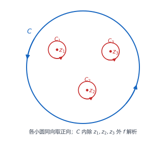
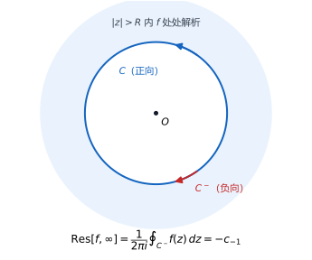
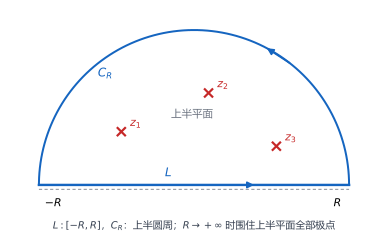

# 05 留数

## 学习目标

- 判断孤立奇点是可去奇点、极点还是本性奇点，并确定极点的阶。
- 由分母零点的阶数读出极点的阶。
- 判断无穷远点是否为孤立奇点，并说明它属于哪一类。
- 计算有限孤立奇点与无穷远点处的留数。
- 用留数定理计算闭路积分，以及形如 $\int_0^{2\pi}$、$\int_{-\infty}^{+\infty}$ 的三类实积分。

## 目录

1. 第一节 孤立奇点
2. 第二节 留数
3. 第三节 留数在定积分中的应用

## 第一节 孤立奇点

### 1. 奇点与孤立奇点

若 $f(z)$ 在 $z_0$ 处不解析，就称 $z_0$ 是 $f(z)$ 的**奇点**。若 $f$ 在 $z_0$ 的某个去心邻域 $0<|z-z_0|<\delta$ 内处处解析，则称 $z_0$ 为**孤立奇点**：$z_0$ 本身允许不解析甚至没有定义，例如 $\frac{\sin z}{z}$ 在 $z=0$ 处。

#### 例 1：$\dfrac{1}{(z-i)(z+1)}$ 的孤立奇点

**题目**：说明 $f(z)=\dfrac{1}{(z-i)(z+1)}$ 的奇点及其孤立性。

**解**：$f$ 在 $z=i$ 与 $z=-1$ 处不解析。取 $\delta<|i-(-1)|$，则 $0<|z-i|<\delta$ 内既不含 $i$ 也不含 $-1$，$f$ 处处解析，故 $i$ 是孤立奇点；对 $-1$ 同理。

#### 例 2：一个非孤立奇点

**题目**：说明 $f(z)=\dfrac{1}{\sin\frac1z}$ 在 $z=0$ 处的奇点类型。

**解**：使分母为零或无定义的点都是奇点：$z=0$ 处 $\frac1z$ 无定义，另一族由 $\frac1z=n\pi$ 给出，即 $z=\dfrac{1}{n\pi}\ (n=\pm1,\pm2,\cdots)$。当 $n\to\infty$ 时 $\frac{1}{n\pi}\to0$，这些奇点向 $0$ 堆积，于是 $0$ 的去心邻域无论取多小都夹着别的奇点，$f$ 不可能在其中处处解析，故 $z=0$ 是奇点但**不是**孤立奇点。其余各 $\frac{1}{n\pi}$ 都孤立。

### 2. 孤立奇点与洛朗级数

若 $f$ 在 $R_1<|z-z_0|<R_2$ 内解析，则可在其中展开为洛朗级数。孤立奇点正是内半径 $R_1=0$ 的情形：$f$ 在 $z_0$ 的某个去心邻域内可展开为

$$
f(z)=\sum_{n=-\infty}^{+\infty}c_n(z-z_0)^n,\qquad 0<|z-z_0|<\delta .
$$

按幂次分成两段：

$$
\underbrace{\sum_{n=1}^{\infty}c_{-n}(z-z_0)^{-n}}_{\text{主要部分}}
+\underbrace{\sum_{n=0}^{\infty}c_n(z-z_0)^{n}}_{\text{解析部分}} .
$$

解析部分是普通幂级数，在 $|z-z_0|<\delta$ 内解析；决定奇性态的是主要部分，也就是负幂项的个数：

| 主要部分的情形 | 奇点类型 |
| --- | --- |
| 一项负幂项也没有 | 可去奇点 |
| 只有有限多个负幂项 | 极点 |
| 有无限多个负幂项 | 本性奇点 |

同一圆环内的洛朗展开唯一，三类互斥。解析部分在 $z_0$ 处也解析，奇性只来自 $(z-z_0)^{-n}$，$n$ 越大发散越快，极点的阶 $m$ 正是对"发散有多快"的记录。

### 3. 可去奇点

若 $f$ 在 $z_0$ 处的洛朗展开不含负幂项，即 $c_{-1}=c_{-2}=\cdots=0$，则称 $z_0$ 为 $f(z)$ 的**可去奇点**。此时 $f(z)=c_0+c_1(z-z_0)+\cdots$，令 $z\to z_0$，含 $(z-z_0)^n\ (n\ge1)$ 的项全趋于零，故 $\lim\limits_{z\to z_0}f(z)=c_0$，极限存在且有限。

反过来，设 $\lim\limits_{z\to z_0}f(z)=A$ 为有限数，取 $r<\delta$ 使 $0<|z-z_0|\le r$ 时 $|f(z)|\le M$。对 $k\ge1$，洛朗系数由圆周 $|\zeta-z_0|=r$ 上的积分表示为 $c_{-k}=\dfrac{1}{2\pi i}\oint f(\zeta)(\zeta-z_0)^{k-1}\,d\zeta$；被积函数的模不超过 $Mr^{k-1}$，弧长为 $2\pi r$，故 $|c_{-k}|\le Mr^{k}$，令 $r\to0^+$ 得每个 $c_{-k}=0$。因此

$$
z_0\ \text{是}\ f\ \text{的可去奇点}
\iff
\lim_{z\to z_0}f(z)\ \text{存在且有限}.
$$

同一估计还说明：$z_0$ 是可去奇点当且仅当 $f$ 在 $z_0$ 的某个去心邻域内有界。补上 $f(z_0)=c_0$ 后 $f$ 在 $z_0$ 处解析，奇点被补掉，故称可去。

#### 例 3：$\dfrac{\sin z}{z}$ 在 $z=0$

**题目**：判断 $f(z)=\dfrac{\sin z}{z}$ 在 $z=0$ 处的奇点类型。

**解**：由 $\sin z=z-\dfrac{z^3}{3!}+\dfrac{z^5}{5!}-\cdots$，

$$
\frac{\sin z}{z}=1-\frac{z^2}{3!}+\frac{z^4}{5!}-\cdots,\qquad 0<|z|<+\infty .
$$

没有负幂项，故 $z=0$ 是可去奇点，$\lim\limits_{z\to0}\frac{\sin z}{z}=1$；补上 $f(0)=1$ 后 $f$ 在 $0$ 处解析。

### 4. 极点

若 $f$ 在 $z_0$ 处的洛朗展开只有有限个负幂项，最低次幂为 $(z-z_0)^{-m}$（$m\ge1$，$c_{-m}\ne0$），则称 $z_0$ 为 $f(z)$ 的 **$m$ 阶极点**，$m=1$ 时称为**简单极点**：

$$
f(z)=\frac{c_{-m}}{(z-z_0)^{m}}+\cdots+\frac{c_{-1}}{z-z_0}+c_0+c_1(z-z_0)+\cdots,\qquad c_{-m}\ne0 .
$$

通分后 $f(z)=\dfrac{c_{-m}+c_{-m+1}(z-z_0)+\cdots}{(z-z_0)^m}$，分母趋于零、分子趋于 $c_{-m}\ne0$，故 $f(z)\to\infty$。

**极点结构**：$z_0$ 是 $f$ 的 $m$ 阶极点，当且仅当在 $z_0$ 的某邻域内

$$
f(z)=\frac{G(z)}{(z-z_0)^m},\qquad G(z_0)\ne0,
$$

其中 $G$ 解析。把 $G$ 在 $z_0$ 处展开即可验证：若 $z_0$ 是 $m$ 阶极点，提出 $(z-z_0)^{-m}$ 后 $G(z)=c_{-m}+c_{-m+1}(z-z_0)+\cdots$，故 $G(z_0)=c_{-m}\ne0$；反之把 $G$ 的泰勒展开代回，最低次幂就是 $-m$。

反过来，若 $z\to z_0$ 时 $|f(z)|\to+\infty$，令 $g(z)=\dfrac{1}{f(z)}$，则 $g$ 在去心邻域内解析且 $|g(z)|\to0$，因而有界。由可去奇点的有界判别，补上 $g(z_0)=0$ 后 $g$ 在 $z_0$ 处解析；$g$ 不恒为零，设 $z_0$ 是 $g$ 的 $m$ 阶零点，即 $g(z)=(z-z_0)^m\psi(z)$，$\psi(z_0)\ne0$，于是

$$
f(z)=\frac{1}{(z-z_0)^m\psi(z)}=\frac{G(z)}{(z-z_0)^m},\qquad G=\frac1\psi,\quad G(z_0)\ne0 ,
$$

由结构式即得 $z_0$ 是 $f$ 的 $m$ 阶极点。因此

$$
z_0\ \text{是}\ f\ \text{的极点}
\iff
\lim_{z\to z_0}f(z)=\infty .
$$

极限判别只能判断"是极点"，阶数仍要由结构式或零点阶数读出。

#### 例 4：$\dfrac{z-2}{(z-1)^3(z^2+1)}$ 的极点阶数

**题目**：求 $f(z)=\dfrac{z-2}{(z-1)^3(z^2+1)}$ 的全部奇点，并确定阶数。

**解**：奇点为 $z=1$ 与 $z=\pm i$，都孤立。对 $z=1$，取 $G(z)=\dfrac{z-2}{z^2+1}$，则 $f=\dfrac{G(z)}{(z-1)^3}$ 且 $G(1)=-\dfrac12\ne0$，故 $z=1$ 是**三阶极点**。对 $z=i$，由 $z^2+1=(z-i)(z+i)$，取 $G_1(z)=\dfrac{z-2}{(z-1)^3(z+i)}$，则 $f=\dfrac{G_1(z)}{z-i}$ 且 $G_1(i)\ne0$，故 $z=i$ 是**简单极点**；同理 $z=-i$ 也是简单极点。

#### 例 5：$\dfrac{\sin z}{z^2}$ 在 $z=0$

**题目**：判断 $f(z)=\dfrac{\sin z}{z^2}$ 在 $z=0$ 处的奇点类型。

**解**：若写成 $f=\dfrac{G(z)}{z^2}$、$G(z)=\sin z$，看到分母是 $z^2$ 就断言二阶极点是**错的**，因为 $G(0)=0$。正确做法是展开：

$$
\frac{\sin z}{z^2}=\frac{1}{z}\Big(1-\frac{z^2}{3!}+\frac{z^4}{5!}-\cdots\Big)=\frac1z-\frac{z}{3!}+\frac{z^3}{5!}-\cdots .
$$

只有一个负幂项，最低次为 $-1$，故 $z=0$ 是**简单极点**。

### 5. 本性奇点

若 $f$ 在 $z_0$ 处的洛朗展开有无限多个负幂项，则称 $z_0$ 为 $f(z)$ 的**本性奇点**。三类奇点按负幂项零个、有限个、无限个划分；前两类有极限刻画，第三类对应极限既不存在、也不为无穷大：

$$
z_0\ \text{是}\ f\ \text{的本性奇点}
\iff
\lim_{z\to z_0}f(z)\ \text{不存在，且不是无穷大}.
$$

若极限存在且有限，所有负幂系数为零，是可去奇点；若极限为 $\infty$，则 $f$ 必为极点；两种情形都排除后只剩本性奇点。

#### 例 6：$e^{1/z}$ 在 $z=0$

**题目**：判断 $f(z)=e^{1/z}$ 在 $z=0$ 处的奇点类型。

**解**：令 $t=\dfrac1z$，由 $e^t=\sum\limits_{n=0}^{\infty}\dfrac{t^n}{n!}$，

$$
e^{1/z}=1+\frac1z+\frac{1}{2!\,z^2}+\frac{1}{3!\,z^3}+\cdots,\qquad 0<|z|<+\infty .
$$

负幂项无限多，故 $z=0$ 是本性奇点。再看极限：沿正实轴 $z\to0^+$ 时 $e^{1/z}\to+\infty$，沿负实轴 $z\to0^-$ 时 $e^{1/z}\to0$，两者不同，故极限不存在也不是无穷大。

### 6. 三类孤立奇点对照

| 类型 | 主要部分（负幂项） | $\lim\limits_{z\to z_0}f(z)$ | 常用判别 |
| --- | --- | --- | --- |
| 可去奇点 | 没有负幂项 | 存在且有限（$=c_0$） | 算极限，或展开看有无负幂项 |
| $m$ 阶极点 | 有限项，最低次为 $-m$ | $\infty$ | 写成 $\dfrac{G(z)}{(z-z_0)^m}$，$G(z_0)\ne0$ |
| 本性奇点 | 无限多项 | 不存在且非 $\infty$ | 展开，看负幂项是否无限多 |

### 7. 零点与极点的关系

若在 $z_0$ 的某邻域内 $f(z)=(z-z_0)^m\varphi(z)$，其中 $\varphi$ 在 $z_0$ 处解析、$\varphi(z_0)\ne0$，$m$ 为正整数，则称 $z_0$ 为 $f(z)$ 的 **$m$ 阶零点**。
**导数判别**：设 $f$ 在 $z_0$ 处解析，则 $z_0$ 是 $f$ 的 $m$ 阶零点，当且仅当

$$
f(z_0)=f'(z_0)=\cdots=f^{(m-1)}(z_0)=0,\qquad f^{(m)}(z_0)\ne0 .
$$

把 $f$ 在 $z_0$ 处展开为 $f(z)=\sum a_n(z-z_0)^n$，$a_n=\dfrac{f^{(n)}(z_0)}{n!}$。设 $a_m$ 是第一个非零系数，则

$$
f(z)=(z-z_0)^m\Big(a_m+a_{m+1}(z-z_0)+\cdots\Big)=(z-z_0)^m\varphi(z),
$$

#### 例 7：零点阶数的两种读法

**题目**：求 (1) $f(z)=z(z-1)^3$ 的各零点阶数；(2) $f(z)=z^3-1$ 在 $z=1$ 处的零点阶数。

**解**：(1) 对 $z=1$，$f=(z-1)^3\cdot z$，取 $\varphi(z)=z$，$\varphi(1)=1\ne0$，故 $z=1$ 是**三阶零点**；对 $z=0$，$f=(z-0)^1\cdot(z-1)^3$，$\varphi(0)=-1\ne0$，故 $z=0$ 是**一阶零点**。

(2) $f(1)=0$，$f'(z)=3z^2$，$f'(1)=3\ne0$，故 $z=1$ 是一阶零点。也可由 $z^3-1=(z-1)(z^2+z+1)$ 且 $1+1+1=3\ne0$ 得到同一结论。

#### 例 8：$e^{z^2}-1$ 在 $z=0$

**题目**：求 $f(z)=e^{z^2}-1$ 在 $z=0$ 处的零点阶数。

**解**：

$$
e^{z^2}-1=z^2+\frac{z^4}{2!}+\frac{z^6}{3!}+\cdots=z^2\Big(1+\frac{z^2}{2!}+\frac{z^4}{3!}+\cdots\Big).
$$

括号内的幂级数在 $z=0$ 处取值 $1\ne0$，故 $z=0$ 是**二阶零点**。

零点孤立：不恒为零的解析函数，其 $m$ 阶零点 $z_0$ 附近有 $\varphi(z)\ne0$，故该去心邻域内 $f(z)\ne0$；恒等于零的解析函数没有孤立零点，所以"不恒为零"这一前提不能丢。

**极点与倒数的零点**：$z_0$ 是 $f$ 的 $m$ 阶极点，当且仅当 $z_0$ 是 $\dfrac1f$ 的 $m$ 阶零点。由 $f=\dfrac{G(z)}{(z-z_0)^m}$、$G(z_0)\ne0$ 得

$$
\frac{1}{f(z)}=(z-z_0)^m\cdot\frac{1}{G(z)} ,
$$

$G(z_0)\ne0$ 且 $G$ 连续，故 $\dfrac1G$ 在 $z_0$ 的某邻域内解析且不为零，按零点定义即得；反向推导对称。这里默认 $f$ 在去心邻域内不为零——对不恒为零的解析函数，零点孤立，取足够小的去心邻域即可。

**有理函数判阶**：设 $f(z)=\dfrac{P(z)}{Q(z)}$，$P,Q$ 在 $z_0$ 处解析，$P(z_0)\ne0$，而 $z_0$ 是 $Q$ 的 $m$ 阶零点，则 $z_0$ 是 $f$ 的 $m$ 阶极点。事实上 $Q(z)=(z-z_0)^m\psi(z)$，$\psi(z_0)\ne0$，于是

$$
f(z)=\frac{P(z)}{(z-z_0)^m\psi(z)}=\frac{G(z)}{(z-z_0)^m},\qquad G(z)=\frac{P(z)}{\psi(z)},
$$

$G$ 在 $z_0$ 解析且 $G(z_0)=\dfrac{P(z_0)}{\psi(z_0)}\ne0$。$P(z_0)\ne0$ 是关键，它保证分子没有跟着分母一起消失；若分子分母同时为零，必须先约去公因子再数幂次，例如

$$
f(z)=\frac{z^2-1}{(z-1)^2}=\frac{z+1}{z-1},
$$

分母看着是二次，约分后 $z=1$ 实际是**一阶**极点。约分要在 $z_0$ 的去心邻域内用恒等式完成，不能只在 $z_0$ 这一点上比数值。

#### 例 9：$\dfrac{1}{\sin z}$ 的全部孤立奇点

**题目**：求 $f(z)=\dfrac{1}{\sin z}$ 的全部孤立奇点，并确定类型。

**解**：分母 $\sin z$ 的零点为 $z=k\pi\ (k=0,\pm1,\pm2,\cdots)$，相邻相距 $\pi$，都孤立。对固定的 $k$，

$$
(\sin z)'\big|_{z=k\pi}=\cos k\pi=(-1)^k\ne0,
$$

故 $k\pi$ 是 $\sin z$ 的一阶零点；分子 $1\ne0$，故每个 $k\pi$ 都是 $f$ 的**简单极点**。

#### 例 10：$\dfrac{1}{z^3(e^{z^3}-1)}$ 在 $z=0$

**题目**：求 $f(z)=\dfrac{1}{z^3(e^{z^3}-1)}$ 在 $z=0$ 处的奇点类型。

**解**：令 $Q(z)=z^3(e^{z^3}-1)$，则 $f=\dfrac1Q$，只需数 $Q$ 的零点阶。由

$$
e^{z^3}-1=z^3+\frac{z^6}{2!}+\cdots=z^3\Big(1+\frac{z^3}{2!}+\cdots\Big),
$$

得 $Q(z)=z^6\varphi(z)$，$\varphi(0)=1\ne0$，即 $Q$ 在 $0$ 处是六阶零点；分子恒为 $1$，故 $z=0$ 是 $f$ 的**六阶极点**。只看分母里的 $z^3$ 会漏掉 $e^{z^3}-1$ 自带的三阶零点。

### 8. 函数在无穷远处的性态

有限点用 $|z-z_0|<\delta$ 刻画邻域；无穷远点对应 $|z|>R$，即圆外区域，它不含 $z=\infty$ 本身，正是无穷远点的**去心邻域**。若 $f(z)$ 在某个区域 $|z|>R$ 内处处解析，则称无穷远点为 $f(z)$ **无穷型**孤立奇点——这里不要求 $f$ 在 $\infty$ 处不解析，只看圆外是否处处解析；前面讨论的奇点叫**有限型孤立奇点**。

若 $f$ 的有限奇点只有有限多个，取 $R$ 大于它们的模，则 $\infty$ 孤立。有限奇点有无穷多时要看它们是否有界：若它们趋于 $\infty$（如例 13 的 $k\pi$），任何 $|z|>R$ 都躲不开，$\infty$ 不孤立；若它们在某个有限点处堆积（如例 2 的 $1/(n\pi)$ 堆积于 $0$），堆积点本身不是孤立奇点，而 $\infty$ 仍可能孤立。

$\infty$ 是孤立奇点时，$f$ 在 $|z|>R$ 内有洛朗展开 $f(z)=\sum_{n=-\infty}^{+\infty}c_nz^n$。分类看**正幂项**的个数，与有限点正好相反：

| 正幂项的情形 | $\infty$ 的类型 |
| --- | --- |
| 一项也没有（$c_n=0,\ n\ge1$） | 可去奇点 |
| 有限多个，最高次为 $z^m$ | $m$ 阶极点 |
| 无限多个 | 本性奇点 |

阶数取最高正幂次，不是非零系数的个数：$c_1=0,\ c_2\ne0$ 时仍是二阶极点。分类相反的原因是把无穷远点搬到原点：令 $t=\dfrac1z$，则 $z=\infty$ 对应 $t=0$，且

$$
\varphi(t)=f\Big(\dfrac1t\Big)=\sum c_nt^{-n},
$$

$f$ 在 $\infty$ 处的正幂项 $c_n\ (n\ge1)$ 正是 $\varphi$ 在 $0$ 处的负幂项，故两处的奇点类型与阶数都相同。极限判别也一致：$\infty$ 为可去奇点当且仅当极限为有限数 $c_0$，为极点当且仅当极限为 $\infty$，为本性奇点当且仅当极限不存在且不为 $\infty$。

#### 例 11：$\dfrac{1}{z-2}$ 的有限奇点与无穷远点

**题目**：求 $f(z)=\dfrac{1}{z-2}$ 的全部孤立奇点，并判断 $\infty$ 的类型。

**解**：有限奇点只有 $z=2$，是一阶极点；取 $R>2$，$f$ 在 $|z|>R$ 内处处解析，故扩充复平面上共有 $2$ 与 $\infty$ 两个孤立奇点。又 $\lim\limits_{z\to\infty}\dfrac{1}{z-2}=0$，极限存在且有限，故 $\infty$ 是**可去奇点**；在 $|z|>2$ 内 $\dfrac{1}{z-2}=\dfrac1z+\dfrac{2}{z^2}+\cdots$ 没有正幂项，两种判别一致。

#### 例 12：多项式与 $e^z$ 的 $\infty$

**题目**：判断 $f(z)=z^3+z^2+1$ 与 $g(z)=e^z$ 在 $\infty$ 处的类型。

**解**：两函数都是整函数，对任意 $R$ 在 $|z|>R$ 内解析，故 $\infty$ 都是孤立奇点。$f$ 的展开式就是它本身，最高正幂次为 $3$，故 $\infty$ 是**三阶极点**；$e^z=1+z+\dfrac{z^2}{2!}+\cdots$ 正幂项无限多，故 $\infty$ 是**本性奇点**。

#### 例 13：$\dfrac{1}{\sin z}$ 的 $\infty$

**题目**：判断 $f(z)=\dfrac{1}{\sin z}$ 在 $\infty$ 处是否为孤立奇点。

**解**：有限奇点是 $k\pi$，随 $|k|\to\infty$ 无限逼近 $\infty$，无论 $R$ 取多大，$|z|>R$ 内总有 $k\pi$，$f$ 在其中不可能处处解析，故 $\infty$ **不是**孤立奇点，也就无从分类。

## 第二节 留数

### 1. 留数的定义

设 $z_0$ 是 $f(z)$ 的有限孤立奇点，$f$ 在 $0<|z-z_0|<\delta$ 内的洛朗展开为 $f(z)=\sum_{n=-\infty}^{+\infty}c_n(z-z_0)^n$，则称 $c_{-1}$ 为 $f(z)$ 在 $z_0$ 处的**留数**，记作

$$
\operatorname{Res}\big[f,z_0\big]\quad\text{或}\quad\operatorname{Res}_{z=z_0}f(z).
$$

一次负幂项被单独命名，是因为它与闭路积分直接相关。洛朗系数的一般公式为

$$
c_n=\frac{1}{2\pi i}\oint_C\frac{f(\zeta)}{(\zeta-z_0)^{n+1}}\,d\zeta ,
$$

其中 $C$ 是去心邻域内绕 $z_0$ 一周的正向简单闭曲线。取 $n=-1$，分母幂次变为零，得

$$
c_{-1}=\frac{1}{2\pi i}\oint_C f(\zeta)\,d\zeta ,
\qquad\text{即}\qquad
\oint_C f(z)\,dz=2\pi i\operatorname{Res}\big[f,z_0\big].
$$

正向（逆时针）不能省：逐项积分用到的 $\oint_C(\zeta-z_0)^k\,d\zeta=2\pi i\delta_{k,-1}$ 依赖绕行方向，顺时针会整体差一个符号；$C$ 只要在去心邻域内绕 $z_0$ 一周即可，不必是圆。定义只针对**有限**孤立奇点。

#### 例 14：$ze^{1/z}$ 与 $z^2\cos\dfrac1z$ 在 $z=0$

**题目**：求下列函数在 $z=0$ 处的留数，并判断奇点类型：(1) $ze^{1/z}$；(2) $z^2\cos\dfrac1z$。

**解**：(1) 由 $e^{1/z}=1+\dfrac1z+\dfrac{1}{2!\,z^2}+\cdots$，$ze^{1/z}=z+1+\dfrac{1}{2!\,z}+\dfrac{1}{3!\,z^2}+\cdots$，$z^{-1}$ 的系数是 $\dfrac12$，故 $\operatorname{Res}[f,0]=\dfrac12$，且 $z=0$ 是本性奇点。

(2) 由 $\cos\dfrac1z=1-\dfrac{1}{2!\,z^2}+\dfrac{1}{4!\,z^4}-\cdots$，

$$
z^2\cos\frac1z=z^2-\frac12+\frac{1}{24\,z^2}-\cdots ,
$$

没有 $z^{-1}$ 项，故 $\operatorname{Res}[f,0]=0$，但负幂项无限多，$z=0$ 仍是**本性奇点**。留数为零不能反推奇点类型：可去奇点必留数为零，反之不成立，例如 $\dfrac{1}{z^2}$ 留数为零却是二阶极点。

### 2. 留数定理

**留数定理**：设 $C$ 是一条取正向的简单闭曲线，$f(z)$ 在 $C$ 内部除有限个孤立奇点 $z_1,z_2,\cdots,z_n$ 外处处解析，在 $C$ 上处处解析，则

$$
\oint_C f(z)\,dz=2\pi i\sum_{k=1}^{n}\operatorname{Res}\big[f,z_k\big].
$$

**证明**：在每个 $z_k$ 周围作互不相交的小圆 $C_k$，使 $C_k$ 及其内部都落在 $C$ 的内部且只含奇点 $z_k$，挖去这 $n$ 个闭圆盘得到有界多连通区域 $D$。按"区域在行进方向左侧"定边界正向：外边界 $C$ 逆时针、内边界 $C_k$ 顺时针，则 $f$ 在 $D$ 内解析、在边界上连续，由复合闭路定理 $\oint_C f\,dz=\sum_{k=1}^{n}\oint_{C_k^+}f\,dz$，其中 $C_k^+$ 是与 $C$ 同向的逆时针圆周。在 $0<|z-z_k|<r_k$ 内把 $f$ 展开为 $\sum c_m^{(k)}(z-z_k)^m$，该级数在闭圆环 $\dfrac{r_k}{2}\le|z-z_k|\le r_k$ 上一致收敛，可以逐项积分。令 $z=z_k+r_ke^{i\theta}$，则

$$
\oint_{C_k^+}(z-z_k)^m\,dz
=ir_k^{m+1}\int_0^{2\pi}e^{i(m+1)\theta}\,d\theta
=\begin{cases}2\pi i, & m=-1,\\ 0, & m\ne-1,\end{cases}
$$

于是级数中只有 $m=-1$ 的项留下，$\oint_{C_k^+}f\,dz=2\pi i\operatorname{Res}\big[f,z_k\big]$，对 $n$ 个小圆求和即得定理。

### 3. 用留数算闭路积分

#### 例 15：$\displaystyle\oint_{|z|=3}\frac{dz}{z(z+1)(z+4)}$

**题目**：计算积分 $\displaystyle\oint_{|z|=3}\frac{dz}{z(z+1)(z+4)}$。

**解**：$|z|=3$ 内有奇点 $z=0$ 与 $z=-1$（$z=-4$ 在圆外），二者都是简单极点。用公式一：

$$
\operatorname{Res}\big[f,0\big]=\lim_{z\to0}\frac{1}{(z+1)(z+4)}=\frac14,
\qquad
\operatorname{Res}\big[f,-1\big]=\lim_{z\to-1}\frac{1}{z(z+4)}=-\frac13 ,
$$

于是

$$
\oint_{|z|=3}\frac{dz}{z(z+1)(z+4)}
=2\pi i\Big(\frac14-\frac13\Big)
=-\frac{\pi i}{6}.
$$

### 4. 极点处留数的计算

对极点不必每次写整个洛朗展开，可由 $c_{-1}$ 直接得到三条公式。

**公式一（简单极点）**：若 $z_0$ 是 $f$ 的简单极点，则

$$
\operatorname{Res}\big[f,z_0\big]=\lim_{z\to z_0}(z-z_0)f(z).
$$

因为 $f=\dfrac{c_{-1}}{z-z_0}+c_0+c_1(z-z_0)+\cdots$，两边乘 $z-z_0$ 后令 $z\to z_0$ 只剩 $c_{-1}$。

**公式二（$\dfrac PQ$ 型）**：设 $f(z)=\dfrac{P(z)}{Q(z)}$，$P,Q$ 在 $z_0$ 处解析，$P(z_0)\ne0$，$z_0$ 是 $Q$ 的一阶零点（$Q(z_0)=0,\ Q'(z_0)\ne0$），则 $z_0$ 是 $f$ 的简单极点，且

$$
\operatorname{Res}\big[f,z_0\big]=\frac{P(z_0)}{Q'(z_0)} .
$$

由 $Q(z)=Q'(z_0)(z-z_0)\big(1+O(z-z_0)\big)$，

$$
f(z)=\frac{P(z_0)+O(z-z_0)}{Q'(z_0)(z-z_0)\big(1+O(z-z_0)\big)}
=\frac{P(z_0)}{Q'(z_0)}\cdot\frac{1+O(z-z_0)}{z-z_0},
$$

一次负幂项的系数即 $\dfrac{P(z_0)}{Q'(z_0)}$。若 $Q'(z_0)=0$，$z_0$ 是 $Q$ 的二阶或更高阶零点，公式作废；若 $P(z_0)=0$，应先约公因子。

**公式三（$m$ 阶极点）**：若 $z_0$ 是 $f$ 的 $m$ 阶极点，则

$$
\operatorname{Res}\big[f,z_0\big]=\frac{1}{(m-1)!}\lim_{z\to z_0}\frac{d^{\,m-1}}{dz^{\,m-1}}\Big[(z-z_0)^m f(z)\Big].
$$

记 $g(z)=(z-z_0)^mf(z)$，它在 $z_0$ 处解析，展开中 $(z-z_0)^{m-1}$ 的系数为 $c_{-1}$；求 $m-1$ 阶导并令 $z\to z_0$，得 $g^{(m-1)}(z_0)=(m-1)!\,c_{-1}$。$m=1$ 时退化为公式一。使用时先乘 $(z-z_0)^m$ 约掉极点，再求导，最后取极限，系数 $\dfrac{1}{(m-1)!}$ 不能漏。

#### 例 16：简单极点的留数

**题目**：求 $f(z)=\dfrac{z}{\cos z}$ 在 $z=\dfrac{\pi}{2}$ 处的留数。

**解**：取 $P(z)=z$，$Q(z)=\cos z$。$P\left(\dfrac\pi2\right)=\dfrac\pi2\ne0$，$Q\left(\dfrac\pi2\right)=0$，$Q'\left(\dfrac\pi2\right)=-\sin\dfrac\pi2=-1\ne0$，故 $\dfrac\pi2$ 是简单极点，由公式二

$$
\operatorname{Res}\Big[f,\frac\pi2\Big]
=\frac{P\left(\frac\pi2\right)}{Q'\left(\frac\pi2\right)}
=-\frac{\pi}{2}.
$$

#### 例 17：两个 $|z|=2$ 围道积分

**题目**：计算 (1) $\displaystyle\oint_{|z|=2}\frac{5z-2}{z(z-1)^2}\,dz$；(2) $\displaystyle\oint_{|z|=2}\frac{\sin^2z}{z^2(z-1)}\,dz$。

**解**：(1) $|z|=2$ 内有 $z=0$（分子 $-2\ne0$，简单极点）与 $z=1$（分子 $3\ne0$，二阶极点）。$z=0$ 用公式一，$z=1$ 用公式三：

$$
\begin{aligned}
\operatorname{Res}\big[f,0\big]&=\lim_{z\to0}\frac{5z-2}{(z-1)^2}=-2,\\
\operatorname{Res}\big[f,1\big]&=\lim_{z\to1}\frac{d}{dz}\Big(\frac{5z-2}{z}\Big)=\lim_{z\to1}\frac{2}{z^2}=2 .
\end{aligned}
$$

故 $\displaystyle\oint_{|z|=2}f\,dz=2\pi i\big[(-2)+2\big]=0$。积分为零不代表被积函数解析，这里只是两奇点的留数相互抵消。

(2) $z=0$ 处

$$
\lim_{z\to0}\frac{\sin^2z}{z^2(z-1)}=1\cdot(-1)=-1,
$$

极限有限，故 $z=0$ 是**可去奇点**，留数为零；$z=1$ 是简单极点（分子 $\sin^21\ne0$），

$$
\operatorname{Res}\big[f,1\big]=\lim_{z\to1}\frac{\sin^2z}{z^2}=\sin^21 ,
\qquad
\oint_{|z|=2}f\,dz=2\pi i\sin^21 .
$$

### 5. 无穷远点处的留数

$\infty$ 不能照搬有限点的定义，要从积分给出。设 $\infty$ 是 $f(z)$ 的孤立奇点，即 $f$ 在某个 $|z|>R$ 内处处解析。取 $\rho>R$，$C^-$ 表示圆周 $|z|=\rho$ 取**顺时针**方向，定义

$$
\operatorname{Res}\big[f,\infty\big]=\frac{1}{2\pi i}\oint_{C^-}f(z)\,dz .
$$

定正向的规矩仍是"区域留在行进方向的左侧"：对圆盘 $|z|<\rho$ 逆时针走时圆盘在左，对圆外区域 $|z|>\rho$ 则须顺时针走，所以 $C^-$ 就是绕 $\infty$ 的正向，与有限点处绕 $z_0$ 的逆时针是同一套约定。

由 $f(z)=\sum c_nz^n$ 和 $\oint_{|z|=\rho}z^n\,dz=2\pi i$（$n=-1$）或 $0$（$n\ne-1$），得

$$
\oint_{C^-}f\,dz=-\oint_{|z|=\rho}f\,dz=-2\pi i\,c_{-1},
\qquad\text{从而}\qquad
\boxed{\operatorname{Res}\big[f,\infty\big]=-c_{-1}} .
$$

这里 $c_{-1}$ 是 $f$ 在圆外区域 $|z|>R$ 的洛朗展开中 $z^{-1}$ 的系数；负号来自 $C^-$ 与 $|z|=\rho$ 方向相反。

#### 例 18：$\dfrac1z$ 在 $\infty$ 处的留数

**题目**：求 $f(z)=\dfrac1z$ 与 $g(z)=\dfrac{1}{z^2}$ 在 $\infty$ 处的留数。

**解**：$f$ 在 $|z|>0$ 内解析，$\lim\limits_{z\to\infty}\dfrac1z=0$，故 $\infty$ 是可去奇点；展开就是 $\dfrac1z$，$c_{-1}=1$，故 $\operatorname{Res}\left[\dfrac1z,\infty\right]=-1\ne0$。对 $g(z)=\dfrac{1}{z^2}$，$c_{-1}=0$，故 $\operatorname{Res}\left[\dfrac{1}{z^2},\infty\right]=0$。有限点处可去奇点的留数必为零，$\infty$ 处可去奇点的留数却可以不为零，类型不能决定留数。

### 6. 全平面留数之和为零

**定理**：若 $f(z)$ 在扩充复平面内只有有限个孤立奇点 $z_1,z_2,\cdots,z_n$ 以及 $\infty$，则

$$
\sum_{k=1}^{n}\operatorname{Res}\big[f,z_k\big]+\operatorname{Res}\big[f,\infty\big]=0 .
$$

**证明**：$\infty$ 是孤立奇点，故存在 $R_0$ 使 $f$ 在 $|z|>R_0$ 内解析；有限奇点只有 $n$ 个，再取 $R>R_0$ 同时大于 $|z_1|,\cdots,|z_n|$。圆周 $|z|=R$ 上没有奇点而圆内恰有 $z_1,\cdots,z_n$，由留数定理、以及 $\infty$ 处留数的定义（$|z|=R$ 取顺时针），

$$
\begin{aligned}
\oint_{|z|=R}f(z)\,dz&=2\pi i\sum_{k=1}^{n}\operatorname{Res}\big[f,z_k\big],\\
\operatorname{Res}\big[f,\infty\big]&=-\frac{1}{2\pi i}\oint_{|z|=R}f\,dz=-\sum_{k=1}^{n}\operatorname{Res}\big[f,z_k\big],
\end{aligned}
$$

移项即得。有限奇点太多或阶数太高时可改算 $\infty$ 处留数，反之也可由有限和求 $\infty$。

### 7. 无穷远点留数的计算

**方法一（按定义展开）**：在 $|z|>R$ 内展开，读出 $z^{-1}$ 的系数 $c_{-1}$，结果取 $-c_{-1}$。

**方法二（用全平面留数之和）**：先算全部有限奇点的留数，

$$
\operatorname{Res}\big[f,\infty\big]=-\sum_{k=1}^{n}\operatorname{Res}\big[f,z_k\big].
$$

**方法三（公式）**：

$$
\operatorname{Res}\big[f,\infty\big]
=-\operatorname{Res}_{z=0}\Big[\frac{1}{z^2}f\Big(\frac1z\Big)\Big].
$$

来历：圆外展开 $f(\zeta)=\sum c_n\zeta^n$，令 $\zeta=\dfrac1z$ 并除以 $z^2$，得 $\dfrac{1}{z^2}f\Big(\dfrac1z\Big)=\sum c_nz^{-n-2}$；$n=-1$ 的项被平移到 $z^{-1}$，故原点留数读出 $c_{-1}$，再补负号即得 $\operatorname{Res}[f,\infty]$。

#### 例 19：$\dfrac{z-5}{2z+3}$ 在 $\infty$ 处的留数

**题目**：用两种方法求 $f(z)=\dfrac{z-5}{2z+3}$ 在 $\infty$ 处的留数。

**解**：方法一：$f$ 在 $|z|>\dfrac32$ 内解析，且 $\Big|\dfrac{3}{2z}\Big|<1$，

$$
f(z)=\frac{1-\dfrac5z}{2+\dfrac3z}
=\frac12\Big(1-\frac5z\Big)\Big(1-\frac{3}{2z}+\frac{9}{4z^2}-\cdots\Big)
=\frac12-\frac{13}{4}\cdot\frac1z+\cdots ,
$$

$z^{-1}$ 的系数为 $-\dfrac{13}{4}$，故 $\operatorname{Res}[f,\infty]=\dfrac{13}{4}$。

方法二：有限奇点只有 $z=-\dfrac32$，是简单极点，

$$
\operatorname{Res}\Big[f,-\frac32\Big]
=\lim_{z\to-3/2}\Big(z+\frac32\Big)\frac{z-5}{2z+3}
=\lim_{z\to-3/2}\frac{z-5}{2}
=-\frac{13}{4},
$$

故 $\operatorname{Res}[f,\infty]=\dfrac{13}{4}$。

#### 例 20：各有限奇点留数之和

**题目**：求 $f(z)=\dfrac{z^{10}}{(z^4+2)^2(z-2)^3}$ 在各有限孤立奇点处留数之和。

**解**：有限奇点是 $z=2$（三阶极点）以及 $z^4=-2$ 的四个根（$(z^4+2)'=4z^3$ 在根处不为零，故每个都是二阶极点）。逐个算要处理四次方根，改用全平面留数之和为零：

$$
\sum_{\text{有限奇点}}\operatorname{Res}\big[f,z_k\big]
=-\operatorname{Res}\big[f,\infty\big]
=\operatorname{Res}_{z=0}\Big[\frac{1}{z^2}f\Big(\frac1z\Big)\Big].
$$

分子分母同乘 $z^{11}$，得

$$
\begin{aligned}
f\Big(\frac1z\Big)
&=\frac{\frac{1}{z^{10}}}{\Big(\frac{1}{z^4}+2\Big)^2\Big(\frac1z-2\Big)^3}
=\frac{z}{\big(1+2z^4\big)^2\big(1-2z\big)^3},\\
\frac{1}{z^2}f\Big(\frac1z\Big)
&=\frac{1}{z\big(1+2z^4\big)^2\big(1-2z\big)^3}.
\end{aligned}
$$

$z=0$ 是简单极点，用公式一：

$$
\operatorname{Res}_{z=0}\Big[\frac{1}{z^2}f\Big(\frac1z\Big)\Big]
=\lim_{z\to0}\frac{1}{\big(1+2z^4\big)^2\big(1-2z\big)^3}=1 ,
$$

所求之和为 $1$。

#### 例 21：$\displaystyle\oint_{|z|=2}\frac{dz}{(z+i)^{10}(z-1)(z-3)}$

**题目**：计算 $\displaystyle\oint_{|z|=2}\frac{dz}{(z+i)^{10}(z-1)(z-3)}$。

**解**：$|z|=2$ 内有 $z=1$（简单极点）和 $z=-i$（十阶极点），$z=3$ 在圆外。直接算 $z=-i$ 的留数要用九阶导数，改用全平面留数之和：

$$
\operatorname{Res}\big[f,1\big]+\operatorname{Res}\big[f,-i\big]
=-\Big(\operatorname{Res}\big[f,3\big]+\operatorname{Res}\big[f,\infty\big]\Big).
$$

圆外的 $z=3$ 是简单极点，

$$
\operatorname{Res}\big[f,3\big]=\lim_{z\to3}(z-3)f(z)
=\frac{1}{(3+i)^{10}\cdot(3-1)}
=\frac{1}{2(3+i)^{10}} .
$$

再看 $\infty$ 处：分母的 $(1/z+i)^{10}$、$(1/z-1)$、$(1/z-3)$ 各提出 $z$ 后共 $z^{12}$，于是

$$
\frac{1}{z^2}f\Big(\frac1z\Big)=\frac{z^{10}}{(1+iz)^{10}(1-z)(1-3z)} ,
$$

右端在 $z=0$ 处解析且等于零，故 $\operatorname{Res}[f,\infty]=0$。代入得

$$
\operatorname{Res}\big[f,1\big]+\operatorname{Res}\big[f,-i\big]
=-\frac{1}{2(3+i)^{10}},
\qquad
\oint_{|z|=2}f\,dz
=-\frac{\pi i}{(3+i)^{10}} .
$$

## 第三节 留数在定积分中的应用

留数把实积分化为闭路积分分三步：选取 $f(z)$，使它在实轴或单位圆上的取值正好是被积函数；补辅助曲线，把这一段接成简单闭曲线；用留数定理算闭路积分，再令辅助曲线趋于无穷，使其上积分消失。辅助曲线上的积分用估计处理：模的上界乘曲线长度须趋于零。半圆 $C_R$ 长 $\pi R$，只按 $R^{-1}$ 衰减时 $\dfrac{M}{R}\cdot\pi R=\pi M$ 不趋于零，须按 $R^{-2}$ 或更快；第二类实积分因此要求分母高两次，第三类只要求高一次，因为 $e^{iaz}$ 在上半平面额外提供指数衰减。

### 1. 形如 $\displaystyle\int_0^{2\pi}R(\cos\theta,\sin\theta)\,d\theta$

设 $R(u,v)$ 是 $u,v$ 的有理函数，且换元后的分母在单位圆上不为零，否则分母的零点对应 $f(z)$ 在 $|z|=1$ 上的极点，闭路穿过极点，留数定理不适用。令 $z=e^{i\theta}$，$\theta$ 从 $0$ 增到 $2\pi$ 时 $z$ 沿单位圆逆时针走一整圈，正好是正向，又

$$
d\theta=\frac{dz}{iz},\quad
\cos\theta=\frac{z^2+1}{2z},\quad
\sin\theta=\frac{z^2-1}{2iz},
$$

后两式由 $\cos\theta=\dfrac{z+z^{-1}}2$、$\sin\theta=\dfrac{z-z^{-1}}{2i}$ 通分得到。代入原积分：

$$
\int_0^{2\pi}R(\cos\theta,\sin\theta)\,d\theta
=\oint_{|z|=1}R\Big(\frac{z^2+1}{2z},\ \frac{z^2-1}{2iz}\Big)\frac{dz}{iz}
=2\pi i\sum_{|z_k|<1}\operatorname{Res}\big[f,z_k\big],
$$

其中 $f(z)$ 是换元后的被积函数，$z_k$ 只取**单位圆内**的奇点。$d\theta=\dfrac{dz}{iz}$ 中的 $i$ 与 $z$ 都不能漏，$\sin\theta$ 的分母 $2iz$ 还多一个 $i$。

#### 例 22：$\displaystyle\int_0^{2\pi}\frac{d\theta}{2+\sin\theta}$

**题目**：计算 $\displaystyle\int_0^{2\pi}\frac{d\theta}{2+\sin\theta}$。

**解**：换元后

$$
\frac{1}{2+\sin\theta}\,d\theta
=\frac{1}{2+\frac{z^2-1}{2iz}}\cdot\frac{dz}{iz}
=\frac{2\,dz}{z^2+4iz-1}.
$$

分母零点为 $z=\dfrac{-4i\pm\sqrt{-16+4}}{2}=i\big(-2\pm\sqrt3\big)$。记 $z_1=i(-2+\sqrt3)$，$z_2=i(-2-\sqrt3)$，模分别为 $2-\sqrt3$ 与 $2+\sqrt3$，只有 $z_1$ 在单位圆内。$z_1$ 是简单极点，用公式一：

$$
\operatorname{Res}\big[f,z_1\big]
=\frac{2}{z_1-z_2}
=\frac{1}{\sqrt3\,i},
\qquad
\int_0^{2\pi}\frac{d\theta}{2+\sin\theta}
=2\pi i\cdot\frac{1}{\sqrt3\,i}
=\frac{2\pi}{\sqrt3}.
$$

**变体**：计算 $\displaystyle\int_0^{2\pi}\frac{dx}{\big(2+\sqrt3\cos x\big)^2}$。先化分母，平方时把 $\sqrt3$ 提出、系数一起平方：

$$
\big(2+\sqrt3\cos x\big)^2
=\Big(2+\sqrt3\cdot\frac{z^2+1}{2z}\Big)^2
=\frac{\big(\sqrt3z^2+4z+\sqrt3\big)^2}{4z^2}
=\frac{3\Big(z^2+\frac{4}{\sqrt3}z+1\Big)^2}{4z^2}.
$$

再乘 $dx=\dfrac{dz}{iz}$，把 $z^2$ 约掉一个：

$$
\oint_{|z|=1}\frac{4z^2}{3\Big(z^2+\frac{4}{\sqrt3}z+1\Big)^2}\cdot\frac{dz}{iz}
=\frac{4}{3i}\oint_{|z|=1}\frac{z\,dz}{\Big(z^2+\frac{4}{\sqrt3}z+1\Big)^2}.
$$

二次式 $z^2+\dfrac{4}{\sqrt3}z+1$ 的两根为 $-\dfrac{1}{\sqrt3}$ 与 $-\sqrt3$，只有 $z_1=-\dfrac{1}{\sqrt3}$ 在单位圆内；它带平方因子，且分子在 $z_1$ 处等于 $z_1\ne0$，故是**二阶**极点。记

$$
F(z)=\frac{z}{\Big(z+\frac{1}{\sqrt3}\Big)^2\big(z+\sqrt3\big)^2},\qquad
h(z)=\frac{z}{(z+\sqrt3)^2},
$$

则 $F(z)=\dfrac{h(z)}{\big(z+\frac{1}{\sqrt3}\big)^2}$，用公式三（$m=2$）需要 $h'(z)=\dfrac{(z+\sqrt3)^2-2z(z+\sqrt3)}{(z+\sqrt3)^4}=\dfrac{\sqrt3-z}{(z+\sqrt3)^3}$。在 $z_1=-\dfrac{1}{\sqrt3}$ 处分子为 $\sqrt3+\dfrac{1}{\sqrt3}=\dfrac{4}{\sqrt3}$，分母为 $\Big(\sqrt3-\dfrac{1}{\sqrt3}\Big)^3=\dfrac{8}{3\sqrt3}$，故 $\operatorname{Res}\big[F,z_1\big]=\dfrac{4/\sqrt3}{8/(3\sqrt3)}=\dfrac32$，于是

$$
\int_0^{2\pi}\frac{dx}{\big(2+\sqrt3\cos x\big)^2}
=\frac{4}{3i}\cdot2\pi i\cdot\frac32
=4\pi .
$$

### 2. 形如 $\displaystyle\int_{-\infty}^{+\infty}R(x)\,dx$

设 $R(x)=\dfrac{P(x)}{Q(x)}$ 是**真分式**，并满足：分母次数至少比分子高**两次**（$\deg Q\ge\deg P+2$），且 $Q(x)$ 在实轴上没有零点。前者保证积分收敛并使大圆弧上的积分消失，后者保证围道不穿过奇点。

取上半平面的半圆围道：实轴线段 $L:[-R,R]$，加上半圆周 $C_R:|z|=R,\ \operatorname{Im}z\ge0$，方向都取正向（$L$ 从左到右，$C_R$ 逆时针）。这里 $R$ 兼作半径与被积函数名，按上下文区分。

图中带叉处是上半平面内的极点。设它们为 $z_1,\cdots,z_n$，则

$$
\oint_{L\cup C_R}R(z)\,dz
=\int_{-R}^{R}R(x)\,dx+\int_{C_R}R(z)\,dz
=2\pi i\sum_{k=1}^{n}\operatorname{Res}\big[R,z_k\big].
$$

$L$ 上的积分就是实积分，只需看 $R\to+\infty$ 时 $\int_{C_R}R(z)\,dz$ 是否趋于零。由 $\deg Q\ge\deg P+2$，存在常数 $M$ 使 $|R(z)|\le\dfrac{M}{|z|^2}$（$|z|$ 充分大），于是

$$
\left|\int_{C_R}R(z)\,dz\right|
\le\frac{M}{R^2}\cdot\pi R
=\frac{\pi M}{R}\longrightarrow0\qquad(R\to+\infty),
$$

故

$$
\int_{-\infty}^{+\infty}R(x)\,dx
=2\pi i\sum_{\operatorname{Im}z_k>0}\operatorname{Res}\big[R(z),z_k\big].
$$

求和只取**上半平面**的极点。若改取下半平面，辅助半圆必须顺时针走才能与实轴段接成闭路，公式前面多一个负号，结果相同但容易丢符号。

若 $R$ 在实轴上有有限个一阶极点 $x_1,\cdots,x_m$，$\int_{-\infty}^{+\infty}R\,dx$ 按通常意义发散，只能取柯西主值：以 $x_j$ 为心、半径 $\varepsilon$ 作上半小圆弧 $\gamma_j$ 绕过每个极点。由 $R(z)=\dfrac{c_{-1}}{z-x_j}+h(z)$，$h$ 沿小弧的积分消失，而

$$
\lim_{\varepsilon\to0^+}\int_{\gamma_j}R(z)\,dz=-i\pi\operatorname{Res}\big[R,x_j\big],
$$

故

$$
\operatorname{PV}\int_{-\infty}^{+\infty}R(x)\,dx
=2\pi i\sum_{\operatorname{Im}z_k>0}\operatorname{Res}\big[R,z_k\big]
+i\pi\sum_{j=1}^{m}\operatorname{Res}\big[R,x_j\big].
$$

$2\pi i$ 配上半平面内点，$i\pi$ 配实轴上的边界点，后者相当于"半个留数"。

#### 例 23：两个有理函数实积分

**题目**：计算 (1) $\displaystyle\int_{-\infty}^{+\infty}\frac{x^2-x+2}{x^4+10x^2+9}\,dx$；(2) $\displaystyle\int_{-\infty}^{+\infty}\frac{x^2}{(x^2+a^2)(x^2+b^2)}\,dx\quad(a>0,\ b>0,\ a\ne b)$。

**解**：(1) 分母次数 $4$、分子次数 $2$，高两次；$z^4+10z^2+9=(z-i)(z+i)(z-3i)(z+3i)$ 在实轴上没有零点，条件满足。上半平面极点为 $z=i$ 与 $z=3i$，都是简单极点。取 $P(z)=z^2-z+2$，$Q(z)=z^4+10z^2+9$，$Q'(z)=4z^3+20z$，用公式二：

$$
\begin{aligned}
\operatorname{Res}\big[R,i\big]&=\frac{P(i)}{Q'(i)}
=\frac{-1-i+2}{-4i+20i}=\frac{1-i}{16i}=-\frac{1+i}{16},\\
\operatorname{Res}\big[R,3i\big]&=\frac{P(3i)}{Q'(3i)}
=\frac{-9-3i+2}{-108i+60i}=\frac{3-7i}{48}.
\end{aligned}
$$

两者相加得 $\dfrac{-(3+3i)+(3-7i)}{48}=-\dfrac{5i}{24}$，所以

$$
\int_{-\infty}^{+\infty}\frac{x^2-x+2}{x^4+10x^2+9}\,dx
=2\pi i\cdot\Big(-\frac{5i}{24}\Big)
=\frac{5\pi}{12}.
$$

(2) 分母高两次且实轴上无零点。上半平面极点为 $ai$ 与 $bi$（$a\ne b$ 时互异），都是一阶。对 $z=ai$ 用公式一：

$$
\begin{aligned}
\operatorname{Res}\big[R,ai\big]
&=\lim_{z\to ai}\frac{z^2}{(z+ai)(z^2+b^2)}
=\frac{-a^2}{2ai\,(b^2-a^2)}
=\frac{a}{2i(a^2-b^2)},\\
\operatorname{Res}\big[R,bi\big]&=-\frac{b}{2i(a^2-b^2)} .
\end{aligned}
$$

相加得 $\dfrac{a-b}{2i(a^2-b^2)}=\dfrac{1}{2i(a+b)}$，所以

$$
\int_{-\infty}^{+\infty}\frac{x^2}{(x^2+a^2)(x^2+b^2)}\,dx
=2\pi i\cdot\frac{1}{2i(a+b)}
=\frac{\pi}{a+b}.
$$

令 $b\to a$ 会使两个极点合并：$ai$ 成为 $Q(z)=(z^2+a^2)^2$ 的二阶零点，$Q'(ai)=0$，公式二的分母为零；公式一给出的两个留数各自随 $a^2-b^2\to0$ 发散，只有其和保持有限

$$
\frac{a}{2i(a^2-b^2)}-\frac{b}{2i(a^2-b^2)}
=\frac{1}{2i(a+b)}
\longrightarrow\frac{1}{4ai}.
$$

所以积分值 $\dfrac{\pi}{a+b}\to\dfrac{\pi}{2a}$ 连续，断掉的只是"两个简单极点"这一结构：$b=a$ 的结论必须改用二阶极点公式重算，结果仍是 $\dfrac{\pi}{2a}$。

#### 例 24：$\displaystyle\int_0^{+\infty}\frac{x^2}{(2x^2+1)(x^2+2)}\,dx$

**题目**：计算 $\displaystyle\int_0^{+\infty}\frac{x^2}{(2x^2+1)(x^2+2)}\,dx$。

**解**：被积函数是偶函数，故原积分是全轴积分的一半。由 $(2x^2+1)(x^2+2)=2\Big(x^2+\dfrac12\Big)(x^2+2)$，

$$
R(z)=\frac{z^2}{2(z-z_1)(z+z_1)(z-z_2)(z+z_2)},\qquad
z_1=\frac{i}{\sqrt2},\quad z_2=i\sqrt2,
$$

$z_1,z_2$ 是上半平面的两个简单极点。用公式一：

$$
\begin{aligned}
\operatorname{Res}\big[R,z_1\big]
&=\frac{z_1^2}{2\cdot2z_1\cdot(z_1^2-z_2^2)}
=\frac{z_1}{4\Big(-\frac12+2\Big)}
=\frac{i}{6\sqrt2},\\
\operatorname{Res}\big[R,z_2\big]
&=\frac{z_2}{4(z_2^2-z_1^2)}
=-\frac{i\sqrt2}{6}.
\end{aligned}
$$

相加得 $-\dfrac{i}{6\sqrt2}$，故全轴积分为 $2\pi i\cdot\Big(-\dfrac{i}{6\sqrt2}\Big)=\dfrac{\sqrt2\,\pi}{6}$，原积分是它的一半：

$$
\int_0^{+\infty}\frac{x^2}{(2x^2+1)(x^2+2)}\,dx=\frac{\sqrt2\,\pi}{12}.
$$

折半要求区间对称、被积函数为偶函数、全轴积分收敛；奇函数在全轴积分为零（收敛时），不能推出半区间为零。

### 3. 形如 $\displaystyle\int_{-\infty}^{+\infty}R(x)e^{iax}\,dx\quad(a>0)$

设 $R(x)=\dfrac{P(x)}{Q(x)}$ 为真分式（$\deg Q\ge\deg P+1$），$Q$ 在实轴上无零点。这里比上一类放宽一次：分母只需高一次，因为 $e^{iax}$ 在上半平面自带衰减。取 $f(z)=R(z)e^{iaz}$，仍用半圆围道 $L\cup C_R$。$e^{iaz}$ 是整函数，$f$ 的奇点就是 $R$ 的奇点，由留数定理

$$
\int_{-R}^{R}R(x)e^{iax}\,dx+\int_{C_R}R(z)e^{iaz}\,dz
=2\pi i\sum_{\operatorname{Im}z_k>0}\operatorname{Res}\big[R(z)e^{iaz},z_k\big].
$$

**约当引理**：设对每个 $\rho>R_0$，$g(z)$ 在 $C_\rho$ 上连续，且 $\rho\to+\infty$ 时 $\max\limits_{|z|=\rho,\ \operatorname{Im}z\ge0}|g(z)|\longrightarrow0$，则对任意 $a>0$，$\lim\limits_{\rho\to+\infty}\int_{C_\rho}g(z)e^{iaz}\,dz=0$。

**证明**：在 $C_\rho$ 上写 $z=\rho e^{i\theta}$，$0\le\theta\le\pi$，用 $|e^{iaz}|=e^{-a\rho\sin\theta}$，记 $M_\rho=\max\limits_{|z|=\rho,\ \operatorname{Im}z\ge0}|g(z)|$，则 $\left|\int_{C_\rho}g(z)e^{iaz}\,dz\right|\le\int_0^{\pi}\big|g(\rho e^{i\theta})\big|\,e^{-a\rho\sin\theta}\,\rho\,d\theta$。把 $[0,\pi]$ 分成 $[0,\delta]$、$[\delta,\pi-\delta]$、$[\pi-\delta,\pi]$（$\delta\in\big(0,\frac\pi2\big)$）。两端小段不能用"弧长乘上界"，否则留下未必趋于零的因子 $\rho\delta$；改用 $\sin\theta$ 在 $\big[0,\frac\pi2\big]$ 上的图像位于连接 $(0,0)$ 与 $\big(\frac\pi2,1\big)$ 的弦之上，即 $\sin\theta\ge\frac2\pi\theta$，对称地 $\theta\in\big[\frac\pi2,\pi\big]$ 时 $\sin\theta\ge\frac2\pi(\pi-\theta)$，积分得每端不超过 $\frac{\pi}{2a}M_\rho$。中段上 $\sin\theta\ge\frac{2\delta}{\pi}$，长度不超过 $\pi$，贡献不超过 $M_\rho\pi\rho\,e^{-2a\rho\delta/\pi}$。于是

$$
\Big|\int_{C_\rho}g(z)e^{iaz}\,dz\Big|
\le M_\rho\left(\frac{\pi}{a}+\pi\rho\, e^{-2a\rho\delta/\pi}\right),
$$

先固定 $\delta>0$ 再令 $\rho\to+\infty$：第一项由 $M_\rho\to0$ 趋于零，第二项中指数因子压过多项式因子 $\pi\rho$，也趋于零。

$a>0$ 不可少：若 $a<0$，$|e^{iaz}|=e^{|a|\rho\sin\theta}$ 在上半平面指数增长，引理失效，此时应改取**下半平面**，那里 $-a\operatorname{Im}z<0$，$|e^{iaz}|$ 重新衰减；代价是下半平面的辅助半圆须顺时针走，公式写成

$$
\int_{-\infty}^{+\infty}R(x)e^{iax}\,dx
=-2\pi i\sum_{\operatorname{Im}z_k<0}\operatorname{Res}\big[R(z)e^{iaz},z_k\big]
\qquad(a<0).
$$

$a=0$ 时估计只剩 $M_\rho\cdot\pi\rho$，须退回 $\deg Q\ge\deg P+2$ 的条件。

取 $g=R$：由 $\deg Q\ge\deg P+1$ 得 $|R(z)|\le\dfrac{M}{|z|}$，在 $C_R$ 上一致趋于零，引理条件成立，于是

$$
\int_{-\infty}^{+\infty}R(x)e^{iax}\,dx
=2\pi i\sum_{\operatorname{Im}z_k>0}\operatorname{Res}\big[R(z)e^{iaz},z_k\big]
\qquad(a>0).
$$

由 $e^{iax}=\cos ax+i\sin ax$，实部对应余弦型积分，虚部对应正弦型积分。

#### 例 25：含 $e^{iax}$ 的两个实积分

**题目**：计算 (1) $\displaystyle\int_0^{+\infty}\frac{x\sin x}{x^2+a^2}\,dx\quad(a>0)$；(2) $\displaystyle\int_{-\infty}^{+\infty}\frac{\cos x}{x^2+a^2}\,dx$ 与 $\displaystyle\int_{-\infty}^{+\infty}\frac{\sin x}{x^2+a^2}\,dx$。

**解**：(1) 被积函数是偶函数（$x$ 奇、$\sin x$ 奇，乘积偶；分母偶），故

$$
I=\frac12\int_{-\infty}^{+\infty}\frac{x\sin x}{x^2+a^2}\,dx=\frac12\operatorname{Im}J,
\qquad
J=\int_{-\infty}^{+\infty}\frac{xe^{ix}}{x^2+a^2}\,dx,
$$

取 $f(z)=\dfrac{ze^{iz}}{z^2+a^2}$。$R(z)=\dfrac{z}{z^2+a^2}$ 分母高一次，满足条件；$f$ 在上半平面只有一个简单极点 $z=ai$（$a>0$）。用公式一：

$$
\operatorname{Res}\big[f,ai\big]
=\lim_{z\to ai}\frac{ze^{iz}}{z+ai}
=\frac{ai\,e^{i\cdot ai}}{2ai}
=\frac{e^{-a}}{2},
$$

于是 $J=2\pi i\cdot\dfrac{e^{-a}}{2}=\pi i\,e^{-a}$，取虚部得 $\operatorname{Im}J=\pi e^{-a}$，所以

$$
\int_0^{+\infty}\frac{x\sin x}{x^2+a^2}\,dx=\frac{\pi}{2}e^{-a}.
$$

若把 $e^{ix}$ 换成 $1$，$\displaystyle\int_{-\infty}^{+\infty}\frac{x\,dx}{x^2+a^2}$ 发散，不能套第二类的公式。

(2) 取 $f(z)=\dfrac{e^{iz}}{z^2+a^2}$，上半平面只有简单极点 $z=ai$：

$$
\begin{aligned}
\operatorname{Res}\big[f,ai\big]
&=\frac{e^{i\cdot ai}}{2ai}
=\frac{e^{-a}}{2ai}
=-\frac{i\,e^{-a}}{2a},\\
\int_{-\infty}^{+\infty}\frac{e^{ix}}{x^2+a^2}\,dx
&=2\pi i\cdot\Big(-\frac{i\,e^{-a}}{2a}\Big)
=\frac{\pi}{a}e^{-a}.
\end{aligned}
$$

右端是实数，所以

$$
\int_{-\infty}^{+\infty}\frac{\cos x}{x^2+a^2}\,dx=\frac{\pi}{a}e^{-a},\qquad
\int_{-\infty}^{+\infty}\frac{\sin x}{x^2+a^2}\,dx=0 .
$$

第二个结果也可由奇偶性看出：$\dfrac{\sin x}{x^2+a^2}$ 是奇函数，在全轴上绝对收敛的积分为零。
