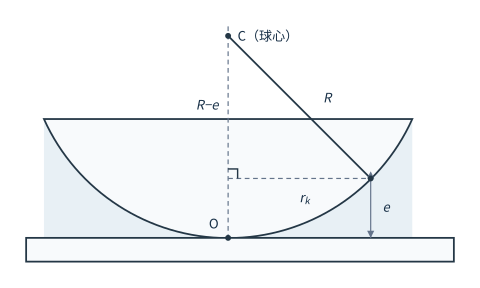

# 03 利用牛顿环测量平凸透镜的曲率半径

## 学习目标

- 说明牛顿环等厚干涉条纹的成因，写出明环与暗环条件并解释圆心为什么一般是暗斑。
- 由几何关系推出暗环半径公式 $r_k^2=kR\lambda$，说明它为什么不能直接用来求 $R$。
- 用逐差式 $R=\dfrac{D_m^2-D_n^2}{4(m-n)\lambda}$ 处理数据，并说清它为什么不需要知道圆心位置和干涉级数。
- 用读数显微镜正确读取条纹位置，说明空程误差与视差的成因和消除办法。
- 用逐差法和最小二乘法分别求出 $R$，评定不确定度并与标准值比较。

---

## 1 等厚干涉与牛顿环

**牛顿环仪**由一块曲率半径很大的平凸透镜和一块平面玻璃板组成，两者用金属框架固定，凸面朝下压在平面上。这样在透镜凸面与玻璃板平面之间夹出一层空气薄膜：接触处厚度为零，越往外空气层越厚，厚度只随到接触点的距离变化。

平行光垂直入射后，在空气膜的上表面（透镜下表面）和下表面（玻璃板上表面）各反射一次。这两束反射光来自同一入射波面，频率相同、振动方向相同、位相差恒定，因而是相干光；它们在空气膜上表面附近相遇叠加，形成干涉条纹。

由于同一条纹上各点的空气膜厚度相同，这种干涉叫**等厚干涉**，条纹是一系列以接触点为圆心的明暗相间同心圆环，最早由牛顿在 1675 年观察到，故称**牛顿环**。白光入射时环是彩色的，单色光入射时环是明暗相间的单色环。

### 1.1 光程差与明暗条件

设空气膜折射率为 $n$（空气 $n=1$），某处膜厚为 $e$，则两束反射光的光程差为

$$
\Delta=2ne+\frac{\lambda}{2}=2e+\frac{\lambda}{2}
$$

式（1）

附加的 $\dfrac{\lambda}{2}$ 来自**半波损失**：光从光疏介质射向光密介质时，反射光相位突变 $\pi$，相当于多走了半个波长。下表面反射是空气射向玻璃板（光疏→光密），有半波损失；上表面反射是玻璃（透镜）射向空气（光密→光疏），没有半波损失。两束光之间只计入一次附加光程差。

按干涉加强和减弱的条件：

$$
\Delta=2e+\frac{\lambda}{2}
\begin{cases}
=k\lambda, & k=1,2,3,\cdots\quad \text{明环}\\[4pt]
=(2k+1)\dfrac{\lambda}{2}, & k=0,1,2,3,\cdots\quad \text{暗环}
\end{cases}
$$

式（2）

化简后，明环满足 $2e=\left(2k-1\right)\dfrac{\lambda}{2}$，暗环满足

$$
2e=k\lambda
$$

接触处 $e=0$，代入式（1）得 $\Delta=\dfrac{\lambda}{2}$，恰好满足 $k=0$ 的暗环条件，所以牛顿环的中心一般是一个暗斑，称为 0 级暗环。若透镜与平板之间有灰尘或被压变形，接触处 $e\neq0$，中心就可能变成亮斑或不规则的圆斑——这既是判断装置好坏的标志，也是下面必须改用逐差式的根本原因。

### 1.2 与等倾干涉条纹的区别

牛顿环（等厚干涉）和迈克尔逊干涉仪产生的等倾干涉条纹都是明暗相间的同心圆环，也都内疏外密，但成因相反。

| 项目 | 牛顿环（等厚干涉） | 迈克尔逊（等倾干涉） |
|---|---|---|
| 相同点 | 都是薄膜干涉，明暗相间的同心圆环，内疏外密 | 同左 |
| 形成条件 | 膜厚不均匀、入射倾角相同 | 膜厚相同、入射倾角不同 |
| 圆心处干涉级次 | 最低 | 最高 |
| 圆心特征 | 永远是暗环 | 圆环不断"吞吐" |

区分方法：膜厚相同的地方连成一条纹，就是等厚干涉；倾角相同的地方连成一条纹，就是等倾干涉。牛顿环是垂直入射、观察同一厚度，所以属于前者。

## 2 暗环半径与曲率半径的关系

图中 $R$ 是透镜凸面的曲率半径，$O$ 是接触点，$C$ 是该球面的球心，$e$ 是距轴 $r_k$ 处的膜厚。要看的是 $C$、膜上表面上的点与转轴围成的直角三角形：斜边为 $R$，竖直边为 $R-e$，水平边为 $r_k$。由勾股关系

$$
R^{2}=\left(R-e\right)^{2}+r_k^{2}=R^{2}-2Re+e^{2}+r_k^{2}
$$

式（3）

因为 $e\ll R$，$e^{2}$ 与其他项相比可以舍去，得 $r_k^{2}=2Re$。再把暗环条件 $2e=k\lambda$ 代入（即 $e=k\lambda/2$），得

$$
r_k^{2}=kR\lambda
$$

式（4）

这就是牛顿环暗环半径公式。它说明 $r_k\propto\sqrt{k}$：级数每增加 1，半径只按平方根增长，所以条纹越往外越密，与观察一致。

### 2.1 为什么不能直接用 $r_k^2=kR\lambda$ 求 $R$

用式（4）需要知道某个环的半径 $r_k$ 和它的级数 $k$，而这两者都定不准：

- 灰尘和机械压力使玻璃发生形变，透镜凸面与平板玻璃之间不是理想的点接触而是一个小接触面，牛顿环的圆心变成一个圆斑，半径 $r$ 的起点无法确定；
- 接触面使中心膜厚不为零，环的绝对级数 $k$ 也随之失去依据。

解决办法是两式相减。以 $D_m$、$D_n$ 分别表示第 $m$ 级和第 $n$ 级暗环的直径，由 $D_k^{2}=4r_k^{2}=4kR\lambda$ 有

$$
D_m^{2}=4m\lambda R,\qquad D_n^{2}=4n\lambda R
$$

两式相减并解出 $R$：

$$
R=\frac{D_m^{2}-D_n^{2}}{4\left(m-n\right)\lambda}
$$

式（5）

这个测量模型只用到两个环的**直径**和它们的**级差** $m-n$。级差是可以直接数出来的（环与环相差多少级是确定的），直径可以由左右两侧位置读数相减得到，于是既不必确定牛顿环的中心，也不必确定某一环的绝对级数。接触面形变带来的那点附加厚度，在相减时被消掉了。

### 2.2 为什么测弦长与测直径没有区别

式（5）要求直径，但显微镜的叉丝很难保证严格通过圆心。设大圆半径为 $r_1$、小圆半径为 $r_2$，一条到圆心的垂直距离为 $d$ 的直线截两圆所得的弦长分别为 $2\sqrt{r_1^{2}-d^{2}}$ 和 $2\sqrt{r_2^{2}-d^{2}}$，两者平方之差为

$$
4\left(r_1^{2}-d^{2}\right)-4\left(r_2^{2}-d^{2}\right)=4\left(r_1^{2}-r_2^{2}\right)
$$

结果与 $d$ 无关，正好等于两圆直径的平方差，即 $EF^{2}-GH^{2}=AB^{2}-CD^{2}$。所以只要叉丝在同一条直线上依次对准某级环的左、右两侧，读出两个位置值再相减，得到的就是该级暗环的直径：

$$
D_k=D_{\text{左}}-D_{\text{右}}
$$

式（6）

## 3 实验仪器

仪器：钠光灯、牛顿环仪、读数显微镜、$45^{\circ}$ 半反射镜。

**光源**：钠光灯是气体放电灯，在可见光范围内有两条靠得很近的谱线，波长分别为 $589.59\ \text{nm}$ 和 $589.00\ \text{nm}$，可以当作单色光源，取其平均值

$$
\lambda=589.30\ \text{nm}
$$

作为计算用波长。

**读数显微镜**是本实验的测长仪器，主要由目镜、物镜、调焦手轮、测微鼓轮、主尺刻度、鼓轮刻度和反光镜旋钮组成。它的读数规则与千分尺相同：

- 微分筒每旋转一圈，主尺上进一小格（$1\ \text{mm}$）；
- 整毫米数从主尺读出，不足 $1\ \text{mm}$ 的部分从微分筒上读取；
- 微分筒一圈分 100 格，分度值 $0.01\ \text{mm}$，再多估读一位，读数记到 $0.001\ \text{mm}$。

例如主尺读准线露出 $25\ \text{mm}$，微分筒读准线指在第 $71.9$ 格，读数为 $25.719\ \text{mm}$。因为可以估读，仪器误差取 $\Delta_{\text{仪}}=0.01/2=0.005\ \text{mm}$。

用读数显微镜有两个必须避免的误差：

| 误差 | 成因 | 消除方法 |
|---|---|---|
| 视差 | 叉丝与被测物的像不共面 | 仔细调焦，使眼睛上下移动时叉丝与条纹无相对位移 |
| 空程误差（系统误差） | 螺母与螺杆之间存在间隙，反向转动时鼓轮转了、镜筒不动 | 测量过程中测微鼓轮只沿同一方向转动 |

空程误差是本实验最主要的系统误差来源，一旦某次读数转过头，就必须退回相当距离后重新单向趋近，不能就地反向。

## 4 实验内容与步骤

### 4.1 调出清晰的牛顿环条纹

1. **调节牛顿环仪**：调节框架上的三个螺丝，使干涉图样的中心出现可见的同心圆环，环不偏心、不呈月牙形。
2. **布置光路**：放置牛顿环仪，调节 $45^{\circ}$ 半反镜的角度和钠光灯的位置，使入射光经半反镜反射后垂直照射到牛顿环上。
3. **调节显微镜**：先调目镜使叉丝清晰，再调物镜——从下往上移动显微镜筒，直到看到清晰的牛顿环。从下往上移可避免物镜压碎牛顿环仪。
4. **调节视场明暗**：转动反光镜旋钮，使视场明暗适中，条纹明暗对比强烈。

### 4.2 测量暗环位置

1. 旋转测微鼓轮，使分划板中的十字叉丝由牛顿环中心向左（或向右）移动，从 0 级暗环数到第 25 级暗环。多移出几环是为了越过读数不稳定的区域。
2. 反向移动到第 23 级暗环并记录读数，然后**沿同一方向**依次记录 23、22、21、……、15、14 级暗环的位置读数。
3. 继续向前移动叉丝，使它经过圆心后再依次测出另一侧第 14、15、……、22、23 级暗环位置的读数。

左右两侧同一级读数的差值就是该级暗环的直径。条纹位置读数必须同一方向逐条读取，否则容易产生空程误差。

表1 测量牛顿环的曲率半径

| 环数 | $m$ | 23 | 22 | 21 | 20 | 19 |
|---|---|---|---|---|---|---|
| 环的位置/mm | 左→ | | | | | |
| 环的位置/mm | ←右 | | | | | |
| 大环直径/mm | $D_m$ | | | | | |
| 环数 | $n$ | 18 | 17 | 16 | 15 | 14 |
| 环的位置/mm | 左→ | | | | | |
| 环的位置/mm | ←右 | | | | | |
| 小环直径/mm | $D_n$ | | | | | |
| 大环直径平方 | $D_m^2/\text{mm}^2$ | | | | | |
| 小环直径平方 | $D_n^2/\text{mm}^2$ | | | | | |
| $R=\dfrac{D_m^2-D_n^2}{4\left(m-n\right)\lambda}/\text{mm}$ | | | | | | |

### 4.3 注意事项

1. 应预先使显微镜筒标尺位置处在可移动范围的中点，避免测量中途超出行程。
2. 测量过程中不要碰动牛顿环仪，也不要震动实验台；一次测量中途挪动，圆心就变了。
3. 测微鼓轮应沿一个方向转动。
4. 环数不可数错。数错一环，$m-n$ 就错一环，结果会明显偏离；测量过程中发现环数有变化必须重测。

## 5 数据处理

下面用一组示例数据演示完整计算链（数据为演示用，非实测）。钠光波长 $\lambda=589.30\ \text{nm}=5.893\times10^{-4}\ \text{mm}$，本实验室牛顿环曲率半径标准值 $R_0=855.1\ \text{mm}$。

### 5.1 示例数据与逐差法结果

| $k$ | 23 | 22 | 21 | 20 | 19 | 18 | 17 | 16 | 15 | 14 |
|---|---|---|---|---|---|---|---|---|---|---|
| 左位置/mm | 21.433 | 21.506 | 21.590 | 21.672 | 21.744 | 21.823 | 21.913 | 22.003 | 22.094 | 22.185 |
| 右位置/mm | 28.269 | 28.194 | 28.117 | 28.032 | 27.952 | 27.872 | 27.790 | 27.711 | 27.602 | 27.513 |
| $D_k/\text{mm}$ | 6.836 | 6.688 | 6.527 | 6.360 | 6.208 | 6.049 | 5.877 | 5.708 | 5.508 | 5.328 |
| $D_k^2/\text{mm}^2$ | 46.731 | 44.729 | 42.602 | 40.450 | 38.539 | 36.590 | 34.539 | 32.581 | 30.338 | 28.388 |

左行读数随 $k$ 减小而增大（叉丝从左端向右移动），右行读数随 $k$ 减小而减小（叉丝继续向右，先遇到 14 级再遇到 23 级），两行都是单向逐条读取的。

把 10 个环分成 $m$（23~19）与 $n$（18~14）两组，对应项相减，每对级差 $m-n=5$：

$$
R=\frac{D_m^{2}-D_n^{2}}{4\times5\lambda}=\frac{D_m^{2}-D_n^{2}}{4\times5\times5.893\times10^{-4}}=\frac{D_m^{2}-D_n^{2}}{0.011786}
$$

| 级次对 $(m,n)$ | (23,18) | (22,17) | (21,16) | (20,15) | (19,14) |
|---|---|---|---|---|---|
| $D_m^2-D_n^2/\text{mm}^2$ | 10.141 | 10.190 | 10.021 | 10.112 | 10.151 |
| $R/\text{mm}$ | 860.4 | 864.6 | 850.2 | 858.0 | 861.3 |

$$
\bar{R}=\frac{860.4+864.6+850.2+858.0+861.3}{5}=858.9\ \text{mm}
$$

这正是 [[01 误差理论、有效数字与数据处理方法]] 中的逐差法：10 个直径全部参与运算，没有一个数据被浪费。若改用"首尾相减"，只剩 23 级和 14 级两个数据起作用。

### 5.2 不确定度评定

**A 类分量**：5 个 $R$ 值的分散，

$$
\sigma_{A,R}=\sqrt{\frac{\sum\left(R_i-\bar{R}\right)^2}{5\left(5-1\right)}}=5.4\ \text{mm}
$$

**B 类分量**：$R$ 的不确定度来自 $D_m^{2}-D_n^{2}$。每个直径由两次位置读数相减得到，单次读数 $\Delta_{\text{仪}}=0.005\ \text{mm}$、$\sigma_{\text{读}}=\dfrac{0.005}{\sqrt{3}}=0.0029\ \text{mm}$，故

$$
\sigma_D=\sqrt{2}\,\sigma_{\text{读}}=0.0041\ \text{mm}
$$

由 $D^{2}$ 的传递 $\sigma_{D^{2}}=2D\sigma_D$，取平均一对（$D_m=6.5\ \text{mm}$、$D_n=5.7\ \text{mm}$）估算 $\sigma_{D_m^2}$ 与 $\sigma_{D_n^2}$，两项独立、方差相加，得

$$
\sigma_{D_m^2-D_n^2}=\sqrt{\left(2D_m\sigma_D\right)^{2}+\left(2D_n\sigma_D\right)^{2}}=0.0709\ \text{mm}^{2},\qquad
\sigma_{B,R}=\frac{0.0709}{0.011786}=6.0\ \text{mm}
$$

**合成与结果**：

$$
\sigma_R=\sqrt{5.4^{2}+6.0^{2}}=8.1\ \text{mm}\rightarrow9\ \text{mm}
$$

$$
R=\left(859\pm9\right)\ \text{mm},\qquad
E_R=\frac{8.1}{858.9}\times100\%=0.94\%\rightarrow0.95\%
$$

$\sigma_R$ 按只进不舍取一位有效数字，$\bar{R}$ 的末位对齐到个位。$B$ 类分量与 $A$ 类同量级，说明读数精度和测量分散对结果的贡献相当。

### 5.3 与标准值比较

$$
A_R=\frac{\left|R-R_0\right|}{R_0}\times100\%=\frac{\left|858.9-855.1\right|}{855.1}\times100\%=0.44\%
$$

偏差 $0.44\%$ 小于测量自身的相对不确定度 $0.95\%$，说明测量结果可靠。$E_R$ 衡量测量本身的可靠程度，$A_R$ 衡量偏离标准值多远，两者要分别给出。

### 5.4 作图法与最小二乘法

由 $D_k^{2}=4k\lambda R$ 可知 $D_k^{2}$ 与级次 $k$ 成正比。以 $k$ 为横轴、$D_k^{2}$ 为纵轴作图，应得一条直线，斜率

$$
a=4\lambda R,\qquad R=\frac{a}{4\lambda}
$$

对表1 的 10 个点作最小二乘拟合 $D^{2}=A_1k+A_0$。先算各统计量（$n=10$）：

$$
\sum k=185,\quad \sum D^{2}=375.487,\quad \sum k^{2}=3505,\quad \sum kD^{2}=7114.315,\quad \sum\left(D^{2}\right)^{2}=14440.42
$$

$$
\bar{k}=18.5,\qquad \overline{D^{2}}=37.5487,\qquad \overline{k^{2}}=350.5,\qquad \overline{kD^{2}}=711.4315
$$

$$
A_1=\frac{\overline{kD^{2}}-\bar{k}\,\overline{D^{2}}}{\overline{k^{2}}-\bar{k}^{2}}
=\frac{711.4315-18.5\times37.5487}{350.5-18.5^{2}}
=\frac{16.7805}{8.25}=2.0340\ \text{mm}^{2}
$$

$$
A_0=\overline{D^{2}}-A_1\bar{k}=37.5487-2.0340\times18.5=-0.080\ \text{mm}^{2}
$$

$$
R=\frac{A_1}{4\lambda}=\frac{2.0340}{4\times5.893\times10^{-4}}=862.9\ \text{mm}
$$

相关系数 $\gamma=0.9999$，接近 1，说明 $D^{2}$ 与 $k$ 的线性关系成立，用直线拟合是合理的。

两种方法的结果 $858.9\ \text{mm}$ 与 $862.9\ \text{mm}$ 相差 $0.5\%$，在不确定度范围内一致。**作图法/最小二乘法**比逐差法多给出两样信息：相关系数 $\gamma$ 可以直接判断线性程度，截距 $A_0$ 则反映圆心与级次的定标是否有系统偏移——理想点接触时 $A_0=0$，本例 $A_0=-0.08\ \text{mm}^{2}$ 远小于 $D^{2}$ 的量级，可以认为接触近似理想。若某点明显偏离直线，就是数错环或读错数，可以当场发现，这是逐差法做不到的。

## 6 误差来源分析

- **空程误差**：螺杆间隙使鼓轮反向后的第一串读数整体偏移，是系统误差。靠"单向逐条读取"消除；一旦转过头，须退回较远处再重新单向趋近。
- **视差**：叉丝与条纹像不共面时，眼睛位置稍变读数就变。调焦不仔细会把它带进每一次读数。
- **数错环数**：本例级差 $m-n=5$，数错一环就把它变成 4 或 6，$R$ 相应偏大 $25\%$ 或偏小 $17\%$，属于粗大误差，结果会明显偏离标准值，必须重测。
- **条纹定位偏差**：暗环有一定宽度，叉丝应始终对准同一侧边缘（通常取环的中心），左右两侧取法要一致，否则直径系统偏大或偏小。
- **温度与形变**：手温、灯光加热使透镜与玻璃板膨胀程度不同，膜厚分布改变，长时间测量中条纹会缓慢移动，所以牛顿环仪不能压得太紧、测完一组数据要检查中心是否还在原位。
- **波长取值**：钠双线本身相差 $0.59\ \text{nm}$，取平均值引入的相对误差约 $5\times10^{-4}$，远小于读数项，可以忽略。

## 7 拓展应用（了解）

- **检测光学表面加工质量**：用被检面与标准平面玻璃贴合，同样产生等厚干涉。条纹是直线、间距均匀，说明表面是理想平面；条纹弯曲的方向和间距反映局部凹凸的高度差，相邻两条纹对应膜厚差 $\lambda/2\approx295\ \text{nm}$，因此可以定量读出加工误差。
- **充液测折射率**：若在透镜与平板之间充入透明液体，把空气膜（$n=1$）换成折射率为 $n$ 的液膜，光程差中的 $2e$ 变成 $2ne$，暗环条件给出 $D_k^{2}=4kR\lambda/n$。同一装置下测出充液前后的同级直径平方之比，即得 $n=D_{\text{气}}^{2}/D_{\text{液}}^{2}$，不必知道 $R$ 和 $\lambda$。
- **薄膜与微纳测量**：晶圆键合时两片硅必须原子级贴合，界面残留的空洞会表现为牛顿环，环的疏密可以直接换算空隙厚度；用纳米结构阵列替代玻璃平晶，可把这类测量的精度推进到亚纳米量级。

## 8 公式一览

| 内容 | 公式 |
|---|---|
| 光程差（含半波损失） | $\Delta=2e+\dfrac{\lambda}{2}$ |
| 明环条件 | $2e=\left(2k-1\right)\dfrac{\lambda}{2}$，$k=1,2,3,\cdots$ |
| 暗环条件 | $2e=k\lambda$，$k=0,1,2,\cdots$ |
| 几何关系 | $r_k^{2}=2Re$（$e\ll R$） |
| 暗环半径 | $r_k^{2}=kR\lambda$ |
| 暗环直径平方 | $D_k^{2}=4kR\lambda$ |
| 曲率半径（逐差式） | $R=\dfrac{D_m^{2}-D_n^{2}}{4\left(m-n\right)\lambda}$ |
| 直径的读取 | $D_k=D_{\text{左}}-D_{\text{右}}$ |
| 最小二乘法求 $R$ | $R=\dfrac{A_1}{4\lambda}$，$A_1=\dfrac{\overline{kD^{2}}-\bar{k}\,\overline{D^{2}}}{\overline{k^{2}}-\bar{k}^{2}}$ |
| 相对不确定度 | $E_R=\dfrac{\sigma_R}{\bar{R}}\times100\%$，$\sigma_R=\sqrt{\sigma_{A,R}^{2}+\sigma_{B,R}^{2}}$ |
| 与标准值比较 | $A_R=\dfrac{\left\lvert R-R_0\right\rvert}{R_0}\times100\%$ |
| 充液测折射率 | $n=\dfrac{D_{\text{气}}^{2}}{D_{\text{液}}^{2}}$ |
