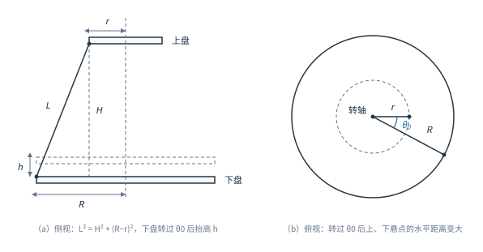

# 04 用三线摆测量刚体的转动惯量

## 学习目标

- 写出转动惯量的定义式，说明它由哪两个因素决定，判断哪些刚体适合用实验方法测定。
- 由机械能守恒和几何关系推出下盘转动惯量公式 $I_0=\dfrac{m_0gRr}{4\pi^2H}T_0^{2}$。
- 说明 $h=\dfrac{Rr\theta_0^{2}}{2H}$ 用到的近似条件，以及摆角为什么要限制在 $5^{\circ}$ 以内。
- 用悬点间距和悬线长算出 $r$、$R$、$H$，并解释为什么测的是弦长而不是半径。
- 用三线摆测圆盘、圆环的转动惯量并验证平行轴定理，完成不确定度评定。

---

## 1 转动惯量与测量思路

**转动惯量** $I$ 是描述刚体转动惯性大小的物理量。把刚体看成许多质元，每个质元的质量 $dm$ 到转轴的垂直距离为 $r$，则

$$
I=\int r^{2}\,dm\qquad\text{或}\qquad I=\sum_i m_i r_i^{2}
$$

可见 $I$ 由两件事决定：① 总质量 $m$；② 质量相对转轴的分布 $r$。同样的质量，分布离轴越远 $I$ 越大。花样运动员收拢双臂时质量分布靠近转轴、$I$ 减小，角动量 $I\omega$ 守恒，角速度随之增大，所以转得更快。飞轮储能、发动机飞轮、陀螺仪和卫星姿态控制都是靠设计 $I$ 来获得所需的转动特性。

形状简单、质量分布均匀的刚体（圆盘、圆环、细棒、球）可以直接积分算出 $I$。形状复杂或质量分布不均匀的刚体，积分难以进行，只能实验测定。常用方法有三线摆法、扭摆法、复摆法和转动惯量测量仪，其中**三线摆法**既简便易行，又能测量任意形状刚体绕定轴的转动惯量。

三线摆的测量思路是：转动惯量本身测不出来，但把它装成摆之后，周期 $T$ 与 $I$ 有确定的函数关系。于是"测 $I$"变成"测周期 $T$ 和几个几何常量"，而这两类量都能用普通仪器精确测量。

## 2 实验原理

### 2.1 装置与简谐摆动

三线摆由上、下两个圆盘和等长的三根悬线组成：上盘固定，三根悬线对称地挂在下盘边缘，下盘可绕通过两盘中心的竖直轴转动。当下盘转过一个小角度 $\theta$ 时，三根悬线倾斜，下盘质心同时被抬高 $h$；重力矩把它拉回，于是下盘在水平转动与竖直升降之间往复转换，形成扭摆。

当转动角度很小时，摆动可近似看作简谐运动。设振动周期为 $T_0$，角位移与角速度为

$$
\theta=\theta_0\sin\frac{2\pi}{T_0}t,\qquad
\omega=\frac{d\theta}{dt}=\frac{2\pi\theta_0}{T_0}\cos\frac{2\pi}{T_0}t
$$

$\theta_0$ 为最大转角。通过平衡位置的瞬时余弦因子为 1，角速度取最大值

$$
\omega_0=\frac{2\pi\theta_0}{T_0}
$$

图中各量：$R$ 为下盘悬线连接点到转轴的距离，$r$ 为上盘悬线连接点到转轴的距离，$H$ 为上下两盘之间的垂直距离，$h$ 为下盘扭转后质心上升的高度，$\theta_0$ 为下盘的最大转角，$m_0$ 为下盘质量，$L$ 为悬线长度。（a）是侧视，画出 $L$、$H$ 与 $R-r$ 构成的直角三角形以及抬高后的下盘位置；（b）是俯视，两个实心点分别是上、下悬点，下盘转过 $\theta_0$ 后两点的水平距离变大，悬线的竖直投影随之变短，这就是下盘被抬高的原因。

### 2.2 几何关系 $h=\dfrac{Rr\theta_0^{2}}{2H}$

静止时，上、下盘悬点在同一竖直平面内，悬线长 $L$、上下盘垂直距离 $H$、两悬点到轴距离之差 $R-r$ 构成直角三角形：

$$
L^{2}=H^{2}+\left(R-r\right)^{2}
$$

下盘转过 $\theta_0$ 后，上、下悬点在水平面上的投影不再共线，如图（b）。以转轴为顶点，两点到轴的距离分别为 $r$ 和 $R$、夹角为 $\theta_0$，记两悬点间的水平距离为 $s$，由余弦定理

$$
s^{2}=r^{2}+R^{2}-2Rr\cos\theta_0
$$

利用 $1-\cos\theta_0=2\sin^{2}\dfrac{\theta_0}{2}$，且摆角很小时 $\sin\dfrac{\theta_0}{2}\approx\dfrac{\theta_0}{2}$，得 $2\left(1-\cos\theta_0\right)\approx\theta_0^{2}$，于是

$$
s^{2}=\left(R-r\right)^{2}+Rr\theta_0^{2}
$$

另一方面，下盘抬高 $h$ 后悬线长不变，故 $s^{2}=L^{2}-\left(H-h\right)^{2}$。两式相等并把 $L^{2}=H^{2}+\left(R-r\right)^{2}$ 代入：

$$
H^{2}+\left(R-r\right)^{2}-\left(H-h\right)^{2}=\left(R-r\right)^{2}+Rr\theta_0^{2}
$$

$$
2Hh-h^{2}=Rr\theta_0^{2}
$$

因为 $h\ll H$，$h^{2}$ 可以略去，得

$$
h=\frac{Rr\theta_0^{2}}{2H}
$$

这里用了两次近似：小角度下 $\sin(\theta_0/2)\approx\theta_0/2$，以及 $h^{2}\ll 2Hh$。两次近似的误差都随 $\theta_0$ 增大而迅速变大，这就是实验要求摆角不超过 $5^{\circ}$ 的原因——$\theta_0=5^{\circ}=0.0873\ \text{rad}$ 时 $\sin\theta_0$ 与 $\theta_0$ 相差约 $0.13\%$，摆角放大到 $10^{\circ}$ 误差就变成 $0.5\%$。

### 2.3 由机械能守恒求 $I_0$

略去摩擦，下盘在最大转角处的重力势能全部转化为通过平衡位置时的转动动能，即 $E_1=E_2$：

$$
m_0gh=\frac{1}{2}I_0\omega_0^{2}
$$

把 $h=\dfrac{Rr\theta_0^{2}}{2H}$ 和 $\omega_0=\dfrac{2\pi\theta_0}{T_0}$ 代入：

$$
m_0g\frac{Rr\theta_0^{2}}{2H}=\frac{1}{2}I_0\frac{4\pi^{2}\theta_0^{2}}{T_0^{2}}
$$

$\theta_0^{2}$ 消去，解出下盘转动惯量

$$
I_0=\frac{m_0gRr}{4\pi^{2}H}T_0^{2}
$$

$\theta_0$ 被消掉这件事本身就是实验设计的关键：结果与摆角大小无关，所以不必精确控制起振角度，只要保证它足够小、满足简谐近似即可。反过来看，上式等价于 $T_0=2\pi\sqrt{\dfrac{I_0H}{m_0gRr}}$，这正是简谐振动周期公式，说明 2.1 节"小角度下可看作简谐运动"的假设与能量守恒的推导彼此自洽。

### 2.4 仪器常数 $r$、$R$、$H$ 的测定

悬点到转轴的距离 $r$、$R$ 无法直接测量（悬点在盘边，轴心在盘心，中间没有参考刻线）。三根等长悬线在盘上的连接点构成一个**等边三角形**，其外接圆半径就是所求距离，而等边三角形的外接圆半径等于边长的 $\dfrac{\sqrt{3}}{3}$ 倍。因此只需用直尺量出三角形的三条边：

$$
r=\frac{\sqrt{3}}{3}\bar{a}=\frac{\sqrt{3}}{3}\times\frac{1}{3}\left(a_1+a_2+a_3\right),\qquad
R=\frac{\sqrt{3}}{3}\bar{b}=\frac{\sqrt{3}}{3}\times\frac{1}{3}\left(b_1+b_2+b_3\right)
$$

其中 $a_1,a_2,a_3$ 是上盘三个悬点之间的距离，$b_1,b_2,b_3$ 是下盘三个悬点之间的距离。三条边分别测量再取平均，可以消掉上、下盘不完全平行或悬点不完全等分圆周带来的偏差。

上下盘的垂直距离 $H$ 也不便直接测量（下盘在悬线中间，无法把尺子伸进去量到盘心所在的水平面），但悬线长 $l$ 可以直接量。由 2.2 节的直角三角形

$$
H=\sqrt{l^{2}-\left(R-r\right)^{2}},\qquad l=\frac{l_1+l_2+l_3}{3}
$$

## 3 待测物体与平行轴定理

### 3.1 圆环的转动惯量

把待测圆环放在下盘上，使两者中心轴线重合，此时摆动的系统变成"下盘 + 圆环"，总转动惯量为 $I_0+I_1$，周期由 $T_0$ 变为更大的 $T_1$，即 $I_0+I_1=\dfrac{\left(m_0+m_1\right)gRr}{4\pi^{2}H}T_1^{2}$。移项得实验公式

$$
I_1=\frac{\left(m_0+m_1\right)gRr}{4\pi^{2}H}T_1^{2}-I_0
$$

均匀圆环绕中心轴的转动惯量可以直接积分，理论公式为

$$
I_1^{\prime}=\frac{1}{2}m_1\left(a^{2}+b^{2}\right)=\frac{m_1}{8}\left(D_1^{2}+D_2^{2}\right)
$$

其中 $m_1$ 为圆环质量，$a$、$b$ 为圆环的内、外半径，$D_1=2a$、$D_2=2b$ 为内、外直径（这里的 $a$、$b$ 与 2.4 节的悬点间距 $a_i$、$b_i$ 无关）。式中的 $-I_0$ 这一步很关键：与下盘和悬线有关的系统误差（摆角近似、悬线弹性、下盘质量分布）在加与不加圆环两次测量中几乎相同，相减后被大幅抵消，剩下的只是圆环本身的贡献，所以圆环的相对偏差通常比下盘小。

### 3.2 验证平行轴定理

**平行轴定理**：刚体绕任一轴的转动惯量，等于它绕过质心的平行轴的转动惯量加上质量与两轴距离平方的乘积，

$$
I=I_C+md^{2}
$$

把两个质量均为 $m_2$、半径为 $r_d$ 的小圆柱**对称**放在下盘两侧，两圆柱中心到下盘中心的距离都是 $d$。对称放置是为了让组合体的质心仍落在转轴上，摆动的升降关系式不变；若只放一个，质心偏移，摆会出现前后左右晃动，公式失效。

同理，"加圆柱后的总转动惯量减去下盘的 $I_0$"再除以 2，得单个圆柱对下盘转轴的转动惯量（实验公式）

$$
I_d=\frac{1}{2}\left[\frac{\left(m_0+2m_2\right)gRr}{4\pi^{2}H}T_2^{2}-I_0\right]
$$

按平行轴定理，圆柱对下盘转轴（与圆柱自身中心轴相距 $d$）的转动惯量（理论公式）为

$$
I_d^{\prime}=\frac{1}{2}m_2r_d^{2}+m_2d^{2}
$$

第一项是圆柱绕过自身中心轴的转动惯量（实心圆柱 $\frac{1}{2}m_2r_d^{2}$），第二项就是平行轴定理的 $md^{2}$。$I_d$ 与 $I_d^{\prime}$ 在误差范围内一致，即验证了平行轴定理。实验中直接测的是两圆柱中心之间的距离 $2d$，因为它比 $d$ 大、相对误差更小。

## 4 实验仪器

FB210A 型三线摆、FB213A 型数显计时计数毫秒仪、钢直尺、游标卡尺、待测圆环、待测圆柱、天平、水准仪。

**仪器调整**：

1. **上盘水平**：调仪器底座上的三个螺钉，使上盘水平，水准仪气泡居中。
2. **下盘水平**：调三悬线等长（约 $50\ \text{cm}$），使下盘与上盘平行。悬线过短，周期短，记录误差大且摆动次数可能不满足要求；过长则周期太长，实验时间拖得过长。
3. **调光电传感接收装置**：使下盘上的挡光杆能往返通过光电门槽口，既不被卡住，也不脱离。
4. **设置计数次数**：面板操作为 置数 → 上/调 → 置数 → 执行 → 读数 → 返回。计数器**每半个周期计数一次**，屏上的计数值减到 0 时给出的就是所置周期数的总时间——例如置 30，显示从 60 递减到 0，对应 30 个全周期。测 $N$ 个周期的总时间 $t$，则 $T=t/N$。

## 5 实验内容与步骤

### 5.1 测周期

1. 轻轻扭动上圆盘（最大转角控制在 $5^{\circ}$ 左右）带动下悬盘摆动。摆动几次、待摆动稳定后按毫秒计仪"执行"键，每计量一个周期显示数值自动递减，递减为 0 时显示悬盘扭转摆动 $N$ 个周期的总时间，按"返回"键进行下一次测量。重复三次，差值不能超过 $1\ \text{s}$，取平均得 $t$，则 $T_0=t/N$。
2. 把待测圆环置于悬盘上，使两者中心轴线重合，按同样方法测出摆动周期 $T_1$。
3. 将两个小圆柱对称放在下盘，按同样方法测出摆动周期 $T_2$。

### 5.2 测仪器常数与几何量

用钢直尺测上盘悬点间距 $a_1,a_2,a_3$、下盘悬点间距 $b_1,b_2,b_3$、悬线长 $l_1,l_2,l_3$；用游标卡尺或直尺测下盘半径 $r_0$、圆环内、外半径 $a$、$b$、小圆柱半径 $r_d$ 和两圆柱中心间距 $2d$；用天平测下盘质量 $m_0$、圆环质量 $m_1$、小圆柱质量 $m_2$。

### 5.3 注意事项

1. 用水准仪调节下圆盘水平，摆轴才与盘面垂直。
2. 三悬线要等长，约 $50\ \text{cm}$。
3. 起振前必须让下盘静止，摆动角度要小于 $5^{\circ}$。启动时用手快速转动上盘，让下盘"旋"出去而不是"晃"出去，避免产生前后左右的晃动；一旦有平动分量，周期与转动惯量的关系式不再成立。
4. 直尺读数要准确、规范，必须读出估读位。
5. 换放待测物时不要碰撞悬线，摆动的下盘上不能用手按压物体。

表1 三线摆实验数据记录

| 形状 | 质量/kg | 仪器常量和平行轴间距/m | $N$ 个周期的时间 $t$/s | 平均周期 $T$/s |
|---|---|---|---|---|
| 圆盘 | $m_0=$ | $a_1=$、$a_2=$、$a_3=$，$r=$ | 1 | |
| | | $b_1=$、$b_2=$、$b_3=$，$R=$ | 2 | |
| | | $r_0=$、$l=$、$H=$ | 3 | |
| 圆环 | $m_1=$ | $D_1=2a$、$D_2=2b$ | 1、2、3 | |
| 圆柱 | $m_2=$ | $r_d=$、$2d=$ | 1、2、3 | |

## 6 数据处理

下面用一组示例数据演示完整计算链。取 $g=9.80\ \text{m/s}^{2}$，$\pi$ 取 $3.142$，计时按 $N=50$ 个周期（置数 50，倒计时显示 100）。

### 6.1 仪器常数

上盘悬点间距 $a_1=a_2=a_3=0.0950\ \text{m}$，下盘悬点间距 $b_1=b_2=b_3=0.1640\ \text{m}$，悬线长 $l_1=l_2=l_3=0.4860\ \text{m}$。

$$
\bar{a}=\frac{1}{3}\left(a_1+a_2+a_3\right)=0.0950\ \text{m},\qquad
r=\frac{\sqrt{3}}{3}\bar{a}=0.0548\ \text{m}
$$

$$
\bar{b}=\frac{1}{3}\left(b_1+b_2+b_3\right)=0.1640\ \text{m},\qquad
R=\frac{\sqrt{3}}{3}\bar{b}=0.0947\ \text{m}
$$

**$\bar{a}$ 的不确定度**：三次读数相同，A 类分量为零；用钢直尺测量、可估读，$\Delta_{\text{仪}}=0.001/2=0.0005\ \text{m}$，

$$
\sigma_a=\sqrt{\sigma_{\bar{a}}^{2}+\sigma_{a\text{仪}}^{2}}
=\sqrt{\left[\sqrt{\frac{\sum\left(a_i-\bar{a}\right)^{2}}{n\left(n-1\right)}}\right]^{2}+\left(\frac{\Delta_{a\text{仪}}}{\sqrt{3}}\right)^{2}}
=\sqrt{0+\left(\frac{0.0005}{\sqrt{3}}\right)^{2}}=0.000289\ \text{m}
$$

$r$ 与 $\bar{a}$ 只差一个常数因子 $\sqrt{3}/3$，不确定度按同一比例传递：

$$
\sigma_r=\frac{\sqrt{3}}{3}\sigma_a=0.000167\ \text{m},\qquad
\sigma_R=\frac{\sqrt{3}}{3}\sigma_b=0.000167\ \text{m}
$$

**垂直距离 $H$**：

$$
H=\sqrt{l^{2}-\left(R-r\right)^{2}}=\sqrt{0.4860^{2}-\left(0.0947-0.0548\right)^{2}}=0.4844\ \text{m}
$$

$\sigma_l=\Delta_{l\text{仪}}/\sqrt{3}=0.000289\ \text{m}$。$H$ 是三个独立直接量的函数，按不确定度传递公式，各偏导为

$$
\frac{\partial H}{\partial l}=\frac{l}{H},\qquad
\frac{\partial H}{\partial r}=\frac{R-r}{H},\qquad
\frac{\partial H}{\partial R}=-\frac{R-r}{H}
$$

$$
\sigma_H=\sqrt{\left(\frac{l}{H}\sigma_l\right)^{2}+\left(\frac{R-r}{H}\sigma_r\right)^{2}+\left(\frac{R-r}{H}\sigma_R\right)^{2}}
$$

$$
=\sqrt{\left(\frac{0.4860}{0.4844}\times0.000289\right)^{2}+2\left(\frac{0.0947-0.0548}{0.4844}\times0.000167\right)^{2}}
=0.000290\ \text{m}
$$

$H$ 的不确定度几乎全部来自 $\sigma_l$：$l$ 前的系数 $l/H\approx1$，而 $R$、$r$ 前的系数只有 $(R-r)/H\approx0.08$，几何量的误差被大幅压低。

### 6.2 下盘周期与转动惯量

50 个周期的总时间三次测量为 $t_1=71.55\ \text{s}$、$t_2=72.02\ \text{s}$、$t_3=71.40\ \text{s}$，

$$
\bar{t}=\frac{1}{3}\left(71.55+72.02+71.40\right)=71.66\ \text{s},\qquad
T_0=\frac{\bar{t}}{50}=1.4331\ \text{s}
$$

各次偏差为 $-0.11,0.36,-0.26\ \text{s}$，平方和 $0.2093\ \text{s}^{2}$。计时读数记录到 $0.01\ \text{s}$，B 类分量 $\sigma_{t\text{仪}}=\dfrac{0.01/2}{\sqrt{3}}=0.0029\ \text{s}$，

$$
\sigma_t=\sqrt{\frac{\sum\left(t_i-\bar{t}\right)^{2}}{n\left(n-1\right)}+\left(\frac{\Delta_{t\text{仪}}}{\sqrt{3}}\right)^{2}}
=\sqrt{\frac{0.2093}{3\times2}+0.0029^{2}}=0.187\ \text{s}
$$

$$
\sigma_{T_0}=\frac{1}{50}\sigma_t=0.00374\ \text{s}
$$

这里 B 类分量比 A 类分散小两个量级，说明周期的不确定度完全由摆动本身的重现性决定，而不是计时仪器的分辨率——这正是采用"测 $N$ 个周期再除以 $N$"的理由：$\sigma_{T}=\sigma_t/N$，$N$ 越大单个周期的不确定度越小。

**下盘转动惯量**（$m_0=1.273\ \text{kg}$）：

$$
I_0=\frac{m_0gRr}{4\pi^{2}H}T_0^{2}
=\frac{1.273\times9.80\times0.0947\times0.0548}{4\times3.142^{2}\times0.4844}\times1.4331^{2}
=6.951\times10^{-3}\ \text{kg}\cdot\text{m}^{2}
$$

**相对不确定度**：$I_0\propto RrT_0^{2}/H$ 是乘除与幂的组合，用对数形式的传递公式，各指数（$R$、$r$、$H$ 为 $1$、$-1$，$T_0$ 为 $2$）直接成为系数：

$$
E_{I_0}=\sqrt{\left(\frac{\sigma_r}{r}\right)^{2}+\left(\frac{\sigma_R}{R}\right)^{2}+\left(\frac{\sigma_H}{H}\right)^{2}+\left(\frac{2\sigma_{T_0}}{T_0}\right)^{2}}
$$

$$
=\sqrt{\left(\frac{0.000167}{0.0548}\right)^{2}+\left(\frac{0.000167}{0.0947}\right)^{2}+\left(\frac{0.000290}{0.4844}\right)^{2}+\left(\frac{2\times0.00374}{1.4331}\right)^{2}}
=0.64\%
$$

$$
\sigma_{I_0}=E_{I_0}I_0=6.951\times10^{-3}\times0.64\%=4.4\times10^{-5}\ \text{kg}\cdot\text{m}^{2}\rightarrow0.05\times10^{-3}\ \text{kg}\cdot\text{m}^{2}
$$

$$
I_0=\left(6.95\pm0.05\right)\times10^{-3}\ \text{kg}\cdot\text{m}^{2},\qquad E_{I_0}=0.64\%
$$

四项中周期项 $0.52\%$ 最大，其次是 $r$ 项 $0.30\%$。要提高精度，第一是设法压低 $\sigma_t$（增加测量次数、减小起振扰动），第二是把悬点间距测得更准（改用游标卡尺测 $a$、$b$）。

### 6.3 与理论值比较

下盘可近似看作均匀圆盘，$r_0=0.100\ \text{m}$，

$$
I_0^{\prime}=\frac{1}{2}m_0r_0^{2}=\frac{1}{2}\times1.273\times0.100^{2}=6.365\times10^{-3}\ \text{kg}\cdot\text{m}^{2}
$$

用尚未修约的实验值 $I_0=6.951\times10^{-3}\ \text{kg}\cdot\text{m}^{2}$ 作比较：

$$
A_0=\frac{\left|I_0-I_0^{\prime}\right|}{I_0^{\prime}}\times100\%=\frac{\left|6.951-6.365\right|}{6.365}\times100\%=9.2\%
$$

实验值明显大于理论值，而测量本身的不确定度只有 $0.64\%$，说明这 $9.2\%$ 不是随机误差，而是**理论模型的适用条件不满足**：$I_0^{\prime}=\frac{1}{2}m_0r_0^{2}$ 要求下盘是质量均匀的薄圆盘，实际下盘上装有挡光杆、中心有凸台，且盘面厚度不完全均匀，这些附加质量都分布在盘缘附近，使真实转动惯量偏大。$E_{I_0}$ 与 $A_0$ 含义不同：前者是测量自身的可靠程度，后者是偏离理论模型的程度，两者都要报告。

### 6.4 圆环的转动惯量

圆环 $m_1=0.555\ \text{kg}$，内、外半径 $a=0.067\ \text{m}$、$b=0.090\ \text{m}$，加上圆环后 50 个周期的总时间 $\bar{t}_1=72.70\ \text{s}$，$T_1=1.4540\ \text{s}$。

$$
I_1=\frac{\left(m_0+m_1\right)gRr}{4\pi^{2}H}T_1^{2}-I_0
=\frac{1.828\times9.80\times0.0947\times0.0548}{4\times3.142^{2}\times0.4844}\times1.4540^{2}-6.951\times10^{-3}
$$

$$
=\left(10.275-6.951\right)\times10^{-3}=3.324\times10^{-3}\ \text{kg}\cdot\text{m}^{2}
$$

$$
I_1^{\prime}=\frac{1}{2}m_1\left(a^{2}+b^{2}\right)=\frac{1}{2}\times0.555\times\left(0.067^{2}+0.090^{2}\right)=3.493\times10^{-3}\ \text{kg}\cdot\text{m}^{2}
$$

$$
A_1=\frac{\left|3.324-3.493\right|}{3.493}\times100\%=4.8\%
$$

### 6.5 验证平行轴定理

两个小圆柱 $m_2=0.073\ \text{kg}$，半径 $r_d=0.0100\ \text{m}$，两圆柱中心间距 $2d=0.1802\ \text{m}$ 即 $d=0.0901\ \text{m}$；加上圆柱后 50 个周期的总时间 $\bar{t}_2=73.41\ \text{s}$，$T_2=1.4682\ \text{s}$。

$$
I_d=\frac{1}{2}\left[\frac{\left(2m_2+m_0\right)gRr}{4\pi^{2}H}T_2^{2}-I_0\right]
=\frac{1}{2}\left[\frac{1.419\times9.80\times0.0947\times0.0548}{4\times3.142^{2}\times0.4844}\times1.4682^{2}-6.951\times10^{-3}\right]
$$

$$
=\frac{1}{2}\left(8.133-6.951\right)\times10^{-3}=5.91\times10^{-4}\ \text{kg}\cdot\text{m}^{2}
$$

$$
I_d^{\prime}=\frac{1}{2}m_2r_d^{2}+m_2d^{2}=\frac{1}{2}\times0.073\times0.0100^{2}+0.073\times0.0901^{2}=5.96\times10^{-4}\ \text{kg}\cdot\text{m}^{2}
$$

$$
A=\frac{\left|5.91-5.96\right|}{5.96}\times100\%=0.84\%
$$

圆柱这一项的偏差比下盘（$9.2\%$）和圆环（$4.8\%$）都小得多，原因有两层：一是圆柱本身是规则、均匀的实心件，$\frac{1}{2}m_2r_d^{2}+m_2d^{2}$ 这个理论式没有近似；二是 $I_d$ 由两次大数相减再除以 2 得到，与下盘形状有关的系统误差在相减中已经抵消。平行轴定理在 $0.84\%$ 的偏差内得到验证。

## 7 误差来源分析

- **摆角超出简谐范围**：$\theta_0$ 偏大时 $h=\dfrac{Rr\theta_0^{2}}{2H}$ 的两处近似同时失效，周期偏大、$I$ 偏大。这是最主要的系统误差，靠限制摆角（$\le5^{\circ}$）控制。
- **下盘的非纯转动**：起振时若带前后左右平动，摆的动能不再全是转动动能，能量关系式不成立；表现为周期跳动、三次测量差值超过 $1\ \text{s}$。
- **悬线不打滑、长度不变的假设**：悬线在夹具上滑动或受力后伸长，会同时改变 $l$、$H$ 和有效摆长，$I\propto1/H$，$H$ 偏小则 $I$ 偏大。
- **空气阻力与振幅衰减**：摆动过程中振幅越来越小，这是阻尼造成的能量损耗。三线摆的周期在小阻尼下几乎与振幅无关（等时性），所以衰减本身对周期影响很小，真正的影响来自摆角随之偏离简谐范围。
- **理论模型的质量分布假设**：$I_0^{\prime}=\frac{1}{2}m_0r_0^{2}$ 忽略了挡光杆与中心凸台，是 $9.2\%$ 偏差的来源，不是操作错误。
- **几何量的读数与估读**：$a$、$b$、$l$ 都用钢直尺测，估读位读不准直接进 $\sigma_l$、$\sigma_a$；悬点位置本身有粗细，量"哪两点之间"要有统一约定。

## 8 公式一览

| 内容 | 公式 |
|---|---|
| 转动惯量定义 | $I=\displaystyle\int r^{2}\,dm$ |
| 最大角速度 | $\omega_0=\dfrac{2\pi\theta_0}{T_0}$ |
| 几何关系（小角度） | $h=\dfrac{Rr\theta_0^{2}}{2H}$ |
| 机械能守恒 | $m_0gh=\dfrac{1}{2}I_0\omega_0^{2}$ |
| 下盘转动惯量 | $I_0=\dfrac{m_0gRr}{4\pi^{2}H}T_0^{2}$ |
| 悬点半径 | $r=\dfrac{\sqrt{3}}{3}\bar{a}$，$R=\dfrac{\sqrt{3}}{3}\bar{b}$ |
| 上下盘垂直距离 | $H=\sqrt{l^{2}-\left(R-r\right)^{2}}$ |
| 圆环（实验/理论） | $I_1=\dfrac{\left(m_0+m_1\right)gRr}{4\pi^{2}H}T_1^{2}-I_0$，$I_1^{\prime}=\dfrac{1}{2}m_1\left(a^{2}+b^{2}\right)$ |
| 平行轴定理 | $I=I_C+md^{2}$ |
| 圆柱（实验/理论） | $I_d=\dfrac{1}{2}\left[\dfrac{\left(m_0+2m_2\right)gRr}{4\pi^{2}H}T_2^{2}-I_0\right]$，$I_d^{\prime}=\dfrac{1}{2}m_2r_d^{2}+m_2d^{2}$ |
| 周期与总时间 | $T=\dfrac{\bar{t}}{N}$，$\sigma_T=\dfrac{\sigma_t}{N}$ |
| $I_0$ 的相对不确定度 | $E_{I_0}=\sqrt{\left(\dfrac{\sigma_r}{r}\right)^{2}+\left(\dfrac{\sigma_R}{R}\right)^{2}+\left(\dfrac{\sigma_H}{H}\right)^{2}+\left(\dfrac{2\sigma_T}{T}\right)^{2}}$ |
| 与理论值比较 | $A=\dfrac{\left\lvert I-I^{\prime}\right\rvert}{I^{\prime}}\times100\%$ |
