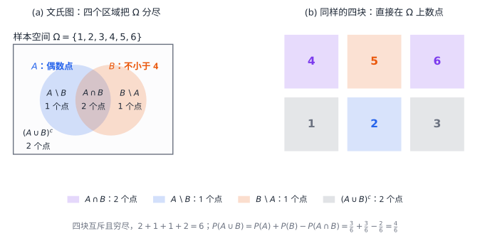

# 01 随机事件与概率

[[00 概率论与数理统计 MOC|← 目录]] · 下一章：[[02 随机变量及其分布]]

## 学习目标

- 写出与问题匹配的样本空间，并判断样本点是否等可能。
- 把文字条件翻译成事件运算。
- 用古典概型、几何概型和条件概率计算概率。
- 用全概率公式与贝叶斯公式处理分阶段试验。
- 区分互斥、对立与独立。

## 1 随机试验与样本空间

在相同条件下可以重复进行、结果不止一个、事先能列出全部可能结果，但每次试验前不能确定出现哪一个结果的试验，称为随机试验。概率论研究的是大量重复试验中呈现的规律，而不是某一次的具体结果。

随机试验的所有可能结果组成的集合称为**样本空间**，记为 $\Omega$；其中每个结果称为**样本点**。事件是样本空间的子集，事件 $A$ 发生就是试验结果落在 $A$ 中。只含一个样本点的事件称为基本事件，$\Omega$ 称为必然事件，$\varnothing$ 称为不可能事件。

同一个物理试验可以配不同的样本空间，样本点取决于要观察什么。抛一枚公平硬币两次，若记录正反面的顺序，则

$$
\Omega_1=\{HH,HT,TH,TT\},
$$

四个样本点等可能，各为 $1/4$；若只记录正面出现的次数，则 $\Omega_2=\{0,1,2\}$，三个结果的概率依次为 $1/4,1/2,1/4$，不再等可能。前者适合问“两次结果是否相同”，后者适合问“正面出现几次”。样本空间一旦选错，后面的计数再准确也没有意义。

## 2 事件的关系与运算

事件之间的关系与集合关系一一对应。若 $A$ 发生必然导致 $B$ 发生，称 $A$ 包含于 $B$，记 $A\subseteq B$；若 $A\subseteq B$ 且 $B\subseteq A$，则 $A=B$。若 $A\cap B=\varnothing$，称 $A$ 与 $B$ **互斥**，即两者不能同时发生；$A$ 的对立事件记 $A^c$，满足 $A\cup A^c=\Omega$ 且 $A\cap A^c=\varnothing$。

对立一定互斥，互斥不一定对立。掷骰子时“点数为偶数”与“点数为 1”互斥，但两者的并集不是整个样本空间，所以不对立；“点数为偶数”与“点数为奇数”既互斥又对立。

事件的并 $A\cup B$ 表示 $A$ 或 $B$ 至少一个发生，交 $A\cap B$ 表示两者同时发生，差 $A\setminus B=A\cap B^c$ 表示 $A$ 发生而 $B$ 不发生。概率论中的“或”通常指至少一个，允许两者同时发生；只有题目说“恰有一个”时才排除同时发生。

有的教材把 $A^c$ 写作 $\bar A$，把 $A\setminus B$ 写作 $A-B$。$A-B$ 仍然是事件差，不是概率相减；它的概率是 $P(A-B)=P(A)-P(A\cap B)$，不是 $P(A)-P(B)$。

事件运算满足交换律、结合律与分配律，例如

$$
(A\cup B)\cap C=(A\cap C)\cup(B\cap C).
$$

最常用的是德摩根律：

$$
\left(\bigcup_{i=1}^{n}A_i\right)^c=\bigcap_{i=1}^{n}A_i^c,
\qquad
\left(\bigcap_{i=1}^{n}A_i\right)^c=\bigcup_{i=1}^{n}A_i^c.
$$

它的读法是“整体取补，并交互换”。遇到“至少一个发生”，常先改写为对立事件“一个都不发生”，后者是若干个补事件的交集，再取补即可。

**例 1** 设 $A,B,C$ 是三个事件，把下列条件写成事件运算。

（1）$A,B$ 发生而 $C$ 不发生：$A\cap B\cap C^c$。

（2）$A,B,C$ 中恰有一个发生：

$$
(A\cap B^c\cap C^c)\cup(A^c\cap B\cap C^c)\cup(A^c\cap B^c\cap C).
$$

（3）至少一个发生：$A\cup B\cup C$。

（4）至多一个发生：没有事件发生，或恰有一个发生，即

$$
(A^c\cap B^c\cap C^c)\cup(A\cap B^c\cap C^c)\cup(A^c\cap B\cap C^c)\cup(A^c\cap B^c\cap C).
$$

“至少一个”的对立事件是“一个都不发生”，“至多一个”的对立事件是“至少两个发生”，两者并不互为对立事件。

图中四块互斥且穷尽，因此求并事件的概率只需把对应区域的概率相加。取 $\Omega=\{1,2,3,4,5,6\}$、$A=\{2,4,6\}$、$B=\{4,5,6\}$，则 $A\cup B=\{2,4,5,6\}$，$A\cap B=\{4,6\}$，于是

$$
P(A\cup B)=P(A)+P(B)-P(A\cap B)
=\frac36+\frac36-\frac26=\frac46.
$$

交集在 $P(A)+P(B)$ 中被计算了两次，所以减去一次。

## 3 概率的定义与性质

在 $n$ 次试验中，事件 $A$ 发生 $N_A$ 次，称 $N_A/n$ 为频率。频率随试验波动，但大量重复时会稳定在一个数附近，这个稳定值就是概率的直观来源。概率 $P(A)$ 是模型赋予事件的数，满足三条公理：

1. 非负性：$P(A)\ge0$；
2. 规范性：$P(\Omega)=1$；
3. 可列可加性：若 $A_1,A_2,\ldots$ 两两互斥，则

$$
P\left(\bigcup_{i=1}^{\infty}A_i\right)=\sum_{i=1}^{\infty}P(A_i).
$$

由公理可推出 $P(\varnothing)=0$、$0\le P(A)\le1$、$P(A^c)=1-P(A)$，以及单调性：若 $A\subseteq B$，则 $P(B)=P(A)+P(B\setminus A)\ge P(A)$。

减法公式来自分解 $A=(A\setminus B)\cup(A\cap B)$，两部分互斥，故

$$
P(A\setminus B)=P(A)-P(A\cap B).
$$

对任意两个事件，

$$
P(A\cup B)=P(A)+P(B)-P(A\cap B).
$$

三个事件的容斥公式为

$$
\begin{aligned}
P(A\cup B\cup C)={}&P(A)+P(B)+P(C)\\
&-P(A\cap B)-P(A\cap C)-P(B\cap C)+P(A\cap B\cap C).
\end{aligned}
$$

展开规律是“加奇减偶”：单事件相加，两两交集相减，三重交集相加。

**例 2** 已知 $P(A)=P(B)=P(C)=\frac14$，$P(A\cap C)=\frac18$，且 $A\cap B$、$B\cap C$、$A\cap B\cap C$ 都是不可能事件，求 $P(A\cup B\cup C)$。

**解** 代入三事件容斥公式，所有不存在的交集概率为零：

$$
P(A\cup B\cup C)=\frac14+\frac14+\frac14-\frac18=\frac58.
$$

概率为零的事件不一定是不可能事件。在 $[0,1]$ 上均匀取一点，恰好取到 $1/2$ 的概率为零，但 $\{1/2\}$ 并不是空集。因此“概率为 1”只表示几乎必然发生，不能当作逻辑上的必然。

## 4 古典概型

若样本空间只含有限个样本点，且每个样本点等可能，则称为古典概型。设 $\Omega$ 含 $n$ 个样本点，事件 $A$ 含 $m$ 个，则

$$
P(A)=\frac{m}{n}=\frac{|A|}{|\Omega|}.
$$

使用前要确认两件事：样本点有限且等可能；分子与分母按同一口径计数，不能分母按有序结果、分子按无序结果。

计数依赖两个基本公式。从 $n$ 个不同对象中取出 $r$ 个排成一列，有

$$
A_n^r=\frac{n!}{(n-r)!}
$$

种取法；若不计顺序，则有

$$
\binom nr=C_n^r=\frac{n!}{r!(n-r)!}
$$

种取法，且 $A_n^r=r!\,\binom nr$。

**例 3** 袋中有 5 个白球、6 个黑球，任取 2 个，不放回。

（1）求取到一白一黑的概率。按“同时取出”建模，样本总数为 $\binom{11}{2}$，有利取法为 $\binom51\binom61$，故

$$
P=\frac{\binom51\binom61}{\binom{11}{2}}=\frac{30}{55}=\frac6{11}.
$$

（2）求至少取到一个黑球的概率。对立事件是“两个都是白球”，所以

$$
P(\text{至少一黑})=1-\frac{\binom52}{\binom{11}{2}}
=1-\frac{10}{55}=\frac9{11}.
$$

“至少一个”常从对立事件入手，但“恰好一个”不能这样替代。

## 5 几何概型

若样本点落在某个区域 $G_\Omega$ 内，且落在任意子区域的概率只与该子区域的长度、面积或体积成正比，则称为几何概型。设事件 $A$ 对应区域 $G_A$，则

$$
P(A)=\frac{|G_A|}{|G_\Omega|},
$$

其中 $|\cdot|$ 表示相应的度量。几何概型的“等可能”加在测度上，单点与单条曲线的概率为零。

**例 4** 在 $(0,1)$ 上独立、均匀地取两个数 $X,Y$，求 $P\left(|X-Y|<\frac12\right)$。

**解** 点 $(X,Y)$ 均匀落在单位正方形内，总面积为 $1$。条件 $|X-Y|\ge\frac12$ 对应左上角与右下角两个直角边长为 $\frac12$ 的等腰直角三角形，总面积为

$$
2\times\frac12\times\frac12\times\frac12=\frac14.
$$

所以

$$
P\left(|X-Y|<\frac12\right)=1-\frac14=\frac34.
$$

几何概型必须先说清“在哪个量上均匀”。同一句“随机取一条弦”，若分别对端点、弦心距或弦中点均匀，得到的概率不同；均匀性不是几何图形自带的，而是建模假设。

## 6 条件概率与乘法公式

设 $P(A)>0$，在事件 $A$ 已发生的条件下，事件 $B$ 发生的概率定义为

$$
P(B\mid A)=\frac{P(A\cap B)}{P(A)}.
$$

直观上，条件概率把样本空间从 $\Omega$ 缩小为 $A$，再在 $A$ 内考察 $B$。它仍满足概率的三条公理，因此 $P(\Omega\mid A)=1$、$P(B^c\mid A)=1-P(B\mid A)$，并且对互斥事件有可加性。

由定义直接得到乘法公式（第一个等号要求 $P(A)>0$，第二个等号要求 $P(B)>0$）：

$$
P(A\cap B)=P(A)P(B\mid A)=P(B)P(A\mid B).
$$

求 $P(A\mid B^c)$ 时，先把分子化成差事件。当 $P(B)<1$ 时，

$$
P(A\mid B^c)=\frac{P(A\cap B^c)}{P(B^c)}
=\frac{P(A)-P(A\cap B)}{1-P(B)}.
$$

例如 $B\subset A$、$P(A)=0.8$、$P(B)=0.4$，则 $P(A\mid B^c)=\frac{0.8-0.4}{0.6}=\frac23$。若还已知 $A$ 与 $C$ 互斥，则

$$
P(A\cap B\mid C^c)
=\frac{P(A\cap B)-P(A\cap B\cap C)}{1-P(C)}
=\frac{P(A\cap B)}{1-P(C)},
$$

因为 $A\cap C=\varnothing$ 迫使 $A\cap B\cap C=\varnothing$。这类题先把条件概率写成分数，再把分子写成差事件，通常比直接展开更快。

多个事件可以连续展开：

$$
P(A_1A_2\cdots A_n)
=P(A_1)P(A_2\mid A_1)\cdots P(A_n\mid A_1A_2\cdots A_{n-1}),
$$

其中 $A_1A_2\cdots A_n$ 表示交集，各条件概率要求对应的前序交集概率为正。

**例 5** 袋中有 5 个白球、6 个黑球，不放回地依次取两个球。求第一次取到白球且第二次取到黑球的概率；再求在第一次取到白球的条件下，第二次取到黑球的概率。

**解** 设 $A$ 为第一次取到白球，$B$ 为第二次取到黑球。第一次取白后袋中剩 4 白 6 黑，故 $P(B\mid A)=\frac6{10}=\frac35$。由乘法公式

$$
P(A\cap B)=P(A)P(B\mid A)=\frac5{11}\cdot\frac6{10}=\frac3{11}.
$$

两个结果的区别在于：联合概率同时要求第一次取白，条件概率已经把第一次取白视为已知。

## 7 全概率公式与贝叶斯公式

若事件组 $A_1,A_2,\ldots,A_n$ 两两互斥且并集为 $\Omega$，则称为**完备事件组**或一个划分。只互斥而不覆盖全集不能称为划分。

设 $A_1,\ldots,A_n$ 是完备事件组，且 $P(A_i)>0$，则对任意事件 $B$，

$$
P(B)=\sum_{i=1}^{n}P(A_i)P(B\mid A_i).
$$

这就是**全概率公式**。它把事件 $B$ 按“来源”或“第一阶段结果”分成互斥的几类，每类用乘法公式求概率，再相加。反过来，若已知 $B$ 发生，要判断它来自哪个 $A_k$，且 $P(B)>0$，则

$$
P(A_k\mid B)=
\frac{P(A_k)P(B\mid A_k)}{\sum_{i=1}^{n}P(A_i)P(B\mid A_i)}.
$$

这就是**贝叶斯公式**：分子是第 $k$ 条路径的概率，分母是所有能导致 $B$ 的路径概率之和。把两级试验画成概率树，第一层分支标 $P(A_i)$（先验），第二层标 $P(B\mid A_i)$（似然），沿路径相乘得联合概率，全概率公式是通往 $B$ 的各路径之和，贝叶斯公式是其中一条路径占全部路径的比例。

**例 6** 甲袋有 $N$ 个白球、$M$ 个红球，乙袋有 $n$ 个白球、$m$ 个红球，所有球除颜色外相同。先从甲袋任取一球放入乙袋，再从乙袋任取一球，求第二次取到白球的概率。

**解** 设 $A_1$ 为第一次取到白球，$A_2$ 为第一次取到红球，$B$ 为第二次取到白球。$A_1,A_2$ 是完备事件组，且

$$
P(A_1)=\frac{N}{N+M},\quad P(A_2)=\frac{M}{N+M}.
$$

若 $A_1$ 发生，乙袋变为 $n+1$ 白 $m$ 红；若 $A_2$ 发生，乙袋变为 $n$ 白 $m+1$ 红。因此

$$
P(B)=\frac{N}{N+M}\cdot\frac{n+1}{n+m+1}
+\frac{M}{N+M}\cdot\frac{n}{n+m+1}.
$$

**例 7** 某病在人群中的患病率为 $0.001$。患者检测阳性的概率为 $0.95$，未患病者检测阳性的概率为 $0.002$。求检测阳性者实际患病的概率。

**解** 设 $A$ 为患病，$B$ 为检测阳性。由贝叶斯公式

$$
P(A\mid B)=
\frac{0.001\times0.95}{0.001\times0.95+0.999\times0.002}
=\frac{0.00095}{0.002948}\approx0.322.
$$

尽管灵敏度很高，阳性者中真正患病的比例只有约 $32\%$，原因是未患病者的人数远多于患者，少量误报在阳性结果中占了多数。若两次检测在给定健康状态下相互独立，连续两次阳性后

$$
P(A\mid B_1B_2)=
\frac{0.001\times0.95^2}{0.001\times0.95^2+0.999\times0.002^2}\approx0.996.
$$

这里不能在总体中直接写 $P(B_1B_2)=P(B_1)P(B_2)$，因为两次检测共享同一个健康状态；独立性是在“已知患病或不患病”的条件下使用的。

## 8 事件的独立性

若

$$
P(A\cap B)=P(A)P(B),
$$

则称事件 $A$ 与 $B$ 相互**独立**。当 $P(A)>0$ 时，这等价于 $P(B\mid A)=P(B)$，即 $A$ 发生与否不改变 $B$ 的概率；当 $P(B)>0$ 时也等价于 $P(A\mid B)=P(A)$。

若 $A,B$ 独立，则 $A$ 与 $B^c$、$A^c$ 与 $B$、$A^c$ 与 $B^c$ 也分别独立。因此“至少一次成功”常写成 $1-(1-p)^n$。

互斥与独立是不同概念。若 $A,B$ 互斥且 $P(A),P(B)>0$，则 $P(A\cap B)=0$，而 $P(A)P(B)>0$，所以二者不独立。互斥描述“不能同时发生”，独立描述“发生与否互不影响”。

三个事件 $A,B,C$ 两两独立，指

$$
P(AB)=P(A)P(B),\quad P(AC)=P(A)P(C),\quad P(BC)=P(B)P(C).
$$

相互独立还要求

$$
P(ABC)=P(A)P(B)P(C).
$$

两两独立推不出相互独立。独立抛两枚公平硬币，令 $A$ 为第一枚正面，$B$ 为第二枚正面，$C$ 为两枚结果相同。三者概率都是 $1/2$，任意两者的交集概率都是 $1/4$，但 $P(ABC)=P(\text{两枚都正面})=1/4\ne1/8$。

若一次试验只有两个互补结果 $A$ 与 $A^c$，称为伯努利试验。独立重复进行 $n$ 次，称为 $n$ 重伯努利试验。设每次成功的概率为 $p$，则 $n$ 次中恰好成功 $k$ 次的概率为

$$
P(X=k)=\binom nkp^k(1-p)^{n-k},\qquad k=0,1,\ldots,n.
$$

其中 $\binom nk$ 选择哪 $k$ 次成功，每一种具体排列的概率都是 $p^k(1-p)^{n-k}$。

**例 8** 甲、乙进行五局三胜制比赛，各局独立，甲每局获胜的概率为 $\frac23$，求甲最终获胜的概率。

**解** 甲获胜分三种互斥情况：第三局结束、第四局结束、第五局结束。第三局结束需连胜三局；第四局结束需前三局胜两局且第四局胜；第五局结束需前四局战成二比二且第五局胜。因此

$$
P(\text{甲胜})
=\left(\frac23\right)^3
+\binom32\left(\frac23\right)^3\left(\frac13\right)
+\binom42\left(\frac23\right)^3\left(\frac13\right)^2
=\frac{64}{81}.
$$

也可以预想五局全部打完，即使比赛提前结束也保留剩余各局的结果，则甲先取得三胜当且仅当五局中甲至少胜三局，同样得到

$$
P(\text{甲胜})=\sum_{k=3}^{5}\binom5k
\left(\frac23\right)^k\left(\frac13\right)^{5-k}=\frac{64}{81}.
$$

**例 9** 某茶杯的次品率为 $0.1$，每套随机装入 $4$ 只，各只是否为次品相互独立。顾客从一套中随机检查 $2$ 只，若都不是次品就买下。

（1）求一套中次品数 $X$ 的分布律；

（2）求顾客买下该套茶杯的概率；

（3）已知顾客买下，求该套确实无次品的概率。

**解** （1）$X\sim B(4,0.1)$，故

$$
P(X=0)=0.9^4=0.6561,\qquad
P(X=1)=4\cdot0.1\cdot0.9^3=0.2916,
$$

$$
P(X=2)=6\cdot0.1^2\cdot0.9^2=0.0486.
$$

$X\ge3$ 时一套中不足两只正品，顾客不可能买下。

（2）设 $B$ 为顾客买下。在 $X=0,1,2$ 的条件下，买下的概率分别为

$$
P(B\mid X=0)=1,\qquad
P(B\mid X=1)=\frac{\binom32}{\binom42}=\frac12,\qquad
P(B\mid X=2)=\frac{\binom22}{\binom42}=\frac16.
$$

由全概率公式

$$
P(B)=0.6561\cdot1+0.2916\cdot\frac12+0.0486\cdot\frac16=0.81.
$$

（3）由贝叶斯公式

$$
P(X=0\mid B)=\frac{P(X=0)P(B\mid X=0)}{P(B)}
=\frac{0.6561}{0.81}=0.81.
$$

这道题把分布律、全概率公式和贝叶斯公式连成一条链：先用二项分布给出第一层情况的概率，再在每种情况下求买下的条件概率，最后反推“买下时无次品”的后验概率。
