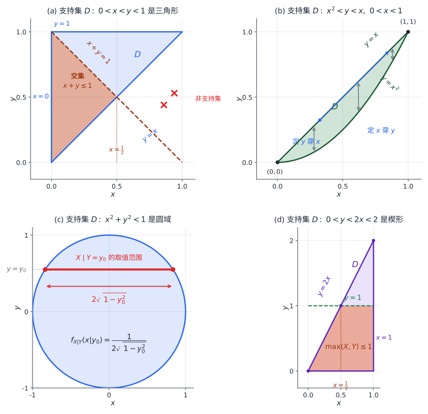

# 03 多维随机变量及其分布

[[00 概率论与数理统计 MOC|← 目录]] · 上一章：[[02 随机变量及其分布]] · 下一章：[[04 随机变量的数字特征]]

## 学习目标

- 写出二维随机变量的联合分布函数、联合分布律与联合密度。
- 由联合分布求边缘分布与条件分布。
- 判断两个随机变量是否相互独立。
- 求两个随机变量函数的分布，重点是和、最大值与最小值。
- 在支持集上正确确定二重积分的上下限。

## 1 二维随机变量与联合分布

同一试验中定义两个随机变量 $X,Y$，就得到二维随机变量 $(X,Y)$，一次试验结果对应平面上的一个随机点。例如从袋中任取两球，$X$ 表示白球数、$Y$ 表示红球数，则 $(X,Y)$ 只能取有限个有序对。

二维随机变量 $(X,Y)$ 的**联合分布函数**定义为

$$
F_{X,Y}(x,y)=P(X\le x,\ Y\le y),
$$

几何上是随机点落在以 $(x,y)$ 为右上角的左下区域的概率。它关于每个变量单调不减、右连续，且

$$
\lim_{x\to-\infty}F_{X,Y}(x,y)=0,\qquad
\lim_{x,y\to+\infty}F_{X,Y}(x,y)=1.
$$

矩形区域的概率由四个角点相减得到：

$$
\begin{aligned}
&P(x_1<X\le x_2,\ y_1<Y\le y_2)\\
&=F(x_2,y_2)-F(x_1,y_2)-F(x_2,y_1)+F(x_1,y_1).
\end{aligned}
$$

### 1.1 二维离散型随机变量

若 $(X,Y)$ 只取有限个或可列无限个有序对 $(x_i,y_j)$，则称为二维离散型随机变量。记

$$
p_{ij}=P(X=x_i,\ Y=y_j),
$$

称为联合分布律，满足 $p_{ij}\ge0$ 且 $\sum_i\sum_jp_{ij}=1$。它通常写成二维表格，求法仍是先列出所有有序对，再逐个计算概率。

**例 1** 袋中有 2 个红球、4 个白球，不放回地连续取两次，每次取一球。令

$$
X=\begin{cases}
0,&\text{第一次取到红球},\\
1,&\text{第一次取到白球},
\end{cases}
\qquad
Y=\begin{cases}
0,&\text{第二次取到红球},\\
1,&\text{第二次取到白球}.
\end{cases}
$$

求 $(X,Y)$ 的联合分布律。

**解** 第一次取红、第二次也取红的概率为

$$
P(X=0,Y=0)=\frac26\cdot\frac15=\frac1{15}.
$$

同理，

$$
P(X=0,Y=1)=\frac26\cdot\frac45=\frac4{15},
$$

$$
P(X=1,Y=0)=\frac46\cdot\frac25=\frac4{15},
\qquad
P(X=1,Y=1)=\frac46\cdot\frac35=\frac6{15}.
$$

四个概率之和为 $1$，列成表格：

| $X\backslash Y$ | $0$ | $1$ |
| --- | ---: | ---: |
| $0$ | $\frac1{15}$ | $\frac4{15}$ |
| $1$ | $\frac4{15}$ | $\frac6{15}$ |

已知边缘分布和某个约束时，可以先填零格，再用行和、列和补齐。例如 $X_1,X_2$ 都取 $-1,0,1$，各自的分布律为 $P(X_i=-1)=P(X_i=1)=\frac14$、$P(X_i=0)=\frac12$，且 $P(X_1X_2=0)=1$。四个乘积非零的格子 $(-1,-1),(-1,1),(1,-1),(1,1)$ 概率为零；行 $-1$ 只有 $(-1,0)$ 可非零，故它等于 $\frac14$，其余三格同理，最后 $(0,0)=0$：

| $X_1\backslash X_2$ | $-1$ | $0$ | $1$ |
| --- | ---: | ---: | ---: |
| $-1$ | $0$ | $\frac14$ | $0$ |
| $0$ | $\frac14$ | $0$ | $\frac14$ |
| $1$ | $0$ | $\frac14$ | $0$ |

于是 $P(X_1=X_2)=0$，$F(0,0)=P(X_1\le0,X_2\le0)=\frac14+\frac14=\frac12$。

### 1.2 二维连续型随机变量

若存在非负函数 $f_{X,Y}(x,y)$，使

$$
F_{X,Y}(x,y)=\int_{-\infty}^{x}\int_{-\infty}^{y}f_{X,Y}(u,v)\,dv\,du,
$$

则称 $(X,Y)$ 为二维连续型随机变量，$f_{X,Y}$ 为**联合概率密度**。它满足

$$
f_{X,Y}(x,y)\ge0,\qquad
\iint_{\mathbb R^2}f_{X,Y}(x,y)\,dx\,dy=1.
$$

对平面区域 $G$，

$$
P\bigl((X,Y)\in G\bigr)=\iint_G f_{X,Y}(x,y)\,dx\,dy.
$$

计算区域概率时，积分区域是 $G$ 与联合密度非零区域（支持集）的交集。先画支持集，再画事件区域，取交集后确定积分限；这一步比直接套公式更重要。

图中阴影是由支持集与事件条件共同确定的积分区域。读图时先看边界由哪几条曲线围成，再选择“先 $x$ 后 $y$”或“先 $y$ 后 $x$”；支持集之外的区域概率为零，不能按外包矩形积分。

**例 2** 设

$$
f_{X,Y}(x,y)=
\begin{cases}
kx,&0<x<y<1,\\
0,&\text{其他},
\end{cases}
$$

求 $k$ 与 $P(X+Y\le1)$。

**解** 由规范性，

$$
1=\int_0^1\int_x^1kx\,dy\,dx
=k\int_0^1x(1-x)\,dx=\frac{k}{6},
$$

故 $k=6$。支持集是三角形 $0<x<y<1$。再要求 $x+y\le1$，得 $0<x\le\frac12$、$x<y\le1-x$，所以

$$
P(X+Y\le1)
=\int_0^{1/2}\int_x^{1-x}6x\,dy\,dx
=\int_0^{1/2}6x(1-2x)\,dx=\frac14.
$$

## 2 边缘分布

只关心其中一个变量时，把另一个变量“消去”，所得分布称为**边缘分布**。对分布函数，令另一个自变量趋于 $+\infty$：

$$
F_X(x)=F_{X,Y}(x,+\infty),\qquad
F_Y(y)=F_{X,Y}(+\infty,y).
$$

离散型的边缘分布律由联合分布表按行或按列求和：

$$
P(X=x_i)=\sum_jp_{ij},\qquad
P(Y=y_j)=\sum_ip_{ij}.
$$

连续型的边缘密度由联合密度对另一个变量积分：

$$
f_X(x)=\int_{-\infty}^{+\infty}f_{X,Y}(x,y)\,dy,
\qquad
f_Y(y)=\int_{-\infty}^{+\infty}f_{X,Y}(x,y)\,dx.
$$

积分限由支持集决定，不能一律写成整个实轴。

**例 3** 设

$$
f_{X,Y}(x,y)=
\begin{cases}
6,&x^2<y<x,\ 0<x<1,\\
0,&\text{其他},
\end{cases}
$$

求 $f_X(x)$ 与 $f_Y(y)$。

**解** 支持集由抛物线 $y=x^2$ 与直线 $y=x$ 围成。固定 $x\in(0,1)$ 时 $y$ 从 $x^2$ 到 $x$；固定 $y\in(0,1)$ 时 $x$ 从 $y$ 到 $\sqrt y$。因此

$$
f_X(x)=
\begin{cases}
\displaystyle\int_{x^2}^{x}6\,dy=6(x-x^2),&0<x<1,\\
0,&\text{其他},
\end{cases}
$$

$$
f_Y(y)=
\begin{cases}
\displaystyle\int_{y}^{\sqrt y}6\,dx=6(\sqrt y-y),&0<y<1,\\
0,&\text{其他}.
\end{cases}
$$

边缘分布一般不能决定联合分布。两个变量可以有相同的边缘分布，却一个独立、一个完全依赖。例如 $X,Y$ 都取 $-1,1$、各以概率 $\frac12$ 出现，若联合分布集中在 $Y=-X$ 上，则两者不独立；若联合概率为四个格子各 $\frac14$，则两者独立。两种情况的行和、列和完全相同，说明联合分布还包含变量之间的依赖信息。

## 3 条件分布

条件分布描述已知一个变量取值时另一个变量如何分布。离散与连续的构造相同：用联合分布除以条件变量的边缘分布。

### 3.1 离散型条件分布

当 $P(Y=y_j)>0$ 时，

$$
P(X=x_i\mid Y=y_j)=\frac{P(X=x_i,Y=y_j)}{P(Y=y_j)}
=\frac{p_{ij}}{\sum_i p_{ij}}.
$$

分母必须与条件中的变量对应。例如联合分布表中 $Y=1$ 这一列的概率为 $0.03,0.01,0.005$，则 $P(Y=1)=0.045$，条件分布为

$$
P(X=0\mid Y=1)=\frac{0.03}{0.045}=\frac69,\quad
P(X=1\mid Y=1)=\frac{0.01}{0.045}=\frac29,\quad
P(X=2\mid Y=1)=\frac{0.005}{0.045}=\frac19.
$$

### 3.2 连续型条件密度

连续型中 $P(Y=y)=0$，不能直接作商。把条件 $Y=y$ 看成窄带 $y<Y\le y+h$，当 $f_Y(y)>0$ 时，分子分母都含因子 $h$，约去后令 $h\to0$，得

$$
f_{X\mid Y}(x\mid y)=\frac{f_{X,Y}(x,y)}{f_Y(y)},
\qquad
f_{Y\mid X}(y\mid x)=\frac{f_{X,Y}(x,y)}{f_X(x)}.
$$

固定 $y$ 后，$f_{X\mid Y}(x\mid y)$ 是 $x$ 的函数，且对整个 $x$ 积分为 $1$。几何上，它是对联合密度沿 $x$ 方向取一条截面，再按该截面的总面积重新归一化；分母 $f_Y(y)$ 正是截面面积。

**例 4** 设 $(X,Y)$ 在单位圆 $D=\{(x,y):x^2+y^2<1\}$ 上均匀分布，求 $f_{X\mid Y}(x\mid y)$。

**解** 圆面积为 $\pi$，故 $f_{X,Y}(x,y)=\frac1\pi$（$(x,y)\in D$），其他位置为零。固定 $y\in(-1,1)$ 时，$x$ 的范围是 $-\sqrt{1-y^2}<x<\sqrt{1-y^2}$，所以

$$
f_Y(y)=\int_{-\sqrt{1-y^2}}^{\sqrt{1-y^2}}\frac1\pi\,dx
=\frac{2\sqrt{1-y^2}}{\pi}.
$$

因此

$$
f_{X\mid Y}(x\mid y)=
\begin{cases}
\dfrac1{2\sqrt{1-y^2}},&-\sqrt{1-y^2}<x<\sqrt{1-y^2},\\
0,&\text{其他}.
\end{cases}
$$

给定 $Y=y$ 后，$X$ 在一条水平弦上均匀分布，条件密度是弦长的倒数。

## 4 随机变量的独立性

若对任意 $x,y$ 都有

$$
F_{X,Y}(x,y)=F_X(x)F_Y(y),
$$

则称 $X$ 与 $Y$ 相互独立。

离散型独立的判据是：对所有可能的 $i,j$，

$$
P(X=x_i,Y=y_j)=P(X=x_i)P(Y=y_j).
$$

只要有一格不成立，就可以否定独立。

连续型独立的判据是：几乎处处有

$$
f_{X,Y}(x,y)=f_X(x)f_Y(y),
$$

实际判断时通常检查两点：密度能否分解为两个单变量因子之积；支持集是否为两个单变量集合的笛卡尔积（忽略零概率的边界）。若支持集是三角形、圆域或带斜边约束的区域，即使密度表达式看起来能拆，变量也不独立。

**例 5** 判断下列两种情况下的 $X,Y$ 是否独立。

（1）$f_{X,Y}(x,y)=2e^{-2x-y}$，$x>0,\ y>0$，其他位置为零。

（2）$f_{X,Y}(x,y)=6$，$x^2<y<x$，$0<x<1$，其他位置为零。

**解** （1）边缘密度为 $f_X(x)=2e^{-2x}$（$x>0$）、$f_Y(y)=e^{-y}$（$y>0$），在第一象限内

$$
f_X(x)f_Y(y)=2e^{-2x-y}=f_{X,Y}(x,y),
$$

支持集又是 $(0,+\infty)\times(0,+\infty)$，故 $X,Y$ 相互独立。

（2）支持集是三角形，不能写成两个区间的笛卡尔积；例如点 $(0.8,0.1)$ 在矩形 $(0,1)\times(0,1)$ 内，却不在支持集中，而 $f_X(0.8)f_Y(0.1)>0$。故 $X,Y$ 不独立。

独立是比“不相关”更强的条件。独立描述完整的分布关系，不相关只描述线性关系；二阶矩存在时独立一定不相关，反之不成立。这一区别在下一章用协方差与相关系数详细说明。

## 5 二维均匀分布与二维正态分布

若随机点在平面区域 $D$ 上均匀分布，则联合密度为

$$
f_{X,Y}(x,y)=
\begin{cases}
\dfrac1{S_D},&(x,y)\in D,\\
0,&\text{其他},
\end{cases}
$$

其中 $S_D$ 是 $D$ 的面积。此时

$$
P\bigl((X,Y)\in D_1\bigr)=\frac{S_{D_1}}{S_D},\qquad D_1\subseteq D.
$$

二维正态分布由参数 $\mu_1,\mu_2,\sigma_1,\sigma_2,\rho$ 描述，其中 $\sigma_1>0$、$\sigma_2>0$、$|\rho|<1$。其密度为

$$
f_{X,Y}(x,y)=\frac{1}{2\pi\sigma_1\sigma_2\sqrt{1-\rho^2}}
\exp\left\{-\frac{1}{2(1-\rho^2)}
\left[
\frac{(x-\mu_1)^2}{\sigma_1^2}
-\frac{2\rho(x-\mu_1)(y-\mu_2)}{\sigma_1\sigma_2}
+\frac{(y-\mu_2)^2}{\sigma_2^2}
\right]\right\}.
$$

两个边缘分布分别为 $N(\mu_1,\sigma_1^2)$ 与 $N(\mu_2,\sigma_2^2)$。在二维正态的前提下，$\rho=0$ 当且仅当 $X,Y$ 独立；代入 $\rho=0$，密度立即分解为两个正态密度之积。反过来，两个边缘都是正态并不能保证联合分布是二维正态，也不能仅凭边缘正态判断独立。

## 6 两个随机变量函数的分布

设 $Z=g(X,Y)$，已知 $(X,Y)$ 的联合分布，求 $Z$ 的分布。

### 6.1 离散型

先列出 $g(x_i,y_j)$ 的所有不同取值，再把同一结果的联合概率相加：

$$
P(Z=z)=\sum_{g(x_i,y_j)=z}P(X=x_i,Y=y_j).
$$

**例 6** 设 $(X,Y)$ 的联合分布律为

| $X\backslash Y$ | $1$ | $2$ | $3$ |
| --- | ---: | ---: | ---: |
| $1$ | $\frac14$ | $\frac14$ | $\frac18$ |
| $2$ | $\frac18$ | $0$ | $\frac14$ |

求 $Z=X+Y$ 的分布律。

**解** $Z$ 取 $2,3,4,5$，把同一和值的格点概率相加：

$$
P(Z=2)=\frac14,\qquad
P(Z=3)=\frac14+\frac18=\frac38,
$$

$$
P(Z=4)=\frac18+0=\frac18,\qquad
P(Z=5)=\frac14.
$$

### 6.2 连续型：和的卷积

设 $Z=X+Y$。一般情况下

$$
f_Z(z)=\int_{-\infty}^{+\infty}f_{X,Y}(x,z-x)\,dx.
$$

若 $X,Y$ 独立，则 $f_{X,Y}=f_Xf_Y$，得到卷积公式

$$
f_Z(z)=\int_{-\infty}^{+\infty}f_X(x)f_Y(z-x)\,dx.
$$

不独立时必须保留联合密度，不能直接卷积。

**例 7** 设 $X,Y$ 独立且都服从 $U(0,1)$，求 $Z=X+Y$ 的密度。

**解** 非零条件为 $0<x<1$、$0<z-x<1$，即

$$
\max(0,z-1)<x<\min(1,z).
$$

当 $0<z<1$ 时积分区间为 $(0,z)$，当 $1\le z<2$ 时为 $(z-1,1)$，其他情况为空。因此

$$
f_Z(z)=
\begin{cases}
z,&0<z<1,\\
2-z,&1\le z<2,\\
0,&\text{其他}.
\end{cases}
$$

两个均匀变量之和呈三角形密度，而不是均匀密度。

若 $Z=X-Y$，令 $x=y+z$，则

$$
f_Z(z)=\int_{-\infty}^{+\infty}f_{X,Y}(y+z,y)\,dy.
$$

独立时 $f_Z(z)=\int f_X(y+z)f_Y(y)\,dy$。例如 $X,Y$ 独立同分布 $E(\lambda)$，则 $f_{X-Y}(z)=\frac{\lambda}{2}e^{-\lambda|z|}$，关于 $0$ 对称。和用 $x=z-y$，差用 $x=y+z$，代换后对剩下的变量积分。

正态分布对独立和封闭：若 $X\sim N(\mu_1,\sigma_1^2)$、$Y\sim N(\mu_2,\sigma_2^2)$ 且独立，则

$$
aX+bY\sim N\left(a\mu_1+b\mu_2,\ a^2\sigma_1^2+b^2\sigma_2^2\right),
$$

其中 $a,b$ 不同时为零。例如 $X\sim N(1,2)$、$Y\sim N(2,4)$ 独立时，$X-2Y\sim N(-3,18)$。

### 6.3 最大值与最小值

设 $X,Y$ 独立，分布函数分别为 $F_X,F_Y$。令 $M=\max(X,Y)$。事件 $\{M\le z\}$ 等价于 $X\le z$ 且 $Y\le z$，故

$$
F_M(z)=P(X\le z)P(Y\le z)=F_X(z)F_Y(z).
$$

令 $N=\min(X,Y)$。事件 $\{N>z\}$ 等价于 $X>z$ 且 $Y>z$，所以

$$
F_N(z)=1-P(X>z)P(Y>z)
=1-\bigl[1-F_X(z)\bigr]\bigl[1-F_Y(z)\bigr].
$$

**例 8** 设 $X,Y$ 独立且都服从 $U(0,3)$，求 $P(\max(X,Y)\le1)$ 与 $P(\min(X,Y)\le1)$。

**解** 第一问要求两者都不超过 $1$：

$$
P(\max(X,Y)\le1)=P(X\le1)P(Y\le1)
=\frac13\cdot\frac13=\frac19.
$$

第二问用对立事件“两者都大于 $1$”：

$$
P(\min(X,Y)\le1)=1-P(X>1)P(Y>1)
=1-\frac23\cdot\frac23=\frac59.
$$

若 $X,Y$ 独立同分布，$F(z)=z^2$（密度 $2z$，$0<z<1$），则 $F_{\max}(z)=z^4$、$f_{\max}(z)=4z^3$；$F_{\min}(z)=2z^2-z^4$、$f_{\min}(z)=4z-4z^3$。先写分布函数再求导，比直接记密度公式稳妥。
