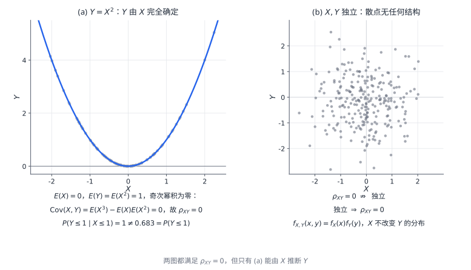

# 04 随机变量的数字特征

[[00 概率论与数理统计 MOC|← 目录]] · 上一章：[[03 多维随机变量及其分布]] · 下一章：[[05 大数定律与中心极限定理]]

## 学习目标

- 计算离散型与连续型随机变量的数学期望。
- 用 $E(X^2)-[E(X)]^2$ 计算方差，并说明方差的含义。
- 记住常见分布的期望与方差。
- 计算协方差与相关系数，区分独立与不相关。
- 用条件期望与全期望公式分层计算。

本章统一把方差记为 $D(X)$，它与 $\operatorname{Var}(X)$ 同义。数字特征只概括分布的某一方面：期望相同的两个随机变量，分布可能完全不同；期望也不一定是可能取值，例如公平骰子的期望是 $3.5$。

## 1 数学期望

### 1.1 离散型随机变量的期望

设离散型随机变量 $X$ 的分布律为 $P(X=x_k)=p_k$。若级数绝对收敛，即 $\sum_k|x_k|p_k<\infty$，则称

$$
E(X)=\sum_kx_kp_k
$$

为 $X$ 的**数学期望**，简称期望。计算方法是“取值乘概率，再求和”。要求 $g(X)$ 的期望时，不必先求 $g(X)$ 的分布，只要 $\sum_k|g(x_k)|p_k<\infty$，就有

$$
E[g(X)]=\sum_kg(x_k)p_k.
$$

### 1.2 连续型随机变量的期望

设连续型随机变量 $X$ 的密度为 $f_X(x)$。若 $\int_{-\infty}^{+\infty}|x|f_X(x)\,dx<\infty$，则

$$
E(X)=\int_{-\infty}^{+\infty}xf_X(x)\,dx.
$$

同样地，若 $\int_{-\infty}^{+\infty}|g(x)|f_X(x)\,dx<\infty$，则

$$
E[g(X)]=\int_{-\infty}^{+\infty}g(x)f_X(x)\,dx.
$$

密度为分段函数时，只在密度非零的区间上积分。

对二维随机变量，

$$
E[g(X,Y)]=\iint_{\mathbb R^2}g(x,y)f_{X,Y}(x,y)\,dx\,dy,
$$

只要积分绝对收敛。求 $E(X)$、$E(Y)$、$E(XY)$ 时不必先求边缘密度，直接在联合密度的非零区域上积分即可。

**例 1** 设 $X$ 取 $0,1,2,3$，概率依次为 $\frac12,\frac14,\frac18,\frac18$，求 $E(X)$ 与 $E(X^2)$。

**解**

$$
E(X)=0\cdot\frac12+1\cdot\frac14+2\cdot\frac18+3\cdot\frac18
=\frac78,
$$

$$
E(X^2)=0^2\cdot\frac12+1^2\cdot\frac14+2^2\cdot\frac18+3^2\cdot\frac18
=\frac{15}{8}.
$$

**例 2** 设 $X\sim U(0,\pi)$，求 $E(X)$ 与 $E(\sin X)$。

**解** 密度为 $f_X(x)=\frac1\pi$（$0<x<\pi$），其他位置为零，故

$$
E(X)=\int_0^\pi x\cdot\frac1\pi\,dx=\frac\pi2,
\qquad
E(\sin X)=\int_0^\pi\sin x\cdot\frac1\pi\,dx=\frac2\pi.
$$

### 1.3 期望的性质

当涉及的期望都存在时，对常数 $a,b,c$，

$$
E(aX+bY+c)=aE(X)+bE(Y)+c,\qquad E(c)=c.
$$

期望具有线性，但一般不能把乘积拆开：$E(XY)\ne E(X)E(Y)$，除非 $X,Y$ 独立（或至少不相关）。同样，$E[g(X)]\ne g(E(X))$，例如 $E(X^2)\ne[E(X)]^2$，两者相差方差。

期望存在要求绝对可积。标准柯西分布的密度

$$
f(x)=\frac{1}{\pi(1+x^2)}
$$

关于原点对称，但

$$
\int_0^{+\infty}\frac{x}{\pi(1+x^2)}\,dx=\infty,
$$

所以 $E|X|=\infty$，期望不存在。对称性只能在一个已经存在的期望上用来求值，不能把正负两部分相互抵消。

## 2 方差与标准差

若 $E(X)$ 存在且 $E[(X-E(X))^2]$ 存在，则称

$$
D(X)=E\left[(X-E(X))^2\right]
$$

为 $X$ 的**方差**。它描述 $X$ 偏离均值的平均平方程度，因此 $D(X)\ge0$。标准差为 $\sigma_X=\sqrt{D(X)}$，与原变量同量纲。

把平方展开：

$$
D(X)=E(X^2)-2E(X)E(X)+[E(X)]^2
=E(X^2)-[E(X)]^2.
$$

口诀是“平方的期望减期望的平方”。反过来，

$$
E(X^2)=D(X)+[E(X)]^2.
$$

对常数 $a,b$，

$$
D(aX+b)=a^2D(X).
$$

平移不改变方差，缩放系数要平方。两个随机变量之和的方差为

$$
D(X+Y)=D(X)+D(Y)+2\operatorname{Cov}(X,Y),
$$

其中 $\operatorname{Cov}(X,Y)=E[(X-E(X))(Y-E(Y))]$。若 $X,Y$ 独立，协方差为零，方差可以直接相加。

**例 3** 续例 1，求 $D(X)$。

**解**

$$
D(X)=E(X^2)-[E(X)]^2=\frac{15}{8}-\left(\frac78\right)^2
=\frac{120}{64}-\frac{49}{64}=\frac{71}{64}.
$$

**例 4** 设 $X_1,X_2,X_3$ 相互独立，$D(X_1)=3$、$D(X_2)=4$、$D(X_3)=3$，求 $D(X_1-2X_2+3X_3)$。

**解** 独立使交叉协方差为零，故

$$
D(X_1-2X_2+3X_3)=D(X_1)+4D(X_2)+9D(X_3)
=3+16+27=46.
$$

## 3 常见分布的期望与方差

常见分布的数字特征汇总如下：

| 分布 | 参数 | $E(X)$ | $D(X)$ |
| --- | --- | ---: | ---: |
| $B(1,p)$ | $0\le p\le1$ | $p$ | $p(1-p)$ |
| $B(n,p)$ | $n\in\mathbb N^+$ | $np$ | $np(1-p)$ |
| $P(\lambda)$ | $\lambda>0$ | $\lambda$ | $\lambda$ |
| 几何分布 | $0<p<1$ | $\dfrac1p$ | $\dfrac{1-p}{p^2}$ |
| 超几何分布 | $N,M,n$ | $n\dfrac MN$ | $n\dfrac MN\left(1-\dfrac MN\right)\dfrac{N-n}{N-1}$ |
| $U(a,b)$ | $a<b$ | $\dfrac{a+b}{2}$ | $\dfrac{(b-a)^2}{12}$ |
| $E(\lambda)$ | $\lambda>0$ | $\dfrac1\lambda$ | $\dfrac1{\lambda^2}$ |
| $N(\mu,\sigma^2)$ | $\sigma>0$ | $\mu$ | $\sigma^2$ |

表中几何分布按“首次成功所需试验次数”计；若改记“首次成功前的失败次数”，期望变为 $\frac{1-p}{p}$，方差不变。超几何分布要求 $N>1$、$0\le M\le N$、$0\le n\le N$，方差公式含 $N-1$，$N=1$ 时不能使用。

二项分布的期望与方差可以用指示变量快速得到。设 $X_i$ 表示第 $i$ 次试验是否成功，则 $X_i\sim B(1,p)$，且 $X=X_1+\cdots+X_n$。由 $X_i^2=X_i$ 得 $E(X_i)=p$、$D(X_i)=p-p^2=p(1-p)$；再由期望的线性与独立性，

$$
E(X)=np,\qquad D(X)=np(1-p).
$$

泊松分布满足 $E(X)=D(X)=\lambda$。计算时先求 $E[X(X-1)]$：由 $e^\lambda=\sum_{k\ge0}\lambda^k/k!$ 求导可得

$$
E[X(X-1)]=\sum_{k=2}^{\infty}k(k-1)e^{-\lambda}\frac{\lambda^k}{k!}
=\lambda^2,
$$

于是

$$
D(X)=E[X(X-1)]+E(X)-[E(X)]^2=\lambda^2+\lambda-\lambda^2=\lambda.
$$

均匀分布的期望是区间中点，方差由积分

$$
E(X^2)=\frac{(b^3-a^3)}{3(b-a)}=\frac{a^2+ab+b^2}{3}
$$

减去 $\left(\frac{a+b}{2}\right)^2$ 得到。指数分布用分部积分得 $E(X)=\frac1\lambda$、$E(X^2)=\frac2{\lambda^2}$，故 $D(X)=\frac1{\lambda^2}$。正态分布的期望与方差就是两个参数 $\mu,\sigma^2$，标准化后由标准正态密度的对称性与 $\int t^2\varphi(t)\,dt=1$ 得到。

**例 5** 设 $X\sim B(10,0.4)$，求 $E(X)$、$D(X)$ 与 $E(X^2)$。

**解**

$$
E(X)=10\times0.4=4,\qquad
D(X)=10\times0.4\times0.6=2.4,
$$

$$
E(X^2)=D(X)+[E(X)]^2=2.4+16=18.4.
$$

**题型：由 $E(X)$、$E(X^2)$ 反求参数**

泊松分布满足 $E(X)=D(X)=\lambda$，所以

$$
E(X^2)=D(X)+[E(X)]^2=\lambda+\lambda^2.
$$

例如 $X\sim P(3)$ 时 $E(X^2)=3+9=12$。二项分布已知 $E(X)=np$、$E(X^2)=np(1-p)+n^2p^2$，联立可解 $n,p$。设 $E(X)=2.4$、$E(X^2)=7.2$，则

$$
D(X)=7.2-2.4^2=1.44,\qquad
1-p=\frac{D(X)}{E(X)}=\frac{1.44}{2.4}=0.6,
$$

故 $p=0.4$、$n=\frac{2.4}{0.4}=6$。步骤固定：先由平方的期望减期望的平方得方差，再用 $\frac{D(X)}{E(X)}=1-p$ 求出 $p$。

## 4 协方差与相关系数

### 4.1 协方差

设 $X,Y$ 的二阶矩都存在，定义

$$
\operatorname{Cov}(X,Y)=E\left[(X-E(X))(Y-E(Y))\right]
=E(XY)-E(X)E(Y).
$$

协方差的符号反映两个变量共同偏离均值的方向：同向偏离为主时为正，反向偏离为主时为负。它受量纲影响，把 $X$ 的单位放大十倍，协方差也放大十倍，因此不能直接比较大小。

协方差具有以下性质：

$$
\operatorname{Cov}(X,Y)=\operatorname{Cov}(Y,X),\qquad
\operatorname{Cov}(aX,bY)=ab\operatorname{Cov}(X,Y),
$$

$$
\operatorname{Cov}(X+Y,Z)=\operatorname{Cov}(X,Z)+\operatorname{Cov}(Y,Z),
\qquad
\operatorname{Cov}(X,X)=D(X).
$$

若 $X,Y$ 独立，则 $\operatorname{Cov}(X,Y)=0$；反之不成立。更一般地，

$$
D(X\pm Y)=D(X)+D(Y)\pm2\operatorname{Cov}(X,Y),
$$

$$
\operatorname{Cov}(aX+bY,cX+dY)
=acD(X)+(ad+bc)\operatorname{Cov}(X,Y)+bdD(Y).
$$

展开时把平方项写成方差、交叉项写成协方差，系数照乘即可。

**例 6** 设 $(X,Y)$ 在三角形 $0<x<y<1$ 上均匀分布，$f_{X,Y}=2$。求 $E(X)$、$E(Y)$、$E(XY)$、$D(X)$、$D(Y)$、$\operatorname{Cov}(X,Y)$ 与 $\rho_{XY}$。

**解** 由二维期望公式，

$$
E(X)=\int_0^1\int_x^1 2x\,dy\,dx=\frac13,\qquad
E(Y)=\int_0^1\int_0^y 2y\,dx\,dy=\frac23,
$$

$$
E(XY)=\int_0^1\int_x^1 2xy\,dy\,dx=\frac14.
$$

又

$$
E(X^2)=\int_0^1\int_x^1 2x^2\,dy\,dx=\frac16,\qquad
E(Y^2)=\int_0^1\int_0^y 2y^2\,dx\,dy=\frac12,
$$

所以

$$
D(X)=\frac16-\frac19=\frac1{18},\qquad
D(Y)=\frac12-\frac49=\frac1{18},
$$

$$
\operatorname{Cov}(X,Y)=\frac14-\frac13\cdot\frac23=\frac1{36},\qquad
\rho_{XY}=\frac{1/36}{1/18}=\frac12.
$$

支持集是三角形而不是矩形，$X,Y$ 不独立。相关系数只有 $0.5$，说明线性关系中等，不能据此判断独立。

### 4.2 相关系数

当 $D(X)>0$、$D(Y)>0$ 时，定义

$$
\rho_{XY}=\frac{\operatorname{Cov}(X,Y)}{\sqrt{D(X)}\sqrt{D(Y)}}.
$$

相关系数无量纲，且 $-1\le\rho_{XY}\le1$。$\rho_{XY}=1$ 时存在 $a>0,b$ 使 $P(Y=aX+b)=1$；$\rho_{XY}=-1$ 时存在 $a<0,b$ 使 $P(Y=aX+b)=1$；$\rho_{XY}=0$ 时称 $X,Y$ **不相关**。

独立一定不相关：若 $X,Y$ 独立，则 $E(XY)=E(X)E(Y)$，协方差为零。不相关不一定独立。设 $X\sim N(0,1)$，$Y=X^2$，由对称性 $E(X)=E(X^3)=0$，所以

$$
\operatorname{Cov}(X,Y)=E(X^3)-E(X)E(X^2)=0.
$$

但 $Y$ 由 $X$ 完全确定，两者显然不独立。

左图中 $X$ 与 $Y$ 存在确定的非线性关系，却因正负两侧相互抵消而使协方差为零；右图才是真正独立的形态。相关系数只度量线性关系的强弱，对弯曲关系可能完全失明。

若 $(X,Y)$ 服从二维正态分布，则 $aX+bY+c$ 仍服从正态分布，且

$$
E(aX+bY+c)=a\mu_1+b\mu_2+c,
$$

$$
D(aX+bY+c)=a^2\sigma_1^2+b^2\sigma_2^2
+2ab\rho\sigma_1\sigma_2.
$$

在二维正态的前提下，$\rho=0$ 与 $X,Y$ 独立等价；对一般分布，$\rho=0$ 只说明不相关。

**例 7** 设 $D(X)=4$、$D(Y)=9$、$\rho_{XY}=\frac12$，求 $D(2X-Y)$。

**解** 先由相关系数求协方差：

$$
\operatorname{Cov}(X,Y)=\rho_{XY}\sqrt{D(X)}\sqrt{D(Y)}
=\frac12\cdot2\cdot3=3.
$$

再由方差公式

$$
D(2X-Y)=4D(X)+D(Y)-4\operatorname{Cov}(X,Y)
=16+9-12=13.
$$

若误以为独立而直接相加，会得到 $25$。

## 5 条件期望与全期望公式

已知 $Y=y$ 后，$X$ 的分布换成条件分布，其期望称为**条件期望**。离散型要求 $P(Y=y)>0$，连续型要求 $f_Y(y)>0$，且 $E|X|<\infty$，否则条件期望可能不存在：

$$
E(X\mid Y=y)=
\begin{cases}
\displaystyle\sum_x x\,P(X=x\mid Y=y),&\text{离散型},\\[6pt]
\displaystyle\int_{-\infty}^{+\infty}x\,f_{X\mid Y}(x\mid y)\,dx,&\text{连续型}.
\end{cases}
$$

$y$ 固定时右边是一个数；让 $y$ 变动，就得到关于 $y$ 的函数。把 $y$ 换成随机变量 $Y$，得到 $E(X\mid Y)$，它本身也是随机变量。

当 $E|X|<\infty$ 时，**全期望公式**为

$$
E(X)=E\bigl[E(X\mid Y)\bigr].
$$

对离散型，证明只需按定义展开并交换求和次序：

$$
\begin{aligned}
E\bigl[E(X\mid Y)\bigr]
&=\sum_yE(X\mid Y=y)P(Y=y)\\
&=\sum_y\sum_x x\,P(X=x\mid Y=y)P(Y=y)\\
&=\sum_y\sum_x x\,P(X=x,Y=y)
=\sum_x x\,P(X=x)=E(X).
\end{aligned}
$$

连续型把求和换成积分，用 $f_{X\mid Y}(x\mid y)f_Y(y)=f_{X,Y}(x,y)$ 即可。

**例 8** 设 $X\sim U(0,1)$，令 $Y=1$ 表示 $X\le\frac12$，$Y=0$ 表示 $X>\frac12$。求 $E(X\mid Y=1)$、$E(X\mid Y=0)$，并用全期望公式求 $E(X)$。

**解** 给定 $Y=1$ 时，$X$ 在 $(0,\frac12)$ 上均匀分布，故 $E(X\mid Y=1)=\frac14$；给定 $Y=0$ 时，$X$ 在 $(\frac12,1)$ 上均匀分布，故 $E(X\mid Y=0)=\frac34$。又 $P(Y=1)=P(Y=0)=\frac12$，所以

$$
E(X)=E\bigl[E(X\mid Y)\bigr]
=\frac12\cdot\frac14+\frac12\cdot\frac34=\frac12.
$$

全期望公式把分层均值还原为总体均值。条件期望按 $Y$ 把样本分成两层，全期望公式是两层均值的加权平均。当 $E(X^2)<\infty$ 时，方差可以按“组内波动加组间差异”分解为

$$
D(X)=E\bigl[D(X\mid Y)\bigr]+D\bigl[E(X\mid Y)\bigr],
$$

但计算期望时只需全期望公式。
