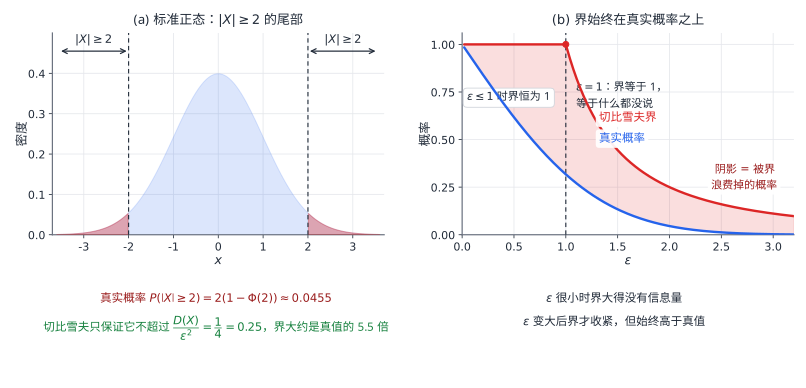

# 05 大数定律与中心极限定理

## 学习目标与先修知识

本章回答两个问题：

<<<<<<< Updated upstream
1. 为什么重复试验次数足够多时，样本平均值会稳定在总体均值附近？
2. 为什么许多独立随机变量相加后，即使每个变量本身不服从正态分布，总和仍常常可以用正态分布近似？

学习本章前，应掌握数学期望、方差、协方差、相关系数、正态分布及标准化。
=======
- 用切比雪夫不等式估计只知道均值与方差时的概率。
- 说明切比雪夫、伯努利与辛钦大数定律的条件与结论。
- 用中心极限定理近似独立同分布变量之和与样本均值。
- 对二项分布作正态近似并使用连续性修正。
- 判断正态近似在什么情况下不可靠。
>>>>>>> Stashed changes

## 1 切比雪夫不等式

<<<<<<< Updated upstream
> 切比雪夫不等式提供概率界；大数定律描述平均值的稳定；中心极限定理描述总和或平均值的波动形状。

---

## 1. 切比雪夫不等式：只知道均值和方差时如何估计概率

### 1.1 定理

设随机变量 $X$ 的数学期望和方差均有限，则对任意 $\varepsilon>0$，有
=======
设随机变量 $X$ 的期望与方差都存在，则对任意 $\varepsilon>0$，
>>>>>>> Stashed changes

$$
P\{|X-E(X)|\ge\varepsilon\}\le\frac{D(X)}{\varepsilon^2},
$$

等价地，

$$
P\{|X-E(X)|<\varepsilon\}\ge1-\frac{D(X)}{\varepsilon^2}.
$$

它只利用均值和方差，不要求知道具体分布，因此在分布未知时仍能给出概率的界。代价是这个界通常很保守。当 $1-\frac{D(X)}{\varepsilon^2}<0$ 时，下界按 $0$ 理解，此时不等式没有提供有用信息。

证明只需一个放缩。在事件 $\{|X-E(X)|\ge\varepsilon\}$ 上，

$$
<<<<<<< Updated upstream
P(|X-E(X)|<\varepsilon)\ge\max\left(0,1-\frac{D(X)}{\varepsilon^2}\right).
$$

这也说明切比雪夫界可能很保守。例如取 $\varepsilon$ 小于标准差，公式通常不能给出有用的正下界。

这里的结论是“上界”或“下界”，通常不是精确概率。若题目给出了完整密度函数并要求精确概率，应优先用积分；分布未知、只给出均值和方差时，切比雪夫不等式尤其有用。即使分布已知，也可用它快速给出保证或证明收敛。

### 1.2 为什么成立：放缩思想
=======
1\le\frac{(X-E(X))^2}{\varepsilon^2},
$$

在事件外右边非负，因此指示函数满足

$$
I_{\{|X-E(X)|\ge\varepsilon\}}\le\frac{(X-E(X))^2}{\varepsilon^2}.
$$

两边取期望，左边是事件概率，右边是 $D(X)/\varepsilon^2$，即得结论。

图中 $\varepsilon=2\sigma$ 时，真实正态尾概率只有约 $0.0455$，而切比雪夫界允许到 $0.25$，相差五倍多。界的作用不是给出精确值，而是在信息很少时给出一个可靠的保守估计。

**例 1** 已知 $E(X)=50$、$D(X)=25$，估计 $P(40<X<60)$。
>>>>>>> Stashed changes

**解** $40<X<60$ 等价于 $|X-50|<10$，代入不等式得

$$
P(40<X<60)\ge1-\frac{25}{10^2}=\frac34.
$$

这只是下界，不是说概率恰好等于 $\frac34$。

**例 2** 已知 $E(X)=1$、$E(Y)=-2$、$D(X)=1$、$D(Y)=4$、$\rho_{XY}=-\frac12$，估计 $P\{|X+Y-E(X+Y)|\ge6\}$。

**解** 令 $W=X+Y$。由相关系数求协方差：

$$
<<<<<<< Updated upstream
E\bigl[(X-E(X))^2\bigr]=D(X),
$$

便得到

$$
P\{|X-E(X)|\geq\varepsilon\}
\leq E\left[\frac{(X-E(X))^2}{\varepsilon^2}\right]
=\frac{D(X)}{\varepsilon^2}.
$$

证明的核心不是具体分布，而是“在目标事件上构造一个至少为 $1$ 的非负量，再取期望”。

这里指标函数 $I_A$ 在事件 $A$ 发生时取 $1$，否则取 $0$，所以 $E(I_A)=P(A)$。完整的不等式为 $I_{\{|X-E(X)|\ge\varepsilon\}}\le (X-E(X))^2/\varepsilon^2$。

### 1.3 例题：区间概率的下界

**题目**　已知 $E(X)=50$，$D(X)=25$，估计 $P(40<X<60)$。

**分析**　区间事件可改写为

$$
40<X<60
\Longleftrightarrow |X-50|<10.
$$

题目没有给出 $X$ 的具体分布，所以不能求精确值，只能估计。

**解**

$$
P(40<X<60)
=P\{|X-50|<10\}
\geq 1-\frac{25}{10^2}
=\frac34.
$$

因此，

$$
P(40<X<60)\geq\frac34.
$$

注意这是下界，不是说该概率恰好等于 $3/4$。

### 1.4 例题：把整体变量看成一个随机变量

**题目**　已知 $E(X)=1$，$E(Y)=-2$，$D(X)=1$，$D(Y)=4$，相关系数 $\rho_{XY}=-\frac12$。估计

$$
P\{|X+Y-E(X+Y)|\geq 6\}.
$$

**解**　令整体变量 $W=X+Y$。先求它的均值：

$$
E(W)=E(X)+E(Y)=1-2=-1.
$$

由

$$
\rho_{XY}=\frac{\operatorname{Cov}(X,Y)}{\sqrt{D(X)}\sqrt{D(Y)}},
$$

得

$$
\operatorname{Cov}(X,Y)
=\rho_{XY}\sqrt{D(X)}\sqrt{D(Y)}
=-\frac12\cdot1\cdot2=-1.
=======
\operatorname{Cov}(X,Y)=-\frac12\cdot1\cdot2=-1,
>>>>>>> Stashed changes
$$

所以

$$
E(W)=-1,\qquad
D(W)=1+4+2(-1)=3.
$$

由切比雪夫不等式，

$$
P\{|W-E(W)|\ge6\}\le\frac{3}{36}=\frac1{12}.
$$

<<<<<<< Updated upstream
**方法提示**：题目中的 $X+Y$、$aX+bY$ 或 $XY$ 都可以先看成一个整体随机变量，再计算这个整体的期望和方差。

---

## 2. 大数定律：样本平均值趋于总体均值
=======
## 2 大数定律

设 $X_1,X_2,\ldots$ 是随机变量序列。若对任意 $\varepsilon>0$，
>>>>>>> Stashed changes

$$
\lim_{n\to\infty}P\{|X_n-a|\ge\varepsilon\}=0,
$$

则称 $X_n$ 依概率收敛于 $a$，记 $X_n\xrightarrow{P}a$。大数定律讨论的是样本平均值

$$
\overline X_n=\frac{X_1+X_2+\cdots+X_n}{n}
$$

依概率收敛于总体均值。

### 2.1 切比雪夫大数定律

设 $X_1,X_2,\ldots$ 相互独立，且存在常数 $\mu$ 与 $C$，使对所有 $i$ 有

$$
<<<<<<< Updated upstream
\overline X_n\xrightarrow{P}\mu,
$$

即对任意 $\varepsilon>0$，

$$
P\{|\overline X_n-\mu|<\varepsilon\}\to1,
$$

或等价地，

$$
P\{|\overline X_n-\mu|\geq\varepsilon\}\to0.
$$

这里的 $\xrightarrow{P}$ 是**依概率收敛**。它不是说每一次样本平均都等于 $\mu$，也不自动等同于几乎处处收敛。

### 2.1 切比雪夫大数定律

一种常用的充分条件是：$X_1,X_2,\ldots$ 相互独立，且

$$
E(X_i)=\mu,
\qquad D(X_i)\leq C
$$

对所有 $i$ 成立，其中 $C$ 为与 $i$ 无关的常数。则

$$
\overline X_n\xrightarrow{P}\mu.
$$

证明直接来自切比雪夫不等式。因为独立性给出

$$
D(\overline X_n)
=D\left(\frac1n\sum_{i=1}^nX_i\right)
=\frac1{n^2}\sum_{i=1}^nD(X_i)
\leq\frac{C}{n},
$$

所以

$$
P\{|\overline X_n-\mu|\geq\varepsilon\}
\leq\frac{D(\overline X_n)}{\varepsilon^2}
\leq\frac{C}{n\varepsilon^2}\to0.
$$

### 2.2 伯努利大数定律：频率趋于概率

设事件 $A$ 在每次独立重复试验中的发生概率为 $p$。进行 $n$ 次试验，记 $N_A$ 为事件 $A$ 发生的次数，则

$$
\frac{N_A}{n}\xrightarrow{P}p.
$$

左边是事件 $A$ 的**频率**，右边是事件 $A$ 的**概率**。因此，试验次数足够多时，频率会稳定在概率附近。

证明时可令

$$
X_i=
\begin{cases}
1,&\text{第 }i\text{ 次试验中 }A\text{ 发生},\\
0,&\text{第 }i\text{ 次试验中 }A\text{ 不发生}.
\end{cases}
$$

则 $X_i\sim B(1,p)$，并且

$$
N_A=X_1+\cdots+X_n,
\qquad \frac{N_A}{n}=\overline X_n.
$$

由于 $E(X_i)=p$、$D(X_i)=p(1-p)$，由切比雪夫大数定律即可得到结论。

### 2.3 辛钦大数定律

若 $X_1,X_2,\ldots$ 相互独立同分布，且数学期望存在，即

$$
E(X_i)=\mu,
=======
E(X_i)=\mu,\qquad D(X_i)\le C,
>>>>>>> Stashed changes
$$

则

$$
\overline X_n\xrightarrow{P}\mu.
$$

证明来自切比雪夫不等式。由独立性，

<<<<<<< Updated upstream
### 2.4 三个大数定律的比较
=======
$$
D(\overline X_n)=\frac1{n^2}\sum_{i=1}^nD(X_i)\le\frac{C}{n},
$$
>>>>>>> Stashed changes

于是对任意 $\varepsilon>0$，

$$
P\{|\overline X_n-\mu|\ge\varepsilon\}
\le\frac{D(\overline X_n)}{\varepsilon^2}
\le\frac{C}{n\varepsilon^2}\to0.
$$

### 2.2 伯努利大数定律

设事件 $A$ 在每次试验中发生的概率为 $p$，独立重复 $n$ 次，$N_A$ 为 $A$ 发生的次数，则

$$
\frac{N_A}{n}\xrightarrow{P}p.
$$

令 $X_i=1$ 表示第 $i$ 次 $A$ 发生，$X_i=0$ 表示不发生，则 $X_i\sim B(1,p)$，$N_A=\sum_iX_i$，$N_A/n=\overline X_n$，且 $E(X_i)=p$、$D(X_i)=p(1-p)$。由切比雪夫大数定律即得结论。这条定律把第 01 章“频率稳定于概率”的直观说法变成了严格命题：频率依概率收敛于概率，但有限次试验的频率仍可能偏离 $p$。

### 2.3 辛钦大数定律

设 $X_1,X_2,\ldots$ 相互独立同分布，且期望存在，$E(X_i)=\mu$，则

$$
\overline X_n\xrightarrow{P}\mu.
$$

辛钦大数定律不要求方差存在，但要求同分布；与切比雪夫大数定律的条件互不包含。三个定律的区别集中在条件上：

| 定律 | 条件 | 结论 |
| --- | --- | --- |
| 切比雪夫大数定律 | 独立；期望相同；方差有统一上界 | $\overline X_n\xrightarrow{P}\mu$ |
| 伯努利大数定律 | 独立重复；每次成功概率为 $p$ | $N_A/n\xrightarrow{P}p$ |
| 辛钦大数定律 | 独立同分布；期望存在 | $\overline X_n\xrightarrow{P}\mu$ |

“试验次数多”本身不是条件。使用前要确认独立性、同分布性与矩的存在性；若期望不存在，平均值不一定稳定。

<<<<<<< Updated upstream
这里“期望存在”指有限期望，即 $E|X_i|<\infty$。第 2.1 节证明实际上只用到方差可相加，因此两两不相关也足够；如果均值不相同，类似证明得到的是 $n^{-1}\sum_{i=1}^n[X_i-E(X_i)]\xrightarrow{P}0$，不能自行找一个共同均值代入。

### 2.5 例题：用频率估计概率需要多少次试验

独立重复进行成功率为 $p$ 的试验，用 $\hat p=N_A/n$ 估计 $p$。希望无论真实 $p$ 为何，都保证

$$
P(|\hat p-p|<0.05)\ge0.95.
$$

由 $E(\hat p)=p$、$D(\hat p)=p(1-p)/n$，且 $p(1-p)\le1/4$，有
=======
**题型：平方的平均值**

设 $X_1,\ldots,X_n$ 独立同分布，都服从 $P(\lambda)$。把 $X_i^2$ 看成新的独立同分布序列，由大数定律，

$$
\frac1n\sum_{i=1}^nX_i^2\xrightarrow{P}E(X_1^2).
$$

泊松分布满足 $E(X_1)=D(X_1)=\lambda$，故

$$
E(X_1^2)=D(X_1)+[E(X_1)]^2=\lambda+\lambda^2.
$$

所以填 $\lambda+\lambda^2$。这里用的不是“$X$ 的平均值趋于 $E(X)$”，而是对 $X_i^2$ 整体套用大数定律；只要 $E(X_i^2)$ 存在，结论就成立。

**例 3** 独立重复试验的成功率为未知的 $p$，用 $\hat p=N_A/n$ 估计 $p$。要求 $P(|\hat p-p|<0.05)\ge0.95$，用切比雪夫不等式给出一个充分样本量。

**解** $E(\hat p)=p$，$D(\hat p)=\frac{p(1-p)}n$。因为 $p(1-p)\le\frac14$，
>>>>>>> Stashed changes

$$
P(|\hat p-p|\ge0.05)
\le\frac{p(1-p)}{n(0.05)^2}
\le\frac{1}{4n(0.05)^2}=\frac{100}{n}.
$$

令 $\frac{100}{n}\le0.05$，得 $n\ge2000$。这是切比雪夫不等式给出的充分条件，偏保守；若用中心极限定理并按最坏情况 $p=\frac12$ 估算，$n\approx385$ 即可。

<<<<<<< Updated upstream
---

### 2.6 函数的大数定律：先把目标改写成平均值

若 $X_1,X_2,\ldots$ 独立同分布，$h$ 是可测函数且 $E|h(X_1)|<\infty$，那么 $h(X_i)$ 仍独立同分布。将辛钦大数定律用于这组新变量，得到

$$
\frac1n\sum_{i=1}^n h(X_i)\xrightarrow{P}E[h(X_1)].
$$

例如 $h(x)=x^2$ 时，只要 $E(X_1^2)<\infty$，样本二阶原点矩便依概率趋于总体二阶矩；这里不需要四阶矩存在，因为使用的是辛钦大数定律。

另一个常用步骤是**连续映射**：若 $Z_n\xrightarrow{P}a$，且 $g$ 在常数 $a$ 处连续，则 $g(Z_n)\xrightarrow{P}g(a)$。给定 $\varepsilon>0$，连续性保证存在 $\delta>0$，使 $|z-a|<\delta$ 时 $|g(z)-g(a)|<\varepsilon$，从而

$$
P(|g(Z_n)-g(a)|\ge\varepsilon)
\le P(|Z_n-a|\ge\delta)\longrightarrow0.
$$

若同时有 $W_n\xrightarrow{P}b$，连续二元函数也可类似处理。控制两者偏差用并集界

$$
P\bigl(\{|Z_n-a|\ge\delta\}\cup\{|W_n-b|\ge\delta\}\bigr)
\le P(|Z_n-a|\ge\delta)+P(|W_n-b|\ge\delta),
$$

不要求 $Z_n,W_n$ 独立。因此样本均值与二阶矩可以一起用于方差的相合性证明；如果使用比值，还必须保证极限分母非零。

**例题：几何平均的极限。** 设 $X_i$ 独立同分布于 $U(0,1)$，求

$$
G_n=\left(\prod_{i=1}^nX_i\right)^{1/n}
$$

的依概率极限。题目参照[南京大学学生作业 hw8](https://github.com/wuzhengyi/NJU-Probability-and-Statistics/tree/master/hw8)，解答将可积性与连续映射条件明确展开。

乘积不能直接套平均值的大数定律，但取对数后有 $\ln G_n=n^{-1}\sum\ln X_i$。由于

$$
E|\ln X_i|=\int_0^1-\ln x\,dx=1<\infty,\qquad
E(\ln X_i)=\int_0^1\ln x\,dx=-1,
$$

大数定律给出 $\ln G_n\xrightarrow{P}-1$，再用指数函数的连续性得

$$
G_n\xrightarrow{P}e^{-1}\approx0.3679.
$$

不能把结果写为 $E(X)=1/2$：算术平均和几何平均不是同一个统计量。这个例子体现的操作顺序是“把乘积取对数 → 检查函数的期望存在 → 用大数定律 → 连续变换还原”。

## 3. 中心极限定理：和的标准化结果近似正态

大数定律告诉我们平均值会靠近均值，但没有说明它在均值附近怎样波动。中心极限定理进一步指出：在适当条件下，许多独立随机变量的和经过标准化后近似服从标准正态分布。
=======
## 3 中心极限定理

大数定律说明样本均值会稳定在总体均值附近，但没有说明波动的形状。中心极限定理指出：在适当条件下，许多独立随机变量之和经标准化后近似服从标准正态分布。
>>>>>>> Stashed changes

### 3.1 独立同分布中心极限定理

设 $X_1,X_2,\ldots$ 相互独立同分布，$E(X_i)=\mu$、$0<D(X_i)=\sigma^2<\infty$，记 $S_n=X_1+\cdots+X_n$，则当 $n$ 很大时，

$$
\frac{S_n-n\mu}{\sigma\sqrt n}
\approx N(0,1),
$$

等价地，

$$
\frac{\overline X_n-\mu}{\sigma/\sqrt n}\approx N(0,1).
$$

严格结论是依分布收敛，这里只使用近似形式。原变量不必服从正态分布；近似精度取决于原分布的形状、样本量以及所计算的区间，不能仅凭“$n$ 大”就认为任何尾概率都准确。

**例 4** $100$ 人依次面试，每人用时 $X_i$ 相互独立且同分布，$E(X_i)=1$、$D(X_i)=0.64$，总用时 $T=\sum_{i=1}^{100}X_i$。分别用切比雪夫不等式和中心极限定理估计 $P(82<T<118)$。

**解** $E(T)=100$、$D(T)=100\times0.64=64$。把事件写成 $|T-100|<18$。切比雪夫不等式给出

$$
P(82<T<118)=P(|T-100|<18)\ge1-\frac{64}{18^2}
=1-\frac{16}{81}=\frac{65}{81}\approx0.803.
$$

<<<<<<< Updated upstream
标准化时必须减去总和的均值 $n\mu$，再除以总和的标准差 $\sigma\sqrt n$。

### 3.2 德莫弗—拉普拉斯中心极限定理

若 $X_1,\ldots,X_n$ 相互独立同分布，且
=======
由中心极限定理，$T$ 近似服从 $N(100,64)$，标准差为 $8$，故
>>>>>>> Stashed changes

$$
P(82<T<118)\approx\Phi\left(\frac{18}{8}\right)-\Phi\left(-\frac{18}{8}\right)
=2\Phi(2.25)-1\approx0.9756.
$$

同一道题，切比雪夫只给出约 $0.803$ 的下界，中心极限定理给出约 $0.976$ 的近似值。前者不需要知道分布，结论一定成立但很保守；后者依赖独立同分布与有限方差，给出的是近似而不是保证。

**例 5** $10$ 只灯泡的寿命相互独立，都服从均值为 $60$ 小时的指数分布。求平均寿命 $\overline X$ 超过 $45$ 小时的概率近似值。

**解** 指数分布的均值为 $1/\lambda=60$，故 $\lambda=\frac1{60}$，方差为 $\frac1{\lambda^2}=3600$。于是

$$
E(\overline X)=60,\qquad
D(\overline X)=\frac{3600}{10}=360,
$$

标准差为 $\sqrt{360}\approx18.97$。由中心极限定理，$\overline X$ 近似服从 $N(60,360)$，

$$
P(\overline X>45)\approx1-\Phi\left(\frac{45-60}{\sqrt{360}}\right)
=1-\Phi(-0.79)=\Phi(0.79)\approx0.785.
$$

<<<<<<< Updated upstream
这一定理是独立同分布中心极限定理在伯努利变量上的特殊形式。

这里 $p\in(0,1)$ 固定；$p=0$ 或 $1$ 时方差为零，无法标准化。实际近似还需检查 $np$ 和 $n(1-p)$ 是否足够大，不能只看 $n$。

### 3.3 平均值稳定与标准化波动并不矛盾

大数定律研究 $\overline X_n-\mu$，它依概率趋于零；中心极限定理把这个越来越小的误差放大 $\sqrt n/\sigma$ 倍，观察放大后的形状。因而二者分别回答“偏差会不会消失”和“典型波动是什么形状”。

如果所有 $X_i$ 都等于同一个随机变量 $X$，则 $\overline X_n=X$，再多次记录也不会降低方差。这个反例说明“大量数据”不能替代独立性等结构条件。

---

## 4. 中心极限定理例题
=======
分母是样本均值的标准差 $\sqrt{360}$，不是单个灯泡的标准差 $60$。样本量只有 $10$，指数分布又明显右偏，这个正态近似只能作粗略参考。

### 3.2 棣莫弗—拉普拉斯中心极限定理
>>>>>>> Stashed changes

若 $X\sim B(n,p)$，当 $n$ 很大时，

$$
\frac{X-np}{\sqrt{np(1-p)}}\approx N(0,1).
$$

这是独立同分布中心极限定理在伯努利变量上的特例：$X$ 是 $n$ 个独立 $B(1,p)$ 变量之和。使用时要确认 $np$ 与 $n(1-p)$ 都不太小，不能只看 $n$。

**例 6** 每袋味精净重的均值为 $100$ 克、标准差为 $10$ 克，一箱装 $200$ 袋，各袋重量独立同分布。求一箱总重量超过 $20500$ 克的概率近似值。

**解** 令 $X_i$ 为第 $i$ 袋的重量，$S_{200}=\sum_{i=1}^{200}X_i$。则

$$
E(S_{200})=200\times100=20000,\qquad
D(S_{200})=200\times10^2=20000,
$$

标准差为 $\sqrt{20000}=100\sqrt2$。由中心极限定理，

$$
P(S_{200}>20500)
=P\left(\frac{S_{200}-20000}{100\sqrt2}>\frac{500}{100\sqrt2}\right)
\approx1-\Phi(3.54)\approx0.0002.
$$

**例 7** 把一段距离分成 $1200$ 段测量，第 $i$ 段误差 $X_i$ 相互独立，且服从 $U\left(-\frac12,\frac12\right)$。求总误差绝对值超过 $20$ 的概率近似值。

**解** 单段误差的均值为 $0$，方差为

$$
D(X_i)=\frac{(1)^2}{12}=\frac1{12}.
$$

<<<<<<< Updated upstream
令 $Z\sim N(0,1)$，则

$$
P(S_{200}>20500)
\approx P(Z>3.54)=1-\Phi(3.54)\approx0.0002.
$$

这里直接把“超过”转成右尾概率即可；若查表更习惯处理左侧区间，也可先使用对立事件。

### 4.2 测量误差总和

**题目**　将甲、乙两地之间的距离分成 $1200$ 段测量。第 $i$ 段误差 $X_i$ 相互独立，且服从均匀分布 $U\left(-\frac12,\frac12\right)$。求总误差绝对值超过 $20$ 的概率近似值。

**单段误差的数字特征**

均匀分布 $U(a,b)$ 的均值和方差为

$$
E(X_i)=\frac{a+b}{2},
\qquad D(X_i)=\frac{(b-a)^2}{12}.
$$

因此

$$
\mu=0,
\qquad \sigma^2=\frac{(1)^2}{12}=\frac1{12}.
$$

令 $S_{1200}=\sum_{i=1}^{1200}X_i$，则

$$
E(S_{1200})=0,
\qquad D(S_{1200})=1200\cdot\frac1{12}=100.
$$

由中心极限定理，$S_{1200}$ 近似服从 $N(0,100)$。

**计算概率**

$$
P(|S_{1200}|>20)
=1-P(-20\leq S_{1200}\leq20).
=======
令 $S_{1200}=\sum_{i=1}^{1200}X_i$，则 $E(S_{1200})=0$、$D(S_{1200})=1200\cdot\frac1{12}=100$，标准差为 $10$。由中心极限定理 $S_{1200}\approx N(0,100)$，所以

$$
P(|S_{1200}|>20)
=1-P(-20\le S_{1200}\le20)
\approx2[1-\Phi(2)]\approx0.0455.
>>>>>>> Stashed changes
$$

## 4 二项分布的正态近似与连续性修正

若 $X\sim B(n,p)$，当 $n$ 较大且 $np$、$n(1-p)$ 都不太小时，可用正态分布 $N(np,np(1-p))$ 近似 $X$。二项分布是离散的，正态分布是连续的，直接在整数点处代入会带来误差；把边界向两侧扩展半个单位，称为**连续性修正**。

常用修正规则如下：

| 原事件 | 修正后的正态区间 |
| --- | --- |
| $X\le k$ | $Y<k+\frac12$ |
| $X\ge k$ | $Y>k-\frac12$ |
| $a\le X\le b$ | $a-\frac12<Y<b+\frac12$ |
| $X=k$ | $k-\frac12<Y<k+\frac12$ |

**例 8** 设 $X\sim B(100,0.5)$，求 $P(40\le X\le60)$ 的正态近似。

**解** $E(X)=50$、$D(X)=25$，取 $Y\sim N(50,25)$。两端都包含相应整数，故作连续性修正：

$$
<<<<<<< Updated upstream
P(-20\leq S_{1200}\leq20)
\approx P(-2\leq Z\leq2)
=\Phi(2)-\Phi(-2)
=2\Phi(2)-1.
=======
P(40\le X\le60)\approx P(39.5<Y<60.5)
=\Phi(2.1)-\Phi(-2.1)\approx0.9643.
>>>>>>> Stashed changes
$$

精确的二项和为 $0.9648$，修正后的误差约 $-0.05\%$；不作修正得 $2\Phi(2)-1\approx0.9545$，误差约 $-1.07\%$。修正的效果取决于端点位置：区间越窄、端点越靠近均值，半个单位带来的相对变化越明显；在远离均值的极端尾部，正态近似本身的误差可能已超过修正量，修正不保证一定更准。

**例 9** $100$ 名学生，每人去图书馆的概率为 $0.8$，相互独立。至少需要多少个座位，才能以不低于 $95\%$ 的概率保证去的学生都有座位？已知 $\Phi(1.645)\approx0.95$。

**解** 设去图书馆的人数为 $X$，则 $X\sim B(100,0.8)$，$E(X)=80$、$D(X)=16$。用 $N(80,16)$ 近似，要求

$$
P(X\le N)\approx\Phi\left(\frac{N-80}{4}\right)\ge0.95.
$$

<<<<<<< Updated upstream
**解题信号**：题目出现“大量独立误差的总和”，通常先想到中心极限定理；然后依次求单个变量的均值、方差，再求总和的均值和方差并标准化。

---

## 5. 正态近似的统一解题流程

### 5.1 独立同分布变量的和或样本均值

1. 识别总和 $S_n=\sum X_i$ 或样本均值 $\overline X_n$，检查独立同分布及有限正方差。独立但不同分布的和需要另外的中心极限定理条件，不能直接套本章公式。
2. 写出单个变量的 $\mu=E(X_i)$ 和 $\sigma^2=D(X_i)$。
3. 写出总和的均值 $n\mu$、方差 $n\sigma^2$。
4. 用
   $$
   Z=\frac{S_n-n\mu}{\sigma\sqrt n}
   $$
   或
   $$
   Z=\frac{\overline X_n-\mu}{\sigma/\sqrt n}
   $$
   标准化。
5. 根据正态分布的对称性、对立事件和分布函数表计算。

### 5.2 二项分布的正态近似

若 $X\sim B(n,p)$，当 $n$ 较大且 $np$、$n(1-p)$ 都不太小时，可用

$$
Y\sim N\bigl(np,\,np(1-p)\bigr)
$$

近似 $X$。离散变量转连续变量时，常需进行连续性修正：

$$
P(a\leq X\leq b)
\approx P(a-0.5<Y<b+0.5),
$$

例如

$$
P(X\leq k)\approx P(Y<k+0.5).
$$

连续性修正尤其影响尾部概率，不能机械省略。

上述 $a,b,k$ 为整数边界；若原边界不是整数，先将事件改为包含的整数取值。例如 $X<60$ 是 $X\le59$，修正后上界为 $59.5$，不是 $60.5$。

**完整算例。** 设 $X\sim B(100,0.5)$，求 $P(40\le X\le60)$ 的正态近似。此时均值为 $50$，方差为 $25$，取 $Y\sim N(50,25)$。两端均包含相应整数，故

$$
\begin{aligned}
P(40\le X\le60)
&\approx P(39.5<Y<60.5)\\
&=\Phi(2.1)-\Phi(-2.1)\\
&=2\Phi(2.1)-1\approx0.9643.
\end{aligned}
$$

不修正会得到 $2\Phi(2)-1\approx0.9545$。修正的几何含义是把每个整数的概率质量对应到以它为中心、宽度为一的小区间；它改善离散到连续的匹配，但不改变结果仍是近似这一事实。

---

### 5.3 例题：先从密度求成功率，再近似计数

沿用第二章 §6.3 的密度：$0<x<1$ 时为 $x^2$，$1<x<2$ 时为 $2/3$，其他处为零。对该总体独立重复观测 450 次，记 $Z$ 为观测值小于 1 的次数，求 $P(Z>160)$ 的近似值。题目据[浙江大学共享试卷目录](https://github.com/QSCTech/zju-icicles/tree/master/概率论与数理统计)中 2019—2020 春夏 A 卷第四大题重述。

单次落在 1 以下的概率是 $p=\int_0^1x^2\,dx=1/3$。每次观测是否满足条件是一次伯努利试验，所以

$$
Z\sim B(450,1/3),\qquad E(Z)=150,\qquad D(Z)=100.
$$

注意 $Z>160$ 等价于 $Z\ge161$。采用连续性修正，取 $V\sim N(150,100)$，有

$$
P(Z>160)\approx P(V>160.5)
=1-\Phi(1.05)\approx0.1469.
$$

共享扫描中的手写解答未作连续性修正，得到 $1-\Phi(1)\approx0.1587$；两者均是近似，数值不同来自离散边界处理。若使用二项分布直接求和，精确概率约为 $0.1470$，可用来检查近似质量。

同一密度还给出 $E(X)=\int_0^1x^3\,dx+\int_1^2(2x/3)\,dx=5/4$，因此样本均值依概率趋于 $5/4$。这里“原观测的平均值”与“满足某条件的次数”分别使用原变量与指示变量，不能把两个均值混用。

## 6. 常见误区与边界

### 误区 1：把切比雪夫不等式当成等式

切比雪夫不等式只给出界。例如

$$
P(|X-E(X)|<\varepsilon)\geq1-\frac{D(X)}{\varepsilon^2}
$$

表示概率至少这么大，不表示恰好等于这个数。

### 误区 2：大数定律意味着每个样本都等于均值

大数定律讨论的是样本平均值的极限行为。有限次试验中，$\overline X_n$ 仍会随机波动，只是 $n$ 增大时偏离均值超过固定误差的概率趋于 $0$。

### 误区 3：中心极限定理要求原变量正态

中心极限定理的典型条件是独立同分布、均值和方差存在，而不是“每个 $X_i$ 都正态”。正态的是标准化后的和的近似分布。

### 误区 4：标准化时除以 $\sigma$ 而不是 $\sigma\sqrt n$

单个变量的标准差是 $\sigma$，$n$ 个独立变量之和的标准差是 $\sigma\sqrt n$。总和与样本均值不能混用标准化公式。

### 误区 5：忽略定理条件

看到“趋于均值”先检查独立性、同分布性、期望和方差条件；看到“近似正态”先确认是总和还是平均值，并写出相应的均值和方差。

---

## 7. 自测题

### 题 1

已知 $E(X)=8$，$D(X)=9$，用切比雪夫不等式估计 $P(|X-8|<6)$。

**答案提示**

$$
P(|X-8|<6)\geq1-\frac9{36}=\frac34.
$$

### 题 2

说明伯努利大数定律中的 $N_A/n$ 和 $p$ 分别表示什么。

**答案提示**：$N_A/n$ 是事件频率，$p$ 是事件概率；当 $n\to\infty$ 时，频率依概率收敛于概率。

### 题 3

设 $X_i$ 独立同分布，$E(X_i)=2$，$D(X_i)=9$。写出 $S_n=\sum_{i=1}^nX_i$ 的中心极限定理标准化形式。

**答案提示**

$$
\frac{S_n-2n}{3\sqrt n}\approx N(0,1).
$$

### 题 4

判断正误：若 $X_i$ 不服从正态分布，则不能使用中心极限定理。

**答案**：错误。只要满足相应的独立性、同分布性及矩条件，$n$ 足够大时仍可对和使用正态近似。

### 题 5

设 $X\sim B(100,0.5)$，把 $P(X\ge60)$ 写成含连续性修正的正态近似。

**答案**：整数 $60$ 也应计入，故 $P(X\ge60)\approx P(Y>59.5)=1-\Phi(1.9)\approx0.0287$，其中 $Y\sim N(50,25)$。

### 题 6

为何“连续十次失败，下一次成功率必然增大”不能由大数定律推出？

**答案**：在固定成功率的独立试验中，下一次的成功概率仍为 $p$。大数定律描述长期频率，不要求后续结果补偿前面的偏差。

## 本章回顾

- **切比雪夫不等式**：只需均值和方差，就能给出偏离均值事件的概率界。
- **大数定律**：样本平均值在适当条件下依概率趋于总体均值；伯努利大数定律说明频率趋于概率。
- **中心极限定理**：许多独立随机变量的和或平均值标准化后近似服从标准正态分布。
- **做题顺序**：先识别对象和定理，再核对条件；然后求均值、方差，标准化，最后利用正态分布对称性或查表。
=======
故 $\frac{N-80}{4}\ge1.645$，解得 $N\ge86.58$，座位数取整数 $N=87$。这里必须向上取整：$86$ 个座位达不到 $95\%$ 的要求。若作连续性修正，把 $N$ 换成 $N+0.5$，得 $N\ge86.08$，仍然取 $87$。

正态近似的适用条件是 $np$ 与 $n(1-p)$ 都不太小，经验上取两者均不小于 $10$。$p$ 接近 $0$ 时二项分布右偏，可用泊松近似（$\lambda=np$）；$p$ 接近 $1$ 时对失败次数用泊松近似（$\lambda=n(1-p)$），或直接精确计算。样本量 $n$ 大并不自动保证近似可靠，关键在于标准化后的分布是否已经接近正态。
>>>>>>> Stashed changes
