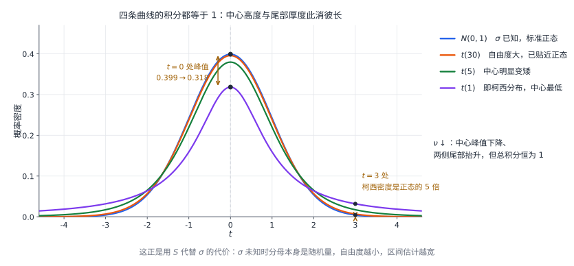

# 06 样本与抽样分布

## 学习目标与先修知识

本章是从概率论进入数理统计的桥梁。学习前应掌握随机变量的分布、期望、方差和正态分布。完成本章后，应能：

<<<<<<< Updated upstream
- 区分总体、个体、样本、观测值和统计量；
- 计算样本均值与样本方差，掌握其常用数字特征，并区分样本原点矩和中心矩；
- 理解抽样分布是“统计量的分布”；
- 在正态总体下识别卡方、$t$、$F$ 分布及其构造条件；
- 根据已知或未知的总体方差选择标准正态、$t$、卡方或 $F$ 统计量。

## 1. 总体、个体、样本与观测值
=======
- 区分总体、样本、观测值与统计量。
- 计算样本均值与样本方差，并说明它们的数字特征。
- 掌握卡方、$t$、$F$ 分布的构造与用途。
- 写出正态总体的常用枢轴量及其分布。
- 按上侧分位点约定查表并确定自由度。

## 1 总体、样本与统计量
>>>>>>> Stashed changes

研究对象的全体称为**总体**，其中每个研究对象称为**个体**。用随机变量 $X$ 表示所抽个体的某项指标，则总体的分布就是 $X$ 的分布，$E(X)=\mu$、$D(X)=\sigma^2$ 分别描述总体的位置与离散程度。

从总体中抽取 $n$ 个个体，得到样本 $X_1,X_2,\ldots,X_n$。若它们相互独立且都与总体同分布，则称为**简单随机样本**，$n$ 称为样本容量。抽样后得到的具体数值 $x_1,x_2,\ldots,x_n$ 称为**观测值**：$X_i$ 是抽样前的随机变量，$x_i$ 是已经观察到的数。

<<<<<<< Updated upstream
$$
E(X)=\mu,\qquad D(X)=\sigma^2
$$

描述总体的位置和离散程度。

### 1.2 样本与观测值

从总体中抽取 $n$ 个个体得到样本

$$
(X_1,X_2,\ldots,X_n).
$$

本章“简单随机样本”指 $X_1,\ldots,X_n$ 相互独立，且与总体 $X$ 同分布，简称独立同分布样本，样本容量为 $n$。有限总体的不放回抽样通常不独立，不能无条件沿用本章的方差和精确分布公式。

在实际抽样后，样本变量取得具体数值

$$
(x_1,x_2,\ldots,x_n),
$$

称为**观测值**或**样本值**。大写 $X_i$ 表示抽样前的随机变量，小写 $x_i$ 表示抽样后已经观察到的数值；统计量必须先用大写变量定义，代入观测值后才得到具体数字。

## 2. 样本分布函数与统计量

### 2.1 经验分布函数

设样本为 $X_1,\ldots,X_n$，经验分布函数定义为

$$
F_n(x)=\frac1n\sum_{i=1}^n I(X_i\le x),
$$

其中 $I(\cdot)$ 是示性函数：条件成立时取 $1$，否则取 $0$。因此 $F_n(x)$ 等于样本中不超过 $x$ 的观测值所占比例。

例如样本观测值为 $1,2,3$，其经验分布函数为

$$
F_3(x)=\begin{cases}
0,&x<1,\\
1/3,&1\le x<2,\\
2/3,&2\le x<3,\\
1,&x\ge3.
\end{cases}
$$

所以 $F_3(2)=2/3$。若样本中有相同观测值，跳跃高度为其频数除以 $n$，不一定只有 $1/n$。对固定 $x$，独立同分布样本中的 $I(X_i\le x)$ 是成功率为 $F(x)$ 的伯努利变量，因此

$$
E[F_n(x)]=F(x),\qquad D[F_n(x)]=\frac{F(x)[1-F(x)]}{n},
$$

由大数定律 $F_n(x)\xrightarrow{P}F(x)$。这说明为什么能用样本比例估计累积概率，而不是说有限样本的阶梯函数已经等于总体分布函数。

### 2.2 统计量

只含样本变量、不含未知总体参数的样本函数称为**统计量**。常用统计量包括：
=======
只含样本、不含未知参数的样本函数称为**统计量**。常用的有样本均值
>>>>>>> Stashed changes

$$
\overline X=\frac1n\sum_{i=1}^nX_i,
$$

样本方差

$$
S^2=\frac1{n-1}\sum_{i=1}^n(X_i-\overline X)^2,
$$

以及样本标准差 $S=\sqrt{S^2}$。

**题型：统计量与次序统计量**

判断一个样本函数是否为统计量，只看它是否含有未知参数，与形式是否复杂无关。设 $X_1,\ldots,X_n$ 来自 $N(\mu,\sigma^2)$，其中 $\mu$ 已知、$\sigma$ 未知，则

<<<<<<< Updated upstream
### 2.3 例题：从观测值计算统计量
=======
- $\sum_{i=1}^nX_i^2$ 只含样本，是统计量；
- $\sum_{i=1}^n(X_i-\mu)^2$ 中的 $\mu$ 已知，仍是统计量；
- $\frac1{\sigma^2}\sum_{i=1}^n(X_i-\mu)^2$ 含未知的 $\sigma$，不是统计量。

把样本从小到大排列为 $X_{(1)}\le X_{(2)}\le\cdots\le X_{(n)}$，称为**次序统计量**，$X_{(1)}$ 是最小值、$X_{(n)}$ 是最大值。$X_{(n)}-X_{(1)}$ 只由样本排序得到，因此也是统计量。次序统计量的分布通常比样本均值复杂；第 03 章的最值分布公式可用于求它的分布。
>>>>>>> Stashed changes

### 1.1 样本均值的数字特征

<<<<<<< Updated upstream
$$
\bar x=2,\qquad a_2=\frac{1^2+2^2+3^2}{3}=\frac{14}{3},
$$

$$
\sum_{i=1}^3(x_i-\bar x)^2=1+0+1=2,
\qquad s^2=\frac2{3-1}=1,\qquad m_2=\frac23.
$$

可用 $m_2=a_2-\bar x^2=14/3-4=2/3$ 复核。样本二阶中心矩与无偏样本方差相差系数 $(n-1)/n$，不是同一个量。

## 3. 样本均值、样本方差及矩

设 $X_1,\ldots,X_n$ 独立同分布，且

$$
E(X_i)=\mu,\qquad D(X_i)=\sigma^2.
$$

由期望和方差的性质，
=======
设 $X_1,\ldots,X_n$ 独立同分布，$E(X_i)=\mu$、$D(X_i)=\sigma^2$，则
>>>>>>> Stashed changes

$$
E(\overline X)=\mu,\qquad D(\overline X)=\frac{\sigma^2}{n}.
$$

样本均值是总体均值的无偏估计，且样本量越大，波动越小。$\frac{\sigma}{\sqrt n}$ 称为样本均值的标准差或**标准误**，它描述“用样本均值估计总体均值”的误差大小。

**例 1** 从均值 $10$ 的指数分布总体中抽取 $100$ 个独立样本，记 $\overline X$ 为样本均值。(1) 求 $E(\overline X)$、$D(\overline X)$，并写出 $\overline X$ 的近似分布；(2) 样本容量 $n$ 至少多大，才能使 $\overline X$ 的标准差不超过 $0.1$？(3) 求 $E\left(\frac1{100}\sum_{i=1}^{100}X_i^2\right)$；(4) 求 $E\left(\frac1{100}\sum_{i=1}^{100}(X_i-\overline X)^2\right)$。

**解** 指数分布均值 $1/\lambda=10$，故 $\lambda=0.1$，方差 $1/\lambda^2=100$。

(1) $E(\overline X)=10$，$D(\overline X)=\frac{100}{100}=1$。样本量 $100$ 较大，由中心极限定理，$\overline X$ 近似服从 $N(10,1)$。

(2) 要求 $\sqrt{D(\overline X)}=\frac{10}{\sqrt n}\le0.1$，即 $n\ge10000$。

(3) 对每个 $X_i$，$E(X_i^2)=D(X_i)+[E(X_i)]^2=100+100=200$，所以

$$
E\left(\frac1{100}\sum_{i=1}^{100}X_i^2\right)
=\frac1{100}\cdot100\cdot200=200.
$$

(4) 括号内是除以 $n$ 的样本二阶中心矩。由

$$
E\left[\sum_{i=1}^n(X_i-\overline X)^2\right]=(n-1)\sigma^2=99\times100,
$$

得

$$
E\left(\frac1{100}\sum_{i=1}^{100}(X_i-\overline X)^2\right)
=\frac{99\times100}{100}=99.
$$

第 (4) 问若直接套用 $E(S^2)=100$，会忽略分母 $n$ 与 $n-1$ 的差别。实际上 $\frac1n\sum(X_i-\overline X)^2=\frac{n-1}{n}S^2$，期望为 $\frac{n-1}{n}\sigma^2$。

### 1.2 样本方差为什么除以 $n-1$

先利用恒等式

$$
\sum_{i=1}^n(X_i-\overline X)^2
=\sum_{i=1}^n(X_i-\mu)^2-n(\overline X-\mu)^2.
$$

两边取期望。右边第一项的期望是 $n\sigma^2$，第二项的期望是 $n\cdot\frac{\sigma^2}{n}=\sigma^2$，所以

$$
E\left[\sum_{i=1}^n(X_i-\overline X)^2\right]=(n-1)\sigma^2.
$$

<<<<<<< Updated upstream
所以 $n\ge2$ 时 $E(S^2)=\sigma^2$，而 $E(M_2)=(n-1)\sigma^2/n$。用样本均值代替真均值会使平方偏差和平均偏小，除以 $n-1$ 正好修正这个偏差；但 $S=\sqrt{S^2}$ 一般不是 $\sigma$ 的无偏估计量，不能把期望移进平方根。

### 3.2 样本矩和标准误

若 $E|X|^k<\infty$，则 $E(A_k)=E(X^k)$。若进一步 $E(X^{2k})<\infty$，独立性给出 $D(A_k)=D(X^k)/n$。特别地，样本均值的标准差为 $\sigma/\sqrt n$，称为其标准误；用数据估计时为 $S/\sqrt n$。$S$ 描述单个观测的离散程度，$S/\sqrt n$ 描述样本均值的抽样波动，不能混用。

## 4. 抽样分布

若 $G(X_1,\ldots,X_n)$ 是统计量，则它作为随机变量具有自己的分布，称为该统计量的**抽样分布**。例如，$\overline X$ 的抽样分布是样本均值在重复抽样下的分布，$S^2$ 的抽样分布是样本方差在重复抽样下的分布。

抽样分布回答的是：从同一总体反复抽取容量为 $n$ 的样本时，统计量会怎样波动？它是参数估计和假设检验的概率基础。

例如正态总体均值为 $10$、方差为 $4$，每次抽 $n=16$ 个独立观测，则 $\overline X\sim N(10,1/4)$，从而
=======
因此

$$
E(S^2)=\sigma^2.
$$

若除以 $n$，得到的样本二阶中心矩 $M_2=\frac1n\sum(X_i-\overline X)^2$ 的期望是 $\frac{n-1}{n}\sigma^2$，会系统性偏小。自由度损失一个的原因是 $n$ 个偏差满足 $\sum_{i=1}^n(X_i-\overline X)=0$，只有 $n-1$ 个可以自由变化。注意 $S=\sqrt{S^2}$ 一般不是 $\sigma$ 的无偏估计，无偏性不能穿过平方根。

**例 2** 给定样本值 $1,2,3$，计算 $\overline x$、$s^2$ 与 $m_2$。

**解** $n=3$，$\overline x=2$，
>>>>>>> Stashed changes

$$
\sum_{i=1}^3(x_i-\overline x)^2=1+0+1=2,
$$

<<<<<<< Updated upstream
这里概率描述“重新抽取一组 16 个样本后得到的均值”，不是已有 16 个数落在某区间的比例。

### 4.1 样本最大值与最小值的抽样分布

设 $X_1,\ldots,X_n$ 是来自分布函数 $F$ 的简单随机样本，记 $M_n=\max_iX_i$、$L_n=\min_iX_i$。最大值不超过 $x$ 等价于所有观测都不超过 $x$；最小值大于 $x$ 等价于所有观测都大于 $x$。利用样本独立性，
=======
所以

$$
s^2=\frac{2}{3-1}=1,\qquad m_2=\frac23.
$$

### 1.3 经验分布函数

设样本为 $X_1,\ldots,X_n$，定义

$$
F_n(x)=\frac1n\sum_{i=1}^nI(X_i\le x),
$$

其中 $I(\cdot)$ 在条件成立时取 $1$、否则取 $0$。$F_n(x)$ 是不超过 $x$ 的观测值所占比例，称为经验分布函数。固定 $x$ 时，$I(X_i\le x)$ 是成功率为 $F(x)$ 的伯努利变量，故
>>>>>>> Stashed changes

$$
E[F_n(x)]=F(x),\qquad D[F_n(x)]=\frac{F(x)[1-F(x)]}{n}.
$$

由大数定律，$F_n(x)\xrightarrow{P}F(x)$，即样本量增大时经验分布逐点接近总体分布。

## 2 三大抽样分布

统计量作为随机变量，其分布称为**抽样分布**。正态总体下的推断主要依赖卡方、$t$、$F$ 三个分布。

### 2.1 卡方分布

设 $Z_1,\ldots,Z_\nu$ 相互独立且都服从 $N(0,1)$，则

$$
\chi^2=Z_1^2+\cdots+Z_\nu^2
$$

服从自由度为 $\nu$ 的**卡方分布**，记 $\chi^2\sim\chi^2(\nu)$。若 $U\sim\chi^2(m)$、$V\sim\chi^2(n)$ 且独立，则 $U+V\sim\chi^2(m+n)$。卡方分布的期望与方差为

$$
E\bigl(\chi^2(\nu)\bigr)=\nu,\qquad D\bigl(\chi^2(\nu)\bigr)=2\nu.
$$

<<<<<<< Updated upstream
当 $n=5$ 时，$P(M_5\le0.9\theta)=0.9^5=0.59049$。样本量增大后，该概率趋于零，反映样本最大值越来越靠近总体右端点；这为下一章用最大值估计 $\theta$ 提供直觉。最大值虽是统计量，其分布仍可依赖未知参数。这里把第三章的两个变量最值推广到整个样本，内容覆盖参照[南京大学课程个人笔记第六章](https://github.com/Andres-Nju/Probability-and-Mathematical-Statistics)。

## 5. 卡方分布

若 $Z_1,\ldots,Z_n$ 相互独立且均服从 $N(0,1)$，则

$$
\sum_{i=1}^n Z_i^2\sim\chi^2(n).
$$

若 $U\sim\chi^2(m)$、$V\sim\chi^2(n)$ 且相互独立，则

$$
U+V\sim\chi^2(m+n).
$$

卡方分布的期望和方差为

$$
E(V)=\nu,\qquad D(V)=2\nu,\qquad V\sim\chi^2(\nu).
$$

若 $X_1,\ldots,X_n$ 来自正态总体 $N(\mu,\sigma^2)$，则
=======
设 $X_1,\ldots,X_n$ 来自正态总体 $N(\mu,\sigma^2)$。当 $\mu$ 已知时，

$$
\frac1{\sigma^2}\sum_{i=1}^n(X_i-\mu)^2\sim\chi^2(n);
$$

当 $\mu$ 未知、用 $\overline X$ 代替时，平方和损失一个自由度：
>>>>>>> Stashed changes

$$
\frac{(n-1)S^2}{\sigma^2}\sim\chi^2(n-1).
$$

正态总体下 $\overline X$ 与 $S^2$ 还相互独立，这是构造 $t$ 统计量的基础；非正态样本不能仅凭“偏差和为 $0$”推出卡方分布或这项独立性。

**例 3** 设 $X_1,\ldots,X_5$ 独立且都服从 $N(2,9)$，写出两个服从卡方分布的统计量。

**解** 标准差为 $3$，故

$$
\frac19\sum_{i=1}^5(X_i-2)^2\sim\chi^2(5),
$$

因为这里用的是已知均值 $2$，自由度不扣减；而

$$
\frac{4S^2}{9}\sim\chi^2(4),
$$

因为样本方差围绕样本均值构造，损失一个自由度。两式都含五个平方项，但自由度不同。

### 2.2 $t$ 分布

设 $Z\sim N(0,1)$，$V\sim\chi^2(\nu)$，且 $Z$ 与 $V$ 相互独立，则

$$
T=\frac{Z}{\sqrt{V/\nu}}
$$

服从自由度为 $\nu$ 的 **$t$ 分布**，记 $T\sim t(\nu)$。$t$ 分布关于 $0$ 对称，自由度越大越接近标准正态分布。

<<<<<<< Updated upstream
## 6. $t$ 分布
=======

>>>>>>> Stashed changes

图中自由度越小，中心越低、尾部越厚；$\nu=1$ 时是柯西分布，$\nu\to\infty$ 时趋近标准正态。厚尾来自用样本标准差 $S$ 代替未知的 $\sigma$，$S$ 本身会波动，使比值出现更大的极端值。

设 $X_1,\ldots,X_n$ 来自正态总体 $N(\mu,\sigma^2)$，$\sigma$ 未知，则

$$
\frac{\overline X-\mu}{S/\sqrt n}\sim t(n-1).
$$

构造依据是：$\frac{\overline X-\mu}{\sigma/\sqrt n}\sim N(0,1)$，$\frac{(n-1)S^2}{\sigma^2}\sim\chi^2(n-1)$，两者独立，按定义相除后 $\sigma$ 消去。方差已知时应使用标准正态，不应使用 $t$ 分布。

**例 4** 来自正态总体的样本容量为 $10$，写出用于推断均值的 $t$ 统计量。

**解** 方差未知时，

$$
T=\frac{\overline X-\mu}{S/\sqrt{10}}\sim t(9).
$$

自由度是 $n-1=9$，分母是标准误 $S/\sqrt n$，不是 $S$。

### 2.3 $F$ 分布

设 $U\sim\chi^2(m)$、$V\sim\chi^2(n)$，且相互独立，则

$$
F=\frac{U/m}{V/n}
$$

<<<<<<< Updated upstream
而不是 $t$ 分布。

**构造例。** 来自正态总体的样本容量为 $10$，记 $Z=\sqrt{10}(\overline X-\mu)/\sigma$、$V=9S^2/\sigma^2$。两者独立，分别服从 $N(0,1)$ 和 $\chi^2(9)$，因此

$$
\frac{Z}{\sqrt{V/9}}
=\frac{\sqrt{10}(\overline X-\mu)/\sigma}{S/\sigma}
=\frac{\overline X-\mu}{S/\sqrt{10}}\sim t(9).
$$

这里 $S$ 的随机性使分母也会波动，解释了为什么 $t$ 分布尾部比标准正态更厚。不能把 $S$ 代入 $\sigma$ 后仍声称精确标准正态。反过来，即使实际知道 $\sigma$，这个用 $S$ 构成的比值仍服从 $t(9)$；已知性影响方法选择，不改变随机变量的数学分布。

### 6.1 新观测与样本均值之差

设 $X_1,\ldots,X_n,X_{n+1}$ 独立同分布于 $N(\mu,\sigma^2)$，$n\ge2$；$\overline X,S^2$ 只由前 $n$ 个观测计算。现在研究下一次观测 $X_{n+1}$ 与已有均值的差，而非均值与固定参数 $\mu$ 的差。构造参照[南京大学学生作业 hw9](https://github.com/wuzhengyi/NJU-Probability-and-Statistics/tree/master/hw9)。

由于新观测独立于已有样本，

$$
E(X_{n+1}-\overline X)=0,\qquad
D(X_{n+1}-\overline X)=\sigma^2+\frac{\sigma^2}{n}.
$$

正态变量的独立线性组合仍正态，所以

$$
Z=\frac{X_{n+1}-\overline X}{\sigma\sqrt{1+1/n}}\sim N(0,1).
$$

正态样本中 $\overline X$ 与 $S^2$ 独立，新观测又独立于整个已有样本，故二元组 $(X_{n+1},\overline X)$ 与 $S^2$ 独立。这保证 $Z$ 与 $V=(n-1)S^2/\sigma^2$ 独立。按 $t$ 分布定义，

$$
\frac{Z}{\sqrt{V/(n-1)}}
=\frac{X_{n+1}-\overline X}{S\sqrt{1+1/n}}
\sim t(n-1).
$$

例如 $n=10$ 时，分母为 $S\sqrt{1.1}$，自由度为 9；误写为 $S/\sqrt{10}$ 就忽略了新观测自身的方差。下一章的均值置信区间使用 $S/\sqrt n$，而预测一次新观测要使用 $S\sqrt{1+1/n}$：即使已有样本很多，新个体自身的波动也不会消失。

## 7. $F$ 分布

若 $U\sim\chi^2(m)$、$V\sim\chi^2(n)$ 且相互独立，则

$$
F=\frac{U/m}{V/n}\sim F(m,n).
$$

分子自由度是第一参数，分母自由度是第二参数。若 $F\sim F(m,n)$，则
=======
服从自由度为 $(m,n)$ 的 **$F$ 分布**，记 $F\sim F(m,n)$。分子自由度在前，分母自由度在后。若 $F\sim F(m,n)$，则
>>>>>>> Stashed changes

$$
\frac1F\sim F(n,m).
$$

设两个独立正态总体 $N(\mu_1,\sigma_1^2)$、$N(\mu_2,\sigma_2^2)$ 的样本容量分别为 $n_1,n_2$，样本方差为 $S_1^2,S_2^2$，则

$$
\frac{S_1^2/\sigma_1^2}{S_2^2/\sigma_2^2}\sim F(n_1-1,n_2-1).
$$

**例 5** 两个独立正态样本的容量分别为 $8$ 和 $11$，总体方差相等，求 $S_1^2/S_2^2$ 的分布。

**解** 设共同方差为 $\sigma^2$，则

$$
\frac{7S_1^2}{\sigma^2}\sim\chi^2(7),\qquad
\frac{10S_2^2}{\sigma^2}\sim\chi^2(10),
$$

两者独立，故

$$
\frac{S_1^2}{S_2^2}
=\frac{\frac{7S_1^2/\sigma^2}{7}}{\frac{10S_2^2/\sigma^2}{10}}
\sim F(7,10).
$$

交换两个样本的顺序，比值变为倒数，分布同时变为 $F(10,7)$。

<<<<<<< Updated upstream
## 8. $t$ 与 $F$ 的关系
=======
### 2.4 配凑法

考试中常给出若干个独立标准正态变量的平方和、商或线性组合，要求乘以常数 $C$ 后服从某个分布。做法是先把分子、分母分别凑成定义中的标准形式，再对比系数。

**例 6** 设 $X_1,\ldots,X_5$ 相互独立，都服从 $N(0,1)$。

(1) 设 $Y=(X_1+X_2)^2+(X_3-X_4)^2$，求常数 $C$ 使 $CY\sim\chi^2$，并求 $E(Y)$、$D(Y)$；

(2) 设 $Y=\dfrac{X_1-X_2}{\sqrt{X_3^2+X_4^2+X_5^2}}$，求常数 $C$ 使 $CY\sim t$，并写出自由度；

(3) 设 $Y=\dfrac{X_1^2}{X_2^2+X_3^2}$，求常数 $C$ 使 $CY\sim F$，并写出自由度。
>>>>>>> Stashed changes

**解** (1) $X_1+X_2\sim N(0,2)$，$X_3-X_4\sim N(0,2)$，故

$$
\frac{X_1+X_2}{\sqrt2}\sim N(0,1),\qquad
\frac{X_3-X_4}{\sqrt2}\sim N(0,1),
$$

<<<<<<< Updated upstream
这是因为 $t$ 统计量的分子平方服从 $\chi^2(1)$，分母对应自由度为 $\nu$ 的卡方变量。

### 8.1 分位点的统一约定

延续第 2 章的上侧记号，$t_\alpha(\nu)$、$\chi^2_\alpha(\nu)$、$F_\alpha(m,n)$ 均表示右侧尾概率为 $\alpha$ 的临界值。例如 $P(T>t_\alpha(\nu))=\alpha$。下标越小，右尾越小，对应分位点越大。

对称性与倒数关系分别给出
=======
两者独立，平方和为 $\chi^2(2)$：
>>>>>>> Stashed changes

$$
\frac12Y=\left(\frac{X_1+X_2}{\sqrt2}\right)^2
+\left(\frac{X_3-X_4}{\sqrt2}\right)^2\sim\chi^2(2).
$$

所以 $C=\frac12$。由 $\chi^2(2)$ 的期望 $2$、方差 $4$，得 $E(Y)=4$、$D(Y)=16$。

(2) 分子 $X_1-X_2\sim N(0,2)$，除以 $\sqrt2$ 后为标准正态；分母

$$
\sqrt{X_3^2+X_4^2+X_5^2}=\sqrt{\chi^2(3)}.
$$

按 $t$ 分布的定义，

$$
\frac{(X_1-X_2)/\sqrt2}{\sqrt{(X_3^2+X_4^2+X_5^2)/3}}
=\sqrt{\frac32}\,Y\sim t(3).
$$

所以 $C=\sqrt{\frac32}$，自由度为 $3$。

(3) 分子 $X_1^2\sim\chi^2(1)$，分母 $X_2^2+X_3^2\sim\chi^2(2)$，两者独立。按 $F$ 分布的定义，

$$
\frac{X_1^2/1}{(X_2^2+X_3^2)/2}=2Y\sim F(1,2).
$$

所以 $C=2$，自由度为 $(1,2)$。

配凑时先看目标分布需要什么：卡方需要标准正态的平方和；$t$ 的分子是标准正态，分母是“独立卡方除以其自由度后的平方根”；$F$ 是两个独立卡方各除自由度后相除。系数只用来把方差调整到 $1$，或抵消分母中的自由度；还要确认分子与分母相互独立，否则不能直接套定义。

## 3 常用枢轴量与分位点

### 3.1 枢轴量

含样本与待估参数、但分布不依赖未知参数的随机变量称为**枢轴量**。它本身可以含未知参数，因此不一定是统计量；关键是它的分布已知。正态总体的常用枢轴量如下：

| 待估参数 | 枢轴量 | 分布 | 条件 |
| --- | --- | --- | --- |
| $\mu$ | $\dfrac{\overline X-\mu}{\sigma/\sqrt n}$ | $N(0,1)$ | $\sigma$ 已知 |
| $\mu$ | $\dfrac{\overline X-\mu}{S/\sqrt n}$ | $t(n-1)$ | $\sigma$ 未知 |
| $\sigma^2$ | $\dfrac{(n-1)S^2}{\sigma^2}$ | $\chi^2(n-1)$ | 正态总体 |
| $\mu_1-\mu_2$ | $\dfrac{(\overline X_1-\overline X_2)-(\mu_1-\mu_2)}{S_p\sqrt{\frac1{n_1}+\frac1{n_2}}}$ | $t(n_1+n_2-2)$ | 两独立正态总体，方差未知但相等 |
| $\sigma_1^2/\sigma_2^2$ | $\dfrac{S_1^2/\sigma_1^2}{S_2^2/\sigma_2^2}$ | $F(n_1-1,n_2-1)$ | 两独立正态总体 |

表中合并样本方差为

$$
S_p^2=\frac{(n_1-1)S_1^2+(n_2-1)S_2^2}{n_1+n_2-2}.
$$

它只在两总体方差未知但假定相等时使用；方差已知时直接用已知值，方差明显不等时应改用近似方法。

方差已知时不需要合并样本方差，两个样本均值之差直接用正态分布处理。

**例 7** 从 $N(2,3)$ 中独立抽取容量为 $10$ 和 $15$ 的两个样本，样本均值分别为 $\overline X$、$\overline Y$。求 $P(|\overline X-\overline Y|>0.3)$ 的近似值。

**解** 正态总体的样本均值仍服从正态分布：

$$
\overline X\sim N\left(2,\frac3{10}\right),\qquad
\overline Y\sim N\left(2,\frac3{15}\right).
$$

两者独立，故

$$
\overline X-\overline Y\sim N\left(0,\frac3{10}+\frac3{15}\right)=N(0,0.5).
$$

标准差为 $\sqrt{0.5}\approx0.7071$，所以

$$
P(|\overline X-\overline Y|>0.3)
=2\left[1-\Phi\left(\frac{0.3}{\sqrt{0.5}}\right)\right]
\approx2[1-\Phi(0.424)]\approx0.671.
$$

这里方差相加而不是相减，因为两个样本独立；若误写成 $\frac3{10}-\frac3{15}$，会得到错误的方差。

### 3.2 分位点的统一约定

本套笔记统一采用**上侧分位点**：对连续随机变量 $Z$ 与 $0<\alpha<1$，$Z_\alpha$ 满足

$$
P(Z>Z_\alpha)=\alpha.
$$

下标越小，右尾面积越小，分位点越大。标准正态分位点记为 $z_\alpha$，$t$、卡方、$F$ 分位点分别记为 $t_\alpha(\nu)$、$\chi^2_\alpha(\nu)$、$F_\alpha(m,n)$。由对称性与倒数关系，

$$
z_{1-\alpha}=-z_\alpha,\qquad
t_{1-\alpha}(\nu)=-t_\alpha(\nu),\qquad
F_\alpha(m,n)=\frac1{F_{1-\alpha}(n,m)}.
$$

卡方分布不对称，没有这种中心对称关系，上下分位点必须分别查表。

<<<<<<< Updated upstream
## 9. 三大抽样分布的识别流程

1. 先确认总体是否为正态总体，以及样本是否独立同分布。
2. 看到独立标准正态平方和，考虑卡方分布。
3. 看到标准正态除以独立卡方平方根，考虑 $t$ 分布。
4. 看到两个独立卡方变量分别除以自由度后相除，考虑 $F$ 分布。
5. 样本方差通常损失一个自由度，因此单总体方差对应 $n-1$，两总体方差比对应 $n_1-1,n_2-1$。
6. 方差已知时样本均值用标准正态；方差未知并以 $S$ 替代时用 $t$。

## 10. 常见误区

- 把样本变量 $X_i$ 与观测值 $x_i$ 混用。
- 样本方差分母在 $n$ 与 $n-1$ 之间随意切换；无偏样本方差使用 $n-1$。
- 看到平方和就直接写卡方，忽略标准化、独立性和自由度。
- 已知总体方差时误用 $t$，或未知方差时直接使用标准正态。
- 忘记 $F(m,n)$ 中分子、分母自由度的顺序。
- 忽略正态性或样本独立性条件，直接套用卡方、$t$、$F$ 的精确分布。

## 11. 自测题（附答案）

1. 说明样本 $X_1,\ldots,X_n$ 与观测值 $x_1,\ldots,x_n$ 的区别。
2. 若 $E(X)=\mu$、$D(X)=\sigma^2$，求 $E(\overline X)$ 和 $D(\overline X)$。
3. 若总体为 $N(\mu,\sigma^2)$，样本容量为 $8$，则 $(n-1)S^2/\sigma^2$ 服从什么分布？
4. 总体正态且方差未知时，样本均值应使用标准正态还是 $t$？自由度是多少？
5. 若 $U\sim\chi^2(5)$、$V\sim\chi^2(8)$ 且独立，$(U/5)/(V/8)$ 服从什么分布？
6. 若 $T\sim t(12)$，$T^2$ 服从什么分布？

**答案：**

1. $X_i$ 是抽样前的随机变量，$x_i$ 是其观测到的具体数值。
2. $E(\overline X)=\mu$，$D(\overline X)=\sigma^2/n$。
3. $\chi^2(7)$。
4. 使用 $t$ 统计量，自由度为 $n-1$。
5. $F(5,8)$。
6. $F(1,12)$。

## 本章回顾

样本是来自总体的随机变量集合，统计量是样本的函数，抽样分布是统计量在重复抽样下的分布。样本均值满足 $E(\overline X)=\mu$、$D(\overline X)=\sigma^2/n$；样本方差使用 $n-1$ 个自由度并满足 $E(S^2)=\sigma^2$。正态总体下，标准正态平方和产生卡方分布，标准正态除以独立卡方平方根产生 $t$ 分布，两个独立卡方比产生 $F$ 分布。解题时必须同时核对总体条件、独立性、方差是否已知、自由度以及分子分母顺序。
=======
常用分位点数值如下，其余需查表：

| 分位点 | 数值 | 分位点 | 数值 |
| --- | ---: | --- | ---: |
| $t_{0.025}(10)$ | $2.2281$ | $t_{0.05}(10)$ | $1.8125$ |
| $t_{0.025}(15)$ | $2.1314$ | $t_{0.05}(63)$ | $1.6694$ |
| $\chi^2_{0.025}(19)$ | $32.8523$ | $\chi^2_{0.975}(19)$ | $8.9065$ |
| $\chi^2_{0.05}(19)$ | $30.1435$ | $\chi^2_{0.95}(19)$ | $10.1170$ |
| $F_{0.025}(9,9)$ | $4.0260$ | $F_{0.975}(9,9)$ | $0.2484$ |

查表前先确认表上给的是“右尾面积”还是“左端累积面积”。若把左分位点当成上侧分位点，置信区间会取反，假设检验的拒绝域也会整体颠倒。

## 4 抽样分布的识别

识别统计量的分布，先看它由哪些量构成：

- 标准正态变量的平方和，或正态样本围绕已知均值的平方和，想到卡方分布；
- 标准正态变量除以独立卡方变量除以其自由度后的平方根，想到 $t$ 分布；
- 两个独立卡方变量各除自由度后相除，想到 $F$ 分布；
- 正态总体、$\sigma$ 未知的均值推断，用 $t(n-1)$；
- 正态总体方差的推断，用 $\chi^2(n-1)$；
- 两个正态总体方差比的推断，用 $F(n_1-1,n_2-1)$。

自由度的确定遵循一条规则：平方和围绕已知均值构造时自由度为 $n$，围绕样本均值构造时损失一个自由度，为 $n-1$；两个样本合并时自由度相加，为 $n_1+n_2-2$。$F$ 分布的两个自由度顺序不能交换，第一自由度对应分子，第二自由度对应分母。
>>>>>>> Stashed changes
