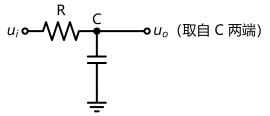

# 07 频率响应基础与混合π模型

> [!abstract] 一句话概括
> 解释"前面算的放大倍数只在中频成立"：低频看大电容、高频看结电容；用 RC 高通/低通加波特图建立分析框架，再用混合 π 模型与密勒定理把高频算清楚。

**上一篇**：[[06 共集电极、共基极与多级放大电路]] ｜ **下一篇**：[[08 共射放大电路的高频与低频响应]]

## 学习目标

1. 说明频率响应要研究的问题：放大倍数为什么随信号频率变化，后果是频率失真；能区分频率失真（线性失真）与饱和、截止失真（非线性失真）；
2. 指出影响低频特性的是耦合电容与旁路电容，影响高频特性的是 PN 结结电容，中频区两类电容都不起作用，这就是前面各篇"电容短路"近似的适用边界；
3. 陈述描述放大器频率特性的三要素：中频放大倍数 $A_{um}$（考虑信号源内阻时写 $A_{usm}$）、下限频率 $f_L$、上限频率 $f_H$，以及 $f_L$、$f_H$ 按 $|A| = 0.707\,A_{um}$（即下降 3 dB）的定义；
4. 推导单时间常数 RC 高通、低通电路的频率特性，会画波特图：渐近线斜率 $\pm20\,\text{dB}/\text{十倍频}$（即 $\pm6\,\text{dB}/\text{倍频}$）、折点 $-3\,\text{dB}$ 修正、相位折线每十倍频 $45^\circ$；
5. 说明低频小信号模型（$r_{be}$ + $\beta i_b$）的适用边界：忽略了 PN 结结电容；会画三极管的高频小信号（混合 $\pi$）模型并说明每个元件对应管内的哪个部分；
6. 掌握模型参数 $r_{b'e}=(1+\beta)\dfrac{U_T}{I_{EQ}}$、$g_m\approx\dfrac{I_{CQ}}{U_T}$，理解 $\beta=g_m r_{b'e}$，注意 $g_m$ 的单位（mA/V，即 mS）；说清受控源从 $\beta i_b$ 改为 $g_m u_{b'e}$ 的原因；
7. 会用密勒定理把跨接在 b′–c 之间的 $C_{b'c}$ 折合到输入、输出两端，得到单向化简化模型，记住 $C_i=C_{b'e}+(1+g_m R_L')C_{b'c}$；
8. 了解 $\beta$ 随频率下降的事实与共射截止频率 $f_\beta$、特征频率 $f_T=\beta_0 f_\beta$ 的定义与用途。

## 先备知识

电路课程的正弦稳态相量法（容抗 $X_C=\dfrac{1}{\omega C}$、复阻抗与分压）；[[05 小信号模型法与射极偏置电路]] 的中频放大倍数 $A_u=-\dfrac{\beta R_L'}{r_{be}}$（它就是本篇的 $A_{um}$）；[[06 共集电极、共基极与多级放大电路]] 的密勒定理（7.10 节与 [[08 共射放大电路的高频与低频响应|08 篇]]折合结电容的工具）。

---

## 7.1 前面算的放大倍数，只在中频成立

前面各篇分析放大电路时，有两处"没管频率"的近似：

1. 所有耦合电容、旁路电容**交流短路**；
2. 三极管用 $r_{be}$ 加 $\beta i_b$ 的低频模型，PN 结只当成一个电阻。

于是算出的 $A_u=-\beta R_L'/r_{be}$ 是一个与频率无关的常数。但输入信号并不一定是单一频率的正弦波，任意信号在数学上总可以分解成若干个不同频率的正弦分量叠加。放大器对不同频率分量若**等比例放大**（相位也成比例），输出波形只是整体放大，形状不变；若某分量放大 70 倍、另一分量放大 60 倍、第三个放大 100 倍，再叠加起来波形必然变形。这就是**频率失真**。

| 对比项 | 频率失真 | 饱和 / 截止失真 |
|---|---|---|
| 起因 | 电容等**线性**元件的电抗随频率变化 | 晶体管的**非线性**特性（Q 点进入饱和区/截止区） |
| 类别 | 线性失真 | 非线性失真 |
| 波形表现 | 不同频率分量比例（或相位）失调，形状改变 | 单侧削顶/削底 |
| 有无新频率成分 | 不产生新频率 | 产生新的谐波成分 |

> [!note]
> 频率失真包含两种：各频率分量**大小比例**失调叫幅度失真，**相移不成比例**叫相位失真，两者都会使波形变形。

## 7.2 电容的两副面孔：大电容管低频，结电容管高频

放大电路里的电容按数值分成两类，作用恰好相反：

| 电容 | 数值 | 中/低频 | 高频 | 影响哪一段 |
|---|---|---|---|---|
| 耦合电容、旁路电容 | $\mu\text{F}$ 量级，很大 | 容抗 $\dfrac{1}{\omega C}$ 小，近似短路；频率越低容抗越大，信号还没放大就先被衰减 | 容抗更小，完全无影响 | **低频** |
| PN 结结电容 $C_j$ | $\text{pF}$ 量级，非常小 | 容抗极大，与结电阻并联可视为开路 | 容抗下降到与结电阻可比，信号经电容直通，破坏 PN 结的单向导电 | **高频** |

所以一个放大器完整的频率特性是：**中频段**（两类电容都不起作用）放大倍数恒定，就是前面算出的 $A_{um}$；频率往低走，大电容开始"挡路"，增益下降；频率往高走，结电容开始"抄近路"，增益也下降。研究频率响应，就是找出**从哪里开始下降**，即下限频率与上限频率，并尽量让输入信号的频谱落在 $f_L\sim f_H$ 之间。

> [!tip]
> 两句话记住全章：**低频看耦合/旁路电容，高频看结电容**。中频区两类电容都可忽略。

## 7.3 三要素与通频带

描述一个放大器的频率特性只需要三个量：

- **中频放大倍数** $A_{um}$（计入信号源内阻时写 $A_{usm}$），就是前面各篇的计算结果；
- **下限频率 $f_L$**：频率降低到增益下降为 $0.707\,A_{um}$（即 $-3\,\text{dB}$）处；
- **上限频率 $f_H$**：频率升高到增益下降为 $0.707\,A_{um}$ 处。

$f_L$ 到 $f_H$ 之间叫**通频带** $f_{BW}=f_H-f_L$。设计使用放大器时，应让信号的频率范围落在通频带内，否则各分量放大倍数不同，产生频率失真。

## 7.4 RC 高通电路：放大器低频特性的模型

![[模电-07-RC高通电路.svg]]

串联 $C$、输出取自 $R$ 两端的电路，直流过不去、频率越高越畅通，故称**高通**。用相量法求输出与输入之比：

$$\dot A_u=\frac{\dot U_o}{\dot U_i}=\frac{R}{R+\dfrac{1}{j\omega C}}=\frac{1}{1+\dfrac{1}{j\omega RC}}=\frac{1}{1-j\dfrac{f_L}{f}}$$

其中令 $f_L=\dfrac{1}{2\pi RC}$（后面会看到它正是放大器的下限频率）。这是一个复数，模与相角分别为：

$$|\dot A_u|=\frac{1}{\sqrt{1+\left(\dfrac{f_L}{f}\right)^2}},\qquad
\varphi=+\arctan\frac{f_L}{f}$$

三个关键点：

| 频率 | $|\dot A_u|$ | $\varphi$ |
|---|---|---|
| $f\gg f_L$ | $\to 1$ | $\to 0^\circ$ |
| $f=f_L$ | $1/\sqrt2=0.707$ | $+45^\circ$ |
| $f\ll f_L$ | $\to 0$ | $\to +90^\circ$ |

幅频特性曲线（$|\dot A_u|$–$f$）与相频特性曲线（$\varphi$–$f$）合称**频率特性**。这条"高频平台、低频下滑"的形状，与放大器低频段的特性一样，所以后面就用 RC 高通电路来模拟放大器的低频响应。

## 7.5 波特图：对数频率轴与分贝

逐点画上述曲线既不精确又麻烦，频率特性分析改用**波特图**：横轴取对数频率刻度，纵轴取分贝。

**为什么要对数频率轴**：放大器的工作频率从几 Hz 到几 MHz、几十 MHz，跨度五六个数量级，线性坐标上 100 Hz 与 1 MHz 根本画不进同一张图。对数轴上同样的距离代表同样的**倍数**（100 Hz、1 kHz、10 kHz 等距排列），宽频段就能铺开画。

**分贝的定义**：放大倍数用 $20\lg|\dot A_u|$ dB 表示。

**常用换算速查**（做题直接引用）：

| $|\dot A_u|$ | 1000 | 100 | 10 | 2 | $\sqrt2\approx0.707$ 倍之下 | 1 | 0.1 | 0.01 |
|---|---|---|---|---|---|---|---|---|
| dB | 60 | 40 | 20 | 6 | 3（下降 3 dB 即降为 0.707 倍） | 0 | −20 | −40 |

斜率的两种说法等价：**每十倍频 20 dB** = **每倍频 6 dB**（$20\lg 2\approx 6$）。$-3\,\text{dB}$ 点就是通频带的边界（0.707 倍），把分贝刻度与倍数刻度换算熟练，读波特图才快。

**幅频波特图（高通）**：

- $f\gg f_L$：$|\dot A_u|\approx 1$，即 $0\,\text{dB}$ 的一条水平线；
- $f\ll f_L$：$|\dot A_u|\approx f/f_L$，取分贝得 $20\lg f-20\lg f_L$，一条斜率为 **$+20\,\text{dB}/\text{十倍频}$** 的直线（把 $10f$ 代入恰好多 $20\lg 10=20\,\text{dB}$）；两条渐近线在 $f_L$ 处相交；
- 精确值在 $f=f_L$ 处是 0.707，即 $-3\,\text{dB}$：实际曲线在折点下方 $3\,\text{dB}$ 处穿过。作图时先画两条直线，折点处记得修 $-3\,\text{dB}$。

**相频波特图（高通）**：相位用折线代替曲线：

- $f\ge 10 f_L$：$0^\circ$；
- $f\le f_L/10$：$+90^\circ$；
- $f_L/10\sim 10 f_L$ 之间：斜率为 $-45^\circ/\text{十倍频}$ 的直线（频率每增加十倍，相位减少 $45^\circ$：$90^\circ$ 到 $45^\circ$ 到 $0^\circ$），恰好在 $f_L$ 处是 $+45^\circ$。

## 7.6 RC 低通电路：放大器高频特性的模型

把 $R$、$C$ 位置对调（输出取自 $C$ 两端），直流畅通、频率越高衰减越大，叫**低通**电路：

$$\dot A_u=\frac{1}{1+j\omega RC}=\frac{1}{1+j\dfrac{f}{f_H}},\qquad f_H=\frac{1}{2\pi RC}$$

$$|\dot A_u|=\frac{1}{\sqrt{1+\left(\dfrac{f}{f_H}\right)^2}},\qquad \varphi=-\arctan\frac{f}{f_H}$$

波特图与高通镜像：

- $f\ll f_H$：$0\,\text{dB}$ 平台；$f\gg f_H$：斜率 $-20\,\text{dB}/\text{十倍频}$；折点 $f_H$ 处实际 $-3\,\text{dB}$；
- 相位：$f\le f_H/10$ 为 $0^\circ$，$f\ge 10f_H$ 为 $-90^\circ$，中间斜线 $-45^\circ/\text{十倍频}$，$f_H$ 处 $-45^\circ$。

这条"低频平台、高频下滑"的形状，正与放大器高频段的特性一样。

**本篇方法主线**就此定下：

| RC 电路 | 模拟放大器的 | 转折频率对应 |
|---|---|---|
| 高通 | 低频响应 | $f_L$（下限频率） |
| 低通 | 高频响应 | $f_H$（上限频率） |

于是"求放大器的频率响应"就翻译成："把放大电路等效成 RC 高通/低通，找出其中的 $R$ 和 $C$，$f_L$、$f_H$ 便随之确定"。[[08 共射放大电路的高频与低频响应|08 篇]]用混合 $\pi$ 模型加密勒定理做高频这一半、做低频这一半，[[09 频率响应习题课|09 篇]]集中练题。

## 7.7 低频模型的边界：把结电容补回来

[[05 小信号模型法与射极偏置电路|05 篇]]的模型只有两个元件：输入端电阻 $r_{be}$、输出端受控源 $\beta i_b$。它是**低频模型**——依据是 [[01 PN结与半导体二极管|01 篇]]讲过的结论：PN 结的完整等效是一个结电阻**并联**一个结电容。低频下结电容只有 pF 级，容抗极大，并联后不起作用，可以扔掉；高频下容抗下降，就必须补回来。研究频率响应恰恰要覆盖高频，所以先重建模型。

## 7.8 从结构图到混合π模型

回忆计算 $r_{be}$ 时用过的管内结构：基区体电阻 $r_{bb'}$（100~300 Ω）、发射结电阻、发射区体电阻（很小，忽略）、集电结（反偏，电阻极大）。把每个 PN 结的电容还原进去，按 b–b′–e / b′–c 的位置摆好，就得到高频小信号模型（混合 $\pi$ 模型）：

![[模电-07-混合π模型.svg]]

| 元件 | 物理来源 | 取值与处理 |
|---|---|---|
| $r_{bb'}$ | 基区体电阻 | 100~300 Ω，**保留**（它正是低频公式里的那一项） |
| $r_{b'e}$ | 发射结结电阻 | $r_{b'e}=(1+\beta)\dfrac{U_T}{I_{EQ}}=\dfrac{U_T}{I_{BQ}}$，kΩ 级 |
| $C_{b'e}$ | 发射结结电容 | 几 pF~几十 pF，**高频必须保留** |
| $r_{b'c}$ | 集电结结电阻（反偏） | 极大（兆欧级），**开路** |
| $C_{b'c}$ | 集电结结电容 | 几个 pF，虽小却是高频的"主角"（见 7.10） |
| $g_m\dot U_{b'e}$ | 输出受控源 | 跨导 $g_m\approx\dfrac{I_{CQ}}{U_T}$，mA/V（mS） |
| $r_{ce}$ | c–e 间输出电阻 | 与低频时一样大，常按开路略去；它对应输出特性"微翘"的斜率倒数，翘的根源是基区宽度调制（[[03 三极管的结构、放大原理与特性参数|03 篇]] 3.3 节的伏笔在此兑现） |

参数计算与低频公式完全接轨：

$$r_{be}=r_{bb'}+r_{b'e},\qquad r_{b'e}=(1+\beta)\frac{U_T}{I_{EQ}}=\frac{U_T}{I_{BQ}},\qquad
g_m=\frac{I_{CQ}}{U_T}\approx\frac{I_{EQ}}{U_T}$$

由 $u_{b'e}=i_b\,r_{b'e}$ 与 $i_c=\beta i_b$ 可得 $\beta=g_m r_{b'e}$。低频模型是高频模型去掉电容后的特例：把 $C_{b'e}$、$C_{b'c}$ 拿掉，受控源 $g_m u_{b'e}=g_m r_{b'e} i_b=\beta i_b$ 就还原了。

## 7.9 受控源为什么改挂 $u_{b'e}$

低频时 $i_b$ 全部流过发射结，$i_c=\beta i_b$ 天经地义。高频下 $i_b$ 在 b′ 点**分流**：一部分流过 $r_{b'e}$，一部分被 $C_{b'e}$ 旁路，还有一部分经 $C_{b'c}$ 直通输出端。$i_b$ 已经不再代表"流过发射结的电流"，受控源就不能再写成 $\beta i_b$。

但真正控制输出电流的物理量没有变：是**发射结上的电压** $u_{b'e}$。电压除以阻抗是电流（量纲自洽），故受控源写成

$$i_c=g_m\,u_{b'e}$$

即由"电流控制电流源（CCCS）"变成"**电压控制电流源（VCCS）**"，系数 $g_m$ 称**跨导**："跨"在输入（b′–e）与输出（c–e）之间，把输入电压翻译成输出电流；单位 mA/V（西门子）。这一点与场效应管的模型（[[12 场效应管放大电路：共源与共漏|12 篇]]）结构完全一致，那边天生就是压控器件。

## 7.10 密勒折合与单向化简化模型

模型中 $C_{b'c}$ 跨接在输入（b′）与输出（c）之间，信号可经它"抄近路"，电路不再是单向的，分析麻烦。用 [[06 共集电极、共基极与多级放大电路|06 篇]]的密勒定理：已知两端电压比 $\dot A=\dfrac{\dot U_{ce}}{\dot U_{b'e}}$，就可把跨接电容拆成并接在两端的两个等效电容。

$\dot A$ 怎么求？把 $C_{b'c}$ 暂时断开：输出回路里 $r_{ce}$ 开路，受控源电流 $g_m u_{b'e}$ 全部流过 $R_L'$（集电极总等效电阻），$u_{ce}=-g_m R_L'\,u_{b'e}$，故

$$\dot A=\frac{\dot U_{ce}}{\dot U_{b'e}}=-g_m R_L'\quad(\text{较大的负数})$$

折合结果：

$$\text{输入端： } C_M=(1-\dot A)C_{b'c}=(1+g_m R_L')\,C_{b'c}\qquad
\text{输出端： } \left(1-\frac{1}{\dot A}\right)C_{b'c}\approx C_{b'c}$$

输入侧两个电容（$C_{b'e}$ 与 $C_M$）结构上并联、直接相加，记为 $C_i$：

$$\boxed{\,C_i=C_{b'e}+(1+g_m R_L')\,C_{b'c}\,}$$

于是得到**单向化简化模型**：

![[模电-07-混合π单向化模型.svg]]

（上方草图只示意连接关系；受控源 $g_m u_{b'e}$ 接在 c–e 之间，$R_L'$ 与输出电容并接在 c–e 回路。）

**数值感受**：$C_{b'c}$ 只有几个 pF，但乘上 $(1+g_m R_L')$（几十倍）后 $C_M$ 可达几百 pF，输入总电容 $C_i$ 的主导成分是密勒电容。这就是"高频瓶颈"的数值来源，[[08 共射放大电路的高频与低频响应|08 篇]]求 $f_H$ 时直接用它。

## 7.11 β 不是常数：共射截止频率 $f_\beta$ 与特征频率 $f_T$

$\beta$ 本身也随频率下降（不作推导），可写成

$$\dot\beta=\frac{\beta_0}{1+j\dfrac{f}{f_\beta}}$$

其中 $\beta_0$ 是低频（中频）电流放大系数，手册给的 $\beta$ 就是它。当 $f=f_\beta$ 时 $|\dot\beta|$ 降到 $0.707\,\beta_0$，$f_\beta$ 称**共射截止频率**。工作频率远低于 $f_\beta$ 时可放心用 $\beta_0$；接近或超过后管子电流放大能力明显衰减。

**特征频率 $f_T$**：让 $|\dot\beta|$ 下降到 **1** 的频率，记作 $f_T$。由上式：当 $f\gg f_\beta$ 时 $|\dot\beta|\approx\beta_0 f_\beta/f$，令其等于 1 得

$$f_T\approx\beta_0\,f_\beta$$

$f_T$ 是衡量管子高频性能的"招牌参数"（手册必给）：$|\dot\beta f|$ 在 $f\gg f_\beta$ 段近似为常数 $\beta_0 f_\beta=f_T$，故 $f_T$ 又叫增益带宽积的管内版本。比较两只管子的高频本领，直接比 $f_T$；由 $f_T=\beta_0 f_\beta$ 也解释了"为什么高 $\beta$ 管的 $f_\beta$ 反而不高"：同一工艺下两者乘积受限。

> [!tip] 带走两句话
> **低频看耦合/旁路电容，高频看结电容（和杂散电容）**；结电容效应已封装进混合 $\pi$ 模型，后面画高频等效电路时套用它即可。

---

## 本篇小结

**概念**

1. 电容容抗随频率变化，放大倍数随之变化，产生频率失真（线性失真，含幅度失真与相位失真）；与饱和截止（非线性）失真并列记忆。
2. 大电容（耦合/旁路）决定低频特性，结电容（pF 级）决定高频特性，中频区两者皆忽略，这是 $A_{um}$ 的适用边界。
3. 三要素 $A_{um}$、$f_L$、$f_H$；$f_L$、$f_H$ 按 0.707（$-3\,\text{dB}$）定义，之间为通频带；dB 换算 $20\lg$，$+6\,\text{dB}/\text{倍频}=+20\,\text{dB}/\text{十倍频}$。

**方法**

4. 高通 $\dot A=\dfrac{1}{1-jf_L/f}$、低通 $\dot A=\dfrac{1}{1+jf_H/f}$，转折频率都是 $\dfrac{1}{2\pi RC}$；波特图渐近线斜率 $\pm20\,\text{dB}/\text{十倍频}$，折点修 $-3\,\text{dB}$，相位折线 $0^\circ\sim\pm90^\circ$。
5. 高通对应低频响应，低通对应高频响应；分析放大器 = 找等效 R、C。

**高频模型**

6. 混合 $\pi$ 模型五件套：$r_{bb'}$、$r_{b'e}$ ∥ $C_{b'e}$、$C_{b'c}$、$g_m u_{b'e}$；$r_{b'c}$、$r_{ce}$ 按开路略去；$r_{ce}$ 对应基区宽度调制。
7. $r_{b'e}=(1+\beta)U_T/I_{EQ}=U_T/I_{BQ}$；$g_m=I_{CQ}/U_T$（mS）；$\beta=g_m r_{b'e}$；去掉电容即还原低频模型。受控源改挂 $u_{b'e}$：电容分流后 $i_b$ 失真，唯有发射结电压始终控制 $i_c$。
8. 密勒单向化：$\dot A=-g_m R_L'$，$C_i=C_{b'e}+(1+g_m R_L')C_{b'c}$，输入侧密勒电容主导。
9. $\dot\beta=\beta_0/(1+jf/f_\beta)$，$f_\beta$ 处 $|\beta|$ 降 0.707 倍；$f_T\approx\beta_0 f_\beta$ 是高频本领的招牌参数。

## 自测题

1. 频率失真与饱和失真在起因、类别（线性/非线性）上有何不同？
2. 为什么耦合电容只影响低频特性、结电容只影响高频特性？中频近似（电容全短路）的边界在哪里？
3. 某放大器中频放大倍数为 100 倍，用分贝表示是多少？$f=f_L$ 处是多少分贝、多少倍？
4. RC 高通电路 $R=1\,\text{k}\Omega$、$C=1\,\mu\text{F}$，转折频率是多少？频率再降一个十倍频，增益约下降多少 dB？
5. $\beta=80$、$I_{EQ}=1.3\,\text{mA}$、$r_{bb'}=200\ \Omega$，求 $r_{b'e}$、$g_m$，并验证 $\beta=g_m r_{b'e}$。
6. 高频模型里受控源为什么写成 $g_m u_{b'e}$ 而不是 $\beta i_b$？
7. 某管 $C_{b'e}=10\,\text{pF}$、$C_{b'c}=3\,\text{pF}$，$g_m R_L'=50$，求输入总电容 $C_i$。哪个成分占主导？
8. 某管 $\beta_0=100$、$f_\beta=2\,\text{MHz}$，求 $f_T$；在 $f=20\,\text{MHz}$ 处 $|\dot\beta|$ 约多少？

> [!success]- 答案要点
> 1. 频率失真由线性元件（电容）电抗随频率变化引起，属线性失真，不产生新频率；饱和/截止由管子非线性引起，属非线性失真。
> 2. 大电容 μF 级，低频时容抗才显著；结电容 pF 级，高频时容抗才降到可通；中频区两者均可忽略。
> 3. $20\lg 100=40\,\text{dB}$；$f_L$ 处 $40-3=37\,\text{dB}$，即 70.7 倍。
> 4. $f=\dfrac{1}{2\pi\times10^3\times10^{-6}}\approx159\,\text{Hz}$；十倍频 $20\,\text{dB}$。
> 5. $r_{b'e}=81\times26/1.3=1620\ \Omega=1.62\,\text{k}\Omega$；$I_{CQ}=\dfrac{\beta}{1+\beta}I_{EQ}\approx1.28\,\text{mA}$，$g_m=1.28/26\approx49.4\,\text{mS}$；$g_m r_{b'e}\approx49.4\times1.62\approx80=\beta$ ✓（$r_{b'e}$ 用 $(1+\beta)U_T/I_{EQ}$ 而 $g_m$ 用 $I_{CQ}/U_T$，乘起来恰好还原 $\beta$）。
> 6. 结电容使 $i_b$ 分流，$i_c$ 不再正比于 $i_b$；控制量是发射结电压 $u_{b'e}$。
> 7. $C_i=10+(1+50)\times3=163\,\text{pF}$，密勒电容 153 pF 占主导。
> 8. $f_T=\beta_0 f_\beta=200\,\text{MHz}$；$f=20\,\text{MHz}\gg f_\beta$，$|\dot\beta|\approx f_T/f=200/20=10$。

**下一篇**：把混合 $\pi$ 模型放进共射放大电路求 $f_H$，把耦合/旁路电容折合求 $f_L$，见 [[08 共射放大电路的高频与低频响应]]。
