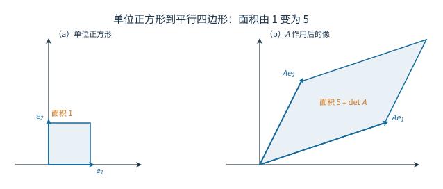

# 01 行列式

[[00 线性代数 MOC|← 目录]] · 下一章：[[02 矩阵运算与逆]]

## 学习目标

- 用二阶、三阶行列式判断方阵可逆与方程组唯一解。
- 用排列与逆序写出 $n$ 阶行列式的定义并判断任意一项的正负。
- 用行列式性质与展开定理把一般行列式化为三角或低阶。
- 识别范德蒙德、爪形、三对角与分块结构，选用对应公式。
- 用克拉默法则解系数行列式非零的方程组，并讨论含参数的情形。

## 1 二阶与三阶行列式

二阶行列式由四个数排成两行两列，定义为

$$
\begin{vmatrix}
a_{11}&a_{12}\\
a_{21}&a_{22}
\end{vmatrix}
=a_{11}a_{22}-a_{12}a_{21}.
$$

它等于主对角线乘积减去副对角线乘积。对二元线性方程组

$$
\begin{cases}
a_{11}x_1+a_{12}x_2=b_1,\\
a_{21}x_1+a_{22}x_2=b_2,
\end{cases}
$$

用消元法消去 $x_2$：第一式乘 $a_{22}$、第二式乘 $a_{12}$ 后相减，得

$$
(a_{11}a_{22}-a_{12}a_{21})x_1=b_1a_{22}-a_{12}b_2.
$$

同理消去 $x_1$ 得 $(a_{11}a_{22}-a_{12}a_{21})x_2=a_{11}b_2-b_1a_{21}$。两式左端的系数正是行列式 $D=a_{11}a_{22}-a_{12}a_{21}$。当 $D\ne0$ 时，两个未知量都能唯一解出；当 $D=0$ 时，消元会把未知量消掉，方程组无解或有无穷多解。一个数决定了解的基本形态，这是行列式最早的作用。

二阶行列式的绝对值等于两个列向量张成的平行四边形面积，符号记录定向是否翻转。取 $A=\begin{pmatrix}3&1\\1&2\end{pmatrix}$，两列是 $(3,1)^T$ 与 $(1,2)^T$，张成的平行四边形面积为 $3\cdot2-1\cdot1=5$。

单位正方形的面积为 $1$，把两条边分别映成 $A$ 的两列后，围成的平行四边形面积为 $5=\det(A)$。交换两列时图形形状不变而绕行方向反转，行列式变号，这就是“有向面积”的含义；$\det(A)=0$ 时两列共线，平行四边形被压成线段，对应两列线性相关。

三阶行列式可以用对角线法则计算：

$$
\begin{aligned}
\det(A)={}&a_{11}a_{22}a_{33}+a_{12}a_{23}a_{31}+a_{13}a_{21}a_{32}\\
&-a_{13}a_{22}a_{31}-a_{11}a_{23}a_{32}-a_{12}a_{21}a_{33}.
\end{aligned}
$$

六项分成三正三负，分别对应三个偶排列与三个奇排列。三阶行列式的绝对值是三个列向量张成的平行六面体体积；对角线法则只适用于二阶和三阶，四阶行列式有 $4!=24$ 项，“主对角减副对角”的结构已不存在。

**例 1** 解方程组

$$
\begin{cases}
2x+y=5,\\
x-y=1.
\end{cases}
$$

**解** 系数行列式 $D=\begin{vmatrix}2&1\\1&-1\end{vmatrix}=-3\ne0$，所以解唯一。由 $x-y=1$ 得 $x=1+y$，代入第一式得 $2(1+y)+y=5$，所以 $y=1$、$x=2$。回代检验：$2\cdot2+1=5$，$2-1=1$，两式都成立。

**例 2** 用对角线法则计算

$$
D=\begin{vmatrix}
1&2&3\\
4&5&6\\
7&8&10
\end{vmatrix},
$$

再用按行展开核对。

**解** 按对角线法则，

$$
D=1\cdot5\cdot10+2\cdot6\cdot7+3\cdot4\cdot8
-3\cdot5\cdot7-1\cdot6\cdot8-2\cdot4\cdot10.
$$

六项分别为 $50,84,96,105,48,80$，所以 $D=230-233=-3$。按第一行展开：

$$
D=1\begin{vmatrix}5&6\\8&10\end{vmatrix}
-2\begin{vmatrix}4&6\\7&10\end{vmatrix}
+3\begin{vmatrix}4&5\\7&8\end{vmatrix}
=2-2\cdot(-2)+3\cdot(-3)=-3.
$$

两种算法一致。展开式中每一项的符号由列号排列的奇偶性决定，下一节把这一点写成一般定义。

## 2 全排列与 $n$ 阶行列式

把 $1,2,\ldots,n$ 排成一列，称为一个 $n$ 阶排列。若 $p<q$ 但 $j_p>j_q$，称 $(j_p,j_q)$ 构成一个逆序；逆序的总数称为逆序数，记为 $\tau(j_1j_2\cdots j_n)$。逆序数为偶数时称偶排列，为奇数时称奇排列。排列 $231$ 中 $2>1$、$3>1$，逆序数为 $2$，是偶排列；排列 $321$ 的逆序数为 $3$，是奇排列。交换排列中任意两个数，逆序数的奇偶性改变，这一点是行列式变号性质的来源。

设 $A=(a_{ij})_{n\times n}$，$n$ 阶行列式定义为

$$
\det(A)=
\sum_{(j_1,\ldots,j_n)}
(-1)^{\tau(j_1\cdots j_n)}
a_{1j_1}a_{2j_2}\cdots a_{nj_n},
$$

其中求和遍历全部 $n!$ 个排列。每一项从每一行取一个元素，列号也互不相同，因此每列恰取一个元素；列号排列为偶排列时取正，奇排列时取负。

这个定义把“对角线法则”解释清楚了：二阶的 $ad$ 与 $bc$ 分别对应偶排列 $12$ 与奇排列 $21$；三阶的六项对应 $123,231,312$ 三个偶排列和 $132,213,321$ 三个奇排列。

**例 3** 判断三阶行列式中 $a_{32}a_{11}a_{23}$ 这一项的符号。

**解** 按行号从小到大重排为 $a_{11}a_{23}a_{32}$，列号排列是 $132$。$132$ 中 $3>2$，逆序数为 $1$，是奇排列，所以该项带负号。若不先按行号重排就直接数逆序，行号与列号的对应会错位，符号判断随之出错。

**例 4** 在四阶行列式中，项 $a_{14}a_{23}a_{32}a_{41}$ 应取什么符号？

**解** 按行号重排后列号排列为 $4321$。它的逆序数为 $3+2+1=6$，是偶排列，所以该项取正号。四阶行列式共有 $24$ 项，其中 $12$ 项取正、$12$ 项取负。

## 3 行列式的性质

以下以行叙述，列的结论完全对称。这些性质把 $n!$ 项求和转化为有限步变形。

1. 转置不改变行列式：$\det(A^T)=\det(A)$。
2. 交换两行，行列式变号。
3. 某一行有公因子 $k$，可以提到行列式外。
4. 两行成比例时，行列式为零；全零行是特例。
5. 若某一行是两个行向量之和，行列式可以按这一行拆成两个行列式之和。
6. 把一行的 $k$ 倍加到另一行，行列式不变。

性质 1 来自定义中的重排：$\det(A^T)$ 的一般项是 $a_{1j_1}\cdots a_{nj_n}$ 的转置写法，把列号排列换成它的逆排列，乘积不变，而逆排列与原排列的逆序数相同。性质 2 来自交换两个列号会使每个排列的奇偶性反转，于是每一项都变号。性质 3、5 是每一项对某一行的元素逐项相乘、逐项相加的直接结果。性质 4 由性质 2 推出：交换两行后行列式既变号又因两行相同而保持不变，只能为零。性质 6 由性质 5 和性质 4 推出：把 $r_i+kr_j$ 拆成 $r_i$ 与 $kr_j$ 两部分，后一部分有两行成比例，贡献为零。

由这些性质可以得到几个常用结论。对同阶方阵 $A,B$，有

$$
\det(AB)=\det(A)\det(B),\qquad
\det(kA)=k^n\det(A),
$$

以及三角行列式等于主对角线元素之积。方阵 $A$ 可逆当且仅当 $\det(A)\ne0$。这条判据把可逆性转化为一个数的计算，是后续所有可逆判据的起点。

$\det(kA)=k^n\det(A)$ 是因为 $kA$ 的每一行都提出一个因子 $k$，共 $n$ 行。乘积公式的证明分两步。若 $A$ 奇异，则 $r(A)<n$，由 $r(AB)\le r(A)$（第 03 章）知 $AB$ 也奇异，两边行列式都为零。若 $A$ 可逆，则 $A$ 可写成有限个初等矩阵的乘积 $A=F_1F_2\cdots F_m$（第 03 章）。对三类初等矩阵逐一验证 $\det(FB)=\det(F)\det(B)$：交换两行时两边同时变号，倍乘一行时两边同时乘 $k$，倍加一行时两边都不变。于是

$$
\det(AB)=\det(F_1)\det(F_2\cdots F_mB)=\cdots=\det(F_1)\cdots\det(F_m)\det(B),
$$

而 $\det(A)=\det(F_1)\cdots\det(F_m)$，乘积公式成立。这个证明同时说明：行列式对矩阵乘法是同态，把矩阵乘法变成数的乘法。

**例 5** 计算

$$
D=\begin{vmatrix}
1&2&3\\
2&5&8\\
1&3&5
\end{vmatrix}.
$$

**解** 作 $r_2\leftarrow r_2-2r_1$、$r_3\leftarrow r_3-r_1$，得

$$
D=\begin{vmatrix}
1&2&3\\
0&1&2\\
0&1&2
\end{vmatrix}=0.
$$

后两行相同，行列式为零。这里只用了性质 6 和性质 4，没有真正展开任何一项。

**例 6** 计算主对角线为 $a$、其余元素为 $b$ 的 $n$ 阶行列式

$$
D_n=\begin{vmatrix}
a&b&\cdots&b\\
b&a&\cdots&b\\
\vdots&\vdots&\ddots&\vdots\\
b&b&\cdots&a
\end{vmatrix}.
$$

**解** 每一行的元素之和都是 $s=a+(n-1)b$。把第 $2,\ldots,n$ 列都加到第 $1$ 列，第 $1$ 列变为全 $s$；提出因子 $s$，再对第 $2,\ldots,n$ 行减去第 $1$ 行：

$$
D_n=s\begin{vmatrix}
1&b&\cdots&b\\
1&a&\cdots&b\\
\vdots&\vdots&\ddots&\vdots\\
1&b&\cdots&a
\end{vmatrix}
=s\begin{vmatrix}
1&b&\cdots&b\\
0&a-b&\cdots&0\\
\vdots&\vdots&\ddots&\vdots\\
0&0&\cdots&a-b
\end{vmatrix}
=s(a-b)^{n-1}.
$$

所以 $D_n=\bigl(a+(n-1)b\bigr)(a-b)^{n-1}$。取 $n=3$、$a=3$、$b=1$，得 $(3+2)\cdot2^2=20$；三阶对角线法则的三正项为 $27+1+1$，三负项为 $3+3+3$，结果同样是 $20$。

## 4 展开定理与代数余子式

删去 $a_{ij}$ 所在的第 $i$ 行和第 $j$ 列，剩下的 $(n-1)$ 阶行列式称为余子式 $M_{ij}$；再乘符号因子，得到代数余子式

$$
A_{ij}=(-1)^{i+j}M_{ij}.
$$

按第 $i$ 行展开：

$$
\det(A)=\sum_{j=1}^n a_{ij}A_{ij}.
$$

按第 $j$ 列展开有同样的公式。展开定理的证明思路是把定义中的 $n!$ 项按“含有哪一个 $a_{ij}$”分组：含 $a_{ij}$ 的项共 $(n-1)!$ 个，剩下的因子正好组成 $M_{ij}$，而列号排列的奇偶性给出符号 $(-1)^{i+j}$。因此展开定理不是新公式，而是对定义的一次重新分组。

展开定理把 $n$ 阶行列式降为若干个 $n-1$ 阶行列式，计算时优先选择零最多的行或列。若某一行只有一个非零元，只需算一个余子式。

**例 7** 计算

$$
D=\begin{vmatrix}
1&2&0\\
0&3&0\\
4&5&6
\end{vmatrix}.
$$

**解** 第二行只有一个非零元素，按第二行展开：

$$
D=3(-1)^{2+2}
\begin{vmatrix}1&0\\4&6\end{vmatrix}
=3\cdot6=18.
$$

若按第一行展开，需要算三个二阶行列式；选对展开行能直接少算两个。

非对应代数余子式之和有一个常用结论：若 $i\ne k$，则

$$
a_{i1}A_{k1}+a_{i2}A_{k2}+\cdots+a_{in}A_{kn}=0.
$$

原因是把第 $k$ 行换成第 $i$ 行后，所得行列式有两行相同，值为零；再按第 $k$ 行展开即得。更一般地，求 $c_1A_{k1}+\cdots+c_nA_{kn}$ 时，可把第 $k$ 行替换为 $(c_1,\ldots,c_n)$ 后算行列式。

**例 8** 对 $A=\begin{pmatrix}1&2&3\\0&1&4\\5&6&0\end{pmatrix}$，求 $A_{21}+A_{22}+A_{23}$。

**解** 把第二行换成全 $1$，按第二行展开：

$$
A_{21}+A_{22}+A_{23}
=\begin{vmatrix}1&2&3\\1&1&1\\5&6&0\end{vmatrix}
=1\cdot(0-6)-2\cdot(0-5)+3\cdot(6-5)=7.
$$

逐项核对：$A_{21}=-\begin{vmatrix}2&3\\6&0\end{vmatrix}=18$，$A_{22}=\begin{vmatrix}1&3\\5&0\end{vmatrix}=-15$，$A_{23}=-\begin{vmatrix}1&2\\5&6\end{vmatrix}=4$，和也是 $7$。

## 5 常见行列式结构

### 5.1 三角与分块三角

上三角、下三角和对角行列式都等于主对角线元素之积。若矩阵分块为

$$
\begin{pmatrix}A&C\\O&B\end{pmatrix}
\quad\text{或}\quad
\begin{pmatrix}A&O\\C&B\end{pmatrix},
$$

其中 $A,B$ 为方阵，则行列式等于 $\det(A)\det(B)$。对反分块三角结构

$$
\begin{pmatrix}O&A\\B&C\end{pmatrix},
$$

若 $A$ 为 $m$ 阶、$B$ 为 $n$ 阶，则

$$
\det\begin{pmatrix}O&A\\B&C\end{pmatrix}
=(-1)^{mn}\det(A)\det(B).
$$

指数 $mn$ 来自把前 $n$ 列整体搬到后 $m$ 列之后所需的列交换次数：把 $B$ 的每一列依次移过 $A$ 的 $m$ 列，共 $mn$ 次相邻交换，每次变号。例如

$$
\begin{vmatrix}0&0&2\\1&0&3\\0&1&4\end{vmatrix}
=(-1)^{1\cdot2}\cdot2\cdot1=2.
$$

直接用对角线法则核对：$0+0+2-0-0-0=2$，符号一致。

### 5.2 范德蒙德行列式

形如

$$
V=\begin{vmatrix}
1&1&\cdots&1\\
a_1&a_2&\cdots&a_n\\
\vdots&\vdots&\ddots&\vdots\\
a_1^{n-1}&a_2^{n-1}&\cdots&a_n^{n-1}
\end{vmatrix}
$$

的行列式称为范德蒙德行列式，其值为

$$
V=\prod_{1\le j<i\le n}(a_i-a_j).
$$

推导用归纳法。对 $n=2$，$V=a_2-a_1$。设结论对 $n-1$ 阶成立。从最后一行开始，依次作 $r_k\leftarrow r_k-a_1r_{k-1}$（$k=n,n-1,\ldots,2$），第 $k$ 行变为 $(0,a_2^k-a_1a_2^{k-1},\ldots,a_n^k-a_1a_n^{k-1})$，即每列提出因子 $a_j-a_1$。按第一行展开，剩下的是一个以 $a_2,\ldots,a_n$ 为参数的 $n-1$ 阶范德蒙德行列式：

$$
V=\prod_{j=2}^n(a_j-a_1)\cdot
\prod_{2\le j<i\le n}(a_i-a_j)
=\prod_{1\le j<i\le n}(a_i-a_j).
$$

若有两个 $a_i$ 相等，两列相同，公式自然给出零，与范德蒙德行列式的结构一致。

**例 9** 计算

$$
D=\begin{vmatrix}1&1&1\\1&2&4\\2&5&17\end{vmatrix}.
$$

**解** 第三行减去第一行：

$$
D=\begin{vmatrix}1&1&1\\1&2&4\\1&4&16\end{vmatrix}
=(2-1)(4-1)(4-2)=6.
$$

这是以 $1,2,4$ 为参数的范德蒙德行列式。直接按第一行展开核对：

$$
1\cdot(2\cdot16-4\cdot4)-1\cdot(1\cdot16-4\cdot1)+1\cdot(1\cdot4-2\cdot1)
=16-12+2=6,
$$

两种算法一致。行变换只改变了行列式的表示，不改变它的值；变换后的矩阵第二、三行正好呈现范德蒙德结构，直接套公式比继续展开更快。

### 5.3 爪形与三对角

爪形行列式只有第一行、第一列和主对角线可能非零：

$$
D_n=\begin{vmatrix}
a_1&b_2&b_3&\cdots&b_n\\
c_2&a_2&0&\cdots&0\\
c_3&0&a_3&\cdots&0\\
\vdots&\vdots&\vdots&\ddots&\vdots\\
c_n&0&0&\cdots&a_n
\end{vmatrix}.
$$

设 $a_2,\ldots,a_n\ne0$，依次作 $r_1\leftarrow r_1-\dfrac{b_i}{a_i}r_i$（$i=2,\ldots,n$），把第一行第 $2,\ldots,n$ 列消成零，第一行第一列变为 $a_1-\sum_{i=2}^n\dfrac{b_ic_i}{a_i}$。矩阵成为上三角，故

$$
D_n=\left(a_1-\sum_{i=2}^n\frac{b_ic_i}{a_i}\right)a_2a_3\cdots a_n.
$$

例如

$$
\begin{vmatrix}2&1&1\\1&3&0\\2&0&4\end{vmatrix}
=\left(2-\frac{1\cdot1}{3}-\frac{1\cdot2}{4}\right)\cdot3\cdot4
=\frac76\cdot12=14.
$$

三对角行列式

$$
D_n=\begin{vmatrix}
2&1&&\\
1&2&\ddots&\\
&\ddots&\ddots&1\\
&&1&2
\end{vmatrix}
$$

按第一行展开，得递推

$$
D_n=2D_{n-1}-D_{n-2},\qquad D_1=2,\quad D_2=3.
$$

由 $D_1=2$、$D_2=3$ 猜想 $D_n=n+1$。归纳验证：若 $D_{n-1}=n$、$D_{n-2}=n-1$，则 $D_n=2n-(n-1)=n+1$，猜想成立。递推式把高阶行列式转化为两个低阶值，这是三对角结构最常用的处理方式。

## 6 克拉默法则

设 $A$ 为 $n$ 阶方阵，$\det(A)\ne0$，线性方程组 $Ax=b$ 有唯一解

$$
x_j=\frac{D_j}{D},\qquad j=1,\ldots,n,
$$

其中 $D=\det(A)$，$D_j$ 是把 $D$ 的第 $j$ 列换成右端列 $b$ 后得到的行列式。这就是克拉默法则。

推导只需上一节的两条余子式结论。把方程组写成 $\sum_{k=1}^n a_{ik}x_k=b_i$，两边乘 $A_{ij}$ 并对 $i$ 求和：

$$
\sum_{i=1}^n\sum_{k=1}^n a_{ik}A_{ij}x_k=\sum_{i=1}^n b_iA_{ij}.
$$

左端交换求和次序，$\sum_i a_{ik}A_{ij}$ 当 $k=j$ 时等于 $D$，当 $k\ne j$ 时等于零，于是左端为 $Dx_j$；右端正是 $D_j$ 按第 $j$ 列的展开。因此 $Dx_j=D_j$，在 $D\ne0$ 时得到公式。

使用前要确认三点：$A$ 是方阵；未知量个数与方程个数相同；$\det(A)\ne0$。若 $\det(A)=0$，方程组可能无解，也可能有无穷多解，克拉默法则不能直接判断，需要改用增广矩阵的秩。

**例 10** 用克拉默法则解

$$
\begin{cases}
x_1+x_2+x_3=6,\\
2x_1-x_2+x_3=3,\\
x_1+2x_2-x_3=2.
\end{cases}
$$

**解** 系数行列式

$$
D=\begin{vmatrix}1&1&1\\2&-1&1\\1&2&-1\end{vmatrix}
=1(1-2)-1(-2-1)+1(4+1)=7\ne0.
$$

替换各列：

$$
D_1=\begin{vmatrix}6&1&1\\3&-1&1\\2&2&-1\end{vmatrix}=7,\quad
D_2=\begin{vmatrix}1&6&1\\2&3&1\\1&2&-1\end{vmatrix}=14,\quad
D_3=\begin{vmatrix}1&1&6\\2&-1&3\\1&2&2\end{vmatrix}=21.
$$

所以 $x_1=1$、$x_2=2$、$x_3=3$。回代三个方程：$1+2+3=6$，$2-2+3=3$，$1+4-3=2$，全部成立。

**例 11** 讨论方程组

$$
\begin{cases}
ax_1+x_2+x_3=1,\\
x_1+ax_2+x_3=1,\\
x_1+x_2+ax_3=1
\end{cases}
$$

的解。

**解** 系数行列式为

$$
D=\begin{vmatrix}a&1&1\\1&a&1\\1&1&a\end{vmatrix}
=(a+2)(a-1)^2.
$$

当 $a\ne1,-2$ 时，$D\ne0$，方程组有唯一解。由对称性，$D_1=D_2=D_3=(a-1)^2$，所以

$$
x_1=x_2=x_3=\frac1{a+2}.
$$

回代第一式：$\dfrac{a+1+1}{a+2}=1$，成立。

当 $a=1$ 时，三个方程都变成 $x_1+x_2+x_3=1$，$r(A)=r([A\mid b])=1<3$，有无穷多解

$$
x=(1,0,0)^T+s(-1,1,0)^T+t(-1,0,1)^T,\qquad s,t\in\mathbb R.
$$

当 $a=-2$ 时，三式相加，左端为 $(-2+1+1)(x_1+x_2+x_3)=0$，右端为 $3$，矛盾，方程组无解。也可以用秩判断：此时 $r(A)=2$、$r([A\mid b])=3$。

含参数的行列式只告诉我们在哪些参数值处 $D=0$，$D=0$ 的具体后果仍要代回方程组逐支讨论。

对 $n$ 阶方阵，齐次方程组 $Ax=\boldsymbol 0$ 的结论是：

$$
\det(A)\ne0\iff\text{只有零解},
\qquad
\det(A)=0\iff\text{存在非零解}.
$$

前者因为 $A$ 可逆，两边左乘 $A^{-1}$ 即得 $x=\boldsymbol 0$；后者在第 03 章用秩证明：$\det(A)=0$ 时 $r(A)<n$，自由变量至少有一个，取自由变量非零即可得到非零解。

克拉默法则的公式整齐，但要计算 $n+1$ 个 $n$ 阶行列式，实际解方程组通常用消元法。它的价值主要在理论推导、低阶问题和含参数方程组的定性分析。
