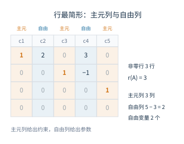

# 03 初等变换、秩与线性方程组

[[00 线性代数 MOC|← 目录]] · 上一章：[[02 矩阵运算与逆]] · 下一章：[[04 向量组与线性方程组解结构]]

## 学习目标

- 作初等行变换，写出阶梯形与行最简形，识别主元列与自由列。
- 说明初等矩阵左乘对应行变换、右乘对应列变换。
- 用阶梯形与子式求秩，并说明行秩与列秩相等。
- 用秩判定线性方程组解的情况，写出自由变量与通解。
- 理解矩阵等价与等价标准形，区分行等价与等价。

## 1 初等变换与初等矩阵

### 1.1 三种初等行变换

解方程组的消元过程只做三件事：交换两个方程、把一个方程乘非零数、把一个方程的倍数加到另一个方程。写成矩阵就是三种初等行变换：

1. 交换两行：$r_i\leftrightarrow r_j$；
2. 第 $i$ 行乘非零数 $k$：$r_i\leftarrow kr_i$；
3. 第 $j$ 行的 $k$ 倍加到第 $i$ 行：$r_i\leftarrow r_i+kr_j$。

把“行”换成“列”，得到初等列变换。每种初等变换都有逆操作，因此经过有限次初等行变换得到的矩阵与原矩阵行等价，记 $A\overset{r}{\sim}B$；只作列变换记 $A\overset{c}{\sim}B$；允许行列变换记 $A\sim B$。

行变换不改变方程组的解集，因为每一种行变换都对应一个可逆的方程变形。列变换会打乱未知量的位置，增广矩阵一般只能作行变换。

### 1.2 初等矩阵

对单位矩阵作一次初等变换，所得方阵称为初等矩阵。设 $A$ 为 $m\times n$ 矩阵，则

- 左乘一个 $m$ 阶初等矩阵，相当于对 $A$ 作相应的初等行变换；
- 右乘一个 $n$ 阶初等矩阵，相当于对 $A$ 作相应的初等列变换。

口诀是“左行右列”。三类初等矩阵都可逆，行列式分别为

$$
\det(F_{ij})=-1,\qquad \det(F_i(k))=k,\qquad \det(F_{ij}(k))=1.
$$

因此初等矩阵的乘积也可逆。矩阵 $A$ 经有限次初等行变换化为 $B$，等价于存在可逆矩阵 $P$ 使 $B=PA$；允许行列变换时，存在可逆矩阵 $P,Q$ 使 $B=PAQ$。$P$ 就是各次行变换对应初等矩阵的乘积，$Q$ 是各次列变换对应初等矩阵的乘积。

方阵 $A$ 可逆，当且仅当 $A$ 行等价于单位矩阵 $I$。若一串行变换把 $A$ 化为 $I$，这些变换对应的可逆矩阵乘积 $P$ 满足 $PA=I$，即 $P=A^{-1}$；把同样的变换作用在 $I$ 上，就得到 $A^{-1}$。反过来，若 $A$ 不可逆，齐次方程组 $Ax=\boldsymbol 0$ 有非零解，行变换不会改变解集，化出的行最简形不可能有 $n$ 个主元，也就不能是 $I$。

**例 1** 设 $A=\begin{pmatrix}1&2\\2&3\end{pmatrix}$，写出实施 $r_2\leftarrow r_2-2r_1$ 的初等矩阵，并验证。

**解** 在 $I_2$ 上作同一行变换，得

$$
F_{21}(-2)=\begin{pmatrix}1&0\\-2&1\end{pmatrix}.
$$

于是

$$
F_{21}(-2)A=
\begin{pmatrix}1&0\\-2&1\end{pmatrix}
\begin{pmatrix}1&2\\2&3\end{pmatrix}
=\begin{pmatrix}1&2\\0&-1\end{pmatrix},
$$

正是对 $A$ 作该行变换的结果。

行变换保持列与列之间的线性关系。设 $P$ 可逆，$A$ 的列向量为 $\alpha_1,\ldots,\alpha_n$，则

$$
x_1\alpha_1+\cdots+x_n\alpha_n=\boldsymbol 0
\iff Ax=\boldsymbol 0
\iff PAx=\boldsymbol 0.
$$

也就是说，$\sum x_j\alpha_j=0$ 与化简后矩阵的列向量满足同一组系数关系。这条性质在第 04 章求极大无关组时会反复使用：主元列的位置可以从化简后的矩阵读取，但真正取向量时必须回到原矩阵。

### 1.3 阶梯形与行最简形

行阶梯形矩阵满足：所有零行都在非零行下方；每个非零行的首非零元（主元）所在列，严格位于上一非零行主元的右方。若每个主元为 $1$，且主元所在列其余元素全为 $0$，则称为行最简形。

任意矩阵都可以通过有限次初等行变换化为行阶梯形；进一步化为唯一的行最简形。主元所在的列称为主元列，其余列称为自由列；主元列数就是矩阵的秩（2.1 节正式定义），自由列数为 $n$ 减去主元列数。

图中第一、三、五列是主元列，第二、四列是自由列。非零行有 $3$ 行，所以 $r(A)=3$；自由列有 $2$ 列，对应两个自由变量。把主元列记成 $c_1,c_3,c_5$，自由列记成 $f_2,f_4$，求解时用自由变量表示主变量，依据正是这张图的列分类。

**例 2** 把

$$
A=\begin{pmatrix}1&2&3\\2&4&7\\3&6&9\end{pmatrix}
$$

化为行最简形，并指出主元列、自由列与秩。

**解** 作 $r_2\leftarrow r_2-2r_1$、$r_3\leftarrow r_3-3r_1$，得

$$
\begin{pmatrix}1&2&3\\0&0&1\\0&0&0\end{pmatrix}.
$$

再用第二行消去第一行的第三列，得

$$
\begin{pmatrix}1&2&0\\0&0&1\\0&0&0\end{pmatrix}.
$$

主元列是第 $1,3$ 列，自由列是第 $2$ 列，$r(A)=2$，自由变量有 $1$ 个。行变换只改变列的数值，不改变列之间的线性关系，所以原矩阵的第 $2$ 列仍是第 $1$ 列的 $2$ 倍，而第 $3$ 列不能由前两列表出。

## 2 矩阵的秩

### 2.1 定义与求法

从 $m\times n$ 矩阵 $A$ 中任取 $k$ 行、$k$ 列，交叉位置按原次序组成的 $k$ 阶行列式，称为 $A$ 的一个 $k$ 阶子式。$A$ 的非零子式的最高阶数称为秩，记 $r(A)$；零矩阵的秩规定为 $0$。

实际计算时，把 $A$ 化为行阶梯形，非零行的行数就是 $r(A)$。注意数的是化简后的非零行，不是原矩阵的非零行。例如两行都是 $(1,2)$ 的矩阵有两行非零，但秩为 $1$。

若 $A$ 为 $m\times n$ 矩阵，则

$$
0\le r(A)\le\min(m,n).
$$

$r(A)=m$ 称为行满秩，$r(A)=n$ 称为列满秩；只有方阵中两者才同时等价于“满秩”。

### 2.2 行秩与列秩

矩阵的行向量组的秩称为行秩，列向量组的秩称为列秩。二者恒相等，且都等于用行变换化出的非零行数。

证明分两步。行变换是可逆变换，保持行空间，因此不改变行秩。先用行最简形 $R$。$R$ 的非零行有 $r$ 行，所以行秩为 $r$。$R$ 的主元列是 $e_1,\ldots,e_r$（在非零行范围内），它们线性无关；每个自由列都可以写成主元列的线性组合，系数就是该自由列在主元行上的分量。因此 $R$ 的列秩也是 $r$。再由 1.2 节的列关系保持性质，$A$ 与 $R$ 的列向量满足完全相同的线性关系，列秩相同。于是行秩等于列秩，都等于 $r$。

转置把行与列互换，因此

$$
r(A^T)=r(A).
$$

乘以可逆矩阵不改变秩：

$$
r(PA)=r(AQ)=r(PAQ)=r(A),
$$

其中 $P,Q$ 可逆且阶数合适。因为可逆矩阵是初等矩阵的乘积，而初等变换不改变行秩与列秩。

### 2.3 秩的运算性质

若乘积 $AB$ 有定义，则

$$
r(AB)\le\min\{r(A),r(B)\}.
$$

$AB$ 的每一列都是 $A$ 的列向量的线性组合，所以 $AB$ 的列空间包含在 $A$ 的列空间内，$r(AB)\le r(A)$；对 $AB$ 取转置并用 $r(A^T)=r(A)$，得 $r(AB)=r((AB)^T)\le r(B^T)=r(B)$。

若 $A,B$ 同型，则

$$
r(A+B)\le r(A)+r(B).
$$

$A+B$ 的列是 $A$ 的对应列与 $B$ 的对应列之和，落在 $A$ 的列空间与 $B$ 的列空间之和中；两个子空间之和的维数不超过两者维数之和。

**例 3** 设

$$
A=\begin{pmatrix}1&0\\0&0\end{pmatrix},\qquad
B=\begin{pmatrix}0&0\\1&0\end{pmatrix}.
$$

验证 $AB=O$，并比较 $r(A)+r(B)$ 与 $r(A+B)$。

**解** 直接计算 $AB=\begin{pmatrix}0&0\\0&0\end{pmatrix}$，所以 $r(AB)=0$。$A,B$ 各有一个非零列，秩都为 $1$，$r(A)+r(B)=2$；而 $A+B=\begin{pmatrix}1&0\\1&0\end{pmatrix}$ 的秩为 $1$。这里 $r(AB)=0<2$，$r(A+B)=1<2$，两条不等式都取严格不等号。乘积为零说明两个矩阵的列空间与行空间发生了“错位”，并不表示其中一个必须为零。

### 2.4 含参数矩阵的秩

含参数的秩题，关键是找出主元会消失的参数值。**例 4** 设

$$
A(t)=\begin{pmatrix}1&1&1\\1&t&1\\1&1&t\end{pmatrix},
$$

求 $r(A(t))$ 随 $t$ 的取值。

**解** 作 $r_2\leftarrow r_2-r_1$、$r_3\leftarrow r_3-r_1$，得

$$
A(t)\sim
\begin{pmatrix}1&1&1\\0&t-1&0\\0&0&t-1\end{pmatrix}.
$$

当 $t\ne1$ 时，有三个非零主元，$r(A)=3$；当 $t=1$ 时，原矩阵全为 $1$，$r(A)=1$。不存在秩为 $2$ 的参数值。

只算出 $\det(A(t))=(t-1)^2=0$ 只能推出秩小于 $3$，不能直接断言秩为 $2$；必须代回化简，才能定出具体秩。

**例 5** 设

$$
B(t)=\begin{pmatrix}1&1&1\\1&t&2\\1&2&t\end{pmatrix},
$$

讨论 $r(B(t))$。

**解** 作 $r_2\leftarrow r_2-r_1$、$r_3\leftarrow r_3-r_1$，得

$$
B(t)\sim
\begin{pmatrix}1&1&1\\0&t-1&1\\0&1&t-1\end{pmatrix}.
$$

右下 $2\times2$ 块的行列式为 $(t-1)^2-1=t(t-2)$。当 $t\ne0,2$ 时，三个主元非零，$r(B)=3$。

当 $t=0$ 时，矩阵化为

$$
\begin{pmatrix}1&1&1\\0&-1&1\\0&1&-1\end{pmatrix}
\sim
\begin{pmatrix}1&1&1\\0&1&-1\\0&0&0\end{pmatrix},
$$

秩为 $2$。当 $t=2$ 时，矩阵化为

$$
\begin{pmatrix}1&1&1\\0&1&1\\0&1&1\end{pmatrix}
\sim
\begin{pmatrix}1&1&1\\0&1&1\\0&0&0\end{pmatrix},
$$

秩也为 $2$。因此 $r(B)=3$（$t\ne0,2$），$r(B)=2$（$t=0$ 或 $t=2$），不存在秩为 $1$ 的参数值。与例 4 对比：同一个 $3\times3$ 矩阵，参数使两行相同时，秩可能从 $3$ 直接掉到 $1$；要让秩恰好为 $2$，必须保留两个独立主元。

## 3 线性方程组解的判定

对线性方程组 $Ax=b$，记系数矩阵为 $A$，增广矩阵为 $[A\mid b]$，未知量个数为 $n$。则

| 条件 | 解的情况 |
| --- | --- |
| $r(A)=r([A\mid b])=n$ | 唯一解 |
| $r(A)=r([A\mid b])<n$ | 无穷多解 |
| $r(A)<r([A\mid b])$ | 无解 |

判别的关键是增广列是否制造了新的矛盾行。把 $[A\mid b]$ 化为行阶梯形，若出现

$$
\begin{pmatrix}0&\cdots&0\mid c\end{pmatrix},\qquad c\ne0,
$$

则方程组无解；否则方程组相容，自由变量个数为 $n-r(A)$。没有自由变量时解唯一，有自由变量时解无穷多。

**例 6** 判断方程组

$$
\begin{cases}
x+y+z=1,\\
2x+2y+2z=3
\end{cases}
$$

的解的情况。

**解** 增广矩阵化简为

$$
\left[\begin{array}{ccc|c}
1&1&1&1\\
0&0&0&1
\end{array}\right],
$$

因此 $r(A)=1$、$r([A\mid b])=2$，方程组无解。未知数多于方程数并不自动意味着无穷多解，必须先排除矛盾行。

**例 7** 求解

$$
\begin{cases}
x_1+2x_2+x_3=3,\\
2x_1+4x_2+3x_3=7,\\
3x_1+6x_2+4x_3=10.
\end{cases}
$$

**解** 对增广矩阵作行变换：

$$
\left[\begin{array}{ccc|c}
1&2&1&3\\
2&4&3&7\\
3&6&4&10
\end{array}\right]
\sim
\left[\begin{array}{ccc|c}
1&2&1&3\\
0&0&1&1\\
0&0&1&1
\end{array}\right]
\sim
\left[\begin{array}{ccc|c}
1&2&1&3\\
0&0&1&1\\
0&0&0&0
\end{array}\right].
$$

$r(A)=r([A\mid b])=2<3$，方程组有无穷多解。由第二行得 $x_3=1$，代回第一行得 $x_1+2x_2=2$。令 $x_2=s$，则

$$
x=(2-2s,\ s,\ 1)^T,\qquad s\in\mathbb R.
$$

回代验证：第一式 $(2-2s)+2s+1=3$，第二式 $2(2-2s)+4s+3=7$，第三式 $3(2-2s)+6s+4=10$，三式都成立。自由变量只有 $x_2$，所以解集是一条直线。

**例 8** 解方程组

$$
\begin{cases}
x_1+2x_2+x_3+x_4=3,\\
2x_1+4x_2+3x_3+2x_4=7,\\
x_1+2x_2+2x_3+x_4=4.
\end{cases}
$$

**解** 对增广矩阵作行变换：

$$
\left[\begin{array}{cccc|c}
1&2&1&1&3\\
2&4&3&2&7\\
1&2&2&1&4
\end{array}\right]
\sim
\left[\begin{array}{cccc|c}
1&2&1&1&3\\
0&0&1&0&1\\
0&0&1&0&1
\end{array}\right]
\sim
\left[\begin{array}{cccc|c}
1&2&0&1&2\\
0&0&1&0&1\\
0&0&0&0&0
\end{array}\right].
$$

$r(A)=r([A\mid b])=2<4$，有两个自由变量 $x_2,x_4$。由行最简形得

$$
x_1=2-2x_2-x_4,\qquad x_3=1.
$$

令 $x_2=s$、$x_4=t$，则

$$
x=\begin{pmatrix}2\\0\\1\\0\end{pmatrix}
+s\begin{pmatrix}-2\\1\\0\\0\end{pmatrix}
+t\begin{pmatrix}-1\\0\\0\\1\end{pmatrix},\qquad s,t\in\mathbb R.
$$

代回第一式：$(2-2s-t)+2s+1+t=3$；第二式：$2(2-2s-t)+4s+3+2t=7$；第三式：$(2-2s-t)+2s+2+t=4$，全部成立。

**例 9** 讨论方程组

$$
\begin{cases}
x_1+x_2+x_3=1,\\
x_1+ax_2+x_3=1,\\
x_1+x_2+ax_3=b
\end{cases}
$$

的解。

**解** 第二、三行分别减第一行，增广矩阵化为

$$
\left[\begin{array}{ccc|c}
1&1&1&1\\
0&a-1&0&0\\
0&0&a-1&b-1
\end{array}\right].
$$

当 $a\ne1$ 时，两个主元 $a-1$ 非零，$r(A)=r([A\mid b])=3$，方程组有唯一解：

$$
x_2=0,\qquad
x_3=\frac{b-1}{a-1},\qquad
x_1=\frac{a-b}{a-1}.
$$

回代第三式：

$$
\frac{a-b}{a-1}+a\cdot\frac{b-1}{a-1}
=\frac{a-b+ab-a}{a-1}=b,
$$

成立。

当 $a=1$ 时，第二、三行变为 $(0,0,0\mid0)$ 与 $(0,0,0\mid b-1)$。若 $b=1$，两行都成为恒等式，$r(A)=r([A\mid b])=1<3$，有无穷多解

$$
x=(1,0,0)^T+s(-1,1,0)^T+t(-1,0,1)^T,\qquad s,t\in\mathbb R.
$$

若 $b\ne1$，最后一行是矛盾方程 $0=b-1$，$r(A)=1<r([A\mid b])=2$，无解。参数 $a$ 控制系数矩阵是否满秩，$b$ 只在 $a=1$ 时决定相容性；两个参数的作用不能混在一起判断。

对 $n$ 阶方阵，以下条件等价：

$$
A\text{ 可逆}
\Longleftrightarrow
\det(A)\ne0
\Longleftrightarrow
r(A)=n
\Longleftrightarrow
Ax=\boldsymbol 0\text{ 只有零解}
\Longleftrightarrow
\text{对任意 }b,\ Ax=b\text{ 有唯一解}.
$$

齐次方程组 $Ax=\boldsymbol 0$ 总有零解；$r(A)=n$ 时只有零解，$r(A)<n$ 时有无穷多解，基础解系含 $n-r(A)$ 个向量。这一条在第 04 章展开。

## 4 等价矩阵

同型的 $m\times n$ 矩阵 $A,B$，若存在 $m$ 阶可逆矩阵 $P$ 与 $n$ 阶可逆矩阵 $Q$，使

$$
B=PAQ,
$$

则称 $A,B$ 等价。等价关系保持秩；反过来，同型矩阵等价当且仅当它们的秩相等。

秩为 $r$ 的 $m\times n$ 矩阵都等价于标准形

$$
\begin{pmatrix}I_r&O\\O&O\end{pmatrix},
$$

其中 $I_r$ 是 $r$ 阶单位矩阵。化简方法：先用行变换化出行最简形，再用列变换把主元列移到前 $r$ 列，并把主元行其余位置消成零。这个标准形说明：同型矩阵按秩分类，秩相同的矩阵可以通过行列变换互相转化。

**例 10** 把 $A=\begin{pmatrix}1&2\\2&4\end{pmatrix}$ 化为等价标准形，并写出对应的 $P,Q$。

**解** 先作行变换 $r_2\leftarrow r_2-2r_1$：

$$
F_{21}(-2)A=
\begin{pmatrix}1&0\\-2&1\end{pmatrix}
\begin{pmatrix}1&2\\2&4\end{pmatrix}
=\begin{pmatrix}1&2\\0&0\end{pmatrix}.
$$

再作列变换 $c_2\leftarrow c_2-2c_1$，即右乘 $F_{12}(-2)=\begin{pmatrix}1&-2\\0&1\end{pmatrix}$：

$$
\begin{pmatrix}1&2\\0&0\end{pmatrix}
\begin{pmatrix}1&-2\\0&1\end{pmatrix}
=\begin{pmatrix}1&0\\0&0\end{pmatrix}.
$$

所以 $P=\begin{pmatrix}1&0\\-2&1\end{pmatrix}$、$Q=\begin{pmatrix}1&-2\\0&1\end{pmatrix}$，$PAQ=\begin{pmatrix}1&0\\0&0\end{pmatrix}$。$P,Q$ 都可逆，符合等价标准形。

注意区分三个概念：相等要求同型且对应元素相同；行等价只允许初等行变换，两矩阵有相同的行最简形；等价允许行列变换，只保证秩相同。行等价是对矩阵本身说的，若要断言两个方程组同解，必须把同样的行变换作用在增广矩阵上，不能只比较系数矩阵行等价。
