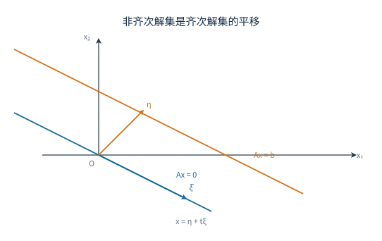

# 03 向量与线性方程组

## 学习目标与前置知识

学完本讲义后，应能：

<<<<<<< Updated upstream:线性代数/03 向量与线性方程组.md
- 把向量线性关系转化为矩阵和齐次方程组；
- 判断向量能否线性表出、向量组是否相关；
- 用初等行变换求极大线性无关组和秩；
- 用 $r(A)$ 与 $r([A\mid b])$ 判断线性方程组的解；
- 求齐次方程组基础解系、非齐次方程组通解和公共解；
- 判断已知解、公共解和同解方程组等特殊题型。

前置知识：矩阵加法与乘法、初等行变换、行列式和矩阵的秩。

本章围绕“向量组如何组织信息、线性方程组如何判定与求解”展开，学习顺序遵循线性代数中最重要的依赖关系：
=======
- 判断向量能否由向量组线性表出，并说明表示系数是否唯一。
- 判断向量组是否线性相关，处理含参数的独立性判定。
- 求极大线性无关组与向量组的秩，并把其余向量用它们表示。
- 求齐次方程组的基础解系与非齐次方程组的通解。
- 判断两个向量组是否等价、两个方程组是否同解。

## 1 向量与线性表出

由 $n$ 个数按顺序组成的数组称为 $n$ 维向量。本章默认使用列向量
>>>>>>> Stashed changes:线性代数/04 向量组与线性方程组解结构.md

$$
\alpha=\begin{pmatrix}a_1\\\vdots\\a_n\end{pmatrix},
$$

<<<<<<< Updated upstream:线性代数/03 向量与线性方程组.md
默认标量属于实数域，向量均视为列向量。本章先在 $\mathbb R^n$ 中研究“哪些向量独立、哪些解能自由变化”；04 再把这些结果提升为向量空间、基、坐标和特征子空间的语言。

## 1. 向量、向量组与线性表出
=======
行向量用转置表示。两个同维向量相等，当且仅当对应分量相等；加法与数乘按分量进行。
>>>>>>> Stashed changes:线性代数/04 向量组与线性方程组解结构.md

给定向量组 $\alpha_1,\ldots,\alpha_m$，表达式

$$
x_1\alpha_1+\cdots+x_m\alpha_m
$$

<<<<<<< Updated upstream:线性代数/03 向量与线性方程组.md
两个同维向量相等，当且仅当对应分量分别相等。若

$$
\alpha=(a_1,\ldots,a_n)^T,\qquad
\beta=(b_1,\ldots,b_n)^T,
$$

则
=======
称为该向量组的线性组合。若存在系数 $x_1,\ldots,x_m$，使
>>>>>>> Stashed changes:线性代数/04 向量组与线性方程组解结构.md

$$
\beta=x_1\alpha_1+\cdots+x_m\alpha_m,
$$

则称 $\beta$ 可由该向量组线性表出，或称 $\beta$ 属于该向量组的张成空间。

<<<<<<< Updated upstream:线性代数/03 向量与线性方程组.md
### 1.2 线性组合、线性表出与矩阵语言

给定向量组 $\alpha_1,\ldots,\alpha_m$，表达式

$$
x_1\alpha_1+\cdots+x_m\alpha_m
$$

称为该向量组的线性组合。若存在 $x_1,\ldots,x_m$ 使

$$
\beta=x_1\alpha_1+\cdots+x_m\alpha_m,
$$

就称 $\beta$ 可由该向量组线性表出。

把向量作为列拼成矩阵

$$
A=(\alpha_1,\ldots,\alpha_m),\qquad
x=(x_1,\ldots,x_m)^T,
$$

则
=======
把向量作为列拼成矩阵 $A=(\alpha_1,\ldots,\alpha_m)$，则
>>>>>>> Stashed changes:线性代数/04 向量组与线性方程组解结构.md

$$
x_1\alpha_1+\cdots+x_m\alpha_m=Ax.
$$

<<<<<<< Updated upstream:线性代数/03 向量与线性方程组.md
所以“能否线性表出”本质上是一个非齐次方程组是否有解的问题。

这里的向量维数 $n$ 是每个向量有几个分量，向量个数 $m$ 是有几个待定系数；矩阵 $A$ 为 $n\times m$，两者不要混淆。所有线性组合形成的集合称为张成空间，记为 $\operatorname{span}\{\alpha_1,\ldots,\alpha_m\}$；能表出 $\beta$ 就表示 $\beta$ 在该集合内。

### 例 1：判断并写出线性表出

设
=======
因此“$\beta$ 能否由 $\alpha_1,\ldots,\alpha_m$ 表出”等价于方程组 $Ax=\beta$ 是否有解。由上一章的秩判据，$\beta$ 可表出当且仅当
>>>>>>> Stashed changes:线性代数/04 向量组与线性方程组解结构.md

$$
r(A)=r([A\mid\beta]).
$$

<<<<<<< Updated upstream:线性代数/03 向量与线性方程组.md
设 $\beta=x_1\alpha_1+x_2\alpha_2$，比较分量得
=======
若进一步 $r(A)=m$，则表示系数唯一；若 $r(A)<m$，表示系数不唯一。原因是 $Ax=\beta$ 的解集等于一个特解加上 $Ax=\boldsymbol 0$ 的解空间，而齐次解空间的维数为 $m-r(A)$。

**例 1** 设

$$
\alpha_1=\begin{pmatrix}1\\2\\-1\end{pmatrix},\quad
\alpha_2=\begin{pmatrix}2\\1\\1\end{pmatrix},\quad
\beta=\begin{pmatrix}5\\4\\1\end{pmatrix},
$$

判断 $\beta$ 能否由 $\alpha_1,\alpha_2$ 表出，并写出表示式。

**解** 设 $\beta=x_1\alpha_1+x_2\alpha_2$，比较分量得
>>>>>>> Stashed changes:线性代数/04 向量组与线性方程组解结构.md

$$
\begin{cases}
x_1+2x_2=5,\\
2x_1+x_2=4,\\
-x_1+x_2=1.
\end{cases}
$$

<<<<<<< Updated upstream:线性代数/03 向量与线性方程组.md
前两式给出 $x_1=1,x_2=2$，代入第三式成立。因此
=======
前两式解得 $x_1=1$、$x_2=2$，代入第三式：$-1+2=1$，成立，故
>>>>>>> Stashed changes:线性代数/04 向量组与线性方程组解结构.md

$$
\beta=\alpha_1+2\alpha_2.
$$
<<<<<<< Updated upstream:线性代数/03 向量与线性方程组.md

**方法提示**：向量数较多时，直接构造增广矩阵 $[A\mid\beta]$，比较

$$
r(A)=r([A\mid\beta])
$$

即可判断能否表出；若方程有解，解出的系数就是线性表出系数。
=======
>>>>>>> Stashed changes:线性代数/04 向量组与线性方程组解结构.md

回代三个分量：$1+2\cdot2=5$，$2\cdot1+2=4$，$-1+2\cdot1=1$，全部吻合。两列线性无关，所以这组系数是唯一的。

**例 2** 设

$$
\alpha_1=\begin{pmatrix}1\\0\\1\end{pmatrix},\quad
\alpha_2=\begin{pmatrix}0\\1\\1\end{pmatrix},\quad
\alpha_3=\begin{pmatrix}1\\1\\2\end{pmatrix},\quad
\beta=\begin{pmatrix}1\\2\\3\end{pmatrix},
$$

判断 $\beta$ 能否由 $\alpha_1,\alpha_2,\alpha_3$ 表出，并说明表示是否唯一。

**解** 注意 $\alpha_3=\alpha_1+\alpha_2$，所以只需判断 $\beta$ 能否由 $\alpha_1,\alpha_2$ 表出。设 $\beta=x\alpha_1+y\alpha_2$，比较前两个分量得 $x=1$、$y=2$，第三个分量为 $1+2=3$，成立。因此

$$
\beta=\alpha_1+2\alpha_2=\alpha_3+\alpha_2.
$$

由于 $r(A)=2<3$，表示不唯一：所有表示系数满足

$$
(x_1,x_2,x_3)=(1-s,\ 2-s,\ s),\qquad s\in\mathbb R,
$$

因为把 $\alpha_3=\alpha_1+\alpha_2$ 代入可知，保持 $x_1+x_3=1$、$x_2+x_3=2$ 的系数给出的线性组合都等于 $\beta$。这里 $\beta$ 落在由 $\alpha_1,\alpha_2$ 张成的平面内，$\alpha_3$ 没有提供新方向。

## 2 线性相关性

向量组 $\alpha_1,\ldots,\alpha_m$ 线性相关，是指存在不全为零的系数 $x_1,\ldots,x_m$，使

$$
x_1\alpha_1+\cdots+x_m\alpha_m=\boldsymbol 0.
$$

<<<<<<< Updated upstream:线性代数/03 向量与线性方程组.md
若只有 $x_1=\cdots=x_m=0$ 才能得到零向量，则称线性无关。

相关的含义是“组内至少有一个向量是多余的”；无关的含义是“任何一个向量都不能由其余向量表出”。在 $\mathbb R^2$ 中，两个非零向量相关，当且仅当它们共线。

对至少含两个向量的组，上述解释可从定义推出：若有非平凡关系且 $x_j\ne0$，则

$$
\alpha_j=-\sum_{i\ne j}\frac{x_i}{x_j}\alpha_i.
$$

所以是“至少有一个可以表出”，并非“每个都可以”。例如 $\{0,(1,0)^T\}$ 相关，但非零向量不能由零向量表出。只有一个向量时，非零就无关，零向量就相关。

### 2.2 三个直接判据

- 含零向量，必相关；
- 含两个成比例向量，必相关；
- $n$ 维空间中有多于 $n$ 个向量，必相关。

第三条是单向结论：向量数不超过维数时，仍然可能相关。

相关组加入向量仍相关，无关组删去部分向量仍无关；两个逆命题都不成立。三个及以上向量“两两不成比例”也不能保证整体无关，例如 $(1,0)^T,(0,1)^T,(1,1)^T$ 两两无关，但第三个等于前两个之和。

### 2.3 与齐次方程组、秩的等价关系
=======
若只有全零系数才能得到零向量，则称该向量组线性无关。
>>>>>>> Stashed changes:线性代数/04 向量组与线性方程组解结构.md

令 $A=(\alpha_1,\ldots,\alpha_m)$，则

$$
x_1\alpha_1+\cdots+x_m\alpha_m=\boldsymbol 0
\Longleftrightarrow
Ax=\boldsymbol 0.
$$

所以

$$
\alpha_1,\ldots,\alpha_m\text{ 线性无关}
\Longleftrightarrow
Ax=\boldsymbol 0\text{ 只有零解}
\Longleftrightarrow
r(A)=m.
$$

反过来，向量组线性相关当且仅当 $r(A)<m$，即齐次方程组有非零解。

线性相关的直观含义是“组内至少有一个向量是多余的”。但要注意，相关不一定意味着每个向量都能由其余向量表出：例如零向量与非零向量组成的向量组相关，而非零向量不能由零向量表出。准确的结论是：向量组相关，当且仅当其中至少有一个向量能由其余向量线性表出。证明只需取一个非零系数 $x_k$，把关系式移项得

<<<<<<< Updated upstream:线性代数/03 向量与线性方程组.md
### 例 2：用齐次方程判断相关性

判断
=======
$$
\alpha_k=-\sum_{i\ne k}\frac{x_i}{x_k}\alpha_i.
$$

几个常用判据：

- 含零向量的向量组必相关；
- 含两个成比例向量的向量组必相关；
- $n$ 维空间中，向量个数超过 $n$ 时必相关，因为 $r(A)\le n<m$；
- 线性无关组的任意非空子组仍无关，相关组的任意超组仍相关；
- 若 $\alpha_1,\ldots,\alpha_m$ 线性无关，且 $\beta$ 不能由它们表出，则 $\alpha_1,\ldots,\alpha_m,\beta$ 仍线性无关。否则若 $c_0\beta+\sum c_i\alpha_i=0$ 且 $c_0\ne0$，就能反解出 $\beta$，与假设矛盾；于是 $c_0=0$，再由原组无关得所有 $c_i=0$。

**例 3** 判断
>>>>>>> Stashed changes:线性代数/04 向量组与线性方程组解结构.md

$$
\alpha_1=\begin{pmatrix}1\\1\\1\end{pmatrix},\quad
\alpha_2=\begin{pmatrix}1\\2\\3\end{pmatrix},\quad
\alpha_3=\begin{pmatrix}2\\3\\4\end{pmatrix}
$$

是否线性相关。

<<<<<<< Updated upstream:线性代数/03 向量与线性方程组.md
构造矩阵并行化简：
=======
**解** 把向量按列拼成矩阵并化简：
>>>>>>> Stashed changes:线性代数/04 向量组与线性方程组解结构.md

$$
\begin{pmatrix}
1&1&2\\
1&2&3\\
1&3&4
\end{pmatrix}
\sim
\begin{pmatrix}
1&1&2\\
0&1&1\\
0&0&0
\end{pmatrix}.
$$

<<<<<<< Updated upstream:线性代数/03 向量与线性方程组.md
秩为 $2<3$，齐次方程有自由变量，故向量组相关。令 $x_3=1$，可得一组非零关系系数

$$
(-1,-1,1)^T,
$$

即
=======
秩为 $2<3$，故向量组线性相关。由行最简形
>>>>>>> Stashed changes:线性代数/04 向量组与线性方程组解结构.md

$$
\begin{pmatrix}
1&0&1\\
0&1&1\\
0&0&0
\end{pmatrix}
$$

读出关系 $x_1+x_3=0$、$x_2+x_3=0$，取 $x_3=1$，得非零关系

$$
-\alpha_1-\alpha_2+\alpha_3=\boldsymbol 0,
\qquad
\alpha_3=\alpha_1+\alpha_2.
$$

回代：$\alpha_1+\alpha_2=(2,3,4)^T=\alpha_3$，关系成立。

<<<<<<< Updated upstream:线性代数/03 向量与线性方程组.md
### 2.4 常用推论

若 $\alpha_1,\ldots,\alpha_s$ 无关，而加入 $\beta$ 后相关，则 $\beta$ 可由原组表出；由于原组无关，表示系数唯一。

为什么不能去掉原组无关的条件？设 $(1,0)^T,(2,0)^T$ 为原组，加入 $(0,1)^T$ 后整组仍相关，却不能用原组表出新向量。原组无关保证非平凡关系中 $\beta$ 的系数非零，才可把它解出来。唯一性则来自：若有两套表示，相减得到原无关组的零线性组合，两套系数必相同。

若 $n$ 个向量都能由 $s$ 个向量表出且 $n>s$，则这 $n$ 个向量必相关，这就是“以少表多”。

在线性无关组的每个向量上追加相同位置的分量，所得组仍无关；在线性相关组的每个向量上删去相同位置的分量，所得组仍相关。逆向推断一般不成立。

证明“添分量仍无关”时，假设新向量组的线性组合为零，只看原有分量便迫使系数全零。删分量则保留原来的非平凡零关系。注意“相同位置”不要求追加的数值相同。

### 例：抽象向量组的参数判定

已知 $\alpha_1,\alpha_2$ 无关，令 $\beta_1=\alpha_1+\alpha_2$、$\beta_2=\alpha_1+t\alpha_2$。判定新组相关性。

设 $c_1\beta_1+c_2\beta_2=0$，展开得
=======
**例 4** 设
>>>>>>> Stashed changes:线性代数/04 向量组与线性方程组解结构.md

$$
\alpha_1=\begin{pmatrix}1\\1\\1\end{pmatrix},\quad
\alpha_2=\begin{pmatrix}1\\2\\3\end{pmatrix},\quad
\alpha_3=\begin{pmatrix}1\\3\\t\end{pmatrix},
$$

问 $t$ 取何值时向量组线性无关；线性相关时写出一个非零关系。

**解** 以三列为矩阵，行列式为

$$
\begin{vmatrix}1&1&1\\1&2&3\\1&3&t\end{vmatrix}
=1(2t-9)-1(t-3)+1(3-2)=t-5.
$$

当 $t\ne5$ 时行列式非零，$r(A)=3$，向量组线性无关。当 $t=5$ 时，第三列 $\alpha_3=(1,3,5)^T$ 满足

<<<<<<< Updated upstream:线性代数/03 向量与线性方程组.md
向量组的一部分若满足：

1. 该部分线性无关；
2. 原组中每个向量都能由该部分表出；

则称其为原组的极大线性无关组。“极大”指不能再加入原组中的向量而保持无关，不表示选法唯一。不同极大无关组可能包含不同向量，但向量个数相同。

极大线性无关组所含向量的个数定义为向量组的秩。
=======
$$
\alpha_3=2\alpha_2-\alpha_1=2(1,2,3)^T-(1,1,1)^T=(1,3,5)^T,
$$
>>>>>>> Stashed changes:线性代数/04 向量组与线性方程组解结构.md

所以

$$
-\alpha_1+2\alpha_2-\alpha_3=\boldsymbol 0
$$

是一个非零关系，向量组线性相关。$t=5$ 是主元消失的唯一参数值，其他 $t$ 都不会让三列共面。

## 3 极大线性无关组与向量组的秩

向量组的一部分若满足：本身线性无关，且原组中每个向量都能由它线性表出，则称为原组的一个极大线性无关组。极大线性无关组一般不唯一（向量组只含一个向量时除外），但所含向量的个数相同，这个个数称为向量组的秩。

<<<<<<< Updated upstream:线性代数/03 向量与线性方程组.md
### 例 3：求极大无关组和线性表示

设
=======
个数相同这一点来自基的替换论证。若一个向量组中有 $p$ 个向量能张成整个组，则组内任意 $q>p$ 个向量都线性相关：把这 $q$ 个向量写成 $p$ 个张成向量的线性组合，得到 $B=AC$，其中 $C$ 是 $p\times q$ 矩阵；$q>p$ 时 $Cx=0$ 有非零解，于是 $Bx=ACx=0$，这 $q$ 个向量相关。因此一个极大无关组不可能比另一个更大，两组大小相等。

求极大无关组的标准方法是把向量按列拼成矩阵，只作初等行变换化为行阶梯形：

1. 记录主元所在的列；
2. 主元个数就是向量组的秩；
3. 回到原矩阵，取对应位置的列，得到一个极大无关组；
4. 若要写出其余向量的表示式，继续化为行最简形，非主元列在主元行上的分量就是组合系数。

行变换会改变列向量本身，但保持列与列之间的线性关系。因此主元列的位置可以沿用，取向量时必须回到原矩阵，不能直接取化简后矩阵的列。

**例 5** 设
>>>>>>> Stashed changes:线性代数/04 向量组与线性方程组解结构.md

$$
\alpha_1=\begin{pmatrix}1\\1\\1\end{pmatrix},\quad
\alpha_2=\begin{pmatrix}1\\2\\3\end{pmatrix},\quad
\alpha_3=\begin{pmatrix}2\\3\\4\end{pmatrix},\quad
\alpha_4=\begin{pmatrix}3\\5\\7\end{pmatrix},
$$

<<<<<<< Updated upstream:线性代数/03 向量与线性方程组.md
列成矩阵后可化为
=======
求一个极大线性无关组，并把其余向量用它表示。

**解** 把向量按列拼成矩阵并化简：
>>>>>>> Stashed changes:线性代数/04 向量组与线性方程组解结构.md

$$
\begin{pmatrix}
1&1&2&3\\
1&2&3&5\\
1&3&4&7
\end{pmatrix}
\sim
\begin{pmatrix}
1&1&2&3\\
0&1&1&2\\
0&0&0&0
\end{pmatrix}.
$$

主元列是第 $1,2$ 列，故 $\alpha_1,\alpha_2$ 是一个极大无关组，向量组的秩为 $2$。继续化为行最简形：

$$
\begin{pmatrix}
1&0&1&1\\
0&1&1&2\\
0&0&0&0
\end{pmatrix}.
$$

非主元列对应的系数为 $(1,1)^T$ 与 $(1,2)^T$，所以

$$
\alpha_3=\alpha_1+\alpha_2,\qquad
\alpha_4=\alpha_1+2\alpha_2.
$$

回代验证：$\alpha_1+\alpha_2=(2,3,4)^T=\alpha_3$，$\alpha_1+2\alpha_2=(3,5,7)^T=\alpha_4$。

极大无关组不唯一。取 $\alpha_2,\alpha_3$，它们线性无关，且

$$
\alpha_1=\alpha_3-\alpha_2,\qquad
\alpha_4=\alpha_2+\alpha_3,
$$

所以 $\alpha_2,\alpha_3$ 也能张成原组，是另一个极大无关组。两组都含 $2$ 个向量，与向量组的秩一致。

## 4 向量组等价与张成空间

<<<<<<< Updated upstream:线性代数/03 向量与线性方程组.md
两组同维向量互相线性表出时，称为等价向量组。这里 $\operatorname{span}(A)$ 表示列矩阵 $A$ 的全部列的线性组合，其本质是

$$
\operatorname{span}(A)=\operatorname{span}(B).
$$

若 $A,B$ 按列组成矩阵，则常用判据为
=======
两个同维向量组若可以互相线性表出，则称它们等价。等价向量组张成同一个空间：

$$
\operatorname{span}\{\alpha_1,\ldots,\alpha_m\}
=\left\{x_1\alpha_1+\cdots+x_m\alpha_m:x_i\in\mathbb R\right\}.
$$

判断两个向量组是否等价，可把两组向量分别按列拼成矩阵 $A,B$，则
>>>>>>> Stashed changes:线性代数/04 向量组与线性方程组解结构.md

$$
\text{两组等价}
\Longleftrightarrow
r(A)=r(B)=r([A\ B]).
$$

<<<<<<< Updated upstream:线性代数/03 向量与线性方程组.md
等价向量组不要求向量个数相同；它表示两组向量张成同一个空间。不要把它与“等价矩阵”混淆：等价矩阵要求同型，向量组等价只要求向量同维。
=======
两组等价意味着 $B$ 的每一列都在 $A$ 的列空间中，且 $A$ 的每一列都在 $B$ 的列空间中。前者等价于 $r(A)=r([A\ B])$，后者等价于 $r(B)=r([A\ B])$，合并即得判据。
>>>>>>> Stashed changes:线性代数/04 向量组与线性方程组解结构.md

只比较 $r(A)=r(B)$ 不够，因为两个秩相同的向量组可能张成不同的空间。例如 $\mathbb R^3$ 中两张不同的二维平面，维数相同但不相等。

<<<<<<< Updated upstream:线性代数/03 向量与线性方程组.md
### 例 4：用互相表出判定等价

设
=======
**例 6** 设
>>>>>>> Stashed changes:线性代数/04 向量组与线性方程组解结构.md

$$
\alpha_1=\begin{pmatrix}1\\0\\1\end{pmatrix},\quad
\alpha_2=\begin{pmatrix}0\\1\\1\end{pmatrix},
\qquad
\beta_1=\begin{pmatrix}1\\1\\2\end{pmatrix},\quad
\beta_2=\begin{pmatrix}1\\-1\\0\end{pmatrix}.
$$

<<<<<<< Updated upstream:线性代数/03 向量与线性方程组.md
有
=======
判断两个向量组是否等价。

**解** 直接观察：
>>>>>>> Stashed changes:线性代数/04 向量组与线性方程组解结构.md

$$
\beta_1=\alpha_1+\alpha_2,\qquad
\beta_2=\alpha_1-\alpha_2,
$$

反解得

$$
\alpha_1=\frac12(\beta_1+\beta_2),\qquad
\alpha_2=\frac12(\beta_1-\beta_2).
$$

两组可以互相表出，故等价。用秩核对：$A,B$ 的秩都是 $2$，拼接矩阵 $[A\ B]$ 的列中 $\beta_1,\beta_2$ 已经能由 $\alpha_1,\alpha_2$ 表出，秩仍为 $2$。

<<<<<<< Updated upstream:线性代数/03 向量与线性方程组.md
## 5. 线性方程组的矩阵语言与解的存在性

### 5.1 三种等价形式

一般线性方程组可写成

$$
Ax=b,
$$

也可写成增广矩阵 $[A\mid b]$，或写成列向量关系
=======
**例 7** 设
>>>>>>> Stashed changes:线性代数/04 向量组与线性方程组解结构.md

$$
\alpha_1=\begin{pmatrix}1\\0\\0\end{pmatrix},\quad
\alpha_2=\begin{pmatrix}0\\1\\0\end{pmatrix},
\qquad
\beta_1=\begin{pmatrix}1\\0\\0\end{pmatrix},\quad
\beta_2=\begin{pmatrix}0\\0\\1\end{pmatrix}.
$$

判断两个向量组是否等价。

**解** 两组都含两个线性无关向量，秩都为 $2$。但 $\beta_2=(0,0,1)^T$ 不在 $\alpha_1,\alpha_2$ 张成的 $xy$ 平面内。把四个向量按列拼成矩阵，第三列与第四列给出两个新的主元，$r([A\ B])=3\ne2$，所以两组不等价。两个不同的二维平面维数相同，却张成不同的空间，这正是不能只比较秩的原因。

## 5 齐次方程组的解结构

<<<<<<< Updated upstream:线性代数/03 向量与线性方程组.md
记

$$
r=r(A),\qquad \bar r=r([A\mid b]).
$$

若行化简出现
=======
齐次方程组 $Ax=\boldsymbol 0$ 总有零解。若 $r(A)=n$，只有零解；若 $r(A)<n$，有无穷多解，自由变量个数为 $n-r(A)$。

若 $\xi_1,\ldots,\xi_{n-r}$ 是 $Ax=\boldsymbol 0$ 的一组线性无关解，并且任意解都能由它们线性表出，则称它们为方程组的一组基础解系。通解为
>>>>>>> Stashed changes:线性代数/04 向量组与线性方程组解结构.md

$$
x=k_1\xi_1+\cdots+k_{n-r}\xi_{n-r}.
$$

<<<<<<< Updated upstream:线性代数/03 向量与线性方程组.md
就得到矛盾式 $0=c$，方程组无解。统一判定为

$$
\begin{array}{c|c}
\text{条件}&\text{解的情况}\\ \hline
r\ne\bar r&\text{无解}\\
r=\bar r=n&\text{唯一解}\\
r=\bar r<n&\text{无穷多解}
\end{array}
$$

其中 $n$ 是未知数个数。有解时，自由变量数为 $n-r$。

### 例 5：先判定是否有解

判断
=======
求基础解系的步骤：

1. 把系数矩阵化为行最简形；
2. 确定主变量与自由变量；
3. 用自由变量表示主变量；
4. 每次令一个自由变量为 $1$、其余为 $0$，得到一组解向量；
5. 写出通解。

这组解向量线性无关：若它们的线性组合为零，看自由变量对应的分量，每个系数都必须为零。任意解的自由变量取一组值，对应的线性组合与它自由变量分量相同，因而两者相等。

**例 8** 求齐次方程组
>>>>>>> Stashed changes:线性代数/04 向量组与线性方程组解结构.md

$$
\begin{cases}
x_1+2x_2-x_3=0,\\
2x_1+4x_2-2x_3=0,\\
x_2+x_4=0
\end{cases}
$$

<<<<<<< Updated upstream:线性代数/03 向量与线性方程组.md
的解的情况。增广矩阵化简为

$$
\left(
\begin{array}{ccc|c}
1&1&1&1\\
0&0&0&1
\end{array}
\right).
=======
的基础解系与通解。

**解** 系数矩阵化为

$$
\begin{pmatrix}
1&2&-1&0\\
2&4&-2&0\\
0&1&0&1
\end{pmatrix}
\sim
\begin{pmatrix}
1&0&-1&-2\\
0&1&0&1\\
0&0&0&0
\end{pmatrix}.
>>>>>>> Stashed changes:线性代数/04 向量组与线性方程组解结构.md
$$

主变量为 $x_1,x_2$，自由变量为 $x_3,x_4$。由行最简形得

$$
x_1=x_3+2x_4,\qquad x_2=-x_4.
$$

<<<<<<< Updated upstream:线性代数/03 向量与线性方程组.md
### 例：含参数方程组的完整分类

讨论并求解
=======
令 $x_3=1,x_4=0$，得 $(1,0,1,0)^T$；令 $x_3=0,x_4=1$，得 $(2,-1,0,1)^T$。因此基础解系为

$$
\xi_1=(1,0,1,0)^T,\qquad
\xi_2=(2,-1,0,1)^T,
$$

通解为

$$
x=k_1\xi_1+k_2\xi_2,\qquad k_1,k_2\in\mathbb R.
$$

代回原方程组：$\xi_1$ 满足 $x_1+2x_2-x_3=1-1=0$、$2x_1+4x_2-2x_3=2-2=0$、$x_2+x_4=0$；$\xi_2$ 满足 $2-2=0$、$4-4=0$、$-1+1=0$。维数 $n-r(A)=4-2=2$，与两个基向量一致。

**例 9** 问 $a$ 取何值时齐次方程组

$$
\begin{cases}
x_1+x_2+x_3=0,\\
x_1+2x_2+3x_3=0,\\
x_1+4x_2+ax_3=0
\end{cases}
$$

有非零解，并求此时的基础解系。

**解** 系数行列式为

$$
\begin{vmatrix}1&1&1\\1&2&3\\1&4&a\end{vmatrix}
=1(2a-12)-1(a-3)+1(4-2)=a-7.
$$

当 $a=7$ 时行列式为零，$r(A)<3$，有非零解；当 $a\ne7$ 时只有零解。取 $a=7$，对系数矩阵作行变换：

$$
\begin{pmatrix}1&1&1\\1&2&3\\1&4&7\end{pmatrix}
\sim
\begin{pmatrix}1&1&1\\0&1&2\\0&3&6\end{pmatrix}
\sim
\begin{pmatrix}1&0&-1\\0&1&2\\0&0&0\end{pmatrix}.
$$

所以 $x_1=x_3$、$x_2=-2x_3$。取 $x_3=1$，基础解系为 $(1,-2,1)^T$，通解为 $x=k(1,-2,1)^T$。回代：$1-2+1=0$，$1-4+3=0$，$1-8+7=0$，成立。

## 6 非齐次方程组的解结构

设 $\eta$ 是 $Ax=b$ 的一个特解，$\xi$ 是齐次方程组 $Ax=\boldsymbol 0$ 的任意解，则

$$
A(\eta+\xi)=A\eta+A\xi=b.
$$

反过来，任意两个非齐次解之差都是齐次解：若 $A\eta_1=b$、$A\eta_2=b$，则 $A(\eta_1-\eta_2)=0$。因此非齐次方程组的通解为

$$
x=\eta+x_h,
$$

其中 $x_h$ 是导出齐次方程组的通解。解集是一个不过原点的仿射子空间；只有当 $b=\boldsymbol 0$ 时它才经过原点、成为子空间。

求解步骤：

1. 对增广矩阵 $[A\mid b]$ 作行变换，先判断是否有解；
2. 求导出齐次方程组的基础解系；
3. 取一个方便的特解；
4. 写出通解并注明参数范围。

**例 10** 讨论并求解
>>>>>>> Stashed changes:线性代数/04 向量组与线性方程组解结构.md

$$
\begin{cases}
x_1+x_2+x_3=1,\\
x_1+tx_2+x_3=1,\\
x_1+x_2+(t-1)x_3=t.
\end{cases}
$$

<<<<<<< Updated upstream:线性代数/03 向量与线性方程组.md
第二、三行分别减第一行，增广矩阵化为
=======
**解** 第二、三行分别减第一行，增广矩阵化为
>>>>>>> Stashed changes:线性代数/04 向量组与线性方程组解结构.md

$$
\left[\begin{array}{ccc|c}
1&1&1&1\\
0&t-1&0&0\\
0&0&t-2&t-1
\end{array}\right].
$$

参数只在 $t=1,2$ 时使主元消失，逐支讨论：

- 当 $t\ne1,2$ 时，三个主元都非零，方程组有唯一解：

$$
x_2=0,\qquad
x_3=\frac{t-1}{t-2},\qquad
x_1=-\frac{1}{t-2}.
$$

回代第一式：$-\dfrac1{t-2}+0+\dfrac{t-1}{t-2}=1$，成立。

<<<<<<< Updated upstream:线性代数/03 向量与线性方程组.md
1. 行化简；
2. 找主变量和自由变量；
3. 用自由变量表示主变量；
4. 每次让一个自由变量为 $1$、其余为 $0$，构造基础解向量；
5. 写出通解。

这些向量为什么必构成基础解系？它们在自由变量位置分别形成标准单位向量，所以线性无关；任意一组自由变量值又能按相同系数组合出全部解，所以能张成解集。若 $r(A)=n$，解集只有零向量，通常称“无非零基础解向量”，不能把 $\{0\}$ 当作基础解系。

对于结构很简单的方程，基础解系也可用**观察法（凑数法）**直接构造。例如
$x_1+x_2-x_3=0$ 可立即取 $(1,-1,0)^T$、$(1,0,1)^T$；只需再核对线性无关且个数为 $n-r(A)$，不必机械地套赋值步骤。

### 例 6：基础解系的构造

若化简后得到
=======
- 当 $t=1$ 时，第二行全零，第三行给出 $-x_3=0$，即 $x_3=0$。此时 $r(A)=r([A\mid b])=2<3$，令 $x_2=s$，得
>>>>>>> Stashed changes:线性代数/04 向量组与线性方程组解结构.md

$$
x=(1,0,0)^T+s(-1,1,0)^T,\qquad s\in\mathbb R.
$$

<<<<<<< Updated upstream:线性代数/03 向量与线性方程组.md
则主变量为 $x_1,x_2,x_4$，自由变量为 $x_3,x_5$。令 $x_3=s,x_5=t$，有
=======
- 当 $t=2$ 时，第三行成为 $0=1$，系数矩阵秩为 $2$，增广矩阵秩为 $3$，方程组无解。

**例 11** 设
>>>>>>> Stashed changes:线性代数/04 向量组与线性方程组解结构.md

$$
A=\begin{pmatrix}1&0&1\\0&1&1\end{pmatrix},\qquad
b=\begin{pmatrix}b_1\\b_2\end{pmatrix},
$$

说明 $Ax=b$ 对任意 $b$ 都有解，并写出通解。取 $b=(2,3)^T$，画出解集的几何形状。

**解** $A$ 的两列线性无关，$r(A)=2$，且增广矩阵只有两行，$r([A\mid b])=2$ 对任意 $b$ 都成立。方程即

$$
x_1+x_3=b_1,\qquad x_2+x_3=b_2.
$$

<<<<<<< Updated upstream:线性代数/03 向量与线性方程组.md
### 6.2 非齐次方程组：特解加齐次通解

设 $\eta$ 是 $Ax=b$ 的一个特解，$\xi$ 是 $Ax=\boldsymbol 0$ 的任意解，则

$$
A(\eta+\xi)=A\eta+A\xi=b.
$$

反过来，任意两个非齐次解之差都是齐次解。因此
=======
令 $x_3=s$，得
>>>>>>> Stashed changes:线性代数/04 向量组与线性方程组解结构.md

$$
x=\begin{pmatrix}b_1\\b_2\\0\end{pmatrix}
+s\begin{pmatrix}-1\\-1\\1\end{pmatrix},\qquad s\in\mathbb R.
$$

取 $b=(2,3)^T$，解集是过点 $(2,3,0)^T$、方向为 $(-1,-1,1)^T$ 的直线。它与齐次解空间（过原点、同方向的直线）平行但不重合。

图中两条平行直线方向相同，都沿 $\xi$ 方向；下面一条过原点，是 $Ax=\boldsymbol 0$ 的解集；上面一条过特解 $\eta$，是 $Ax=b$ 的解集。非齐次解集不是子空间，因为没有零向量。

## 7 公共解与同解

<<<<<<< Updated upstream:线性代数/03 向量与线性方程组.md
“特解加齐次通解”不是只给出一批解。若 $x$ 是任意非齐次解，则 $A(x-\eta)=b-b=0$，所以 $x-\eta$ 必在已求出的齐次通解中；这一步证明没有漏解。

### 例 7：由行最简形写出非齐次通解

设方程组的增广矩阵化为

$$
\left(
\begin{array}{ccc|c}
1&0&1&2\\
0&1&-1&1\\
0&0&0&0
\end{array}
\right).
$$

**分析：** 没有矛盾行，且未知量有 $3$ 个、主元有 $2$ 个，因此方程组相容，并有一个自由变量。令 $x_3=t$，则

$$
x_1=2-t,\qquad x_2=1+t.
$$

于是
=======
两个齐次方程组 $Ax=\boldsymbol 0$、$Bx=\boldsymbol 0$ 的公共解，就是拼接方程组

$$
\begin{pmatrix}A\\B\end{pmatrix}x=\boldsymbol 0
$$

的解。最稳妥的方法是把系数矩阵上下拼接后求基础解系。

两个齐次方程组同解，指解集完全相同。判据是
>>>>>>> Stashed changes:线性代数/04 向量组与线性方程组解结构.md

$$
r(A)=r(B)=r\begin{pmatrix}A\\B\end{pmatrix}.
$$

<<<<<<< Updated upstream:线性代数/03 向量与线性方程组.md
前一个向量是取 $t=0$ 得到的一个特解，后一个向量满足导出齐次方程组，故通解正是“特解加齐次通解”。不能把常数向量也并入齐次解向量的倍数中，因为它不经过原点。

### 例：从原方程到通解，再代回检验

求

$$
\begin{cases}x_1+x_2+x_4=3,\\2x_1+3x_2+x_3+x_4=8,\\x_1+2x_2+x_3=5.\end{cases}
$$

对增广矩阵作 $r_2\leftarrow r_2-2r_1$、$r_3\leftarrow r_3-r_1$，再作 $r_3\leftarrow r_3-r_2$、$r_1\leftarrow r_1-r_2$，得到
=======
这里要求 $A,B$ 的列数相同。只比较 $r(A)=r(B)$ 不够，因为秩相同不代表约束相同。判据的理由是：$Ax=0$ 的解都是 $Bx=0$ 的解，等价于 $B$ 的每一行都能由 $A$ 的行线性表出，也就是 $r(A)=r([A;B])$；反方向同理。

非齐次方程组同解还要带上右端信息：两个方程组都相容，且
>>>>>>> Stashed changes:线性代数/04 向量组与线性方程组解结构.md

$$
r([A\mid b])=r([B\mid d])=r\begin{pmatrix}A&b\\B&d\end{pmatrix}.
$$

只比较两个增广矩阵的秩也不够，例如 $x=0$ 与 $x=1$ 的增广矩阵秩都为 $1$，解集却不同。

<<<<<<< Updated upstream:线性代数/03 向量与线性方程组.md
$$
x=\underbrace{(1,2,0,0)^T}_{\eta}
+s\underbrace{(1,-1,1,0)^T}_{\xi_1}
+t\underbrace{(-2,1,0,1)^T}_{\xi_2},\qquad s,t\in\mathbb R.
$$

把三向量分别代回系数矩阵 $A$，得到 $A\eta=(3,8,5)^T$、$A\xi_1=A\xi_2=0$。再看第 $3,4$ 分量即可确认 $\xi_1,\xi_2$ 无关；其个数等于 $4-r(A)=2$，验证闭合。

### 6.3 克拉默法则的边界

只有当 $A$ 是 $n$ 阶方阵且 $\det(A)\ne0$ 时，$Ax=b$ 才能用克拉默法则：

$$
x_i=\frac{\det(A_i)}{\det(A)}.
$$

它适合低阶方阵的理论计算；一般方程组优先使用高斯消元和秩判定。

## 7. 特殊题型：已知解、公共解与同解

### 7.1 已知多个非齐次解

若 $\eta_1,\ldots,\eta_s$ 都满足 $A\eta_i=b$，且 $c_1+\cdots+c_s=0$，则

$$
A(c_1\eta_1+\cdots+c_s\eta_s)=\boldsymbol 0.
$$

系数和为 $1$ 的线性组合仍是一个特解。这个规则可以直接从题目给出的多个解构造基础解向量和特解。

更完整地，$A(\sum_i c_i\eta_i)=(\sum_i c_i)b$。在 $b\ne0$ 时，系数和为 $0$、$1$ 分别是成为齐次解、非齐次解的充要条件。由已知解作差后，还要检查无关性和数量是否达到 $n-r(A)$；多个不同解之差也可能成比例，不能直接宣布是基础解系。

### 7.2 公共解

两个齐次方程组

$$
Ax=\boldsymbol 0,\qquad Bx=\boldsymbol 0
$$

的公共解等价于

$$
\begin{pmatrix}A\\B\end{pmatrix}x=\boldsymbol 0.
$$

因此最稳妥的做法是上下拼接系数矩阵后求基础解系。若已知其中一个方程组的通解，也可代入另一个方程组求参数。

### 例 8：用拼接矩阵求公共解

求齐次方程组
=======
**例 12** 判断方程组
>>>>>>> Stashed changes:线性代数/04 向量组与线性方程组解结构.md

$$
\begin{cases}
x_1+x_2+x_3=0,\\
x_1-x_2=0
\end{cases}
$$

<<<<<<< Updated upstream:线性代数/03 向量与线性方程组.md
的公共解。

把两组方程上下拼接。后两条方程分别给出 $x_1=x_2$、$x_2=x_3$，故 $x_1=x_2=x_3$；再代入第一条方程得 $3x_1=0$。因此公共解只有

$$
x=\boldsymbol 0.
$$

**迁移提示：** 共同出现的方程也可以只保留一次；保留两次不会改变解集，但手算时去重能减少行化简工作。

### 例 9：由已知解向量构造通解

已知 $\eta_1,\eta_2,\eta_3$ 都是 $Ax=b$ 的解，且

$$
\eta_1-\eta_2=(-1,0,3,-4)^T,
$$

$$
\eta_1+\eta_2=(3,2,1,-2)^T,\qquad
\eta_3+2\eta_2=(5,1,0,3)^T.
$$

若 $r(A)=2$ 且 $A$ 有 $4$ 个未知数，则齐次解空间维数为 $2$。首先

$$
\xi_1=\eta_1-\eta_2
$$

是齐次解。又因为

$$
A(\eta_1+\eta_2)=2b,\qquad
A(\eta_3+2\eta_2)=3b,
$$

所以

$$
\xi_2=3(\eta_1+\eta_2)-2(\eta_3+2\eta_2)
=(-1,4,3,-12)^T
$$

也是齐次解，且不与 $\xi_1$ 成比例。取

$$
\eta=\frac{\eta_1+\eta_2}{2}
=\left(\frac32,1,\frac12,-1\right)^T
$$

作为特解，通解为

$$
x=k_1\xi_1+k_2\xi_2+\eta.
$$

### 7.3 同解方程组

两个齐次方程组同解，是指解集完全相同。常用判据是

$$
r(A)=r(B)=r\begin{pmatrix}A\\B\end{pmatrix}.
$$

这里 $A,B$ 必须有相同列数，即研究同一批未知量；行数可不同。该判据表示两组方程的行向量互相线性表出，因此彼此没有增加约束。仅有 $r(A)=r(B)$ 不够，例如 $x_1=0$ 与 $x_2=0$ 的系数秩都为 $1$，解集却不同。非齐次系统还含右端信息，不能仅用系数矩阵套用此判据。

在原方程组后追加一条齐次方程时，新解集只会缩小或不变；要保持同解，新增方程必须被原方程组的每个解满足。

**考研高频结论（实数域）**：

$$
Ax=\boldsymbol 0\quad\Longleftrightarrow\quad A^TAx=\boldsymbol 0.
$$

证明为 $A^TAx=0\Rightarrow x^TA^TAx=\|Ax\|^2=0\Rightarrow Ax=0$，反向显然。因此
$r(A^TA)=r(A)$，且两方程组的基础解系完全相同。

### 例 10：判断基础解系的替换

设 $\xi_1,\xi_2,\xi_3$ 是 $Ax=\boldsymbol 0$ 的基础解系，令

$$
\eta_1=\xi_1+\xi_2,\qquad
\eta_2=\xi_2+\xi_3,\qquad
\eta_3=\xi_3+\xi_1.
$$

相对于原基础解系，系数矩阵为
=======
与

$$
\begin{cases}
x_1+x_2+x_3=0,\\
x_1-x_2=0,\\
2x_1+x_3=0
\end{cases}
$$

是否同解。

**解** 第一个方程组给出 $x_1=x_2$、$x_3=-2x_1$。第三条方程 $2x_1+x_3=2x_1-2x_1=0$ 是前两条的推论，不会增加新约束，所以两个方程组同解。用秩表示，第一个方程组的系数矩阵秩为 $2$，第二个也为 $2$，拼接后的秩仍为 $2$，满足同解判据。

**例 13** 求两个齐次方程组的公共解：
>>>>>>> Stashed changes:线性代数/04 向量组与线性方程组解结构.md

$$
\begin{cases}
x_1+x_2+x_3=0,\\
x_1-x_2=0,
\end{cases}
\qquad
\begin{cases}
x_1+x_2+x_3=0,\\
2x_1+x_3=0.
\end{cases}
$$

<<<<<<< Updated upstream:线性代数/03 向量与线性方程组.md
因此新向量组仍线性无关，又全部属于原解空间，故仍构成基础解系。只检查“新向量是解”是不够的，还必须检查线性无关性。

### 例 11：追加方程保持同解

设原齐次方程组的通解为

$$
x=t(-3,-5,1,0)^T.
$$

追加方程

$$
4x_1+ax_2+bx_3+13x_4=0.
$$

代入原通解得

$$
t(-12-5a+b)=0.
$$

要让任意 $t$ 都满足，必须

$$
b=5a+12.
$$

这说明新增方程必须对原解空间中的每个向量成立。

## 8. 四大基本子空间与维数定理

本节用于连接第 04 章，可在学完其中的子空间与正交后回读。$U^\perp$ 表示与集合 $U$ 内所有向量正交的向量组成的空间；在实数标准内积下，正交就是点积为零。

对 $A\in\mathbb R^{m\times n}$，线性代数中四个彼此关联的子空间是：

| 子空间 | 所在空间 | 直观含义 | 维数 |
|---|---|---|---|
| 列空间 $\mathcal C(A)$ | $\mathbb R^m$ | $Ax$ 的全部可能输出 | $r(A)$ |
| 行空间 $\mathcal C(A^T)$ | $\mathbb R^n$ | 方程组中独立的约束方向 | $r(A)$ |
| 零空间 $\mathcal N(A)$ | $\mathbb R^n$ | $Ax=0$ 的全部解 | $n-r(A)$ |
| 左零空间 $\mathcal N(A^T)$ | $\mathbb R^m$ | 与 $A$ 的列空间正交的约束 | $m-r(A)$ |

其中

$$
\mathcal N(A)=\mathcal C(A^T)^\perp,
\qquad
\mathcal N(A^T)=\mathcal C(A)^\perp.
$$

因此秩—零度定理给出

$$
r(A)+(n-r(A))=n,
$$

这与消元得到的“基础解系有 $n-r(A)$ 个向量”一致。几何上，$\mathbb R^n$ 可分解为互相正交的行空间与零空间；不要把主元变量所在的坐标轴直接当成行空间。行空间与列空间维数相同，都是秩，但它们分别位于不同的坐标空间，不能把向量本身混为一谈。

例如 $A=\begin{pmatrix}1&2&0\\0&0&1\end{pmatrix}$ 的行空间由 $(1,2,0)^T,(0,0,1)^T$ 张成，零空间由 $(-2,1,0)^T$ 张成，彼此点积均为零，维数为 $2+1=3$。这也说明“自由变量有一个”与“齐次解是一条直线”是同一事实的代数、几何表述。

## 本章解题流程

1. **判断线性表出或相关性：** 把待判向量作为增广列，或把向量组排成列矩阵并转化为齐次方程组。
2. **求极大线性无关组：** 行化简只用来找主元列位置；最终必须回到原矩阵取对应列。
3. **判方程组解的情况：** 先比较 $r(A)$ 与 $r([A\mid b])$，相容后再数自由变量。
4. **写通解：** 齐次方程组先构造基础解系；非齐次方程组写成“一个特解 + 导出齐次方程组通解”。
5. **处理公共解或同解：** 公共解用拼接矩阵；同解既可比较秩，也可检验新增方程是否对原解空间恒成立。

## 自测题

1. 向量组 $\alpha_1,\alpha_2,\alpha_3$ 的列矩阵秩为 $2$，这组向量最多有几个线性无关向量？
2. 若 $r(A)=r([A\mid b])=2$，未知量有 $4$ 个，$Ax=b$ 的解有何结构？
3. 为什么求原向量组的极大线性无关组时，不能直接取行化简后矩阵的主元列？
4. 两个齐次方程组的公共解应如何转化为一个方程组？
5. 已知 $Ax=b$ 有两个解 $\eta_1,\eta_2$，说明 $\eta_1-\eta_2$ 满足什么方程。
6. 求 $(1,0,1)^T,(0,1,1)^T,(1,1,2)^T$ 的一个极大无关组及第三个向量的表示。
7. 求 $x_1+x_2+x_3=0$、$x_2+x_3=0$ 的基础解系；若第一式右端改为 $1$，通解怎样变化？
8. 讨论 $x_1+x_2=1$、$x_1+tx_2=b$ 的解，明确列出特殊参数分支。
9. 判断：两个向量组秩相同就等价；两个齐次方程组系数秩相同就同解。各给一个反例。
10. 设 $A$ 有 $4$ 列且秩为 $2$，已找到三个非齐次解。为什么它们两两作差后不一定能立即写出通解？

### 答案要点

1. 最多 $2$ 个，且任一极大线性无关组恰有 $2$ 个向量。
2. 有无穷多解；自由变量数为 $4-2=2$，通解为一个特解加上两个参数控制的齐次通解。
3. 行变换会改变列向量本身，只保留主元位置与秩；应按这些位置回原矩阵取列。
4. 上下拼接两个系数矩阵，求对应齐次方程组的基础解系。
5. 满足 $A(\eta_1-\eta_2)=\boldsymbol0$，因此是导出齐次方程组的解。
6. 前两向量无关，第三向量为它们之和，故前两个组成一个极大无关组，秩为 $2$。
7. 齐次通解 $x=s(0,-1,1)^T$；改为非齐次后为 $x=(1,0,0)^T+s(0,-1,1)^T$，$s\in\mathbb R$。
8. $t\ne1$ 时唯一解 $((t-b)/(t-1),(b-1)/(t-1))^T$；$t=1,b=1$ 时 $x=(1-s,s)^T$；$t=1,b\ne1$ 时无解。
9. 均错。可分别取向量组 $\{(1,0)^T\}$、$\{(0,1)^T\}$，以及方程 $x_1=0$、$x_2=0$。
10. 需要两个线性无关的齐次解向量，但这些差可能成比例；必须检验无关性。若只得到一个独立方向，就还缺一个方向。

## 本章回顾

- 线性表出、线性相关、向量组的秩和齐次方程组的非零解，本质上都在描述列向量之间是否存在非平凡线性关系。
- 极大线性无关组的向量数等于向量组的秩；行化简确定列的位置，原矩阵提供最终向量。
- 方程组先用秩判断相容性，再用自由变量数描述解的维数；齐次通解经过原点，非齐次通解是它的平移。
- 已知解、公共解和同解题都应回到解空间：差构成齐次解，公共解用拼接，同解要求两个解空间完全一致。

下一章中，极大线性无关组会成为张成空间的一组基，基础解系会成为齐次解空间的一组基；因此本章每次“取原矩阵主元列”和“写出通解”的步骤，都是为基、维数与特征向量作准备。

> **Insight：PageRank**  搜索引擎把网页链接关系编码为巨大转移矩阵，稳定的页面重要性排序就是该矩阵对应特征值 $1$ 的特征向量问题。这里“解空间、特征向量和归一化”会在真实数据中同时出现。

## 参考资料

使用浙江大学课程资料共享仓库中的[期末知识点概要](https://github.com/QSCTech/zju-icicles/blob/master/线性代数/知识点概要/线代期末考试复习知识点概要.pdf)第十至十三部分，核对线性表出、极大无关组、秩与通解结构；结合[2019 年期中试卷解析](https://github.com/QSCTech/zju-icicles/blob/master/线性代数/试卷/2019秋线代期中考试试卷解析.pdf)检查含参题的完整分类要求。原笔记的各类已知解、公共解和同解例题保留在相应方法之后。
=======
**解** 把四个方程上下拼接：

$$
\begin{pmatrix}
1&1&1\\
1&-1&0\\
1&1&1\\
2&0&1
\end{pmatrix}
\sim
\begin{pmatrix}
1&1&1\\
0&-2&-1\\
0&0&0\\
0&-2&-1
\end{pmatrix}
\sim
\begin{pmatrix}
1&1&1\\
0&2&1\\
0&0&0\\
0&0&0
\end{pmatrix}.
$$

秩为 $2$，自由变量有 $3-2=1$ 个。由第二行得 $x_3=-2x_2$，代入第一行得 $x_1=x_2$。令 $x_2=1$，公共解为

$$
x=k(1,1,-2)^T,\qquad k\in\mathbb R.
$$

代回两组方程：$1+1-2=0$，$1-1=0$，$2-2=0$，全部成立。公共解空间的维数等于 $n$ 减去拼接矩阵的秩，这个例子中为 $3-2=1$。
>>>>>>> Stashed changes:线性代数/04 向量组与线性方程组解结构.md
