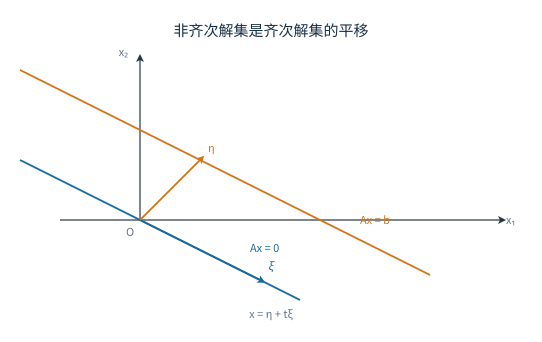

# 04 向量组与线性方程组解结构

[[00 线性代数 MOC|← 目录]] · 上一章：[[03 初等变换、秩与线性方程组]] · 下一章：[[05 向量空间、内积与基]]

## 学习目标

- 判断向量能否由向量组线性表出，并说明表示系数是否唯一。
- 判断向量组是否线性相关，处理含参数的独立性判定。
- 求极大线性无关组与向量组的秩，并把其余向量用它们表示。
- 求齐次方程组的基础解系与非齐次方程组的通解。
- 判断两个向量组是否等价、两个方程组是否同解。

## 1 向量与线性表出

由 $n$ 个数按顺序组成的数组称为 $n$ 维向量。本章默认使用列向量

$$
\alpha=\begin{pmatrix}a_1\\\vdots\\a_n\end{pmatrix},
$$

行向量用转置表示。两个同维向量相等，当且仅当对应分量相等；加法与数乘按分量进行。

给定向量组 $\alpha_1,\ldots,\alpha_m$，表达式

$$
x_1\alpha_1+\cdots+x_m\alpha_m
$$

称为该向量组的线性组合。若存在系数 $x_1,\ldots,x_m$，使

$$
\beta=x_1\alpha_1+\cdots+x_m\alpha_m,
$$

则称 $\beta$ 可由该向量组线性表出，或称 $\beta$ 属于该向量组的张成空间。

把向量作为列拼成矩阵 $A=(\alpha_1,\ldots,\alpha_m)$，则

$$
x_1\alpha_1+\cdots+x_m\alpha_m=Ax.
$$

因此“$\beta$ 能否由 $\alpha_1,\ldots,\alpha_m$ 表出”等价于方程组 $Ax=\beta$ 是否有解。由上一章的秩判据，$\beta$ 可表出当且仅当

$$
r(A)=r([A\mid\beta]).
$$

若进一步 $r(A)=m$，则表示系数唯一；若 $r(A)<m$，表示系数不唯一。原因是 $Ax=\beta$ 的解集等于一个特解加上 $Ax=\boldsymbol 0$ 的解空间，而齐次解空间的维数为 $m-r(A)$。

**例 1** 设

$$
\alpha_1=\begin{pmatrix}1\\2\\-1\end{pmatrix},\quad
\alpha_2=\begin{pmatrix}2\\1\\1\end{pmatrix},\quad
\beta=\begin{pmatrix}5\\4\\1\end{pmatrix},
$$

判断 $\beta$ 能否由 $\alpha_1,\alpha_2$ 表出，并写出表示式。

**解** 设 $\beta=x_1\alpha_1+x_2\alpha_2$，比较分量得

$$
\begin{cases}
x_1+2x_2=5,\\
2x_1+x_2=4,\\
-x_1+x_2=1.
\end{cases}
$$

前两式解得 $x_1=1$、$x_2=2$，代入第三式：$-1+2=1$，成立，故

$$
\beta=\alpha_1+2\alpha_2.
$$

回代三个分量：$1+2\cdot2=5$，$2\cdot1+2=4$，$-1+2\cdot1=1$，全部吻合。两列线性无关，所以这组系数是唯一的。

**例 2** 设

$$
\alpha_1=\begin{pmatrix}1\\0\\1\end{pmatrix},\quad
\alpha_2=\begin{pmatrix}0\\1\\1\end{pmatrix},\quad
\alpha_3=\begin{pmatrix}1\\1\\2\end{pmatrix},\quad
\beta=\begin{pmatrix}1\\2\\3\end{pmatrix},
$$

判断 $\beta$ 能否由 $\alpha_1,\alpha_2,\alpha_3$ 表出，并说明表示是否唯一。

**解** 注意 $\alpha_3=\alpha_1+\alpha_2$，所以只需判断 $\beta$ 能否由 $\alpha_1,\alpha_2$ 表出。设 $\beta=x\alpha_1+y\alpha_2$，比较前两个分量得 $x=1$、$y=2$，第三个分量为 $1+2=3$，成立。因此

$$
\beta=\alpha_1+2\alpha_2=\alpha_3+\alpha_2.
$$

由于 $r(A)=2<3$，表示不唯一：所有表示系数满足

$$
(x_1,x_2,x_3)=(1-s,\ 2-s,\ s),\qquad s\in\mathbb R,
$$

因为把 $\alpha_3=\alpha_1+\alpha_2$ 代入可知，保持 $x_1+x_3=1$、$x_2+x_3=2$ 的系数给出的线性组合都等于 $\beta$。这里 $\beta$ 落在由 $\alpha_1,\alpha_2$ 张成的平面内，$\alpha_3$ 没有提供新方向。

## 2 线性相关性

向量组 $\alpha_1,\ldots,\alpha_m$ 线性相关，是指存在不全为零的系数 $x_1,\ldots,x_m$，使

$$
x_1\alpha_1+\cdots+x_m\alpha_m=\boldsymbol 0.
$$

若只有全零系数才能得到零向量，则称该向量组线性无关。

令 $A=(\alpha_1,\ldots,\alpha_m)$，则

$$
x_1\alpha_1+\cdots+x_m\alpha_m=\boldsymbol 0
\Longleftrightarrow
Ax=\boldsymbol 0.
$$

所以

$$
\alpha_1,\ldots,\alpha_m\text{ 线性无关}
\Longleftrightarrow
Ax=\boldsymbol 0\text{ 只有零解}
\Longleftrightarrow
r(A)=m.
$$

反过来，向量组线性相关当且仅当 $r(A)<m$，即齐次方程组有非零解。

线性相关的直观含义是“组内至少有一个向量是多余的”。但要注意，相关不一定意味着每个向量都能由其余向量表出：例如零向量与非零向量组成的向量组相关，而非零向量不能由零向量表出。准确的结论是：向量组相关，当且仅当其中至少有一个向量能由其余向量线性表出。证明只需取一个非零系数 $x_k$，把关系式移项得

$$
\alpha_k=-\sum_{i\ne k}\frac{x_i}{x_k}\alpha_i.
$$

几个常用判据：

- 含零向量的向量组必相关；
- 含两个成比例向量的向量组必相关；
- $n$ 维空间中，向量个数超过 $n$ 时必相关，因为 $r(A)\le n<m$；
- 线性无关组的任意非空子组仍无关，相关组的任意超组仍相关；
- 若 $\alpha_1,\ldots,\alpha_m$ 线性无关，且 $\beta$ 不能由它们表出，则 $\alpha_1,\ldots,\alpha_m,\beta$ 仍线性无关。否则若 $c_0\beta+\sum c_i\alpha_i=0$ 且 $c_0\ne0$，就能反解出 $\beta$，与假设矛盾；于是 $c_0=0$，再由原组无关得所有 $c_i=0$。

**例 3** 判断

$$
\alpha_1=\begin{pmatrix}1\\1\\1\end{pmatrix},\quad
\alpha_2=\begin{pmatrix}1\\2\\3\end{pmatrix},\quad
\alpha_3=\begin{pmatrix}2\\3\\4\end{pmatrix}
$$

是否线性相关。

**解** 把向量按列拼成矩阵并化简：

$$
\begin{pmatrix}
1&1&2\\
1&2&3\\
1&3&4
\end{pmatrix}
\sim
\begin{pmatrix}
1&1&2\\
0&1&1\\
0&0&0
\end{pmatrix}.
$$

秩为 $2<3$，故向量组线性相关。由行最简形

$$
\begin{pmatrix}
1&0&1\\
0&1&1\\
0&0&0
\end{pmatrix}
$$

读出关系 $x_1+x_3=0$、$x_2+x_3=0$，取 $x_3=1$，得非零关系

$$
-\alpha_1-\alpha_2+\alpha_3=\boldsymbol 0,
\qquad
\alpha_3=\alpha_1+\alpha_2.
$$

回代：$\alpha_1+\alpha_2=(2,3,4)^T=\alpha_3$，关系成立。

**例 4** 设

$$
\alpha_1=\begin{pmatrix}1\\1\\1\end{pmatrix},\quad
\alpha_2=\begin{pmatrix}1\\2\\3\end{pmatrix},\quad
\alpha_3=\begin{pmatrix}1\\3\\t\end{pmatrix},
$$

问 $t$ 取何值时向量组线性无关；线性相关时写出一个非零关系。

**解** 以三列为矩阵，行列式为

$$
\begin{vmatrix}1&1&1\\1&2&3\\1&3&t\end{vmatrix}
=1(2t-9)-1(t-3)+1(3-2)=t-5.
$$

当 $t\ne5$ 时行列式非零，$r(A)=3$，向量组线性无关。当 $t=5$ 时，第三列 $\alpha_3=(1,3,5)^T$ 满足

$$
\alpha_3=2\alpha_2-\alpha_1=2(1,2,3)^T-(1,1,1)^T=(1,3,5)^T,
$$

所以

$$
-\alpha_1+2\alpha_2-\alpha_3=\boldsymbol 0
$$

是一个非零关系，向量组线性相关。$t=5$ 是主元消失的唯一参数值，其他 $t$ 都不会让三列共面。

## 3 极大线性无关组与向量组的秩

向量组的一部分若满足：本身线性无关，且原组中每个向量都能由它线性表出，则称为原组的一个极大线性无关组。极大线性无关组一般不唯一（向量组只含一个向量时除外），但所含向量的个数相同，这个个数称为向量组的秩。

个数相同这一点来自基的替换论证。若一个向量组中有 $p$ 个向量能张成整个组，则组内任意 $q>p$ 个向量都线性相关：把这 $q$ 个向量写成 $p$ 个张成向量的线性组合，得到 $B=AC$，其中 $C$ 是 $p\times q$ 矩阵；$q>p$ 时 $Cx=0$ 有非零解，于是 $Bx=ACx=0$，这 $q$ 个向量相关。因此一个极大无关组不可能比另一个更大，两组大小相等。

求极大无关组的标准方法是把向量按列拼成矩阵，只作初等行变换化为行阶梯形：

1. 记录主元所在的列；
2. 主元个数就是向量组的秩；
3. 回到原矩阵，取对应位置的列，得到一个极大无关组；
4. 若要写出其余向量的表示式，继续化为行最简形，非主元列在主元行上的分量就是组合系数。

行变换会改变列向量本身，但保持列与列之间的线性关系。因此主元列的位置可以沿用，取向量时必须回到原矩阵，不能直接取化简后矩阵的列。

**例 5** 设

$$
\alpha_1=\begin{pmatrix}1\\1\\1\end{pmatrix},\quad
\alpha_2=\begin{pmatrix}1\\2\\3\end{pmatrix},\quad
\alpha_3=\begin{pmatrix}2\\3\\4\end{pmatrix},\quad
\alpha_4=\begin{pmatrix}3\\5\\7\end{pmatrix},
$$

求一个极大线性无关组，并把其余向量用它表示。

**解** 把向量按列拼成矩阵并化简：

$$
\begin{pmatrix}
1&1&2&3\\
1&2&3&5\\
1&3&4&7
\end{pmatrix}
\sim
\begin{pmatrix}
1&1&2&3\\
0&1&1&2\\
0&0&0&0
\end{pmatrix}.
$$

主元列是第 $1,2$ 列，故 $\alpha_1,\alpha_2$ 是一个极大无关组，向量组的秩为 $2$。继续化为行最简形：

$$
\begin{pmatrix}
1&0&1&1\\
0&1&1&2\\
0&0&0&0
\end{pmatrix}.
$$

非主元列对应的系数为 $(1,1)^T$ 与 $(1,2)^T$，所以

$$
\alpha_3=\alpha_1+\alpha_2,\qquad
\alpha_4=\alpha_1+2\alpha_2.
$$

回代验证：$\alpha_1+\alpha_2=(2,3,4)^T=\alpha_3$，$\alpha_1+2\alpha_2=(3,5,7)^T=\alpha_4$。

极大无关组不唯一。取 $\alpha_2,\alpha_3$，它们线性无关，且

$$
\alpha_1=\alpha_3-\alpha_2,\qquad
\alpha_4=\alpha_2+\alpha_3,
$$

所以 $\alpha_2,\alpha_3$ 也能张成原组，是另一个极大无关组。两组都含 $2$ 个向量，与向量组的秩一致。

## 4 向量组等价与张成空间

两个同维向量组若可以互相线性表出，则称它们等价。等价向量组张成同一个空间：

$$
\operatorname{span}\{\alpha_1,\ldots,\alpha_m\}
=\left\{x_1\alpha_1+\cdots+x_m\alpha_m:x_i\in\mathbb R\right\}.
$$

判断两个向量组是否等价，可把两组向量分别按列拼成矩阵 $A,B$，则

$$
\text{两组等价}
\Longleftrightarrow
r(A)=r(B)=r([A\ B]).
$$

两组等价意味着 $B$ 的每一列都在 $A$ 的列空间中，且 $A$ 的每一列都在 $B$ 的列空间中。前者等价于 $r(A)=r([A\ B])$，后者等价于 $r(B)=r([A\ B])$，合并即得判据。

只比较 $r(A)=r(B)$ 不够，因为两个秩相同的向量组可能张成不同的空间。例如 $\mathbb R^3$ 中两张不同的二维平面，维数相同但不相等。

**例 6** 设

$$
\alpha_1=\begin{pmatrix}1\\0\\1\end{pmatrix},\quad
\alpha_2=\begin{pmatrix}0\\1\\1\end{pmatrix},
\qquad
\beta_1=\begin{pmatrix}1\\1\\2\end{pmatrix},\quad
\beta_2=\begin{pmatrix}1\\-1\\0\end{pmatrix}.
$$

判断两个向量组是否等价。

**解** 直接观察：

$$
\beta_1=\alpha_1+\alpha_2,\qquad
\beta_2=\alpha_1-\alpha_2.
$$

反解得

$$
\alpha_1=\frac12(\beta_1+\beta_2),\qquad
\alpha_2=\frac12(\beta_1-\beta_2).
$$

两组可以互相表出，故等价。用秩核对：$A,B$ 的秩都是 $2$，拼接矩阵 $[A\ B]$ 的列中 $\beta_1,\beta_2$ 已经能由 $\alpha_1,\alpha_2$ 表出，秩仍为 $2$。

**例 7** 设

$$
\alpha_1=\begin{pmatrix}1\\0\\0\end{pmatrix},\quad
\alpha_2=\begin{pmatrix}0\\1\\0\end{pmatrix},
\qquad
\beta_1=\begin{pmatrix}1\\0\\0\end{pmatrix},\quad
\beta_2=\begin{pmatrix}0\\0\\1\end{pmatrix}.
$$

判断两个向量组是否等价。

**解** 两组都含两个线性无关向量，秩都为 $2$。但 $\beta_2=(0,0,1)^T$ 不在 $\alpha_1,\alpha_2$ 张成的 $xy$ 平面内。把四个向量按列拼成矩阵，第三列与第四列给出两个新的主元，$r([A\ B])=3\ne2$，所以两组不等价。两个不同的二维平面维数相同，却张成不同的空间，这正是不能只比较秩的原因。

## 5 齐次方程组的解结构

齐次方程组 $Ax=\boldsymbol 0$ 总有零解。若 $r(A)=n$，只有零解；若 $r(A)<n$，有无穷多解，自由变量个数为 $n-r(A)$。

若 $\xi_1,\ldots,\xi_{n-r}$ 是 $Ax=\boldsymbol 0$ 的一组线性无关解，并且任意解都能由它们线性表出，则称它们为方程组的一组基础解系。通解为

$$
x=k_1\xi_1+\cdots+k_{n-r}\xi_{n-r}.
$$

求基础解系的步骤：

1. 把系数矩阵化为行最简形；
2. 确定主变量与自由变量；
3. 用自由变量表示主变量；
4. 每次令一个自由变量为 $1$、其余为 $0$，得到一组解向量；
5. 写出通解。

这组解向量线性无关：若它们的线性组合为零，看自由变量对应的分量，每个系数都必须为零。任意解的自由变量取一组值，对应的线性组合与它自由变量分量相同，因而两者相等。

**例 8** 求齐次方程组

$$
\begin{cases}
x_1+2x_2-x_3=0,\\
2x_1+4x_2-2x_3=0,\\
x_2+x_4=0
\end{cases}
$$

的基础解系与通解。

**解** 系数矩阵化为

$$
\begin{pmatrix}
1&2&-1&0\\
2&4&-2&0\\
0&1&0&1
\end{pmatrix}
\sim
\begin{pmatrix}
1&0&-1&-2\\
0&1&0&1\\
0&0&0&0
\end{pmatrix}.
$$

主变量为 $x_1,x_2$，自由变量为 $x_3,x_4$。由行最简形得

$$
x_1=x_3+2x_4,\qquad x_2=-x_4.
$$

令 $x_3=1,x_4=0$，得 $(1,0,1,0)^T$；令 $x_3=0,x_4=1$，得 $(2,-1,0,1)^T$。因此基础解系为

$$
\xi_1=(1,0,1,0)^T,\qquad
\xi_2=(2,-1,0,1)^T,
$$

通解为

$$
x=k_1\xi_1+k_2\xi_2,\qquad k_1,k_2\in\mathbb R.
$$

代回原方程组：$\xi_1$ 满足 $x_1+2x_2-x_3=1-1=0$、$2x_1+4x_2-2x_3=2-2=0$、$x_2+x_4=0$；$\xi_2$ 满足 $2-2=0$、$4-4=0$、$-1+1=0$。维数 $n-r(A)=4-2=2$，与两个基向量一致。

**例 9** 问 $a$ 取何值时齐次方程组

$$
\begin{cases}
x_1+x_2+x_3=0,\\
x_1+2x_2+3x_3=0,\\
x_1+4x_2+ax_3=0
\end{cases}
$$

有非零解，并求此时的基础解系。

**解** 系数行列式为

$$
\begin{vmatrix}1&1&1\\1&2&3\\1&4&a\end{vmatrix}
=1(2a-12)-1(a-3)+1(4-2)=a-7.
$$

当 $a=7$ 时行列式为零，$r(A)<3$，有非零解；当 $a\ne7$ 时只有零解。取 $a=7$，对系数矩阵作行变换：

$$
\begin{pmatrix}1&1&1\\1&2&3\\1&4&7\end{pmatrix}
\sim
\begin{pmatrix}1&1&1\\0&1&2\\0&3&6\end{pmatrix}
\sim
\begin{pmatrix}1&0&-1\\0&1&2\\0&0&0\end{pmatrix}.
$$

所以 $x_1=x_3$、$x_2=-2x_3$。取 $x_3=1$，基础解系为 $(1,-2,1)^T$，通解为 $x=k(1,-2,1)^T$。回代：$1-2+1=0$，$1-4+3=0$，$1-8+7=0$，成立。

## 6 非齐次方程组的解结构

设 $\eta$ 是 $Ax=b$ 的一个特解，$\xi$ 是齐次方程组 $Ax=\boldsymbol 0$ 的任意解，则

$$
A(\eta+\xi)=A\eta+A\xi=b.
$$

反过来，任意两个非齐次解之差都是齐次解：若 $A\eta_1=b$、$A\eta_2=b$，则 $A(\eta_1-\eta_2)=0$。因此非齐次方程组的通解为

$$
x=\eta+x_h,
$$

其中 $x_h$ 是导出齐次方程组的通解。解集是一个不过原点的仿射子空间；只有当 $b=\boldsymbol 0$ 时它才经过原点、成为子空间。

求解步骤：

1. 对增广矩阵 $[A\mid b]$ 作行变换，先判断是否有解；
2. 求导出齐次方程组的基础解系；
3. 取一个方便的特解；
4. 写出通解并注明参数范围。

**例 10** 讨论并求解

$$
\begin{cases}
x_1+x_2+x_3=1,\\
x_1+tx_2+x_3=1,\\
x_1+x_2+(t-1)x_3=t.
\end{cases}
$$

**解** 第二、三行分别减第一行，增广矩阵化为

$$
\left[\begin{array}{ccc|c}
1&1&1&1\\
0&t-1&0&0\\
0&0&t-2&t-1
\end{array}\right].
$$

参数只在 $t=1,2$ 时使主元消失，逐支讨论：

- 当 $t\ne1,2$ 时，三个主元都非零，方程组有唯一解：

$$
x_2=0,\qquad
x_3=\frac{t-1}{t-2},\qquad
x_1=-\frac{1}{t-2}.
$$

回代第一式：$-\dfrac1{t-2}+0+\dfrac{t-1}{t-2}=1$，成立。

- 当 $t=1$ 时，第二行全零，第三行给出 $-x_3=0$，即 $x_3=0$。此时 $r(A)=r([A\mid b])=2<3$，令 $x_2=s$，得

$$
x=(1,0,0)^T+s(-1,1,0)^T,\qquad s\in\mathbb R.
$$

- 当 $t=2$ 时，第三行成为 $0=1$，系数矩阵秩为 $2$，增广矩阵秩为 $3$，方程组无解。

**例 11** 设

$$
A=\begin{pmatrix}1&0&1\\0&1&1\end{pmatrix},\qquad
b=\begin{pmatrix}b_1\\b_2\end{pmatrix},
$$

说明 $Ax=b$ 对任意 $b$ 都有解，并写出通解。取 $b=(2,3)^T$，画出解集的几何形状。

**解** $A$ 的两列线性无关，$r(A)=2$，且增广矩阵只有两行，$r([A\mid b])=2$ 对任意 $b$ 都成立。方程即

$$
x_1+x_3=b_1,\qquad x_2+x_3=b_2.
$$

令 $x_3=s$，得

$$
x=\begin{pmatrix}b_1\\b_2\\0\end{pmatrix}
+s\begin{pmatrix}-1\\-1\\1\end{pmatrix},\qquad s\in\mathbb R.
$$

取 $b=(2,3)^T$，解集是过点 $(2,3,0)^T$、方向为 $(-1,-1,1)^T$ 的直线。它与齐次解空间（过原点、同方向的直线）平行但不重合。

图中两条平行直线方向相同，都沿 $\xi$ 方向；下面一条过原点，是 $Ax=\boldsymbol 0$ 的解集；上面一条过特解 $\eta$，是 $Ax=b$ 的解集。非齐次解集不是子空间，因为没有零向量。

## 7 公共解与同解

两个齐次方程组 $Ax=\boldsymbol 0$、$Bx=\boldsymbol 0$ 的公共解，就是拼接方程组

$$
\begin{pmatrix}A\\B\end{pmatrix}x=\boldsymbol 0
$$

的解。最稳妥的方法是把系数矩阵上下拼接后求基础解系。

两个齐次方程组同解，指解集完全相同。判据是

$$
r(A)=r(B)=r\begin{pmatrix}A\\B\end{pmatrix}.
$$

这里要求 $A,B$ 的列数相同。只比较 $r(A)=r(B)$ 不够，因为秩相同不代表约束相同。判据的理由是：$Ax=0$ 的解都是 $Bx=0$ 的解，等价于 $B$ 的每一行都能由 $A$ 的行线性表出，也就是 $r(A)=r([A;B])$；反方向同理。

非齐次方程组同解还要带上右端信息：两个方程组都相容，且

$$
r([A\mid b])=r([B\mid d])=r\begin{pmatrix}A&b\\B&d\end{pmatrix}.
$$

只比较两个增广矩阵的秩也不够，例如 $x=0$ 与 $x=1$ 的增广矩阵秩都为 $1$，解集却不同。

**例 12** 判断方程组

$$
\begin{cases}
x_1+x_2+x_3=0,\\
x_1-x_2=0
\end{cases}
$$

与

$$
\begin{cases}
x_1+x_2+x_3=0,\\
x_1-x_2=0,\\
2x_1+x_3=0
\end{cases}
$$

是否同解。

**解** 第一个方程组给出 $x_1=x_2$、$x_3=-2x_1$。第三条方程 $2x_1+x_3=2x_1-2x_1=0$ 是前两条的推论，不会增加新约束，所以两个方程组同解。用秩表示，第一个方程组的系数矩阵秩为 $2$，第二个也为 $2$，拼接后的秩仍为 $2$，满足同解判据。

**例 13** 求两个齐次方程组的公共解：

$$
\begin{cases}
x_1+x_2+x_3=0,\\
x_1-x_2=0,
\end{cases}
\qquad
\begin{cases}
x_1+x_2+x_3=0,\\
2x_1+x_3=0.
\end{cases}
$$

**解** 把四个方程上下拼接：

$$
\begin{pmatrix}
1&1&1\\
1&-1&0\\
1&1&1\\
2&0&1
\end{pmatrix}
\sim
\begin{pmatrix}
1&1&1\\
0&-2&-1\\
0&0&0\\
0&-2&-1
\end{pmatrix}
\sim
\begin{pmatrix}
1&1&1\\
0&2&1\\
0&0&0\\
0&0&0
\end{pmatrix}.
$$

秩为 $2$，自由变量有 $3-2=1$ 个。由第二行得 $x_3=-2x_2$，代入第一行得 $x_1=x_2$。令 $x_2=1$，公共解为

$$
x=k(1,1,-2)^T,\qquad k\in\mathbb R.
$$

代回两组方程：$1+1-2=0$，$1-1=0$，$2-2=0$，全部成立。公共解空间的维数等于 $n$ 减去拼接矩阵的秩，这个例子中为 $3-2=1$。
