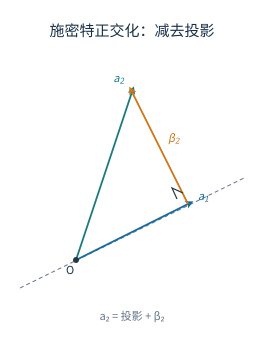
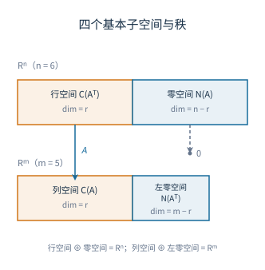

# 05 向量空间、内积与基

[[00 线性代数 MOC|← 目录]] · 上一章：[[04 向量组与线性方程组解结构]] · 下一章：[[06 特征值、相似对角化与二次型]]

## 学习目标

- 判断一个集合是否为子空间，并求出一组基和维数。
- 求向量在给定基下的坐标，写出基变换与坐标变换公式。
- 计算内积、长度与投影，用施密特方法构造标准正交组。
- 判断正交矩阵，并说明正交变换为什么保持内积。
- 说明列空间、零空间、四个基本子空间与秩—零度定理。

## 1 向量空间与子空间

在通常的加法与数乘下，$\mathbb R^n$ 是实向量空间。若非空子集 $V\subseteq\mathbb R^n$ 对这两种运算封闭，即

$$
\alpha,\beta\in V\Rightarrow\alpha+\beta\in V,
\qquad
k\in\mathbb R,\ \alpha\in V\Rightarrow k\alpha\in V,
$$

则 $V$ 是 $\mathbb R^n$ 的子空间。子空间只需检查封闭性：取 $\alpha\in V$，由数乘封闭得 $0\alpha=\boldsymbol 0\in V$，相反向量 $-\alpha=(-1)\alpha$ 也自动包含在内。

由向量组 $\alpha_1,\ldots,\alpha_m$ 的全部线性组合组成的集合

$$
\operatorname{span}\{\alpha_1,\ldots,\alpha_m\}
=\left\{x_1\alpha_1+\cdots+x_m\alpha_m:x_i\in\mathbb R\right\}
$$

称为张成空间，它总是一个子空间。齐次方程组 $Ax=\boldsymbol 0$ 的全部解也构成子空间，因为两个解的线性组合仍是解。

判断子空间时，先看零向量是否属于集合，再验证加法与数乘封闭。由齐次线性条件描述的集合通常是子空间；含常数项的条件通常不是。例如

$$
V_1=\{(x,y,z)^T:x+y-z=0\}
$$

是子空间，而

$$
V_2=\{(x,y,z)^T:x+y-z=1\}
$$

不是，因为零向量不在 $V_2$ 中。两个子空间的交集仍是子空间；两个子空间的并集一般不是子空间，例如 $x$ 轴与 $y$ 轴的并集不包含 $(1,1,0)^T$。

**例 1** 求 $V=\{(x,y,z)^T:x+y-z=0\}$ 的一组基与维数。

**解** 由 $z=x+y$，得

$$
(x,y,z)^T=x(1,0,1)^T+y(0,1,1)^T.
$$

向量 $(1,0,1)^T$ 与 $(0,1,1)^T$ 线性无关，且能表示 $V$ 中全部向量，所以它们构成一组基，$\dim V=2$。几何上 $V$ 是过原点的一个平面；$x+y-z=1$ 是它的平行平移，不过原点，因此不是子空间。

## 2 基、维数与坐标

一组向量若线性无关，并且能表示空间中的任意向量，则称为该空间的一组基；基中向量的个数称为维数。若 $\xi_1,\ldots,\xi_n$ 是一组基，且

$$
\alpha=x_1\xi_1+\cdots+x_n\xi_n,
$$

则

$$
[\alpha]_\xi=(x_1,\ldots,x_n)^T
$$

称为 $\alpha$ 在基 $\xi$ 下的坐标。坐标是相对于所选基的系数，不是向量本身。

基的两个条件分别保证唯一性与存在性：线性无关保证表示唯一，张成保证表示存在。若同一个向量有两组表示 $\sum x_i\xi_i=\sum y_i\xi_i$，则 $\sum(x_i-y_i)\xi_i=\boldsymbol 0$，由线性无关得 $x_i=y_i$。

在 $n$ 维空间中，任意 $n$ 个线性无关的向量都构成一组基；任意能张成该空间的 $n$ 个向量也构成一组基。更一般地，任意张成组都可以删去多余向量得到一组基，任意线性无关组都可以添入向量扩充为一组基。理由是：若无关组还没有张成空间，就取一个不能由它表出的向量添入，由第 04 章的判据，添入后仍无关；有限维空间中这个过程必然停止。

**例 2** 设 $\xi_1=(1,1)^T$、$\xi_2=(1,-1)^T$、$\alpha=(5,1)^T$，求 $[\alpha]_\xi$。

**解** 设 $\alpha=x_1\xi_1+x_2\xi_2$，比较分量得

$$
\begin{cases}
x_1+x_2=5,\\
x_1-x_2=1.
\end{cases}
$$

解得 $x_1=3$、$x_2=2$，故 $[\alpha]_\xi=(3,2)^T$。回代：$3(1,1)^T+2(1,-1)^T=(5,1)^T$，成立。

### 2.1 基变换与坐标变换

同一空间的两组基之间由一个可逆矩阵联系。设 $\xi_1,\ldots,\xi_n$ 与 $\eta_1,\ldots,\eta_n$ 都是 $V$ 的基，且

$$
\eta_j=\sum_{i=1}^n p_{ij}\xi_i,\qquad j=1,\ldots,n.
$$

把 $P=(p_{ij})$ 称为从基 $\xi$ 到基 $\eta$ 的过渡矩阵。用矩阵写法就是

$$
(\eta_1,\ldots,\eta_n)=(\xi_1,\ldots,\xi_n)P.
$$

若 $\alpha=\sum_j y_j\eta_j$，代入 $\eta_j$ 的表达式：

$$
\alpha=\sum_j y_j\sum_i p_{ij}\xi_i
=\sum_i\left(\sum_j p_{ij}y_j\right)\xi_i.
$$

比较 $\xi$ 下的坐标，得

$$
[\alpha]_\xi=P[\alpha]_\eta.
$$

这就是坐标变换公式。反向关系为 $[\alpha]_\eta=P^{-1}[\alpha]_\xi$。过渡矩阵 $P$ 的列是 $\eta_j$ 在 $\xi$ 下的坐标；写公式时先确认方向，避免把 $P$ 和 $P^{-1}$ 用反。

**例 3** 取 $\xi_1=(1,0)^T$、$\xi_2=(0,1)^T$ 为标准基，$\eta_1=(1,1)^T$、$\eta_2=(1,-1)^T$。已知 $[\alpha]_\eta=(3,2)^T$，求 $[\alpha]_\xi$。

**解** 过渡矩阵的列是 $\eta_j$ 在标准基下的坐标：

$$
P=\begin{pmatrix}1&1\\1&-1\end{pmatrix}.
$$

由坐标变换公式，

$$
[\alpha]_\xi=P[\alpha]_\eta
=\begin{pmatrix}1&1\\1&-1\end{pmatrix}
\begin{pmatrix}3\\2\end{pmatrix}
=\begin{pmatrix}5\\1\end{pmatrix}.
$$

与直接计算 $3\eta_1+2\eta_2=(5,1)^T$ 一致。反过来，若已知 $[\alpha]_\xi=(5,1)^T$，则 $[\alpha]_\eta=P^{-1}(5,1)^T=(3,2)^T$。

### 2.2 同一线性变换在不同基下的矩阵

设 $T$ 是 $V$ 上的线性变换，在基 $\xi$ 下的矩阵为 $A$，即

$$
[T\alpha]_\xi=A[\alpha]_\xi.
$$

换到基 $\eta=\xi P$ 后，记 $x=[\alpha]_\xi$、$x'=[\alpha]_\eta$，则 $x=Px'$；同理 $[T\alpha]_\xi=P[T\alpha]_\eta$。代入 $[T\alpha]_\xi=A[\alpha]_\xi$：

$$
P[T\alpha]_\eta=AP[\alpha]_\eta.
$$

左乘 $P^{-1}$，得

$$
[T\alpha]_\eta=P^{-1}AP[\alpha]_\eta.
$$

所以 $T$ 在基 $\eta$ 下的矩阵是 $P^{-1}AP$。第 06 章的相似矩阵正是同一线性变换在不同基下的矩阵；过渡矩阵 $P$ 把两组基联系起来，相似变换则把两个矩阵联系起来。

## 3 内积、长度与正交

对 $x,y\in\mathbb R^n$，标准内积定义为

$$
\langle x,y\rangle=x^Ty=\sum_{i=1}^n x_iy_i.
$$

长度（范数）为

$$
\|x\|=\sqrt{\langle x,x\rangle}.
$$

若 $\langle x,y\rangle=0$，称 $x,y$ 正交。非零向量可以单位化为 $\widehat x=x/\|x\|$。

内积满足对称性与线性性，并且 $\langle x,x\rangle\ge0$，等号只在 $x=\boldsymbol 0$ 时成立。长度满足

$$
\|kx\|=|k|\|x\|,\qquad
|\langle x,y\rangle|\le\|x\|\|y\|,\qquad
\|x+y\|\le\|x\|+\|y\|.
$$

中间一式是柯西—施瓦茨不等式。它的证明可以用判别式：若 $y\ne\boldsymbol 0$，对任意实数 $t$，

$$
0\le\|x+ty\|^2=\|x\|^2+2t\langle x,y\rangle+t^2\|y\|^2.
$$

右端是关于 $t$ 的二次式，首项系数 $\|y\|^2>0$，所以判别式非正：

$$
4\langle x,y\rangle^2-4\|x\|^2\|y\|^2\le0,
$$

即得柯西—施瓦茨不等式。$y=\boldsymbol 0$ 时两边都为零。三角不等式由

$$
\|x+y\|^2=\|x\|^2+2\langle x,y\rangle+\|y\|^2
\le\|x\|^2+2\|x\|\|y\|+\|y\|^2=(\|x\|+\|y\|)^2
$$

得到。

非零向量的夹角由

$$
\cos\theta=\frac{\langle x,y\rangle}{\|x\|\|y\|}
$$

定义；$\langle x,y\rangle=0$ 对应夹角 $90^\circ$。向量 $x$ 在非零向量 $u$ 上的正交投影为

$$
\operatorname{proj}_u x
=\frac{\langle x,u\rangle}{\langle u,u\rangle}u.
$$

投影把 $x$ 分解为沿 $u$ 方向的分量与垂直于 $u$ 的分量：

$$
x=\operatorname{proj}_u x+(x-\operatorname{proj}_u x),
\qquad
\langle x-\operatorname{proj}_u x,u\rangle=0.
$$

**例 4** 设 $x=(1,2,2)^T$、$y=(2,-2,1)^T$，判断它们是否正交；再求 $z=(3,1)^T$ 在 $u=(1,1)^T$ 上的投影与垂直分量。

**解** $\langle x,y\rangle=1\cdot2+2\cdot(-2)+2\cdot1=2-4+2=0$，所以 $x,y$ 正交。两者的长度都是 $\sqrt{9}=3$，夹角为 $90^\circ$。

对 $z,u$，$\langle z,u\rangle=3+1=4$，$\langle u,u\rangle=2$，所以

$$
\operatorname{proj}_u z=\frac42(1,1)^T=(2,2)^T,
\qquad
z-\operatorname{proj}_u z=(1,-1)^T.
$$

两者点积为 $2-2=0$，垂直分量确实与 $u$ 正交；两分量之和回到 $z$。

### 3.1 施密特正交化

对线性无关组 $\alpha_1,\ldots,\alpha_m$，按顺序构造正交组：

$$
\beta_1=\alpha_1,
\qquad
\beta_k=\alpha_k-\sum_{i=1}^{k-1}
\frac{\langle\alpha_k,\beta_i\rangle}{\langle\beta_i,\beta_i\rangle}\beta_i.
$$

再令 $e_i=\beta_i/\|\beta_i\|$，得到标准正交组。

每一新向量都减去它在前面已得正交向量上的投影。以第 $k$ 步为例，对 $i<k$，

$$
\langle\beta_k,\beta_i\rangle
=\langle\alpha_k,\beta_i\rangle
-\frac{\langle\alpha_k,\beta_i\rangle}{\langle\beta_i,\beta_i\rangle}
\langle\beta_i,\beta_i\rangle=0.
$$

同时，$\beta_k$ 是 $\alpha_k$ 减去前面 $\beta_1,\ldots,\beta_{k-1}$ 的组合，所以

$$
\operatorname{span}\{\beta_1,\ldots,\beta_k\}
=\operatorname{span}\{\alpha_1,\ldots,\alpha_k\}.
$$

归纳可得整个过程保持张成空间不变。若某一步得到 $\beta_k=\boldsymbol 0$，说明 $\alpha_k$ 能由前面的向量表出，原向量组线性相关，应先删去冗余向量。施密特正交化的结果与向量顺序有关，顺序改变时标准正交组可能不同，但张成空间不变。

图中 $\alpha_2$ 被分解为沿 $\alpha_1$ 的投影与垂直分量 $\beta_2$。投影点处标有直角记号，说明 $\beta_2\perp\alpha_1$；把 $\alpha_2$ 换成 $\beta_2$ 后，两个向量张成的平面没有改变，但新的向量组已经正交。

**例 5** 将 $\alpha_1=(1,2,-1)^T$、$\alpha_2=(-1,3,1)^T$ 化为标准正交组。

**解** 先算

$$
\langle\alpha_2,\alpha_1\rangle=4,\qquad
\langle\alpha_1,\alpha_1\rangle=6.
$$

取 $\beta_1=\alpha_1$，则

$$
\beta_2=\alpha_2-\frac46\alpha_1
=\frac53(-1,1,1)^T.
$$

去掉非零倍数，取 $\beta_2=(-1,1,1)^T$。核对正交性：$\langle\beta_2,\beta_1\rangle=-1+2-1=0$。单位化得

$$
e_1=\frac1{\sqrt6}(1,2,-1)^T,\qquad
e_2=\frac1{\sqrt3}(-1,1,1)^T.
$$

两者长度都为 $1$，点积为 $0$，构成标准正交组；它们张成的平面与原向量组相同。

## 4 正交矩阵

方阵 $Q$ 若满足

$$
Q^TQ=I,
$$

则称为正交矩阵。等价地，$Q^{-1}=Q^T$。正交矩阵的列向量构成一组标准正交基，行列式只能是 $\pm1$：由 $\det(Q^TQ)=\det(Q)^2=1$ 得 $\det(Q)=\pm1$。

正交变换保持内积：

$$
(Qx)^T(Qy)=x^TQ^TQy=x^Ty.
$$

因此它保持长度、夹角和距离。二维情形中，$\det Q=1$ 的正交矩阵表示旋转，$\det Q=-1$ 表示旋转再叠加一次反射。

**例 6** 验证

$$
Q=\frac12\begin{pmatrix}1&-\sqrt3\\\sqrt3&1\end{pmatrix}
$$

是正交矩阵，并说明其几何意义。

**解** 两列分别是 $\frac12(1,\sqrt3)^T$ 与 $\frac12(-\sqrt3,1)^T$，长度都为 $1$，点积为

$$
\frac14(1\cdot(-\sqrt3)+\sqrt3\cdot1)=0.
$$

所以 $Q^TQ=I$，$Q$ 是正交矩阵。又 $\det Q=\frac14(1+3)=1$，它表示旋转。第一列与 $x$ 轴正向的夹角为 $60^\circ$，故这是逆时针旋转 $60^\circ$。

再如 $Q=\begin{pmatrix}0&1\\1&0\end{pmatrix}$，它交换两个坐标轴，是关于直线 $y=x$ 的反射，$\det Q=-1$。正交矩阵不改变长度，但可能改变定向，行列式的符号正好区分这两种情形。

## 5 列空间、零空间与秩—零度定理

设 $A$ 为 $m\times n$ 矩阵。$A$ 的列向量的全部线性组合构成列空间 $\mathcal C(A)\subseteq\mathbb R^m$；齐次方程组 $Ax=\boldsymbol 0$ 的全部解构成零空间 $\mathcal N(A)\subseteq\mathbb R^n$。

列空间的维数等于 $r(A)$。把 $A$ 化为行最简形，主元列在化简后是标准基向量，彼此线性无关，且每个自由列都是主元列的组合；由行变换保持列关系，原矩阵的主元列也线性无关，并张成整个列空间。因此主元列构成列空间的一组基，$\dim\mathcal C(A)=r(A)$。

零空间的维数等于 $n-r(A)$。行最简形有 $r$ 个主元、$n-r$ 个自由变量；每次让一个自由变量为 $1$、其余为 $0$，得到 $n-r$ 个线性无关的解，且任意解都是它们的组合。因此

$$
\dim\mathcal C(A)+\dim\mathcal N(A)=n.
$$

这就是秩—零度定理。

零空间中的向量与 $A$ 的每一行都正交，因此零空间是行空间的正交补。类似地，左零空间 $\mathcal N(A^T)$ 是列空间的正交补。四个子空间的维数关系如下：

| 子空间 | 所在空间 | 维数 |
| --- | --- | --- |
| 列空间 $\mathcal C(A)$ | $\mathbb R^m$ | $r(A)$ |
| 行空间 $\mathcal C(A^T)$ | $\mathbb R^n$ | $r(A)$ |
| 零空间 $\mathcal N(A)$ | $\mathbb R^n$ | $n-r(A)$ |
| 左零空间 $\mathcal N(A^T)$ | $\mathbb R^m$ | $m-r(A)$ |

图中两块黄色区域分别是行空间与列空间，宽度都等于秩 $r$；两块蓝色区域分别是零空间与左零空间，宽度分别为 $n-r$ 与 $m-r$。行空间与列空间维数相同，但分别位于不同的坐标空间，不能把两者当成同一个空间。左侧的箭头表示 $A$ 把行空间一一映到列空间，同时把零空间压到零向量。

**例 7** 设

$$
A=\begin{pmatrix}1&2&0\\0&0&1\end{pmatrix},
$$

求列空间、零空间的基与维数。

**解** $A$ 的第一列与第三列线性无关，故列空间的一组基为

$$
(1,0)^T,\qquad(0,1)^T,
$$

$\dim\mathcal C(A)=2$，$r(A)=2$。解 $Ax=\boldsymbol 0$，即

$$
x_1+2x_2=0,\qquad x_3=0.
$$

令 $x_2=1$，得 $x_1=-2$、$x_3=0$，所以零空间的一组基为 $(-2,1,0)^T$，$\dim\mathcal N(A)=1$。维数验证为 $2+1=3$。

行空间由 $A$ 的两行张成，维数为 $2$；左零空间是 $\mathcal N(A^T)\subseteq\mathbb R^2$，因为 $A^T$ 的两列线性无关，左零空间只有零向量，维数为 $m-r(A)=2-2=0$。行空间与零空间正交：$(1,2,0)\cdot(-2,1,0)=0$，$(0,0,1)\cdot(-2,1,0)=0$。

### 5.1 正交补与直和

设 $U\subseteq\mathbb R^n$ 是子空间，定义

$$
U^\perp=\{x\in\mathbb R^n:\langle x,u\rangle=0\text{ 对一切 }u\in U\}.
$$

$U^\perp$ 也是子空间。取 $U$ 的一组基 $u_1,\ldots,u_r$，则 $U^\perp$ 就是齐次方程组 $u_i^Tx=0$（$i=1,\ldots,r$）的解空间，系数矩阵的秩为 $r$，所以

$$
\dim U+\dim U^\perp=n.
$$

对 $A$ 而言，行空间与零空间互为正交补，列空间与左零空间互为正交补：

$$
\mathcal N(A)=\mathcal C(A^T)^\perp,\qquad
\mathcal N(A^T)=\mathcal C(A)^\perp.
$$

于是

$$
\mathbb R^n=\mathcal C(A^T)\oplus\mathcal N(A),
\qquad
\mathbb R^m=\mathcal C(A)\oplus\mathcal N(A^T).
$$

两个子空间的交集为零：若 $x$ 同时属于行空间与零空间，则 $x$ 与自身正交，$\langle x,x\rangle=0$，只能 $x=\boldsymbol 0$。再加上维数之和分别等于 $n$ 和 $m$，直和分解成立。

### 5.2 用零空间估计乘积的秩

秩—零度定理还能给出乘积秩的下界。设 $A$ 为 $m\times n$、$B$ 为 $n\times s$，则

$$
r(AB)\ge r(A)+r(B)-n.
$$

把 $B$ 看作 $\mathbb R^s\to\mathbb R^n$ 的线性映射，$A$ 看作 $\mathbb R^n\to\mathbb R^m$ 的线性映射。$AB$ 的像等于 $A$ 在 $B$ 的像上的限制的像，所以

$$
r(AB)=\dim B(\mathbb R^s)-\dim\bigl(B(\mathbb R^s)\cap\mathcal N(A)\bigr).
$$

第一项是 $r(B)$，交集是 $\mathcal N(A)$ 的子空间，维数不超过 $\dim\mathcal N(A)=n-r(A)$。因此

$$
r(AB)\ge r(B)-(n-r(A))=r(A)+r(B)-n.
$$

第 03 章的例 3 中 $A=\begin{pmatrix}1&0\\0&0\end{pmatrix}$、$B=\begin{pmatrix}0&0\\1&0\end{pmatrix}$，$r(A)=r(B)=1$、$n=2$，下界为 $0$，而 $r(AB)=0$，等号成立。当 $A$ 列满秩、$B$ 行满秩时，$r(A)=r(B)=n$，下界为 $n$，乘积也满秩；只有零空间与像发生重叠时，乘积的秩才会下降。
