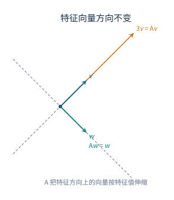
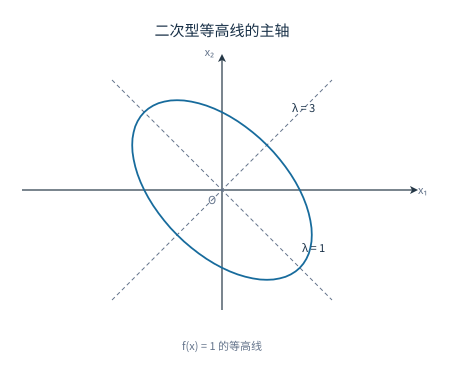

# 06 特征值、相似对角化与二次型

[[00 线性代数 MOC|← 目录]] · 上一章：[[05 向量空间、内积与基]]

## 学习目标

- 求矩阵的特征值与特征向量，区分代数重数与几何重数。
- 判断矩阵能否相似对角化，并构造 $P$ 与 $\Lambda$。
- 对实对称矩阵求出标准正交基，完成正交对角化。
- 把二次型写成对称矩阵形式，用配方法或正交变换化标准形。
- 用特征值或顺序主子式判别二次型的正定性，并读出惯性指数。

## 1 特征值与特征向量

### 1.1 定义与特征多项式

设 $A$ 为 $n$ 阶方阵。若存在数 $\lambda$ 和非零向量 $\xi$，使

$$
A\xi=\lambda\xi,
$$

则称 $\lambda$ 为 $A$ 的特征值，$\xi$ 为属于 $\lambda$ 的特征向量。几何上，$\xi$ 是经过 $A$ 后方向不变（或反向）的非零向量，$\lambda$ 是伸缩倍数；$\lambda=0$ 时该方向被压到零向量，$A$ 不可逆。

图中 $A=\begin{pmatrix}2&1\\1&2\end{pmatrix}$。向量 $v=(1,1)^T$ 被映成 $3v$，向量 $w=(1,-1)^T$ 被映成自身；这两个方向经过 $A$ 后没有转动，只是长度改变。其他方向一般会被转动并伸缩，特征向量正是把这些方向挑出来的特殊向量。

把等式移项得

$$
(\lambda I-A)\xi=\boldsymbol 0.
$$

特征向量必须非零，因此系数矩阵必须奇异：

$$
\det(\lambda I-A)=0.
$$

左端是关于 $\lambda$ 的 $n$ 次多项式，称为特征多项式。它的根就是特征值。对每个特征值 $\lambda_0$，解齐次方程组

$$
(\lambda_0I-A)x=\boldsymbol 0
$$

得到特征子空间 $E_{\lambda_0}$，其维数为

$$
\dim E_{\lambda_0}=n-r(\lambda_0I-A).
$$

这个维数称为几何重数，记 $g_\lambda$。$\lambda_0$ 作为特征多项式根的重数称为代数重数，记 $a_\lambda$。总有

$$
1\le g_\lambda\le a_\lambda.
$$

下界是因为 $\lambda_0$ 至少有一个特征向量。上界可以这样看：取 $E_{\lambda_0}$ 的一组基 $\xi_1,\ldots,\xi_g$，扩充为 $\mathbb R^n$ 的基，在这组基下 $A$ 的矩阵呈分块上三角

$$
\begin{pmatrix}\lambda_0I_g&C\\O&D\end{pmatrix},
$$

其特征多项式为 $(\lambda-\lambda_0)^g\det(\lambda I-D)$，所以 $\lambda_0$ 的代数重数至少为 $g$。

### 1.2 求法

求特征值与特征向量的步骤：

1. 计算 $\det(\lambda I-A)$，分解因式，求出全部特征值及代数重数；
2. 对每个不同的特征值解 $(\lambda_0I-A)x=\boldsymbol 0$；
3. 写出基础解系，得到特征子空间的一组基。

若题目要求“全部特征向量”，应写出基础解系的任意非零线性组合，而不是只列一个代表。

**例 1** 求

$$
A=\begin{pmatrix}
2&-2&0\\
-2&1&-2\\
0&-2&0
\end{pmatrix}
$$

的特征值与特征向量。

**解** 特征多项式为

$$
\begin{aligned}
\det(\lambda I-A)
&=\begin{vmatrix}
\lambda-2&2&0\\
2&\lambda-1&2\\
0&2&\lambda
\end{vmatrix}\\
&=(\lambda-2)\bigl[\lambda(\lambda-1)-4\bigr]-4\lambda\\
&=\lambda^3-3\lambda^2-6\lambda+8\\
&=(\lambda+2)(\lambda-1)(\lambda-4).
\end{aligned}
$$

特征值为 $-2,1,4$。分别解 $(\lambda I-A)x=\boldsymbol 0$：

- $\lambda=-2$：得 $x_2=2x_1$、$x_3=2x_1$，特征向量为 $c(1,2,2)^T$，$c\ne0$；
- $\lambda=1$：得 $x_1=2x_2$、$x_3=-2x_2$，特征向量为 $c(2,1,-2)^T$，$c\ne0$；
- $\lambda=4$：得 $x_1=2x_3$、$x_2=-2x_3$，特征向量为 $c(2,-2,1)^T$，$c\ne0$。

三个特征值互异，对应的特征向量自动线性无关。用迹与行列式核对：$\operatorname{tr}(A)=2+1+0=3$，而 $-2+1+4=3$；$\det(A)=2(0-4)=-8$，而 $(-2)\cdot1\cdot4=-8$，两项检查都通过。

**例 2** 求旋转矩阵

$$
R=\begin{pmatrix}0&-1\\1&0\end{pmatrix}
$$

在实数范围内的特征值。

**解** 特征多项式为

$$
\det(\lambda I-R)=\begin{vmatrix}\lambda&1\\-1&\lambda\end{vmatrix}=\lambda^2+1,
$$

在实数范围内没有根。几何上 $R$ 把每个非零向量逆时针旋转 $90^\circ$，没有任何实方向保持不变，所以不存在实特征值。若允许复数，特征值为 $\pm i$，对应复特征向量。这个例子说明实矩阵不一定有实特征值，也说明实对称矩阵“特征值全为实数”是一条特殊性质。

### 1.3 常用性质

若特征值按代数重数计为 $\lambda_1,\ldots,\lambda_n$，则

$$
\sum_{i=1}^n\lambda_i=\operatorname{tr}(A),
\qquad
\prod_{i=1}^n\lambda_i=\det(A).
$$

这两条来自特征多项式的韦达定理。把 $\det(\lambda I-A)$ 展开，$\lambda^{n-1}$ 的系数是 $-\operatorname{tr}(A)$，常数项是 $(-1)^n\det(A)$；比较根与系数的关系即得。它们常用来检查特征值是否算对。三角矩阵的特征值就是主对角线元素；相似矩阵有相同的特征值；属于不同特征值的特征向量线性无关。

不同特征值的特征向量线性无关，证明用归纳法。设

$$
c_1\xi_1+\cdots+c_m\xi_m=\boldsymbol 0,
$$

其中 $\lambda_1,\ldots,\lambda_m$ 互异。两边作用 $A-\lambda_mI$，前 $m-1$ 项变为 $c_i(\lambda_i-\lambda_m)\xi_i$，第 $m$ 项被消掉：

$$
\sum_{i=1}^{m-1}c_i(\lambda_i-\lambda_m)\xi_i=\boldsymbol 0.
$$

由归纳假设，$\xi_1,\ldots,\xi_{m-1}$ 线性无关，而 $\lambda_i-\lambda_m\ne0$，所以 $c_1=\cdots=c_{m-1}=0$；代回原式得 $c_m\xi_m=0$，于是 $c_m=0$。

若 $A\xi=\lambda\xi$，则对任意多项式 $f$，

$$
f(A)\xi=f(\lambda)\xi.
$$

这是因为 $A^k\xi=\lambda^k\xi$，再对各项线性组合。特别地，$A^m\xi=\lambda^m\xi$；若 $A$ 可逆，则 $A^{-1}\xi=\lambda^{-1}\xi$，因为 $\lambda\ne0$ 且两边左乘 $A^{-1}$ 得 $\xi=\lambda A^{-1}\xi$。

## 2 相似矩阵与相似对角化

### 2.1 相似关系

若存在可逆矩阵 $P$，使

$$
B=P^{-1}AP,
$$

则称 $A,B$ 相似。相似表示同一个线性变换在不同基下的矩阵，$P$ 的列是新基在旧基下的坐标；第 05 章的过渡矩阵已经给出了这一解释。

相似矩阵有相同的秩、行列式、迹和特征多项式，因此特征值及其代数重数也相同。特征多项式相同是因为

$$
\det(\lambda I-P^{-1}AP)
=\det\bigl(P^{-1}(\lambda I-A)P\bigr)
=\det(\lambda I-A).
$$

行列式与迹分别是特征多项式在 $\lambda=0$ 的值与 $\lambda^{n-1}$ 系数的相反数，所以也相同。秩相同则是因为 $P$ 与 $P^{-1}$ 都可逆，乘以可逆矩阵不改变秩。

但特征值相同只是相似的必要条件，不是充分条件：单位矩阵 $I$ 与 $\begin{pmatrix}1&1\\0&1\end{pmatrix}$ 都只有特征值 $1$，却不可能相似，因为与 $I$ 相似的矩阵只能是 $I$：若 $P^{-1}IP=J$，则 $J=I$。

### 2.2 对角化判据

若存在可逆矩阵 $P$，使

$$
P^{-1}AP=\Lambda=\operatorname{diag}(\lambda_1,\ldots,\lambda_n),
$$

则称 $A$ 可相似对角化。把等式写成 $AP=P\Lambda$，按列比较得

$$
A\xi_i=\lambda_i\xi_i.
$$

因此

$$
A\text{ 可对角化}
\Longleftrightarrow
A\text{ 有 }n\text{ 个线性无关的特征向量}.
$$

必要性如上；充分性是把这 $n$ 个特征向量按列拼成 $P$，则 $AP=P\Lambda$，且 $P$ 可逆，所以 $A=P\Lambda P^{-1}$。

等价地，对每个特征值，几何重数等于代数重数。设不同特征值为 $\lambda_1,\ldots,\lambda_s$，代数重数为 $a_i$，几何重数为 $g_i$。不同特征值的特征子空间之和是直和，其维数为 $\sum g_i$；$A$ 可对角化当且仅当这个和等于 $n$。又 $g_i\le a_i$ 且 $\sum a_i=n$，所以

$$
\sum g_i=n
\Longleftrightarrow
g_i=a_i\quad(i=1,\ldots,s).
$$

若 $A$ 有 $n$ 个互异特征值，则每个 $a_i=1$，而 $g_i\ge1$，故 $g_i=a_i=1$，一定可对角化；但可对角化不要求特征值互异，例如单位矩阵本身已经是对角矩阵。

**例 3** 判断

$$
J=\begin{pmatrix}2&1\\0&2\end{pmatrix}
$$

是否可对角化。

**解** $J$ 是上三角矩阵，唯一特征值为 $2$，代数重数为 $2$。解 $(2I-J)x=0$：

$$
2I-J=\begin{pmatrix}0&-1\\0&0\end{pmatrix},
\qquad
x_2=0.
$$

特征子空间是一维的，$g=1<2$，所以 $J$ 不可对角化。若强行找两个线性无关特征向量，只能得到 $(1,0)^T$ 的倍数，凑不出可逆的 $P$。

**例 4** 设

$$
A=\begin{pmatrix}
2&2&-2\\
2&5&-4\\
-2&-4&5
\end{pmatrix},
$$

求可逆矩阵 $P$，使 $P^{-1}AP=\Lambda$。

**解** 计算得特征值为 $1,1,10$。对 $\lambda=1$，解 $(A-I)x=0$，即

$$
x_1+2x_2-2x_3=0,
$$

取两个线性无关解

$$
\xi_1=(-2,1,0)^T,\qquad
\xi_2=(2,0,1)^T.
$$

对 $\lambda=10$，解 $(A-10I)x=0$，可取特征向量

$$
\xi_3=(1,2,-2)^T.
$$

令

$$
P=(\xi_1,\xi_2,\xi_3)
=\begin{pmatrix}
-2&2&1\\
1&0&2\\
0&1&-2
\end{pmatrix},
\qquad
\Lambda=\operatorname{diag}(1,1,10),
$$

则 $P^{-1}AP=\Lambda$。这三列线性无关，所以 $P$ 可逆。核对第三列：$A\xi_3=(10,20,-20)^T=10\xi_3$；前两列同样满足 $A\xi_1=\xi_1$、$A\xi_2=\xi_2$。重特征值 $1$ 的几何重数为 $2$，等于代数重数，因此可对角化。

### 2.3 对角化的应用

若 $A=P\Lambda P^{-1}$，则

$$
A^k=P\Lambda^kP^{-1}.
$$

因此可对角化矩阵的高次幂可以化为对角元的高次幂，这是对角化的主要用途之一。

**例 5** 设

$$
A=\begin{pmatrix}1&1\\0&2\end{pmatrix},
$$

求 $A^k$。

**解** 特征值为 $1,2$，对应的特征向量可取 $(1,0)^T$ 与 $(1,1)^T$。令

$$
P=\begin{pmatrix}1&1\\0&1\end{pmatrix},
\qquad
\Lambda=\begin{pmatrix}1&0\\0&2\end{pmatrix},
\qquad
P^{-1}=\begin{pmatrix}1&-1\\0&1\end{pmatrix}.
$$

则

$$
A^k=P\Lambda^kP^{-1}
=\begin{pmatrix}1&1\\0&1\end{pmatrix}
\begin{pmatrix}1&0\\0&2^k\end{pmatrix}
\begin{pmatrix}1&-1\\0&1\end{pmatrix}
=\begin{pmatrix}1&2^k-1\\0&2^k\end{pmatrix}.
$$

核对 $k=1$：$\begin{pmatrix}1&1\\0&2\end{pmatrix}$，就是 $A$；$k=2$：$\begin{pmatrix}1&3\\0&4\end{pmatrix}$，而 $A^2=\begin{pmatrix}1&3\\0&4\end{pmatrix}$，一致。

## 3 实对称矩阵的正交对角化

实对称矩阵满足 $A^T=A$。它有两条重要性质：

1. 所有特征值都是实数；
2. 属于不同特征值的特征向量相互正交。

并且一定存在正交矩阵 $Q$，使

$$
Q^TAQ=Q^{-1}AQ=\Lambda.
$$

这就是实对称矩阵的正交对角化。

特征值为实数：若 $A\xi=\lambda\xi$，$\xi\in\mathbb C^n$ 非零（$\xi^*$ 表示共轭转置），则

$$
\lambda\,\xi^*\xi=\xi^*A\xi.
$$

右端是一个数，它的共轭为 $\xi^*A^T\xi=\xi^*A\xi$，所以右端为实数；$\xi^*\xi>0$，故 $\lambda$ 为实数。

不同特征值的特征向量正交：设 $A\xi_1=\lambda_1\xi_1$、$A\xi_2=\lambda_2\xi_2$，且 $\lambda_1\ne\lambda_2$。则

$$
\lambda_1\langle\xi_1,\xi_2\rangle
=\langle A\xi_1,\xi_2\rangle
=\langle\xi_1,A\xi_2\rangle
=\lambda_2\langle\xi_1,\xi_2\rangle,
$$

中间一步用了 $A^T=A$。于是 $(\lambda_1-\lambda_2)\langle\xi_1,\xi_2\rangle=0$，只能 $\langle\xi_1,\xi_2\rangle=0$。

正交对角化的存在性用归纳法。取一个单位特征向量 $q_1$，扩充为 $\mathbb R^n$ 的标准正交基 $q_1,q_2,\ldots,q_n$。在这组基下 $A$ 的矩阵为 $Q^TAQ$，其第一列为 $(Aq_1)$ 的坐标，即 $(\lambda_1,0,\ldots,0)^T$；由于矩阵仍对称，第一行也只有对角元 $\lambda_1$。右下角是一个 $n-1$ 阶实对称矩阵，由归纳假设可正交对角化，把它拼回 $q_1$ 的方向，就得到整个 $Q$。

求 $Q$ 的步骤：

1. 求特征值与特征向量；
2. 对每个特征子空间取一组基；若某个特征值有重根，在该子空间内用施密特方法正交化；
3. 把所有特征向量单位化；
4. 按列拼成 $Q$，特征值按相同顺序放在 $\Lambda$ 中。

不同特征值的特征向量已经正交，不需要再对它们作施密特正交化；只有同一重特征值内部的向量可能需要正交化。

**例 6** 将

$$
A=\begin{pmatrix}2&1&1\\1&2&1\\1&1&2\end{pmatrix}
$$

正交对角化。

**解** 特征值为 $1,1,4$。对 $\lambda=1$，解

$$
x_1+x_2+x_3=0,
$$

取一组正交基

$$
(1,-1,0)^T,\qquad(1,1,-2)^T.
$$

对 $\lambda=4$，特征向量为 $(1,1,1)^T$，它与前两个向量都正交。单位化后按列拼成

$$
Q=\begin{pmatrix}
\dfrac1{\sqrt2}&\dfrac1{\sqrt6}&\dfrac1{\sqrt3}\\[6pt]
-\dfrac1{\sqrt2}&\dfrac1{\sqrt6}&\dfrac1{\sqrt3}\\[6pt]
0&-\dfrac2{\sqrt6}&\dfrac1{\sqrt3}
\end{pmatrix},
$$

则

$$
Q^TAQ=\operatorname{diag}(1,1,4).
$$

核对正交性：第一列与第二列点积为 $\dfrac1{\sqrt{12}}(1-1+0)=0$，第一列与第三列点积为 $\dfrac1{\sqrt6}(1-1+0)=0$，第二列与第三列点积为 $\dfrac1{\sqrt{18}}(1+1-2)=0$。三列长度都为 $1$，故 $Q$ 是正交矩阵。

正交对角化还可以写成谱分解：

$$
A=\lambda_1q_1q_1^T+\lambda_2q_2q_2^T+\cdots+\lambda_nq_nq_n^T.
$$

每一项 $q_iq_i^T$ 是向 $q_i$ 方向投影的矩阵，$A$ 把每个方向按对应特征值伸缩，再叠加起来。这一形式在二次型和振动问题中很常用。

## 4 二次型及其矩阵表示

含 $n$ 个变量的二次齐次多项式称为二次型。它总可以写成

$$
f(x)=x^TAx,
$$

其中 $A$ 取实对称矩阵。平方项 $x_i^2$ 的系数直接放在 $a_{ii}$；交叉项 $x_ix_j$ 的系数为 $c$ 时，令

$$
a_{ij}=a_{ji}=\frac c2.
$$

例如

$$
f=2x_1^2+5x_2^2+5x_3^2+4x_1x_2-4x_1x_3-8x_2x_3
$$

的矩阵为

$$
A=\begin{pmatrix}
2&2&-2\\
2&5&-4\\
-2&-4&5
\end{pmatrix}.
$$

交叉项系数要平分到两个对称位置，不能把两个位置都填成原系数。二次型的秩就是其矩阵的秩。展开 $x^TAx$ 核对：$x_1^2$ 的系数是 $2$，$x_2^2$ 是 $5$，$x_3^2$ 是 $5$，$x_1x_2$ 的系数是 $2a_{12}=4$，$x_1x_3$ 是 $2a_{13}=-4$，$x_2x_3$ 是 $2a_{23}=-8$，与题设一致。

## 5 标准形、规范形与合同变换

只含平方项的形式

$$
d_1y_1^2+\cdots+d_ny_n^2
$$

称为标准形。进一步把非零系数缩放为 $\pm1$，得到规范形

$$
y_1^2+\cdots+y_p^2-y_{p+1}^2-\cdots-y_{p+q}^2,
$$

其余项系数为零。$p,q$ 分别称为正、负惯性指数，$r(A)=p+q$。

作可逆变量替换 $x=Cy$，则

$$
f(x)=y^T(C^TAC)y.
$$

令 $B=C^TAC$，称 $A,B$ 合同。合同保持秩和正、负惯性指数；相似保持特征值。两者一般不能互相替代：相似要求 $P^{-1}AP$，合同要求 $C^TAC$；当 $C$ 是正交矩阵时，$C^T=C^{-1}$，合同变换同时是相似变换，一般情形两者不同。

### 5.1 配方法

配方法通过可逆换元把二次型化成平方和。先选一个含平方项的变量，把与它有关的交叉项收进完全平方，再处理剩余变量。

**例 7** 化

$$
f=x_1^2+4x_1x_2+x_2^2
$$

为标准形与规范形，并写出合同矩阵 $C$。

**解** 对 $x_1$ 配方：

$$
f=(x_1+2x_2)^2-3x_2^2.
$$

令

$$
y_1=x_1+2x_2,\qquad y_2=x_2,
$$

则换元可逆，标准形为

$$
f=y_1^2-3y_2^2.
$$

再令 $z_1=y_1$、$z_2=\sqrt3\,y_2$，得规范形

$$
f=z_1^2-z_2^2.
$$

正、负惯性指数都是 $1$，二次型既非正定也非负定。

若题目要求合同矩阵，应把 $y$ 关于 $x$ 的关系反解为 $x=Cy$：

$$
x_1=y_1-2y_2,\qquad x_2=y_2,
\qquad
C=\begin{pmatrix}1&-2\\0&1\end{pmatrix}.
$$

于是 $C^TAC=\operatorname{diag}(1,-3)$。不能把 $y_1=x_1+2x_2$ 的系数矩阵直接当作 $C$，两者互为逆矩阵。

**例 8** 化

$$
f=2x_1x_2+x_3^2
$$

为标准形。

**解** 先用换元制造平方项。令

$$
x_1=y_1+y_2,\qquad x_2=y_1-y_2,\qquad x_3=y_3,
$$

则

$$
2x_1x_2=2(y_1+y_2)(y_1-y_2)=2y_1^2-2y_2^2,
$$

所以

$$
f=2y_1^2-2y_2^2+y_3^2.
$$

换元矩阵

$$
C=\begin{pmatrix}1&1&0\\1&-1&0\\0&0&1\end{pmatrix}
$$

的行列式为 $-2\ne0$，换元可逆。二次型的矩阵为

$$
A=\begin{pmatrix}0&1&0\\1&0&0\\0&0&1\end{pmatrix},
$$

直接计算 $C^TAC=\operatorname{diag}(2,-2,1)$，与配方结果一致。正、负惯性指数为 $2,1$。

### 5.2 正交变换法

实对称矩阵可以正交对角化。令 $x=Qy$，其中 $Q$ 是正交矩阵，则

$$
f(x)=y^TQ^TAQy
=\lambda_1y_1^2+\cdots+\lambda_ny_n^2.
$$

正交变换得到的平方项系数就是特征值，这是它与配方法的主要区别：配方法得到的系数依赖换元选择，正交变换得到的系数是矩阵的谱。

图中 $A=\begin{pmatrix}2&1\\1&2\end{pmatrix}$，特征值为 $3,1$，特征向量方向为 $(1,1)^T$ 与 $(1,-1)^T$。椭圆的两个半轴长分别为 $1/\sqrt3$ 与 $1$，对应特征值越大，等高线在该方向越短。正交变换只是把坐标轴转到特征向量方向，不改变椭圆的形状。

**例 9** 用正交变换把

$$
f=2x_1^2+2x_1x_2+2x_2^2
$$

化为标准形。

**解** 二次型的矩阵为

$$
A=\begin{pmatrix}2&1\\1&2\end{pmatrix}.
$$

特征值为 $3,1$，对应的单位特征向量可取

$$
q_1=\frac1{\sqrt2}(1,1)^T,\qquad
q_2=\frac1{\sqrt2}(1,-1)^T.
$$

令 $Q=(q_1,q_2)$，则 $Q^TAQ=\operatorname{diag}(3,1)$。作 $x=Qy$，得

$$
f=3y_1^2+y_2^2.
$$

核对：$Aq_1=(3/\sqrt2,3/\sqrt2)^T=3q_1$，$Aq_2=(1/\sqrt2,-1/\sqrt2)^T=q_2$，所以 $Q$ 的列确实是单位特征向量，且 $Q^TQ=I$。

同一个二次型 $x_1^2+4x_1x_2+x_2^2$ 若用正交变换，矩阵 $A=\begin{pmatrix}1&2\\2&1\end{pmatrix}$ 的特征值为 $3,-1$，标准形为 $3y_1^2-y_2^2$；而例 7 用配方法得到 $y_1^2-3y_2^2$。两种标准形的系数不同，但正、负惯性指数都是 $1,1$，这就是惯性定理的内容。

### 5.3 惯性定理与合同分类

惯性定理指出：无论用哪种可逆换元化标准形，正、负、零平方项的个数 $p,q,s$ 都不变，且

$$
r(A)=p+q,\qquad n=p+q+s.
$$

证明用子空间维数。设同一个二次型在两组合约换元下的正惯性指数分别为 $p$ 与 $p'$。若 $p>p'$，在第一组标准形中取 $p$ 维的正定子空间 $V$（只保留正平方项对应的坐标），在第二组标准形中取 $n-p'$ 维的“非正”子空间 $U$（令前 $p'$ 个正坐标为零）。因为

$$
\dim V+\dim U=p+n-p'>n,
$$

两子空间必有非零交向量。该向量在 $V$ 上使二次型为正，在 $U$ 上使二次型非正，矛盾。因此 $p\le p'$；交换两组角色得 $p'\le p$，故 $p=p'$。秩相同，负惯性指数也随之相同。

因此合同关系由惯性指数完全决定：两个同阶实对称矩阵合同，当且仅当它们的正、负惯性指数相同。正定矩阵的 $p=n$，负定矩阵的 $q=n$，不定矩阵的 $p,q$ 都大于零。

## 6 正定二次型

若对任意非零向量 $x$，都有

$$
x^TAx>0,
$$

则称二次型正定，称实对称矩阵 $A$ 正定，记 $A\succ0$。类似地可以定义负定、半正定、半负定和不定。

对实对称矩阵 $A$，以下条件等价：

1. $A$ 正定；
2. $A$ 的全部特征值大于 $0$；
3. $A$ 的正惯性指数为 $n$；
4. $A$ 合同于单位矩阵 $I$；
5. $A$ 的全部顺序主子式都大于 $0$。

条件 2 与 3 等价，因为正交变换不改变惯性指数，而标准形的系数就是特征值。条件 3 与 4 等价，因为正惯性指数为 $n$ 时规范形就是 $I$，合同关系可逆。条件 4 推出正定：若 $A=C^TIC=C^TC$，则 $x^TAx=\|Cx\|^2>0$（$x\ne0$，$C$ 可逆）。

顺序主子式是取前 $k$ 行、前 $k$ 列组成的子式，记为 $\Delta_k$。因此

$$
A\succ0
\Longleftrightarrow
\Delta_1>0,\ \Delta_2>0,\ \ldots,\ \Delta_n>0.
$$

必要性：正定矩阵的每个顺序主子矩阵也是正定的（限制在只让前 $k$ 个坐标非零的子空间上），其行列式为正。充分性：对称矩阵作消元时若不换行，可写成 $A=LDL^T$，其中 $D=\operatorname{diag}(\Delta_1,\Delta_2/\Delta_1,\ldots,\Delta_n/\Delta_{n-1})$；所有 $\Delta_k>0$ 时 $D$ 的对角元全为正，于是 $A$ 合同于正对角矩阵，再由条件 4 得正定。

负定的判据是 $(-1)^k\Delta_k>0$，即顺序主子式符号依次为负、正、负、正。半正定不能只用“顺序主子式非负”判断：矩阵 $\begin{pmatrix}0&0\\0&-1\end{pmatrix}$ 的一阶、二阶顺序主子式都是 $0$，但它不是半正定（特征值为 $0,-1$）。半正定应改用特征值或所有主子式判断。

**例 10** 求使

$$
A=\begin{pmatrix}a&1\\1&2\end{pmatrix}
$$

正定的参数范围。

**解** 一阶顺序主子式为 $\Delta_1=a$，二阶为

$$
\Delta_2=\begin{vmatrix}a&1\\1&2\end{vmatrix}=2a-1.
$$

正定要求

$$
a>0,\qquad 2a-1>0,
$$

所以 $a>\frac12$。只检查 $a>0$ 会漏掉二阶条件。

**例 11** 判断

$$
A=\begin{pmatrix}1&1&0\\1&2&0\\0&0&3\end{pmatrix}
$$

的正定性。

**解** 顺序主子式为

$$
\Delta_1=1>0,\qquad
\Delta_2=\begin{vmatrix}1&1\\1&2\end{vmatrix}=1>0,\qquad
\Delta_3=3\Delta_2=3>0.
$$

三个顺序主子式都大于零，所以 $A$ 正定。也可以看分块结构：左上 $2\times2$ 块的特征值为 $\dfrac{3\pm\sqrt5}{2}$，都大于零，右下块为 $3$，全部特征值为正。

**例 12** 判断

$$
f=x_1^2+x_2^2+x_3^2+2x_1x_2+2x_1x_3+2x_2x_3
$$

的类型，并求惯性指数。

**解** 配方得

$$
f=(x_1+x_2+x_3)^2.
$$

因此 $f\ge0$，且只在 $x_1+x_2+x_3=0$ 时取零，存在非零向量使 $f=0$，所以 $f$ 半正定而非正定。矩阵为全 $1$ 矩阵

$$
A=\begin{pmatrix}1&1&1\\1&1&1\\1&1&1\end{pmatrix},
$$

秩为 $1$，正惯性指数 $p=1$、负惯性指数 $q=0$、零惯性指数 $s=2$。顺序主子式 $\Delta_1=1$、$\Delta_2=0$、$\Delta_3=0$，不满足“全部大于零”，正定判据正确地拒绝了它；但半正定也不能仅凭这些非负值确认，本例是靠配方直接看出 $f$ 是单个平方项。

惯性指数给出二次型的粗略形状：$p=n$ 正定，$q=n$ 负定，$p,q$ 都大于零不定，$s>0$ 退化。合同变换只能改变平方项的系数，不能改变这三类符号的个数；这就是二次型在可逆换元下的不变量。
